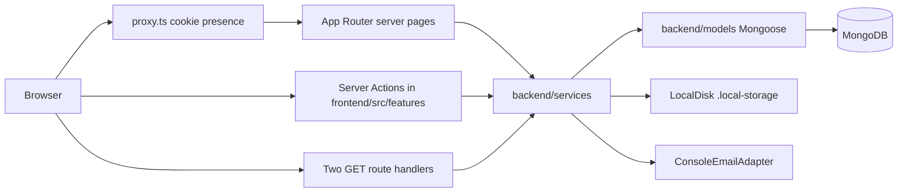
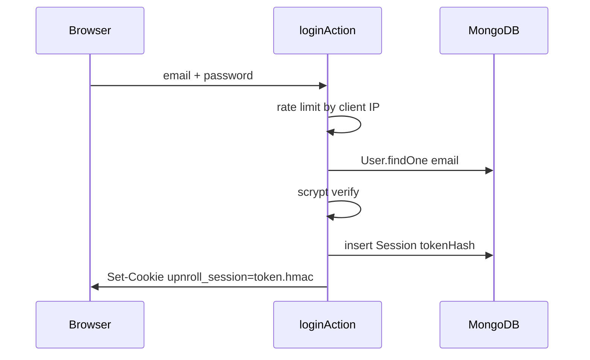
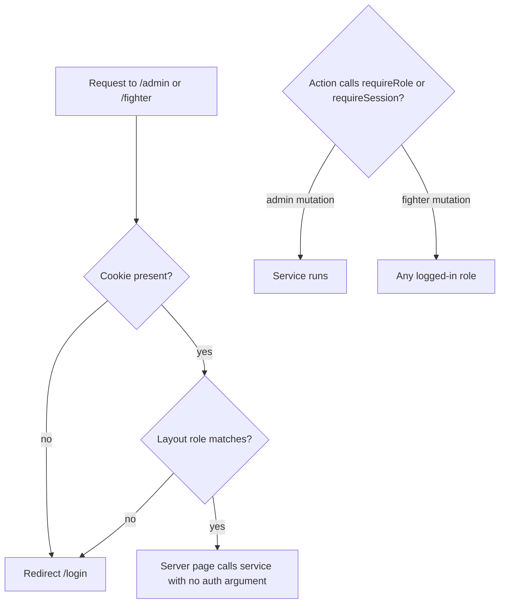
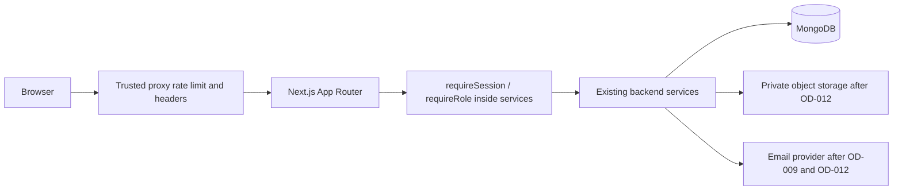

# Master Repository Audit — Up 'n Roll

Audit date: 2026-11-05  
Scope: repository at `d:\upnrol` (application source, docs, scripts, configuration). Generated trees (`node_modules`, `.next`) were not reviewed file-by-file.  
Method: source inspection, documentation comparison, `tsc --noEmit`, Vitest, ESLint.  
Constraint: audit only. No application source was modified by this audit.

This document supersedes stale layout claims in `docs/phases/00-repository-audit.md` and `docs/architecture/folder-structure.md`. Those files were left in place.

---

## 1. Executive Summary

Up 'n Roll is a combat-sports tournament platform: public event and fighter pages, fighter registration and manual payment proof, admin bracket and match operations, rankings, CMS-style content, and a FAQ chatbot. It is **not a frontend-only application**. The Next.js app in `frontend/` is the only HTTP process, and it calls a real server layer in `backend/` (Mongoose models, domain services, session auth, local file storage). There is no separate API server and almost no REST surface. Mutations are Next.js Server Actions.

**Current-state maturity: 3 — Structured Application.** Domain modules, role gates, persistence, and unit tests exist and line up with the product scope matrix. It is not a production candidate. Email is a console logger, files live on local disk, rankings and payment QR are labeled placeholders, there is no CI/CD, auth rate limiting is single-process and spoofable, and Indian national-ID data (Aadhaar) plus medical answers are stored in plaintext.

### Finding counts

Security findings (section 11) and engineering findings are counted separately. None were exploited against a live deployment. Severity is potential risk unless a row says otherwise.

| Severity | Security | Engineering / product | Total |
|---|---:|---:|---:|
| CRITICAL | 0 | 0 | 0 |
| HIGH | 3 | 3 | 6 |
| MEDIUM | 7 | 4 | 11 |
| LOW | 4 | 3 | 7 |
| INFORMATIONAL | 3 | 2 | 5 |

### What another engineer should know first

1. Run the app from `frontend/` against MongoDB. `backend/` has no `package.json`.
2. `npm run dev` fails on Windows because `predev` calls Unix `ln`. Dependencies on this machine are installed at the repo-root `node_modules`, while `frontend/node_modules` is missing. That is inverted from what `next.config.ts` and `predev` expect.
3. Protected pages are gated by `frontend/src/app/(admin)/admin/layout.tsx` and `frontend/src/app/(fighter)/fighter/layout.tsx`. `frontend/src/proxy.ts` only checks that a session cookie exists.
4. Do not treat `docs/api/api-contract.md` as implemented. Two GET handlers exist. Everything else is a Server Action.
5. Open product decisions OD-001 through OD-014 in `docs/decisions/open-decisions.md` are still open (OD-013 is implemented in code but still listed open).

---

## 2. Project Overview

### Purpose

Tournament operations for a combat-sports organizer: publish events, register grapplers, collect a manual payment proof (QR + UTR + screenshot), build single-elimination brackets, record results, show rankings, and publish FAQ / announcement / policy content. The visual system is a light editorial / manga-panel UI (resolved decision RD-001).

### Target users

| Actor | Role value | What they do |
|---|---|---|
| Public visitor | none | Browse events, brackets, schedule, results, fighters, rankings, FAQ, announcements, policies |
| Grappler | `FIGHTER` | Register, edit profile, enter a division, submit payment proof, request cancel/transfer, view own matches |
| Organizer | `ADMIN` | Create events and divisions, review payments, generate and publish brackets, schedule and score matches, recalculate rankings, publish content and external media |
| Operator | CLI | `scripts/create-admin.ts`, `scripts/seed-demo.ts` |

There is no `GUEST` role in code. `docs/architecture/data-model.md` still lists one. Admins are not created through the register form. `registerAction` always writes `role: "FIGHTER"` (`frontend/src/features/auth/actions.ts`).

### Core journeys (as implemented)

1. Visitor opens `/`, `/events`, `/events/[slug]`, brackets, schedule, results, `/fighters`, `/rankings`, `/faq`, `/announcements`, `/policies`. Data comes from MongoDB through services, except the homepage gallery, path-step copy, and the past-event card, which are hardcoded.
2. Visitor registers at `/register` (Zod + scrypt + session cookie) and lands on `/fighter/dashboard`.
3. Fighter creates a registration, is sent to `/fighter/registrations/[id]/payment`, and uploads a screenshot plus UTR. An admin approves or rejects it. Email is logged, not sent.
4. Admin generates a single-elimination bracket, publishes it, schedules matches, records or corrects results.
5. Admin recalculates rankings with a placeholder formula of 3 points per win.
6. Any page can ask the chatbot, which keyword-matches published FAQ bodies. No LLM.

### Explicitly out of product scope

`docs/product/scope-matrix.md` excludes an online payment gateway (PAY-004 / EXC-001). No Stripe, Razorpay, or similar package is declared. Refunds are manual and off-platform (OD-008).

### External systems actually used

| System | Status |
|---|---|
| MongoDB (URI from env, Atlas-style URI present in gitignored local env) | Used by `backend/db/connect.ts` |
| SMTP / transactional email | Not integrated. `ConsoleEmailAdapter` logs only |
| Object storage (S3, GCS, etc.) | Not integrated. `.local-storage/` on disk |
| Payment provider | Not used, by product decision |
| Error monitoring (Sentry, etc.) | Not present |
| CI host | No `.github/` workflows |

---

## 3. Technology Stack Inventory

Verified from manifests and imports on 2026-11-05.

| Layer | Choice | Evidence |
|---|---|---|
| Language | TypeScript, `strict: true` | `frontend/tsconfig.json` |
| UI runtime | Next.js 16.1.6, React, App Router, webpack dev (`next dev --webpack`) | `frontend/package.json`, running dev server |
| Styling | Tailwind CSS v4 via `@tailwindcss/postcss`, tokens in `frontend/src/app/globals.css`. No `tailwind.config.*` | `frontend/postcss.config.mjs` |
| UI kit | shadcn-style primitives (`frontend/components.json`, style `new-york`) plus Radix | `frontend/src/components/ui/` |
| Validation | Zod | feature `schemas.ts`, `frontend/src/lib/config.ts` |
| Database | Mongoose, declared `serverExternalPackages: ["mongoose"]` | `frontend/next.config.ts` lines 15–16 |
| Auth | Custom session: 32-byte token, SHA-256 at rest, HMAC-SHA256 cookie, scrypt passwords | `backend/auth/` |
| Tests | Vitest 3, node environment, no Mongo memory server | `frontend/vitest.config.ts` |
| Package manager | npm. Two lockfiles | root `package-lock.json` and `frontend/package-lock.json` |

Not in the dependency list and not imported: Firebase, Prisma, tRPC, NextAuth, iron-session, bcrypt, MSW, sharp, a payment SDK.

`frontend/package.json` is the only dependency manifest. Root `package.json` only forwards scripts (`dev`, `build`, `start`, `lint`, `test`, `create-admin`, `seed-demo`) with `--prefix frontend`.

---

## 4. Repository Architecture Map

### Current architecture

### What this is not

- Not a monorepo of independently deployable services. `backend/README.md` and the root README call it a monorepo, but `backend/` is a TypeScript library imported with the `@/server/*` alias (`frontend/tsconfig.json`: `@/server/*` → `../backend/*`).
- Not the tree described in `docs/architecture/folder-structure.md` (`src/app`, `src/server`, `tests/unit`). That document is stale.
- Not the REST API in `docs/api/api-contract.md`. That file still says handlers are unimplemented. Two handlers exist; the rest of the contract was never built as HTTP.

### Request boundaries

| Boundary | File | What it enforces |
|---|---|---|
| Edge-style proxy | `frontend/src/proxy.ts` lines 14–28 | Cookie named `upnroll_session` exists for `/fighter/:path*` and `/admin/:path*`. No role check. Comment on lines 8–12 says this is UX only |
| Admin layout | `frontend/src/app/(admin)/admin/layout.tsx` lines 9–11 | `getSession()` and `role === "ADMIN"`, else `redirect("/login")` |
| Fighter layout | `frontend/src/app/(fighter)/fighter/layout.tsx` | Session and `role === "FIGHTER"` |
| Mutations | `frontend/src/features/*/actions.ts` | `requireSession()` or `requireRole("ADMIN")` inside the action |
| Domain services | `backend/services/*.ts` | Business rules. **No session or role checks inside the services** |
| Preview | `frontend/src/app/(preview)/ui-preview/page.tsx` | `notFound()` unless `NODE_ENV !== "production"` or `UI_PREVIEW_ENABLED=true` |

### Data flow that actually runs

`Browser form → Server Action (Zod) → service → Mongoose → MongoDB → redirect or returned state → server page render`

Public reads skip the action and call the service from a Server Component. The React Query client in `frontend/src/lib/queryClient.ts` is mounted by `frontend/src/components/Providers.tsx` and has **no `useQuery` callers**.

---

## 5. Complete File and Folder Inventory

Counts exclude `node_modules` and `.next`. Source inventory was listed from disk on 2026-11-05.

### Top level

| Path | Role | Classification |
|---|---|---|
| `frontend/` | Next.js application | KEEP |
| `backend/` | Domain, models, auth, storage, email | KEEP |
| `scripts/` | `create-admin.ts`, `seed-demo.ts` | KEEP |
| `docs/` | Product, architecture, phase notes, this audit | KEEP; several children are stale (section 12) |
| `frontend/public/` | 8 brand and gallery files | KEEP |
| `public/` | Empty directory | REMOVE CANDIDATE |
| `package.json` | Script forwarder | KEEP |
| `package-lock.json` | Lockfile for a manifest with **zero** dependencies | REMOVE CANDIDATE after installs are corrected |
| `frontend/package-lock.json` | Lockfile that matches declared deps | KEEP |
| `tsconfig.json` | Root path aliases for scripts and editor | KEEP |
| `frontend/tsconfig.json` | Next/TypeScript project | KEEP |
| `.gitignore` | Ignores `.env*`, `.next/`, `node_modules`, `/.local-storage/` | KEEP |
| `frontend/.env.example` | Committed template | KEEP |
| `.env`, `frontend/.env.local` | Local secrets. Gitignored. Not printed here | KEEP out of git |
| `README.md` | Current getting-started and route map | KEEP (more accurate than `folder-structure.md`) |
| `PHASE_1_IMPLEMENTATION_REPORT.md`, `PHASE_2_IMPLEMENTATION_REPORT.md`, `PROJECT_RESCUE_REPORT.md` | Historical reports at repo root | RELOCATE into `docs/phases/` or mark historical |
| `next-env.d.ts`, `tsconfig.tsbuildinfo`, `.next/` at **repo root** | Leftover from a pre-split Next app | REMOVE CANDIDATE (generated) |
| `frontend/.next/` | Dev build output. Gitignored | Generated, do not commit |
| `node_modules/` at repo root | Live install on this Windows machine | INVESTIGATE — expected location is `frontend/node_modules` |
| `.local-storage/` | One payment screenshot JPEG (~144 KB) under `payment-screenshots/`. Gitignored | Runtime data, not source |
| `.claude/`, `.phase3-shots/` | Empty directories | REMOVE CANDIDATE |
| `.git/` | Repository metadata | KEEP |

### `backend/` (58 files)

| Directory | Files |
|---|---|
| `models/` | `AuditLog.ts`, `Bracket.ts`, `ContentEntry.ts`, `Division.ts`, `Event.ts`, `FighterProfile.ts`, `Match.ts`, `MediaAsset.ts`, `PaymentSubmission.ts`, `RankingRecord.ts`, `Registration.ts`, `RegistrationRequest.ts`, `Session.ts`, `User.ts` |
| `services/` | `bracketEngine.ts`, `bracketService.ts`, `chatbotEngine.ts`, `contentService.ts`, `dashboardService.ts`, `eventService.ts`, `fighterService.ts`, `matchService.ts`, `mediaService.ts`, `paymentQueue.ts`, `paymentService.ts`, `profilePhoto.ts`, `rankingEngine.ts`, `rankingService.ts`, `registrationService.ts`, `registrationStateMachine.ts`, `requestService.ts`, plus colocated tests listed in section 17 |
| `auth/` | `cookie-name.ts`, `cookies.ts`, `password.ts`, `session.ts`, plus tests |
| `http/` | `clientIp.ts`, `errors.ts`, `rateLimit.ts`, `response.ts`, plus tests |
| `db/` | `connect.ts` |
| `email/` | `console.ts`, `types.ts` |
| `storage/` | `local-disk.ts`, `types.ts` |
| `audit/` | `log.ts` |
| `README.md` | Alias documentation |

No `backend/package.json`.

### `frontend/src/` (205 files)

| Area | Contents |
|---|---|
| `app/` | 48 route files. Groups `(public)`, `(auth)`, `(fighter)`, `(admin)`, `(preview)`, plus `api/v1` (2 handlers), root `layout.tsx`, `loading.tsx`, `error.tsx`, `global-error.tsx`, `not-found.tsx`, `globals.css` |
| `features/` | 16 modules: `admin`, `admin-payments`, `auth`, `brackets`, `chatbot`, `content`, `events`, `fighter`, `fighters`, `matches`, `media`, `payments`, `profile`, `rankings`, `registrations`, `requests` |
| `components/ui/` | 56 shadcn primitives. Many have no importer outside `components/ui` (section 12) |
| `components/layout/`, `home/`, `events/`, `preview/` | Site chrome, homepage pieces, design showroom |
| `hooks/` | `use-mobile.tsx` (only `sidebar.tsx`), `use-toast.ts` (only `toaster.tsx`) |
| `lib/` | `config.ts`, `utils.ts`, `queryClient.ts`, `preview/fixtures.ts` |
| `proxy.ts` | Cookie gate |

`frontend/public/`: `dimensity-mark.png`, `logo-mark.png`, `logo-wordmark.png`, `gallery/clinch.jpg`, `gallery/grappling-mat.jpg`, `gallery/grappling-throw.jpg`, `gallery/happy-medal.jpg`, `Videos/IMG_7263.MP4_2.mp4`.

### `docs/` (pre-existing, 22 files plus one PDF)

`api/api-contract.md`, `architecture/{data-model,folder-structure,index-review,route-map,system-overview}.md`, `decisions/open-decisions.md`, `deployment/{backup-restore,deployment-guide}.md`, `legal/THIRD_PARTY_NOTICES.md`, `phases/{00-repository-audit,02-production-foundation,03-registration-payment,04-tournament-engine,05-rankings-content-support,06-production-hardening,performance-pass,security-review}.md`, `product/{client-acceptance-checklist,scope-matrix}.md`, `research/combat-sports-reference-analysis.md`, `Up 'n Roll Metrics for Seeding Athletes.pdf`. There is no `docs/phases/01-*`.

---

## 6. Feature and Functionality Inventory

Status key: IMPLEMENTED means the code path reads or writes real persistence and is covered by inspection. It does not mean a live browser walkthrough of every screen was repeated for this audit. The dev server was already serving `http://localhost:3000` before the audit; that is not a feature-by-feature QA pass.

| Feature | Status | Evidence |
|---|---|---|
| Public homepage | PARTIAL | `frontend/src/app/(public)/page.tsx` loads events, rankings, FAQs, media, divisions from services. `GALLERY` and `PATH_STEPS` are hardcoded (lines 13–24) |
| Event list and detail | IMPLEMENTED | `listPublicEvents`, `getEventBySlug` filter `PUBLIC_EVENT_STATUSES` (`backend/services/eventService.ts` lines 19, 79–88) |
| Past event card on `/events` | MOCKED | `frontend/src/components/events/past-nogi-card.tsx` hardcodes a 12 July 2026 Andheri card |
| Public brackets | IMPLEMENTED | Page calls `getEventBySlug` then `getPublishedBracketForDivision` |
| Public schedule and results | PARTIAL | `listPublicSchedule` (`backend/services/matchService.ts` lines 199–208) loads any event slug and returns matches whose **bracket** is `PUBLISHED`. It does not check event status. A `DRAFT` event with a published bracket is reachable at `/events/[slug]/schedule` while `/events/[slug]` 404s |
| Fighter directory and profile | IMPLEMENTED | `listPublicFighters`, `getPublicFighterBySlug`. Public mapper omits Aadhaar and medical fields |
| Rankings leaderboard | PARTIAL | Persisted `RankingRecord` rows. Formula is `wins * 3` and labeled not-approved (`backend/services/rankingEngine.ts` lines 24–29) |
| Rankings demo `/rankings/demo` | MOCKED | `seedRoster()` in `frontend/src/features/rankings/seeding.ts`. Page copy says nothing is written |
| FAQ, announcements, policies | IMPLEMENTED | `listPublished(type)` |
| Chatbot | IMPLEMENTED | `askChatbotAction` + `matchFaq`. No session, no rate limit. Answers only published FAQs |
| Register / login / logout | IMPLEMENTED | `frontend/src/features/auth/actions.ts`. No email verification, no password reset |
| Fighter dashboard, matches, registrations | IMPLEMENTED | Services scoped by `userId` |
| Fighter profile edit | IMPLEMENTED | `updateProfileAction`. Profile page also calls Mongoose directly (`fighter/profile/page.tsx`) |
| Registration create | IMPLEMENTED | `createRegistrationAction` → `registrationService` |
| Payment proof | PARTIAL | Submit, queue, approve/reject, duplicate UTR flag, screenshot GET are implemented. QR on the payment page is a Lucide icon placeholder (OD-006). UTR rules are a generic placeholder (OD-005a). Email is not delivered |
| Cancel / transfer requests | PARTIAL | Create and admin decide exist (`requestService`). Policy windows and fees are not encoded (OD-007). No refund execution (OD-008) |
| Admin events, divisions, status | IMPLEMENTED | Event starts as `DRAFT`. Statuses: `DRAFT`, `REGISTRATION_OPEN`, `REGISTRATION_CLOSED`, `COMPLETED` (`backend/models/Event.ts` lines 3–4). No in-progress/live status |
| Brackets | IMPLEMENTED for single elimination | `bracketEngine.ts`. Extra formats are OD-003 and are absent |
| Match schedule, result, correction | IMPLEMENTED | `matchService.ts`. Unit tests cover schedule validation only |
| Admin rankings recalculate | IMPLEMENTED | Button calls `recalculateRankingsAction` |
| Admin content and media | PARTIAL | Content publish toggle exists. No separate approval workflow (OD-010). Media is an external URL, not an upload |
| Design showroom `/ui-preview` | MOCKED | `frontend/src/lib/preview/fixtures.ts`. Gated outside local dev |
| Notifications collection | MISSING | Named in `docs/architecture/data-model.md`. No model. `getEmailAdapter()` only logs |
| Password reset, email verify | MISSING | No routes, no tokens |
| Online payments | MISSING | Excluded by scope |
| REST API from `docs/api/api-contract.md` | MISSING | Except screenshot GET, and an extra photo GET that the contract does not list |
| Background jobs, webhooks | MISSING | None found |
| CI, container deploy config | MISSING | No `.github/`, `Dockerfile`, or `vercel.json` |

### Backend matrix

“Backend” here means domain code in `backend/` invoked by the Next process, not a second service.

| Module | Frontend | Backend service | Database | Auth on the mutation or page | Status |
|---|---|---|---|---|---|
| Public events | Pages | `eventService` | `Event`, `Division` | Public read; admin writes use `requireRole` | IMPLEMENTED |
| Schedule / results | Pages | `matchService.listPublicSchedule` | `Match`, `Bracket` | Public read; event-status filter missing | PARTIAL |
| Fighters | Pages + profile form | `fighterService`, direct Mongoose on profile page | `FighterProfile`, `User` | Owner session on write | IMPLEMENTED |
| Auth | Login/register forms | `auth/session`, `auth/password` | `User`, `Session` | Rate limit on login/register only | PARTIAL |
| Registration | Fighter pages | `registrationService` | `Registration` | `requireSession`, not role-specific | IMPLEMENTED |
| Payments | Fighter form + admin queue | `paymentService` | `PaymentSubmission` | Fighter owns registration; admin `requireRole` on decide; screenshot route checks admin | PARTIAL |
| Requests | Dialogs | `requestService` | `RegistrationRequest` | Session / admin role on actions | PARTIAL |
| Brackets / matches | Admin pages | `bracketService`, `matchService`, engines | `Bracket`, `Match` | Admin actions check role; page reads rely on layout | IMPLEMENTED |
| Rankings | Public + admin | `rankingService`, `rankingEngine` | `RankingRecord` | Admin action checks role | PARTIAL formula |
| Content / media | Admin forms + public pages | `contentService`, `mediaService` | `ContentEntry`, `MediaAsset` | Admin writes | PARTIAL workflow |
| Chatbot | Widget in root layout | `chatbotEngine` | reads `ContentEntry` | None | IMPLEMENTED |
| Email | None | `email/console.ts` | none | n/a | MOCKED |
| File storage | Photo + screenshot routes | `storage/local-disk.ts` | filesystem | Photo route: own session. Screenshot route: admin | PARTIAL |
| Audit | No viewer UI | `audit/log.ts` | `AuditLog` | Written by services | PARTIAL |

---

## 7. Frontend Engineering Audit

### Architecture

Pages under `frontend/src/app` are Server Components. No `page.tsx` contains `"use client"`. Interactive pieces live in `frontend/src/features/*/`. Forms use `<form action={serverAction}>` and `useActionState`. That split is consistent and appropriate for Next.js 16.

Business rules are mostly in `backend/services`, not in components. Exceptions that weaken the boundary:

- `frontend/src/app/(fighter)/fighter/profile/page.tsx` calls `connectDB()` and `FighterProfile.findOne` directly.
- `frontend/src/app/api/v1/fighter/photo/route.ts` queries `FighterProfile` directly instead of `fighterService`.
- `frontend/src/features/auth/actions.ts` writes `User` and `FighterProfile` itself rather than a registration service.

There is no prop-drilling problem of note: server pages pass small props into client dialogs. React Query, `apiRequest`, and `getQueryFn` are unused (section 13).

### Code quality

- Naming is consistent (`*Action`, `*Service`, route groups).
- `EVENT_STATUS_OPTIONS` in `frontend/src/features/events/event-status.ts` duplicates `EVENT_STATUSES` in `backend/models/Event.ts` on purpose, so client components do not import Mongoose. That duplication is justified. The comment still says `src/server/models/Event.ts`, which is the old path.
- `frontend/src/lib/config.ts` line 4 and `frontend/src/proxy.ts` lines 11–12 still say `src/server/**`. The alias target is `backend/`.
- Homepage and `past-nogi-card.tsx` hardcode marketing content that will drift from the database.
- `ui/chart.tsx` (`dangerouslySetInnerHTML` for theme CSS) has no production importer. Rankings demo uses `features/rankings/bracket-chart.tsx`, not Recharts.
- No `TODO` / `FIXME` markers were found under `frontend/src`.

### UI states

Production forms submit. Empty copy exists on the payment queue (`admin/payments/page.tsx` lines 60–66). Loading files exist for the root, fighter dashboard, and admin home only. Other routes have no segment `loading.tsx`. `error.tsx` and `global-error.tsx` are generic and do not render `error.message` or stack to the user.

`/ui-preview` contains buttons with no `onClick` and no form action (`components/preview/sections/public-previews.tsx`, `buttons-controls.tsx`, `payment-verification.tsx`, `requests-and-transfers.tsx`). Those are showroom controls, not production dead ends.

### Frontend security

- No `localStorage` / `sessionStorage` usage under `frontend/src`.
- Session cookie is `httpOnly` (section 10). Client JavaScript does not read it.
- `dangerouslySetInnerHTML` in `frontend/src/app/layout.tsx` lines 64–66 serializes a static JSON-LD object. It is not user content.
- No `next/image` configuration. Raw `` is used for gallery, brand, and admin-supplied `externalUrl` media (`(public)/page.tsx`). An admin can set any URL. That is an admin-trusted content injection into `src`, not stored XSS of HTML, because React sets the attribute. It is still an open redirect-style content risk if a malicious admin or a compromised admin session points `externalUrl` at an attacker host. There is no URL allowlist in `frontend/src/features/media/schemas.ts` beyond `z.string().url()`.
- Redirects found are internal: `/login`, `/admin`, `/fighter/dashboard`, payment page. No open redirect parameter was found.

---

## 8. Backend Gap Analysis

### Current-state correction

The prompt for this audit described a frontend with a missing backend. **That description does not match the repository.** The missing piece is not “a backend.” The missing pieces are production adapters and a few product workflows around an existing backend library.

### What exists

| Concern | Where | Gap |
|---|---|---|
| Service layer | `backend/services/` | Present. Services trust their caller |
| Data access | Mongoose models, no repository interface | Acceptable at this size. No transaction helper except ad hoc logic in `requestService` |
| Validation | Zod on actions, Mongoose schema types | Payment MIME is not content-sniffed |
| Auth | `backend/auth/session.ts` | No verify-email, no reset, no session list/revoke UI |
| Authorization | Layouts + actions | Not inside services (SEC-05) |
| File storage | `LocalDiskStorageAdapter` | Documented as dev-only (`backend/storage/local-disk.ts` lines 5–9) |
| Email | `ConsoleEmailAdapter` | Called from `paymentService` and `requestService`. Logs the body |
| Rate limit | `backend/http/rateLimit.ts` | Login and register only |
| Audit | `writeAuditLog` | No admin UI, no TTL index |
| API versioning | `/api/v1/...` for two reads | Do not build the unused contract unless a public API is a real requirement |
| Jobs | none | Ranking recalculation is synchronous on button click |
| Logging | `console.log` in the email adapter, `console.error` in error boundaries | No structured logger, no request id |

### Recommended shape (do not treat as already decided)

Stay on the current Next.js + Mongoose process unless a second deployable is required. OD-012 is still open and forbids picking a vendor here as if it were approved.

When OD-012 is decided, add:

1. A private object-storage adapter implementing the existing `StorageAdapter` in `backend/storage/types.ts`.
2. An email adapter implementing `EmailAdapter` in `backend/email/types.ts`.
3. A distributed rate limiter in front of login, register, payment upload, and chatbot.
4. Security headers in `frontend/next.config.ts` (none are set today).

Do not introduce Firebase. Nothing in the repo plans it. Do not split a REST rewrite of working Server Actions unless an external client needs HTTP.

### Authorization model to close

Today a Server Action is safe only if its author remembers `requireRole`. A page is safe only because it lives under the admin or fighter layout. Move a `requireRole("ADMIN")` (or an explicit `assertPublicEvent`) into every service function that returns admin data or mutates state, and keep the layout as a second check. That is the change that stops a future route from calling `listPaymentQueue()` with no guard.

---

## 9. Database and Data Architecture Audit

### Connection

`backend/db/connect.ts` caches one Mongoose connection on `global.__upnrollMongoose`. `getConfig()` requires `MONGODB_URI` and a `SESSION_SECRET` of at least 32 characters (`frontend/src/lib/config.ts` lines 9–12). Indexes are declared on schemas. There is no migration runner. Mongoose `autoIndex` is left on, so indexes are built at model init. That is acceptable for a single organizer database and risky if a production deploy relies on index builds during request traffic.

### Entities

| Model | Collection (Mongoose default) | Notes |
|---|---|---|
| `User` | `users` | `email` unique, `passwordHash`, `role` FIGHTER or ADMIN, `status` ACTIVE or DISABLED |
| `Session` | `sessions` | `tokenHash` unique, TTL on `expiresAt`. **Not listed in `docs/architecture/data-model.md`** |
| `FighterProfile` | `fighterprofiles` | 1:1 user. Holds Aadhaar, medical flags, `photoKey` |
| `Event` | `events` | `slug` unique, fee in minor units inside `paymentInstructions` |
| `Division` | `divisions` | `eventId`, free-text `discipline`, optional fee override |
| `Registration` | `registrations` | Partial unique index on active `(userId, divisionId)` |
| `PaymentSubmission` | `paymentsubmissions` | UTR, amount, screenshot key, status |
| `RegistrationRequest` | `registrationrequests` | Cancel/transfer |
| `Bracket` | `brackets` | One per division (`divisionId` unique) |
| `Match` | `matches` | Unique `(bracketId, round, order)`, correction history |
| `RankingRecord` | `rankingrecords` | One per user, points index |
| `ContentEntry` | `contententries` | FAQ, ANNOUNCEMENT, POLICY |
| `MediaAsset` | `mediaassets` | External URL, no binary |
| `AuditLog` | `auditlogs` | `before` / `after` Mixed. No extra indexes |

`notifications` is documented and **does not exist**.

### Relationships that are enforced

- Unique email, unique fighter slug, unique event slug, unique session token hash, one bracket per division, one active registration per user per division.
- Referential integrity is application-level. Deleting an event does not cascade. No delete-event flow was found, so orphan risk is latent.

### Sensitive fields

`FighterProfile` lines 15–33 store `aadhaar`, blood group, allergies, medication, and medical-condition text as normal strings. Public fighter queries must keep using an explicit projection. A `find()` without `select` pulls those fields into process memory (`ranking` and match enrichment were reported to do this and then drop them before render). That is safe only while every caller continues to drop them.

### Flow example — payment

`Fighter → payment-form.tsx → submitPaymentAction → paymentService.submitPayment → LocalDiskStorageAdapter.put + PaymentSubmission.insert → ConsoleEmailAdapter.send → admin payments page → approvePaymentAction → registration status update`

The chain stops being production-ready at disk storage and the email adapter. The QR the fighter is told to pay is not a real image (OD-006).

### Assumptions (marked)

- One organizer, one database, two roles. No tenant id exists. Multi-club hosting would require a new ownership key on every collection. **Assumption:** the product is single-tenant until someone says otherwise.
- Fee currency defaults to INR (`Event.ts` line 18). **Assumption:** India operations, consistent with Aadhaar, not confirmed as a closed decision (OD-005).

---

## 10. Authentication and Authorization Audit

### Authentication (current)

| Control | Evidence | Assessment |
|---|---|---|
| Password hash | `backend/auth/password.ts` scrypt, random 16-byte salt, `timingSafeEqual` | Sound algorithm. Not bcrypt. Acceptable if parameters stay as written |
| Password policy | Register: length ≥ 10 plus a letter and a number (`grappler-schema`). Login: non-empty only | Register policy is modest. No breach check, no reset |
| Session | 32 random bytes, SHA-256 stored, HMAC cookie (`backend/auth/cookies.ts`) | Good. Forgery requires `SESSION_SECRET` |
| Cookie flags | `httpOnly: true`, `secure` only when `NODE_ENV === "production"`, `sameSite: "lax"`, `path: "/"`, `maxAge` 30 days (`backend/auth/session.ts` lines 31–37, `cookie-name.ts` line 4) | Correct for local HTTP. Production must actually run with `NODE_ENV=production` |
| Revocation | Session row deleted on logout. `getSession` rejects expired and `DISABLED` users | No “log out other devices” UI |
| Email verification | Absent | Anyone can register any syntactically valid email |
| Account recovery | Absent | Locked-out fighters need an operator |
| Admin bootstrap | `scripts/create-admin.ts` only | Good. No public admin signup |

### Authorization (current)

Verified: admin layout lines 9–11 reject non-admins before children render. `GET /api/v1/admin/payments/[id]/screenshot` calls `requireRole("ADMIN")`. `GET /api/v1/fighter/photo` loads `photoKey` for `session.user._id` only.

Gaps:

- Admin **pages** such as `admin/payments/page.tsx` line 15 call `listPaymentQueue()` with no `requireRole` in the page. The layout is the only gate. Next.js does run that layout for the segment, so this is not an unauthenticated HTTP hole today. It is a single point of failure (SEC-05).
- Fighter actions use `requireSession()` and then the user id. An `ADMIN` session can invoke them. The fighter layout would block the admin UI, not the action endpoint.
- `listPublicSchedule` / `listPublicResults` are unauthenticated and skip event status (SEC-04).
- `askChatbotAction` is unauthenticated by design.

### CSRF

Mutations are Server Actions (POST). Cookie is `SameSite=Lax`, so a cross-site POST does not include it. Next.js also rejects cross-origin Server Action requests. No extra CSRF token. Residual risk is a same-site subdomain or a shared `SESSION_SECRET` across environments. INFORMATIONAL, consistent with `docs/phases/security-review.md`.

---

## 11. Complete Security Assessment

No finding below was exploit-tested against production. “Verified” means the code path was read. Do not read this section as a pentest sign-off.

### SEC-01 — HIGH — National ID and medical data stored in plaintext

- File: `backend/models/FighterProfile.ts` lines 15–33.
- What: `aadhaar`, conditions, allergies, medication, and blood group are normal strings.
- Attack: anyone with the MongoDB URI (backup, stolen laptop, over-broad Atlas user) reads national IDs. Public pages do not select these fields today; that is a projection convention, not encryption.
- Verified: schema inspection. Not verified: Atlas network rules or encryption-at-rest on the cluster.
- Remediation: application-level encryption with a key not stored in the database, field-level select allowlists in every query, a retention job once OD-011 is decided. Restrict the Atlas user. Rotate the URI if the workspace copy of `.env` has been shared.

### SEC-02 — HIGH — Login rate limit is bypassable and single-process

- Files: `backend/http/rateLimit.ts` lines 1–16 and 15–16 (10 tokens / 60s, in-memory `Map`); `backend/http/clientIp.ts` lines 6–10 (first `X-Forwarded-For` hop); `frontend/src/features/auth/actions.ts` (only `register:` and `login:` keys).
- Attack: send a fresh `X-Forwarded-For` per guess, or hit a second instance. Password guesses are then limited only by scrypt cost.
- Verified: code inspection. Not executed as an attack.
- Remediation: ignore forwarded headers unless the connection is from a trusted proxy; put a shared limiter at the edge; apply the same limiter to payment upload and chatbot.

### SEC-03 — HIGH — Local session secret is low entropy

- Files: gitignored `.env` and `frontend/.env.local` (values intentionally omitted). `getConfig()` only checks length ≥ 32.
- What: the local `SESSION_SECRET` meets the length check and is a human-readable string, not a random 32-byte key. The dev server loads `frontend/.env.local`. Cookie HMAC uses this key (`backend/auth/cookies.ts`).
- Attack: a person who has seen the file, or who guesses a short human secret, forges `upnroll_session` and, if they also know a valid raw token or can pair a forged cookie with a planted session, impersonates a user. Forgery of the HMAC alone is not enough without a matching `tokenHash` row, but a known secret removes the integrity check that stops cookie tampering and makes any leaked raw token reusable across environments that share the secret.
- Verified: file presence and character class. The value is not reproduced in this document.
- Remediation: replace with `crypto.randomBytes(32)` output before any shared or production use. Do not reuse the local secret. Confirm `.env` stays gitignored (it matches `.gitignore` lines 33–35).

### SEC-04 — MEDIUM — Draft event schedule leak

- File: `backend/services/matchService.ts` lines 199–208 versus `eventService.ts` lines 19 and 84–88.
- `publishBracket` (`bracketService.ts` lines 132–139) does not require the event to be in `PUBLIC_EVENT_STATUSES`.
- Attack: guess or learn `event.slug`. `GET /events/{slug}/schedule` and `/results` return competitor names and times for published brackets even when the event is `DRAFT` and the event page 404s.
- Verified: code inspection. Not confirmed with a live draft fixture during this audit (UNVERIFIED at runtime).
- Remediation: resolve the event with the same status filter as `getEventBySlug` before listing matches. Add a regression test.

### SEC-05 — MEDIUM — Services do not authorize

- Evidence: `listPaymentQueue` (`paymentService.ts` lines 159–182) has no session parameter. Admin pages rely on `admin/layout.tsx`.
- Attack: a new route or action that imports the service and forgets `requireRole` returns the full payment queue. Not an open route today.
- Remediation: require an admin context argument inside admin reads and writes.

### SEC-06 — MEDIUM — Uploads trust client MIME and responses omit nosniff

- Files: `frontend/src/features/payments/file-validation.ts` lines 1–16 (size and `file.type` only); screenshot route sets `Content-Type` from the storage adapter extension map; `next.config.ts` sets no `X-Content-Type-Options`.
- Attack: a polyglot file labeled `image/jpeg` is stored and served inline to an admin’s browser. Impact depends on the browser sniffing the body. No magic-byte check exists.
- Remediation: sniff bytes, force `nosniff`, prefer `Content-Disposition: attachment` for payment proofs.

### SEC-07 — MEDIUM — Local disk adapter is not safe for production

- File: `backend/storage/local-disk.ts` lines 12–35. `path.join(ROOT, key)` does not reject `..`.
- Current keys are server-generated (`payment-screenshots/${registrationId}/${Date.now()}-…`). Traversal is latent unless a stored key is poisoned.
- One real screenshot already exists under `.local-storage/` (gitignored). A deploy that uses this adapter on ephemeral disk loses proofs, and a deploy that uses a shared disk without auth on the folder exposes them if the directory is web-reachable. It is not under `public/`.
- Remediation: real private storage (OD-012), and reject keys that normalize outside `ROOT`.

### SEC-08 — MEDIUM — No security headers

- File: `frontend/next.config.ts`. No `headers()`, no CSP, no `X-Frame-Options` / `frame-ancestors`, no `Referrer-Policy`, no `X-Content-Type-Options`.
- Remediation: add a baseline header set in Next config. Keep CSP strict enough to block unexpected script hosts. The JSON-LD script is inline and must be accounted for.

### SEC-09 — MEDIUM — Payment queue loads password hashes into memory

- File: `paymentService.ts` lines 165–178. `User.find({ _id: { $in: userIds } })` has no `.select()`.
- The admin page passes only `p.user?.email` into the client dialog (`admin/payments/page.tsx` lines 35 and 47–52). The hash is not a client prop today. A later edit that spreads `p.user` into a client component would ship `passwordHash` to the browser.
- Remediation: `.select("email")` (or an explicit DTO) before leaving the service.

### SEC-10 — MEDIUM — No real email, verification, or recovery

- File: `backend/email/console.ts` lines 3–7. Call sites: `paymentService.ts` around lines 75 and 128, `requestService.ts` around line 123.
- Effect: fighters are not told when a payment is approved. Password reset cannot exist. Logs may print email bodies on the server console.
- Remediation: after OD-009 and OD-012, implement the adapter and stop logging full bodies.

### SEC-11 — LOW — Email enumeration on register

- `registerAction` returns “An account with this email already exists.” Login uses a generic failure. Remediation: same generic message, or accept enumeration as a product choice and document it.

### SEC-12 — LOW — Body size limit disagrees with the validator

- `next.config.ts` lines 8–10: Server Action body limit `3mb`.
- `file-validation.ts` line 1: screenshots allowed up to 5MB.
- Effect: a 4MB PNG fails in the framework before the friendly validator runs. Profile photos share the 3MB action limit.
- Remediation: one constant used by both.

### SEC-13 — LOW — Fighter actions do not require the FIGHTER role

- Actions check `requireSession()` then operate on that user id. An admin session can create a fighter registration for the admin user, who may have no profile.
- Remediation: `requireRole("FIGHTER")` on fighter mutations, or a dedicated organizer registration tool.

### SEC-14 — LOW — Chatbot has no rate limit

- `frontend/src/features/chatbot/ask-chatbot-action.ts` reads every published FAQ and scores tokens. Data is already public. The cost is database load.
- Remediation: same limiter as SEC-02, keyed by IP, with a trusted proxy.

### SEC-15 — INFORMATIONAL — CSRF relies on the framework

- See section 10. No extra token. Acceptable while all mutations stay on Server Actions and cookies stay `Lax`.

### SEC-16 — INFORMATIONAL — `secure` cookie flag is off in development

- Expected. Production mis-set `NODE_ENV` would send the cookie over HTTP. Deployment checklist item, not a code bug by itself.

### SEC-17 — INFORMATIONAL — Audit collection can grow without a TTL

- `backend/models/AuditLog.ts` has no TTL and no list UI. `before` / `after` can contain operational data. Retention is OD-011.

### Dependency advisories

`npm audit` was not re-run for this document. An earlier install on this machine reported 20 advisories (1 low, 11 moderate, 5 high, 3 critical) against the root `node_modules` tree. That count was **not reproduced in this audit** and should be treated as UNVERIFIED until `npm audit --prefix frontend` is run against `frontend/package-lock.json`. Do not apply `npm audit fix` blindly. Several “critical” npm advisories are transitive dev tooling and need a human read.

### What is in decent shape

- scrypt with a unique salt and constant-time compare (`password.ts`), covered by `password.test.ts`.
- HMAC cookie tamper checks, covered by `cookies.test.ts` and `session.test.ts`.
- Admin screenshot route and fighter photo route check identity.
- Payment submit checks `registration.userId`.
- `toAppError` replaces unknown errors with “Something went wrong.” (`backend/http/errors.ts`). Error boundaries do not print stacks into the DOM.
- No `eval`, `$where`, `child_process`, or user-built `RegExp` was found in application source.
- `.env` files are gitignored. No live Mongo URI was found hardcoded in `backend/` or `frontend/src`.

---

## 12. File and Folder Cleanup Recommendations

Nothing was deleted.

| Path | Class | Why it looks unused | References checked | Deletion risk | Action |
|---|---|---|---|---|---|
| `public/` (empty, repo root) | REMOVE CANDIDATE | Next public dir is `frontend/public` | No files inside | Low | Delete the empty directory after confirming no tool expects it |
| `.claude/`, `.phase3-shots/` | REMOVE CANDIDATE | Empty | No references in source | Low | Remove empty dirs |
| Root `.next/`, `next-env.d.ts`, `tsconfig.tsbuildinfo` | REMOVE CANDIDATE | Pre-split Next output. Gitignored patterns cover `.next/` and `next-env.d.ts` | Not imported | Low for source. Do not delete `frontend/.next` while dev is running | Delete root artifacts when convenient |
| Root `package-lock.json` | REMOVE CANDIDATE | Root `package.json` has no dependencies. Lockfile still describes a full tree and is why `npm i` at the root populated root `node_modules` | `predev` expects the opposite layout | Medium until `frontend/node_modules` exists | After `npm ci --prefix frontend` works, delete the root lockfile and root `node_modules` |
| `docs/phases/00-repository-audit.md` | REFACTOR | Describes a different TechBlitz tree, “not a git repo”, absent `node_modules` | Historical only | Losing history if deleted | Add a stale banner. Do not follow it |
| `docs/architecture/folder-structure.md` | REFACTOR | Says `src/server` does not exist and there is no backend directory | Contradicts `backend/` | Docs-only | Rewrite to match `frontend/` + `backend/` |
| `docs/api/api-contract.md` | REFACTOR | Header says no handlers. Two handlers exist; the other endpoints do not | Server Actions replaced the plan | High if someone implements the whole contract by mistake | Mark proposal vs actual |
| `docs/architecture/system-overview.md` | REFACTOR | Says no separate backend and “only Phase 1 is authorized” | Phases 2–6 docs and code exist | Docs-only | Update the layer diagram paths |
| `PHASE_*_IMPLEMENTATION_REPORT.md`, `PROJECT_RESCUE_REPORT.md` | RELOCATE | Root clutter | Not imported | None | Move under `docs/phases/` or leave with a pointer |
| `frontend/src/lib/queryClient.ts` | REMOVE CANDIDATE | `apiRequest` / `getQueryFn` never imported. `Providers.tsx` still creates a `QueryClient` | Searched for `useQuery` | Removing the provider is safe only after confirming no future branch needs it | Remove Query wiring or start using it. Do not keep both |
| `frontend/src/components/ui/reveal-loader.tsx` | REMOVE CANDIDATE | Only importer of `gsap` and `@gsap/react`. No importer of `RevealLoader` | Import search | Low | Remove file and gsap packages together, or use the loader |
| `hooks/use-mobile.tsx`, `hooks/use-toast.ts` | REMOVE CANDIDATE | Only referenced by `sidebar.tsx` and `toaster.tsx`, which themselves have no app importer | Import search | Low if the whole unused shadcn cluster goes together | See cluster below |
| `frontend/src/components/ui/` primitives with no app or preview importer | REMOVE CANDIDATE | accordion, alert, aspect-ratio, calendar, carousel, chart, collapsible, command, context-menu, dropdown-menu, form, hover-card, input-otp, menubar, navigation-menu, popover, progress, resizable, scroll-area, sidebar, slider, switch, toast, toaster, toggle, toggle-group, and several group/field wrappers | Searched imports from outside `components/ui`. Dynamic `import()` of these names was not found | shadcn CLI may expect them later. Deleting one file can break a sibling that re-exports it (`form.tsx` imports `label`) | Delete only as a set, with a TypeScript compile after. Not required for production correctness |
| `frontend/src/components/preview/**`, `lib/preview/fixtures.ts`, `/ui-preview` | KEEP | Intentional showroom, env-gated | `ui-preview/page.tsx` | Breaking the design review | Keep until design sign-off, then consider dropping from production builds |
| `frontend/src/features/rankings/seeding.ts`, `ranking-demo.tsx`, `bracket-chart.tsx`, `bracket-flow.ts` | KEEP | Used by `/rankings/demo`, not by live brackets | Page import | Live rankings do not use this code | Keep, but do not let demo names ship as if they were official data |
| `docs/Up 'n Roll Metrics for Seeding Athletes.pdf` | KEEP | Likely the source for OD-004 | Not parsed in this audit | Product decision input | Keep until rankings formula is approved |
| `.local-storage/**` | KEEP off git | Real payment image | Gitignored | Deleting loses a proof | Do not commit. Do not put this folder in `public/` |

UI primitives that **are** used by app or preview code include button, badge, input, label, textarea, select, radio-group, dialog, sheet, table, tabs, avatar, drawer, tooltip, pagination, empty, skeleton, checkbox, breadcrumb, alert-dialog, separator. Do not delete those.

---

## 13. Dependency Audit

Declared in `frontend/package.json`. “Unused package” means no import string in `frontend/src`, `backend`, or `scripts`.

| Package | Verdict |
|---|---|
| `date-fns` | UNUSED. No import |
| `@hookform/resolvers` | UNUSED. No `zodResolver`. App forms do not use react-hook-form |
| `radix-ui` (umbrella) | UNUSED. Individual `@radix-ui/react-*` packages are imported by `components/ui` |
| `tailwindcss-animate` | UNUSED. `globals.css` imports `tw-animate-css` instead |
| `react-hook-form` | Imported only by `components/ui/form.tsx`, which has no app importer |
| `react-day-picker` | Only `ui/calendar.tsx` (no app importer) |
| `embla-carousel-react` | Only `ui/carousel.tsx` |
| `recharts` | Only `ui/chart.tsx` |
| `cmdk` | Only `ui/command.tsx` |
| `vaul` | Only `ui/drawer.tsx` |
| `input-otp` | Only `ui/input-otp.tsx` |
| `react-resizable-panels` | Only `ui/resizable.tsx` |
| `next-themes` | Only `ui/sonner.tsx`. No `ThemeProvider`. `Providers.tsx` renders `sonner` with `theme="light"` |
| `gsap`, `@gsap/react` | Only unused `reveal-loader.tsx` |
| `framer-motion` | Only `components/preview/sections/motion-feedback.tsx` |
| `@tanstack/react-query` | Provider only. No queries |
| `mongoose`, `zod`, `next`, `react`, `react-dom`, `lucide-react`, `class-variance-authority`, `clsx`, `tailwind-merge`, `sonner` | USED |
| Each `@radix-ui/react-*` listed in package.json | Imported by at least one `components/ui` file. Several of those files are themselves unused (section 12) |

Dev dependencies (`typescript`, `eslint`, `eslint-config-next`, `vitest`, `tsx`, `tailwindcss`, `@tailwindcss/postcss`, `tw-animate-css`, `shadcn`, `@types/*`) are used by config or scripts.

`msw` and `sharp` are **not** dependencies. An earlier `npm i` warning mentioned their install scripts because they are transitive, not direct product choices.

### Install layout defect (ENG-01, HIGH)

| Expected by code | Actual on this machine |
|---|---|
| `npm install --prefix frontend` creates `frontend/node_modules` | `frontend/node_modules` is absent |
| `predev`: `ln -sfn frontend/node_modules ../node_modules` | `ln` is not a Windows command. Script fails (`frontend/package.json` line 6) |
| `next.config.ts` lines 17–23 resolve modules from `frontend/node_modules` first | Next still starts because Node walks up to the root `node_modules` |

Risk: a clean Unix CI machine that runs `predev` will replace root `node_modules` with a symlink. A clean Windows machine cannot run `npm run dev` at all. Two lockfiles will drift.

Remediation: delete the `predev` script or replace it with a Node script that no-ops when `frontend/node_modules` exists. Install only under `frontend/`. Point root scripts at that install. Remove the root lockfile once the frontend install is the only one.

### Scripts

| Script | Behavior |
|---|---|
| `dev` | `next dev --webpack`. Blocked by `predev` on Windows |
| `build` / `start` | Next production. **Not executed** in this audit because a dev server is using `frontend/.next` |
| `lint` | `eslint`. This audit ran ESLint with `--max-warnings 0` (section 17) |
| `test` | `vitest run`. 110 tests passed |
| `create-admin` / `seed-demo` | `tsx --env-file=.env.local` |

There is no `typecheck` script. `tsc --noEmit` was run manually and passed.

---

## 14. Configuration Audit

| File | Finding |
|---|---|
| `frontend/tsconfig.json` | Strict, bundler resolution, `@/*` → `./src/*`, `@/server/*` → `../backend/*`. Correct |
| Root `tsconfig.json` | Same aliases from the repo root so `tsx` scripts resolve. Intentional duplicate, not a second compile |
| `frontend/eslint.config.mjs` | `eslint-config-next` core-web-vitals + typescript. No extra rules. Ignores `.next` |
| `frontend/next.config.ts` | `serverActions.bodySizeLimit` 3mb, `outputFileTracingRoot` repo root, `serverExternalPackages: ["mongoose"]`, webpack module path. No images, headers, redirects |
| `frontend/postcss.config.mjs` | Tailwind v4 PostCSS plugin only |
| `frontend/vitest.config.ts` | Includes `src/**/*.test.ts` and `../backend/**/*.test.ts`. Aliases match tsconfig. No setup file |
| `frontend/.env.example` | `MONGODB_URI`, `SESSION_SECRET`, `ADMIN_SEED_EMAIL`, `ADMIN_SEED_PASSWORD`, `UI_PREVIEW_ENABLED` |
| `.gitignore` | `.env*` with `!.env.example`, `.next/`, `node_modules`, `/.local-storage/` |
| CI / Docker / Vercel config | Absent |

`getConfig()` does not read `ADMIN_SEED_*` or `UI_PREVIEW_ENABLED`. Those are script-only and page-only. That is fine.

Production build tracing of `backend/` depends on `outputFileTracingRoot`. A host that builds with the working directory set wrong will omit `backend/` from the serverless file trace. The deployment guide should be checked against the host that is eventually chosen (OD-012). UNVERIFIED against a real host because no deploy config exists.

---

## 15. API and Integration Audit

### HTTP handlers that exist

| Method and path | Auth | Behavior |
|---|---|---|
| `GET /api/v1/fighter/photo` | Session required. Own `photoKey` only | `frontend/src/app/api/v1/fighter/photo/route.ts` |
| `GET /api/v1/admin/payments/[id]/screenshot` | `requireRole("ADMIN")` | `frontend/src/app/api/v1/admin/payments/[id]/screenshot/route.ts` |

No POST, PUT, PATCH, or DELETE route handlers exist.

### Server Actions (the real API)

| Module | Actions |
|---|---|
| `features/auth/actions.ts` | `registerAction`, `loginAction`, `logoutAction` |
| `features/profile/actions.ts` | `updateProfileAction` |
| `features/registrations/actions.ts` | `createRegistrationAction` |
| `features/payments/actions.ts` | `submitPaymentAction` |
| `features/admin-payments/actions.ts` | `approvePaymentAction`, `rejectPaymentAction` |
| `features/requests/actions.ts` | `createRequestAction`, `decideRequestAction` |
| `features/events/actions.ts` | `createEventAction`, `createDivisionAction`, `updateEventStatusAction` |
| `features/brackets/actions.ts` | `generateBracketAction`, `publishBracketAction` |
| `features/matches/actions.ts` | `recordResultAction`, `correctResultAction`, `updateScheduleAction` |
| `features/rankings/actions.ts` | `recalculateRankingsAction` |
| `features/content/actions.ts` | `createContentAction`, `publishContentAction` |
| `features/media/actions.ts` | `createMediaAction` |
| `features/chatbot/ask-chatbot-action.ts` | `askChatbotAction` |

### Contract drift

`docs/api/api-contract.md` describes dozens of `/api/v1` resources and a `{ success, data, meta }` envelope. The app does not use that envelope (`backend/http/response.ts` is used by the screenshot route’s error helper, not as a general public API). `docs/architecture/route-map.md` is closer, and it still says the screenshot route is the only REST handler. The fighter photo route is missing from both docs.

### Integrations

| Integration | Code | Production ready |
|---|---|---|
| MongoDB | `backend/db/connect.ts` | Yes, if the URI, network rules, and backups are real. Backup steps exist only as `docs/deployment/backup-restore.md` |
| Email | Console adapter | No |
| Object storage | Local disk | No |
| Payments | Manual UTR | No gateway, by scope. QR artwork missing |
| Media CDN | Arbitrary `externalUrl` | No allowlist, no upload pipeline |

---

## 16. UI/UX and Accessibility Audit

Inspection was static. A full keyboard and screen-reader pass was **not** run (UNVERIFIED in the browser for this audit).

| Issue | Evidence | Severity |
|---|---|---|
| Payment QR is not a QR code | Fighter payment page renders a Lucide `QrCode` icon and a comment that artwork is pending OD-006 | Product blocker for the payment journey |
| Rankings page tells the user the formula is a placeholder | `(public)/rankings/page.tsx` | Correct honesty, not a launch formula |
| Homepage gallery ignores the database | `GALLERY` constant vs `listPublishedMedia` also being fetched | Two sources of images |
| Past event is fiction or a one-off card | `past-nogi-card.tsx` | Will contradict live events |
| Raw `` | ESLint `@next/next/no-img-element` on `(public)/page.tsx` (4), `brand.tsx`, `header-lockup.tsx`, `page-loader.tsx` (2). Eight warnings | Performance and no responsive sizing |
| Video filename | `frontend/public/Videos/IMG_7263.MP4_2.mp4` | UNVERIFIED whether any page references it. If unused, it is a REMOVE CANDIDATE asset |
| Loading and error coverage | Only three loading files. One root error boundary | Acceptable, thin |
| Preview dead controls | Section 7 | Not production |
| Radix dialogs and labels | Production forms use `label` and dialog primitives | Likely keyboard-usable. UNVERIFIED |
| Color contrast of the halftone theme | `globals.css` | UNVERIFIED |
| Chatbot on every route including admin | Root `layout.tsx` mounts `ChatbotWidget` | Can cover controls. Needs a z-index / focus check (UNVERIFIED) |

Responsive layout classes (`sm:`, `max-w-*`, `overflow-x-auto` on the payment table) are present. A mobile viewport was not exercised in this audit.

---

## 17. Testing and Quality Assurance Audit

### Commands run for this audit

| Command | Result |
|---|---|
| `node ..\node_modules\vitest\vitest.mjs run --config vitest.config.ts` from `frontend/` | **16 files, 110 tests, all passed** (about 9s). No database |
| `node ..\node_modules\typescript\bin\tsc --noEmit --pretty false --project tsconfig.json` from `frontend/` | **Exit 0** |
| `eslint . --max-warnings 0` from `frontend/` | **0 errors, 8 warnings**, exit 1 only because of the warnings flag. The npm script does not set `--max-warnings 0`, so `npm run lint` would still exit 0 |
| `next build` | **Not run.** A dev server is bound to `frontend/.next` |

### What the tests cover

Pure logic: password, cookie HMAC, session state machine (mocked Mongo), rate-limit bucket, error mapping, bracket engine, ranking math, registration state machine, payment duplicate-UTR flagging, chatbot matching, request transfer capacity (mocked), match schedule validation (mocked), Zod schemas, screenshot meta validation, demo seeding.

### What they do not cover

- Any real MongoDB.
- HTTP route auth (`photo`, `screenshot`).
- `listPublicSchedule` event-status filter.
- Payment ownership and storage keys.
- `registrationService` capacity under concurrency against a database.
- Server Action wiring and role checks.
- End-to-end browser flows. No Playwright or Cypress config.
- Accessibility.
- Production build.

`docs/product/scope-matrix.md` mentions a manual “19/19 live assertions” run. The scripts for that run are not in `scripts/` anymore (only `create-admin.ts` and `seed-demo.ts`). Treat that claim as historical, not as this test suite.

### Critical untested workflows

1. Draft-event schedule visibility (SEC-04).
2. Fighter A cannot read fighter B’s registration, photo, or payment.
3. Non-admin cannot call `approvePaymentAction`.
4. Screenshot bytes that are not an image are rejected.
5. `npm run build` succeeds with `backend/` traced into the output.

---

## 18. Performance and Scalability Audit

| Topic | Current behavior | Limit |
|---|---|---|
| Rendering | `force-dynamic` on several public and portal pages | No static/ISR cache. Every view hits Mongo |
| Rankings | Full recompute on a button | Fine for hundreds of fighters. Not for a large historical match table without pagination |
| Payment queue | `PaymentSubmission.find()` with no pagination (`paymentService.ts` line 162) | Loads every submission |
| Rate limit map | Process memory, prune helper is not called from production code | Grows until process restart, and does not span instances |
| Sessions | 30-day server rows, TTL index | Fine |
| Images | Unoptimized ``, one MP4 in `public` | No Next image pipeline (`images` config absent, no `next/image` imports) |
| Brackets | Generated in process | Single elimination of a division is small. Acceptable |
| Horizontal scale | In-memory rate limit, local disk files, Mongoose connection per instance | Second instance loses rate limits and cannot read the other disk |
| Indexes | Declared for the main lookup keys | `AuditLog` and `MediaAsset` have none beyond `_id` |

The design can run one organizer’s season on one Node process and one MongoDB database. It will not scale out until storage, rate limiting, and email leave the process.

---

## 19. Deployment and Infrastructure Audit

| Item | State |
|---|---|
| CI | None |
| CD | None |
| Container | None |
| Preview / staging config | `UI_PREVIEW_ENABLED` documented. No host file |
| Secrets handling | Env vars, Zod-validated, gitignored. Local secret quality is SEC-03 |
| Process model | One Next server. `outputFileTracingRoot` prepares a combined trace |
| Data backup | Documented in `docs/deployment/backup-restore.md`. Not automated in repo |
| File backup | `.local-storage` is local and gitignored. Not in the backup doc as an object store |
| Health check | No `/health` route |
| Log drain | stdout only |
| Error tracking | None |
| Uptime / status | None |
| Windows developer path | Broken `predev` (ENG-01) |

`docs/deployment/deployment-guide.md` is the written procedure. It was not executed and not diffed line-by-line against `next.config.ts` in this audit. Treat any step that still mentions `src/server` as stale until that file is re-read during deploy work.

---

## 20. Technical Debt Register

| ID | Sev | Item |
|---|---|---|
| ENG-01 | HIGH | `predev` Unix `ln`, missing `frontend/node_modules`, extra root lockfile |
| ENG-02 | HIGH | No CI, so typecheck, test, and build are optional |
| ENG-03 | HIGH | Email and file storage are dev adapters on the production code path |
| ENG-04 | MEDIUM | Stale docs: folder structure, system overview, API contract, phase-0 audit, route map photo endpoint |
| ENG-05 | MEDIUM | Placeholder business rules shipped as if they were features: ranking formula, UTR, QR, discipline text (OD-001, OD-002, OD-004, OD-005, OD-005a, OD-006) |
| ENG-06 | MEDIUM | Services are not the authorization boundary |
| ENG-07 | MEDIUM | Test suite never touches Mongo or HTTP |
| ENG-08 | LOW | Unused shadcn cluster and four unused direct dependencies |
| ENG-09 | LOW | React Query installed and unused |
| ENG-10 | LOW | Comments and docs still say `src/server` |
| ENG-11 | INFO | Single-tenant assumption is implicit |
| ENG-12 | INFO | OD-013 (`proxy.ts`) is done in code and still open in `docs/decisions/open-decisions.md` |

---

## 21. Architectural Risks

1. **Calling the repo frontend-only and then adding a second backend.** The domain layer exists. A parallel API would duplicate `paymentService` and drift.
2. **Authorization lives in layouts and actions, not services.** The next feature that exports a helper to a new route can skip the layout.
3. **Dev adapters are the default exports.** `getStorageAdapter()` and `getEmailAdapter()` always return the local implementations. There is no env switch. A production deploy uses disk and `console.log` unless those functions change.
4. **PII in the same database as public rankings** with no encryption boundary.
5. **Publication rules are inconsistent.** Event reads filter status. Schedule reads filter bracket status. Those are different gates (SEC-04).
6. **Install layout.** New contributors on Windows cannot `npm run dev`. CI on Linux might follow `predev` and symlink the wrong directory.
7. **Open decisions are still the real spec.** Building extra bracket formats, a ranking formula, or a payment gateway before OD-003, OD-004, and the payment exclusions are resolved would violate the project’s own decision log.

---

## 22. Recommended Target Architecture

This is a recommendation, not the current system. It keeps the current language and database.

Keep:

- App Router Server Components for reads.
- Server Actions for mutations.
- Mongoose models and the existing engines (`bracketEngine`, `rankingEngine`, `registrationStateMachine`).
- HMAC session cookies. Do not replace them with a new auth vendor unless OD-012 says to.
- The two route handlers for private bytes, or move those reads behind the same storage adapter with short-lived signed URLs.

Add only:

- Adapter selection by env (`STORAGE_DRIVER`, `EMAIL_DRIVER`) with local disk and console as explicit dev values that refuse to boot when `NODE_ENV=production`.
- Service-level authorization.
- Security headers.
- A `typecheck` script and a CI workflow that runs `tsc`, `vitest`, and `next build`.
- Pagination on payment and match lists when row counts grow.

Do not add, unless a written requirement appears:

- Firebase.
- A public REST port of every action.
- Microservices.
- A second ORM.

---

## 23. Prioritized Implementation Roadmap

Complexity is relative to this codebase. None of these tasks were started by this audit.

### P0 — Critical

| ID | Problem | Solution | Modules | Depends on | Risk | Acceptance | Size |
|---|---|---|---|---|---|---|---|
| P0-1 | SEC-03 weak local HMAC secret | Generate a random 32-byte secret for any shared environment. Rotate the Atlas password if `.env` was copied. Keep files gitignored | `.env`, `frontend/.env.local`, `backend/auth/cookies.ts` | None | Invalidates existing sessions | New secret is random, length ≥ 32, not the current human string. Sessions re-login | SMALL |
| P0-2 | SEC-01 Aadhaar and medical plaintext | Encrypt those fields or move them to a restricted collection. Force `.select()` allowlists on every `FighterProfile` read | `FighterProfile.ts`, `fighterService.ts`, profile actions | Key management decision | Bad migration corrupts profiles | Public fighter JSON has no Aadhaar key. Database dump of the field is ciphertext. Profile edit still works for the owner | LARGE |
| P0-3 | SEC-02 auth brute force | Trusted-proxy IP and a limiter that is not a process-local Map. Cover login and register | `rateLimit.ts`, `clientIp.ts`, `auth/actions.ts` | Deploy topology (OD-012) | Lockouts if IP detection is wrong | Test: 11th attempt from one IP within 60s is rejected. Spoofed `X-Forwarded-For` does not reset the bucket when the peer is untrusted | MEDIUM |

### P1 — High

| ID | Problem | Solution | Modules | Depends on | Risk | Acceptance | Size |
|---|---|---|---|---|---|---|---|
| P1-1 | ENG-03 storage | Production `StorageAdapter`. Refuse local disk when `NODE_ENV=production`. Sanitize keys | `storage/`, payment and photo services, screenshot route | OD-012 | Broken proofs during cutover | Screenshot and photo round-trip on the new store. `../` key throws. Admin route still requires ADMIN | LARGE |
| P1-2 | ENG-03 email | Real `EmailAdapter` for payment and request decisions. Stop logging bodies | `email/`, `paymentService`, `requestService` | OD-009, OD-012 | Spam if misconfigured | Approve payment sends one mail. Console adapter cannot be constructed in production | MEDIUM |
| P1-3 | SEC-04 draft schedule | Use `PUBLIC_EVENT_STATUSES` in `listPublicSchedule` | `matchService.ts` | None | Hides schedules the product wanted public while the event is draft. Confirm that is desired | DRAFT slug returns 404 on schedule and results. Open event still returns rows. Unit test with mocked event status | SMALL |
| P1-4 | SEC-05 service auth | Pass an actor into admin reads and writes and check role inside the service | `backend/services/*`, actions | P1-3 can land first | Easy to miss a caller | A test that calls `listPaymentQueue` without an admin actor throws. Existing admin UI still works | LARGE |
| P1-5 | SEC-06 and SEC-08 uploads and headers | Magic-byte check, `nosniff`, baseline security headers, align 3MB vs 5MB | `file-validation.ts`, `next.config.ts`, API routes | None | CSP blocks the JSON-LD or chatbot if written too strictly | Non-image payload rejected. Response includes `nosniff`. Header test or config snapshot | MEDIUM |
| P1-6 | SEC-09 hash over-fetch | Select `email` only in the payment queue | `paymentService.ts` | None | None if the page only uses email | Returned user object has no `passwordHash` | SMALL |
| P1-7 | ENG-01 install | Remove `predev` `ln`. Document `npm install --prefix frontend`. Drop root lockfile after the frontend install exists | `frontend/package.json`, root lockfile, `next.config.ts` | None | Windows and Unix must both resolve `next` | `npm run dev` starts on Windows without Git `ln`. `tsc` still passes | SMALL |
| P1-8 | Payment QR and UTR | Blocked on OD-005a and OD-006. Do not invent a bank format | payment page, `payments/schemas.ts` | Client artwork and UTR spec | Rejecting valid UTRs | Real QR image from the client. Validator matches the approved pattern | MEDIUM |
| P1-9 | ENG-02 CI | GitHub Actions: `npm ci --prefix frontend`, `tsc --noEmit`, `vitest run`, `next build` | new `.github/workflows/ci.yml` | P1-7 | Secrets must not be in the workflow | Pull request fails on a type error | SMALL |

### P2 — Medium

| ID | Problem | Solution | Modules | Depends on | Risk | Acceptance | Size |
|---|---|---|---|---|---|---|---|
| P2-1 | ENG-04 docs | Rewrite folder structure, system overview, API contract, route map. Banner on phase-0 audit. Close OD-013 in the decision log | `docs/` | None | None | A new engineer can find `backend/` from the docs | MEDIUM |
| P2-2 | ENG-07 tests | Service tests for schedule visibility, payment ownership, photo auth, storage key jail | `backend/**/*.test.ts` | P1-3, P1-4 | Slow tests if they use a real DB. Prefer mocks plus one optional integration job | New tests fail if the status filter is removed | MEDIUM |
| P2-3 | ENG-08 cleanup | Remove unused packages and the unused `components/ui` set in one PR, then `tsc` | `frontend/package.json`, `components/ui` | P1-9 so CI catches breakage | Hidden dynamic import | `tsc` and the preview page still build. Bundle no longer contains gsap if the loader is removed | MEDIUM |
| P2-4 | ENG-09 React Query | Delete `queryClient.ts` and the provider, or use them. Do not leave both | `Providers.tsx`, `lib/queryClient.ts` | None | Low | No `QueryClient` import if unused | SMALL |
| P2-5 | Pagination | Cursor or page on payment queue, public schedule, fighter directory | services and tables | None | UI changes | A seeded list larger than the page size does not load every row | MEDIUM |
| P2-6 | Account recovery | Reset token collection, email link, expiry | auth, email | P1-2 | Token leak via logs | Reset works once, token is single-use, generic response either way | MEDIUM |
| P2-7 | Ranking formula | Replace `winLossPointsStrategy` only | `rankingEngine.ts` | OD-004 and the metrics PDF | Rewrites public points | Admin page no longer says the formula is a placeholder. Old records recalculate cleanly | SMALL once the formula is known |

### P3 — Optimization

| ID | Problem | Solution | Acceptance | Size |
|---|---|---|---|---|
| P3-1 | `` warnings | `next/image` for brand and gallery, with a remote pattern only if media URLs stay arbitrary | ESLint image warnings gone for first-party assets | SMALL |
| P3-2 | Cache public reads | Revalidate event pages when status changes, instead of `force-dynamic` everywhere | Published event HTML can be cached and invalidates on status change | MEDIUM |
| P3-3 | Audit viewer | Admin page over `AuditLog` with pagination | An admin can see bracket publish and payment decisions | MEDIUM |
| P3-4 | Session management | List and revoke sessions | User can end other sessions | SMALL |
| P3-5 | Move root phase reports | Relocate `PHASE_*.md` and `PROJECT_RESCUE_REPORT.md` under `docs/phases/` | Root contains no narrative reports | SMALL |

### Suggested sequence

`P0-1` and `P1-7` and `P1-3` and `P1-6` can happen immediately. `P0-2` needs a key-management decision. `P0-3`, `P1-1`, and `P1-2` wait on OD-012. `P1-4` should land before new admin features. `P1-9` should land before the cleanup PR `P2-3`. `P1-8` and `P2-7` wait on the client.

---

## 24. Proposed File and Folder Changes

Recommendations only. This audit did not apply them.

| Action | Path |
|---|---|
| Add | `.github/workflows/ci.yml` (P1-9) |
| Add | `backend/storage` production adapter when OD-012 names a provider |
| Add | `backend/email` production adapter when OD-009 and OD-012 are closed |
| Edit | `frontend/package.json` — remove `predev` `ln` |
| Edit | `frontend/next.config.ts` — headers, one body-size constant |
| Edit | `backend/services/matchService.ts` — event status filter |
| Edit | `backend/services/paymentService.ts` — user field projection |
| Edit | `backend/models/FighterProfile.ts` and readers — PII protection |
| Edit | stale docs listed in section 12 |
| Delete only after the frontend install exists and CI is green | root `package-lock.json`, root `.next/`, root `next-env.d.ts`, root `tsconfig.tsbuildinfo`, empty `public/`, `.claude/`, `.phase3-shots/` |
| Delete only as a reviewed set | unused `components/ui/*` and the packages that exist only for them |
| Do not delete | `backend/`, `frontend/src/features/`, `frontend/src/proxy.ts`, preview showroom, `scripts/`, `docs/decisions/open-decisions.md`, `.local-storage` proofs |

---

## 25. Critical Decisions Required

These are product or infrastructure decisions. Engineering should not close them by guessing. Source: `docs/decisions/open-decisions.md`, re-checked against code.

| ID | Decision | Code today | Blocks |
|---|---|---|---|
| OD-001 | Which disciplines | Free-text `discipline` | Division taxonomy |
| OD-002 | Weight and age classes | Free-text `weightDivision` | Eligibility checks |
| OD-003 | Formats beyond single elimination | Single elimination only | Extra bracket engines |
| OD-004 | Ranking formula | `wins * 3` | Honest public rankings |
| OD-005 | Fees | Schema field exists, amounts are data | Real fee copy |
| OD-005a | UTR format | 6–30 alphanumeric placeholder | Payment validation |
| OD-006 | QR artwork | Icon placeholder | Fighters cannot pay from the page |
| OD-007 | Cancel and transfer policy | Requests can be filed and approved without a time window | Policy enforcement |
| OD-008 | Refunds | Excluded from automation | Admin copy only |
| OD-009 | Email copy | Console log | P1-2 |
| OD-010 | Content approval | Draft vs published flag only | A richer CMS |
| OD-011 | Retention of screenshots and PII | No TTL | SEC-01, SEC-17 |
| OD-012 | Host, object storage, email vendor | Local disk and console | P0-3, P1-1, P1-2 |
| OD-013 | `proxy.ts` vs `middleware.ts` | **Implemented** as `frontend/src/proxy.ts`. Log still says open | Doc cleanup only |
| OD-014 | Brand assets | Logos exist in `frontend/public`. Photography license still open per the decision log | Marketing pages |

Also decide, because the code assumed an answer:

- Is a `DRAFT` event with a published bracket allowed to be visible at `/schedule`? The event page says no. The schedule page says yes. Pick one (P1-3 assumes no).
- Is the product single-organization? There is no tenant key.
- Will external clients need the REST contract, or are Server Actions the permanent API?

---

## 26. Assumptions and Unknowns

| Item | Status |
|---|---|
| Single organizer, two roles | Assumption from the schema. Not written as a closed decision |
| Atlas cluster encryption, IP allowlist, and backup schedule | UNVERIFIED. Only the local URI’s existence was confirmed. The URI was not copied into this file |
| Whether `.env` was ever committed | `.gitignore` matches `.env*`. Commit history was not searched |
| npm advisory count | UNVERIFIED in this pass. An earlier install log on this machine reported 20 issues |
| Runtime behavior of SEC-04 | Code-verified. Not executed with a draft event |
| Video file usage | UNVERIFIED |
| Browser accessibility, mobile layout, and a full click-through | UNVERIFIED for this audit |
| `next build` on a clean machine | UNVERIFIED. Not run, to avoid fighting the live dev server |
| PDF ranking spec contents | Not extracted. OD-004 remains open |
| Phase-6 “19/19 live assertions” | Historical. Scripts are gone |
| `docs/phases/security-review.md` claim of no high findings on that diff | That review’s scope was a diff, not this whole tree. This audit does not repeat that conclusion |

---

## 27. Final Engineering Assessment

**Maturity: 3 — Structured Application.**

Evidence for 3, not 2: real Mongo models, session auth, role-gated layouts, Server Actions for every core mutation, a bracket engine with tests, payment state machine, registration uniqueness, audit log writes, and a feature map that matches `docs/product/scope-matrix.md` for the in-scope workflows.

Evidence against 4 (Production Candidate): dev-only email and disk storage are what production would run, PII is plaintext, rate limiting will not survive a second instance or a spoofed forwarding header, there is no CI or deploy manifest, publication filters disagree, rankings and QR are placeholders, and Windows cannot start the documented `npm run dev` script.

The correct next engineering move is not a new backend. It is to make the existing backend safe to deploy: secret hygiene, service-level authorization, a real storage and email adapter after OD-012, the schedule status fix, a single npm install layout, and CI.

---

### Audit integrity

- Deliverable: `docs/MASTER_REPOSITORY_AUDIT.md` only.
- Application source, dependencies, git history, and environment files were not modified.
- No files were deleted.
- Tests, `tsc --noEmit`, and ESLint were read-only checks. `next build` was not run.
