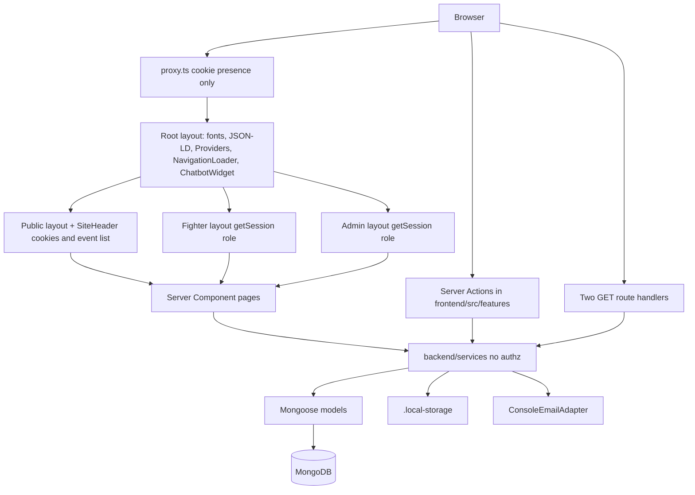

# Next.js 16 Architecture Deep Audit — Up 'n Roll

Audit date: 2026-11-05  
Scope: architecture discovery and target design for the repository at `d:\upnrol`.  
Method: source inspection of `frontend/`, `backend/`, `scripts/`, configuration, and docs; comparison with Next.js 16.1.6 types in the installed `next` package and with the official Next.js 16 documentation for Cache Components, Proxy, `connection()`, and revalidation.  
Constraint: audit only. No application source, configuration, dependency, environment, or git history was modified. This document does not enable Cache Components.

This document starts from `docs/MASTER_REPOSITORY_AUDIT.md` and does not replace it. Claims below were re-checked against source. Where a measurement was not taken in this pass, it is marked **UNVERIFIED**.

Framework references used:

- [Cache Components / `use cache`](https://nextjs.org/docs/app/api-reference/directives/use-cache)
- [`cacheLife`](https://nextjs.org/docs/app/api-reference/functions/cacheLife)
- [`cacheTag`](https://nextjs.org/docs/app/api-reference/functions/cacheTag)
- [`updateTag`](https://nextjs.org/docs/app/api-reference/functions/updateTag)
- [Revalidating](https://nextjs.org/docs/app/getting-started/revalidating)
- [Proxy](https://nextjs.org/docs/app/getting-started/proxy)
- [Upgrade to version 16](https://nextjs.org/docs/app/guides/upgrading/version-16)
- [`connection()`](https://nextjs.org/docs/app/api-reference/functions/connection)
- Installed types: `node_modules/next/dist/server/config-shared.d.ts` (`cacheComponents` defaults to `false`; `experimental.serverActions.bodySizeLimit` is still the typed location for the action body limit in 16.1.6)

Legend used throughout:

| Label | Meaning |
|---|---|
| Fact | Read from a file in this repository or from the installed Next.js 16.1.6 types |
| Assumption | Inferred from product shape, not a closed decision |
| Recommendation | Proposed change. Not implemented |
| UNVERIFIED | Not measured or not executed in this pass |

---

## 1. Executive Summary

Up 'n Roll is a single-process tournament application. The Next.js 16.1.6 App Router in `frontend/` is the only HTTP server. Domain logic, Mongoose models, session authentication, and storage live in the sibling `backend/` library, imported as `@/server/*`. Mutations are Server Actions. Two Route Handlers exist, and both serve private bytes. There is no separate API process.

The App Router split is already the right shape for Next.js 16: pages are Server Components, interactive forms are small Client Components, and reads call services directly instead of calling the application's own HTTP API. That part should be kept.

The application does not yet use the Next.js 16 rendering model that would make public tournament pages fast without risking private data. Every important public page sets `export const dynamic = "force-dynamic"`. The public layout also calls `cookies()` through `getSession()`, so those routes are dynamic even without that export. Cache Components (`cacheComponents`, `use cache`, `cacheLife`, `cacheTag`, `updateTag`) are absent. `revalidatePath` runs after mutations, but it only names the admin or fighter URL that submitted the form. Public event, bracket, schedule, result, ranking, FAQ, announcement, policy, and homepage URLs are not invalidated. That is harmless while every page is forced dynamic. It becomes a correctness bug the moment shared caching is turned on.

**Do not enable `cacheComponents` as the first change.** Official Next.js 16 behavior makes uncached IO fail the build unless it sits behind Suspense, and `use cache` cannot call `cookies()`, `headers()`, or `searchParams`. This codebase reads the session cookie in the shared header, returns full Mongoose documents that include Aadhaar and password hashes into server memory, and invalidates the wrong paths. Caching on top of that would leak private data or serve stale brackets.

### Target

Keep one Node.js process, Server Components for reads, Server Actions for mutations, and Route Handlers only for private file delivery and any future webhook. Evolve `backend/` into an explicit modular monolith: domain rules, application services that authorize their caller, and infrastructure adapters. Add a thin cached read model in the Next.js server layer only for public, non-personalized data, and only after projections and invalidation exist.

### Maturity for a Next.js 16 production architecture

The repository is a structured application, consistent with the master audit's maturity 3. It is not an enterprise Next.js 16 deployment. The gap is boundaries and rendering policy, not a missing backend.

### What must be true before source changes

Engineering reviews and approves this document. Open decisions OD-001 through OD-014 in `docs/decisions/open-decisions.md` stay open except where code already implemented them (OD-013, `proxy.ts`). This audit does not close product decisions.

---

## 2. Existing Repository Context

### Fact — process model

| Path | Role |
|---|---|
| `frontend/` | Next.js 16.1.6 application. `frontend/package.json` is the only dependency manifest |
| `backend/` | TypeScript library. No `package.json`. Alias `@/server/*` → `../backend/*` in `frontend/tsconfig.json` |
| `scripts/create-admin.ts`, `scripts/seed-demo.ts` | Operator scripts. Import `backend/` by relative path |
| `docs/` | Product, architecture, phase history, master audit |
| Root `package.json` | Forwards npm scripts with `--prefix frontend` |

`frontend/next.config.ts` lines 13–16 set `outputFileTracingRoot` to the repository root and `serverExternalPackages: ["mongoose"]`. That is the correct tracing setup for a sibling `backend/` folder. `output: "standalone"` is not set.

### Fact — what the master audit got right

Re-checked and still true:

- Pages under `frontend/src/app` do not declare `"use client"`. `error.tsx` and `global-error.tsx` do, which Next.js requires.
- Services do not check roles. Layouts and actions do.
- `listPublicSchedule` (`backend/services/matchService.ts` lines 199–208) loads an event by slug with no `PUBLIC_EVENT_STATUSES` filter. `getEventBySlug` (`backend/services/eventService.ts` lines 19, 84–88) does filter.
- `FighterProfile` stores Aadhaar and medical fields as plain strings (`backend/models/FighterProfile.ts` lines 15–33).
- `getStorageAdapter()` always returns local disk (`backend/storage/local-disk.ts` lines 53–55). `getEmailAdapter` is the console logger.
- React Query is mounted and unused (`frontend/src/components/Providers.tsx`, `frontend/src/lib/queryClient.ts`).
- `frontend/package.json` line 6 runs `ln -sfn` in `predev`. That script is not portable to Windows PowerShell.

### Fact — corrections and additions beyond the master audit

These are Next.js-specific and were confirmed in this pass:

1. `force-dynamic` is not only "several" pages. It is set on the homepage, events, event detail, brackets, schedule, results, fighters, fighter profile, rankings, FAQ, announcements, policies, fighter dashboard, admin home, and the UI preview. See section 9.
2. Public chrome itself is request-bound. `SiteHeader` (`frontend/src/components/layout/site-header.tsx` lines 16–17) calls `getSession()` and `listPublicEvents()` together. `getSession` calls `cookies()` (`backend/auth/session.ts` line 53). A dynamic layout or header prevents a static shell for every public route, independent of each page's `force-dynamic` export.
3. `revalidatePath` coverage does not match the public URLs that display the mutated data. See section 11.
4. `getSession` loads the full `User` document, including `passwordHash` (`backend/auth/session.ts` lines 61–64). Callers use `_id`, `role`, and sometimes `email`. The hash is not passed into a Client Component today. It is still on the session object.
5. The fighter profile page passes Aadhaar and medical answers into a Client Component as props (`frontend/src/app/(fighter)/fighter/profile/page.tsx` lines 17–54). That is appropriate for the owner editing their own form. It is unsafe to cache.
6. There is no `sitemap.ts`, `robots.ts`, `generateMetadata`, canonical URL, or per-event JSON-LD. `/rankings/demo` has a title and no `robots` noindex (`frontend/src/app/(public)/rankings/demo/page.tsx` lines 4–6). `/ui-preview` does set `robots: { index: false, follow: false }`.
7. The homepage video is referenced. `frontend/src/app/(public)/page.tsx` lines 58–71 render `/Videos/IMG_7263.MP4_2.mp4` with `preload="auto"`. The master audit left video usage UNVERIFIED. It is used.
8. No `import "server-only"` and no `instrumentation.ts` exist anywhere in application source.
9. `React.cache()` is not used. `getSession()` and `listPublicEvents()` run again for every caller in the same request.
10. Installed Next.js 16.1.6 still types `serverActions.bodySizeLimit` under `experimental` (`config-shared.d.ts`). The current `frontend/next.config.ts` lines 7–12 match that type. It is not a stale Next.js 15 key in this version.
11. `cacheComponents` defaults to `false` in the same type file. It is not enabled.

### Assumption

The product is one organizer, one database, two roles (`FIGHTER`, `ADMIN`). No tenant key exists. Multi-club hosting is out of scope until someone decides otherwise.

### Routes that exist

| Group | URLs |
|---|---|
| Public | `/`, `/events`, `/events/[slug]`, `/events/[slug]/brackets`, `/events/[slug]/schedule`, `/events/[slug]/results`, `/fighters`, `/fighters/[slug]`, `/rankings`, `/rankings/demo`, `/faq`, `/announcements`, `/policies` |
| Auth | `/login`, `/register` |
| Fighter | `/fighter/dashboard`, `/fighter/profile`, `/fighter/registrations`, `/fighter/registrations/new`, `/fighter/registrations/[id]/payment`, `/fighter/matches`, `/fighter/requests` |
| Admin | `/admin`, `/admin/events`, `/admin/events/[id]`, `/admin/events/[id]/divisions`, `/admin/events/[id]/brackets`, `/admin/events/[id]/matches`, `/admin/payments`, `/admin/requests`, `/admin/rankings`, `/admin/content`, `/admin/media` |
| Preview | `/ui-preview` (not found in production unless `UI_PREVIEW_ENABLED=true`) |
| HTTP | `GET /api/v1/fighter/photo`, `GET /api/v1/admin/payments/[id]/screenshot` |

No `middleware.ts`. The network boundary is `frontend/src/proxy.ts`.

---

## 3. Current Architecture Diagram



Request path that actually runs for a public page:

`Browser → proxy (no match, public routes are not in the matcher) → root layout → public layout → SiteHeader (session cookie + all public events) → page service calls → MongoDB → HTML`

Mutation path:

`Browser form → Server Action (Zod, then requireRole or requireSession) → service → MongoDB → revalidatePath of the submitting screen → returned state or the same page refresh`

There is no internal `fetch()` to `/api/v1` for page data. That is the correct Next.js data-access direction. Keep it.

---

## 4. Next.js 16 Capability Assessment

Classifications apply to this repository, not to whether the feature is fashionable.

| Feature | Classification | Evidence and reasoning |
|---|---|---|
| App Router | IMPLEMENTED CORRECTLY | `frontend/src/app`, async `params` as `Promise`. No `pages/` router |
| Route groups | IMPLEMENTED CORRECTLY | `(public)`, `(auth)`, `(fighter)`, `(admin)`, `(preview)` separate layouts without changing URLs |
| Nested layouts | IMPLEMENTED BUT SUBOPTIMAL | Role layouts are correct. Root layout mounts global client widgets on admin and fighter routes. Public header blocks on the database |
| Dynamic routes | IMPLEMENTED CORRECTLY | `events/[slug]`, `fighters/[slug]`, `events/[id]`, `registrations/[id]`, `payments/[id]` |
| Server Components | IMPLEMENTED CORRECTLY | Pages are server components and call services |
| Client Components | IMPLEMENTED BUT SUBOPTIMAL | Forms and nav are appropriately client. Root `Providers`, chatbot, and navigation loader wrap every route. See section 6 |
| Server Actions | IMPLEMENTED BUT SUBOPTIMAL | Auth, Zod, and service calls are in place. Invalidation, idempotency, and role precision are incomplete. See section 13 |
| Route Handlers | IMPLEMENTED CORRECTLY for the two byte downloads | No REST rewrite of actions. Handlers skip some response hardening. See section 14 |
| Proxy | IMPLEMENTED CORRECTLY as a UX gate | `frontend/src/proxy.ts`. Official Proxy docs say it must not be the authorization system. The file's own comment matches that. Node runtime is mandatory for `proxy.ts` in Next.js 16; this file does not set an edge runtime |
| `loading.tsx` | PARTIALLY IMPLEMENTED | Root, `admin/`, and `fighter/dashboard` only. Root boundary sits above the public layout, so the header disappears during navigation |
| `error.tsx` / `global-error.tsx` / `not-found.tsx` | IMPLEMENTED BUT SUBOPTIMAL | Present and safe. No segment boundaries, no monitoring, no request id |
| Metadata API | PARTIALLY IMPLEMENTED | Root `metadata` in `frontend/src/app/layout.tsx` lines 23–39. Login and register set titles. No dynamic metadata |
| `generateMetadata` | NOT IMPLEMENTED | Event and fighter pages render the name only in the body |
| Image optimization | NOT IMPLEMENTED | No `next/image` imports. No `images` config |
| Font optimization | IMPLEMENTED CORRECTLY | `next/font/google` Inter and Oswald in the root layout. Unused `Anton` import exists only in unused `reveal-loader.tsx` |
| Script optimization | NOT APPLICABLE | No third-party scripts. JSON-LD is an inline script tag, which is appropriate |
| Cache Components | NOT IMPLEMENTED | `cacheComponents` is unset, so it stays at the framework default `false`. Do not flip it yet |
| `use cache` / `cacheLife` / `cacheTag` | NOT IMPLEMENTED | No matches in application source |
| `updateTag` / `revalidateTag` | NOT IMPLEMENTED | Correct until tags exist |
| `revalidatePath` | IMPLEMENTED BUT SUBOPTIMAL | Called, but the path set is the admin screen, not the public screens |
| Streaming / Suspense | PARTIALLY IMPLEMENTED | File-convention `loading.tsx` only. No `<Suspense>` in pages. Homepage awaits all data before returning |
| Prefetching | IMPLEMENTED BUT SUBOPTIMAL | Default `<Link>` prefetch. Public targets are all dynamic, so hover prefetch hits MongoDB. UNVERIFIED in the browser |
| Static rendering | NOT IMPLEMENTED | Explicit `force-dynamic` plus `cookies()` in shared chrome |
| Dynamic rendering | IMPLEMENTED CORRECTLY for private areas | Fighter and admin must stay dynamic. Public pages are dynamic by policy, not by necessity of every byte |
| `connection()` | NOT APPLICABLE until Cache Components | Today `force-dynamic` and `cookies()` already opt into request-time rendering. `connection()` is the wrong first tool |
| Build `output: "standalone"` | NOT IMPLEMENTED | Tracing root is set. Standalone output is not. Choice depends on OD-012 |
| Deployment config | NOT IMPLEMENTED | No Dockerfile, `vercel.json`, or CI workflow |
| `instrumentation.ts` | NOT IMPLEMENTED | No OpenTelemetry or error SDK hook |
| Draft Mode | NOT APPLICABLE | No preview CMS protocol. `/ui-preview` is an env-gated showroom |
| Parallel routes / intercepting routes | NOT APPLICABLE | Dialogs are component state, which fits these forms |
| Middleware | NOT APPLICABLE | Replaced by Proxy, which is the Next.js 16 name. OD-013 is done in code and still open in the decision log |

Features that should not be added just because they exist: Partial Prerendering as a separate flag (it is now `cacheComponents`), a public REST port of every action, `use cache: private` for dashboards, edge runtime, and a second data-fetching library.

---

## 5. App Router Audit

### Layout tree

| File | Behavior |
|---|---|
| `frontend/src/app/layout.tsx` | HTML, fonts, static Organization JSON-LD, `Providers`, `NavigationLoader`, `ChatbotWidget` |
| `frontend/src/app/(public)/layout.tsx` | `SiteHeader` + `SiteFooter`. Header is async and blocks |
| `frontend/src/app/(auth)/layout.tsx` | Static branded shell. No session read |
| `frontend/src/app/(fighter)/fighter/layout.tsx` lines 9–11 | Session required, role must be `FIGHTER`, else redirect `/login` |
| `frontend/src/app/(admin)/admin/layout.tsx` lines 9–11 | Session required, role must be `ADMIN` |
| `frontend/src/app/(preview)/ui-preview/page.tsx` | `notFound()` outside local dev unless `UI_PREVIEW_ENABLED=true` |

### Finding NX-LAYOUT-01 — P1

Root layout client children apply to admin payment review and fighter medical forms. `ChatbotWidget` is fixed-position UI on those screens (`frontend/src/app/layout.tsx` lines 68–70, widget at `chatbot-widget.tsx` lines 32–44). A support widget on a page that displays Aadhaar or payment screenshots is a focus and privacy problem.

Recommendation: render the chatbot only under the public layout. Keep toaster notifications at the root if forms need them.

### Finding NX-LAYOUT-02 — P1

`SiteHeader` performs a full public event query and a session lookup on every public page, including pages that already call `listPublicEvents()` (`frontend/src/app/(public)/page.tsx` lines 27–31 and `events/page.tsx`). There is no `cache()` from React around either function, so the same request runs the queries twice.

Recommendation: wrap `getSession` and `listPublicEvents` in `react` `cache()` for per-request deduplication. That is not Cache Components and does not share data across users.

### Finding NX-ROUTE-01 — P2

Admin subpages (`payments`, `events/[id]`, `matches`, and the rest) do not export `force-dynamic`. They are still dynamic because the admin layout calls `cookies()` via `getSession`. The explicit export on only some routes makes the rendering policy look inconsistent. After Cache Components, the explicit signal should be the absence of `use cache` on private subtrees, not a scatter of `force-dynamic`.

### Finding NX-ROUTE-02 — P1

`/rankings/demo` is a public route with fictional athlete names (`rankings/demo/page.tsx` lines 10–13) and no `robots` exclusion. It can be indexed and prefetched like any other public page.

Recommendation: `robots: { index: false, follow: false }` until the demo is removed from the production build.

### Params and not-found

Event detail, schedule, and results catch service errors and call `notFound()`. Fighter profile checks `NotFoundError` specifically and rethrows anything else (`fighters/[slug]/page.tsx` lines 14–16). Event detail swallows every error as 404 (`events/[slug]/page.tsx` lines 11–14). A Mongo outage on the event page becomes a 404. Recommendation: map `NotFoundError` to `notFound()` and let other errors hit `error.tsx`.

---

## 6. Server and Client Component Audit

### Rule that the code already follows

No `page.tsx` is a Client Component. Client files are forms, dialogs, pathname-aware navigation, the root providers, the chatbot, and the design showroom. That is the correct default.

No Client Component imports `@/server/*`. Server-only modules are imported from Server Components, Server Actions, Route Handlers, and `proxy.ts` (cookie name constant only). `proxy.ts` does not import Mongoose.

Two intentional client-safe copies exist so UI code does not import Mongoose models:

- `frontend/src/features/events/event-status.ts`
- `frontend/src/features/content/content-types.ts`

`frontend/src/features/content/schemas.ts` line 2 still imports `CONTENT_TYPES` from the Mongoose model. Today that schema is only imported by the Server Action. If a Client Component imports it later, Mongoose enters the client graph. Recommendation: point the schema at `content-types.ts`.

There is no `server-only` package guard. A future `"use client"` file that imports a service would fail at build only after the bundler notices Node builtins. A `server-only` import at the top of `backend/db/connect.ts`, `backend/auth/session.ts`, and `frontend/src/lib/config.ts` fails that mistake immediately.

### Production client inventory

Priority is the value of changing the boundary, not a claim that the file is broken.

| Path | Why client | Bundle note | Recommended type | Change | Priority |
|---|---|---|---|---|---|
| `components/Providers.tsx` | React Query, tooltip, Sonner | Query client is unused. Ships on every page | Client, smaller | Remove `QueryClientProvider` and `queryClient.ts` | P2 |
| `features/chatbot/chatbot-widget.tsx` | Open state, input, calls a Server Action | Button and panel on every route, including admin | Client, public layout only | Move mount to `(public)/layout.tsx`. `next/dynamic` with `ssr: false` is optional | P1 |
| `components/layout/navigation-loader.tsx` | Patches `window.fetch`, uses pathname | Global behavior, not a data boundary | Client | Keep. Do not wrap it around data fetching | P3 |
| `components/layout/header-lockup.tsx` | Scroll and pathname | Small | Client | Keep | P3 |
| `components/layout/comic-nav.tsx` | Active link from pathname | Small | Client | Keep. Receives serializable `links` | P3 |
| `components/layout/mobile-nav-toggle.tsx` | Menu state | Small | Client | Keep | P3 |
| `features/admin/admin-nav.tsx` | Active link | Small | Client | Keep | P3 |
| `features/fighter/fighter-nav.tsx` | Active link | Small | Client | Keep | P3 |
| `features/auth/login-form.tsx` | `useActionState` | Form only | Client | Keep | P3 |
| `features/auth/register-form.tsx` | `useActionState`, file input | Includes grappler fields | Client | Keep. Do not move photo bytes through a client fetch to a Route Handler | P3 |
| `features/fighters/grappler-form.tsx` | Controlled fields | Used by register and profile | Client | Keep. Props must stay field values, not the Mongoose document | P2 |
| `features/profile/profile-form.tsx` | Form state, photo | Receives Aadhaar and medical defaults | Client, private | Keep. Never cache the parent page | P0 design constraint |
| `features/registrations/new-registration-form.tsx` | Form | Server page loads divisions | Client | Keep | P3 |
| `features/payments/payment-form.tsx` | File input, `useActionState` | Screenshot stays in the action body | Client | Keep | P3 |
| `features/events/create-event-form.tsx` | Form | Admin | Client | Keep | P3 |
| `features/events/create-division-form.tsx` | Form | Admin | Client | Keep | P3 |
| `features/events/event-status-form.tsx` | Form | Admin | Client | Keep | P3 |
| `features/brackets/participant-order-form.tsx` | Reorder UI | Admin | Client | Keep. Generation stays a Server Action | P3 |
| `features/brackets/publish-bracket-button.tsx` | Form action | Admin | Client | Keep | P3 |
| `features/brackets/bracket-view.tsx` | None. No `"use client"` | Server-rendered bracket | Server | Keep server. Do not convert for animation | — |
| `features/matches/match-result-dialog.tsx` | Dialog, form | Admin | Client | Keep | P3 |
| `features/matches/schedule-match-dialog.tsx` | Dialog, form | Admin | Client | Keep | P3 |
| `features/rankings/recalculate-button.tsx` | `useActionState` | Admin | Client | Keep | P3 |
| `features/rankings/ranking-demo.tsx` | Interactive demo | Client graph on a public URL | Client, noindex | Keep out of the indexed site | P1 |
| `features/rankings/bracket-chart.tsx` | Demo chart | Demo only | Client | Do not use for live brackets | P3 |
| `features/content/create-content-form.tsx` | Form | Admin | Client | Keep | P3 |
| `features/content/publish-toggle-button.tsx` | Form action | Admin | Client | Keep | P3 |
| `features/media/create-media-form.tsx` | Form | Admin | Client | Keep | P3 |
| `features/requests/create-request-dialog.tsx` | Dialog | Fighter | Client | Keep | P3 |
| `features/requests/decide-request-dialog.tsx` | Dialog | Admin | Client | Keep | P3 |
| `features/admin-payments/payment-review-dialog.tsx` | Dialog, `` for screenshot | Private URL, comment explains why not `next/image` | Client | Keep the ``. Add `nosniff` on the handler | P1 |
| `app/error.tsx`, `app/global-error.tsx` | Next.js error boundary contract | Required client | Client | Add monitoring later. Do not render `error.message` for server failures | P2 |
| `components/ui/*` | Radix interactivity | Many have no importer outside `components/ui` | Client when used | Do not delete in an architecture phase. Cleanup is a separate bundle PR | P3 |
| `components/preview/**` | Showroom | `framer-motion` only here | Client | Exclude from production when OD design sign-off allows | P3 |

### Serialization risks

| Data | Where it crosses to the client | Risk |
|---|---|---|
| Aadhaar, medical answers, emergency contact | `ProfileForm` props from `fighter/profile/page.tsx` lines 23–40 | Correct for the signed-in owner. Catastrophic if this RSC payload is cached or shared |
| `passwordHash` | Not passed to a client today. Present on `session.user` because `User.findById` has no projection | A later `<Client user={session.user} />` ships the hash |
| Payment queue user | Page passes `p.user?.email` only (`admin/payments/page.tsx` lines 35, 47–49) | Service still loaded the full user, including `passwordHash` (`paymentService.ts` lines 165–166) |
| Public fighter page | Service returns a narrowed object (`fighterService.ts` lines 107–115) | Safe at the return boundary. The function still `findOne`s the full profile first (line 95), so Aadhaar enters the Node process |
| Bracket and match names | Plain strings into `BracketView` | Safe |
| Mongoose documents | Several pages pass lean objects only as far as server-rendered tables | Dates and `_id` are fine in Server Components. Do not pass lean documents into client dialogs without a DTO |

### Large client boundaries

The oversized boundary is the root layout, not the bracket UI. `BracketView` is already a Server Component. Admin match pages keep dialogs as leaves. That pattern should be the standard: server page fetches and renders the table; the client file is the dialog.

`NavigationLoader` replaces `window.fetch` (`navigation-loader.tsx` lines 26–40). It is global and subtle. It is acceptable for a loading indicator. It must not grow into a data layer.

---

## 7. Component Dependency and Bundle Audit

### Fact

Dependencies that affect the client graph on ordinary pages:

| Module | Pulled by | Production value |
|---|---|---|
| `@tanstack/react-query` | `Providers.tsx` only. No `useQuery` | None today |
| `sonner` | `Providers.tsx` | Toast surface. Forms mostly use `useActionState` inline errors. Confirm before removal |
| `@radix-ui/react-tooltip` | `Providers.tsx` | Only if tooltips are used on those pages |
| `lucide-react` | Chatbot and many server pages | Icons. Tree-shaking depends on direct imports, which the code uses |
| `gsap`, `@gsap/react` | `components/ui/reveal-loader.tsx` only, and that file has no app importer | Dead if the bundler can drop it. UNVERIFIED without an analyzer report |
| `framer-motion` | Preview section only | Should not be in the public route graph |
| `recharts`, `react-hook-form`, `date-fns`, carousel, command palette | Unused UI primitives or no import | Dead weight in `node_modules`, not necessarily in the visited route |

### UNVERIFIED

No `@next/bundle-analyzer` output, no production `next build`, and no Lighthouse run were produced in this audit. A dev server lock on `frontend/.next` was a reason the master audit skipped `next build`. This pass also did not run `next build`. Bundle sizes below are not numbers.

### Recommendation

Measure before deleting UI kits:

1. `next build` with analyzer on a machine that is not serving `frontend/.next`.
2. Record first-load JS for `/`, `/events/[slug]`, `/fighter/dashboard`, `/admin/payments`.
3. Remove React Query only after the analyzer shows it in the shared root chunk.
4. Do not adopt a client data cache. Server Components already load data.

Hydration: client islands are forms and nav. The homepage still hydrates the root providers, the navigation loader, the header lockup, the comic nav, the mobile toggle, and the chatbot. That is the hydration cost that matters. UNVERIFIED in milliseconds.

---

## 8. Data Fetching Architecture

### Current strategy

Server Components and Server Actions call `backend/services` directly. Route Handlers are not used as an internal API. Keep that.

`connectDB()` caches one Mongoose connection on `global.__upnrollMongoose` (`backend/db/connect.ts` lines 18–31). That is the right Node process pattern. It is a poor serverless pattern if each isolate opens a pool.

### Per-route strategy

| Route | Today | Problem | Recommended fetch |
|---|---|---|---|
| `/` | `Promise.all` of events, rankings, FAQs, media, then a second query for divisions (`page.tsx` lines 27–37). Header repeats events and adds a session | Waterfall after the first batch. Duplicate event list | Per-request `cache()`. Later, cached public reads in Suspense slots. Session chip stays outside the cache |
| `/events` | `listPublicEvents` plus the header's copy | Duplicate query | Same cached `listPublicEvents` |
| `/events/[slug]` | Event, then divisions | Short waterfall. Any error becomes 404 | Parallelize only independent calls. Map `NotFoundError` only |
| `/events/[slug]/brackets` | Event, then divisions, then `Promise.all` of published brackets | Acceptable fan-out per division | One aggregation or a service method that returns divisions with brackets. Cache by slug after publish rules are fixed |
| `/events/[slug]/schedule` and `/results` | `listPublicSchedule` without event status. Results filter in memory (`matchService.ts` lines 199–214) | Draft leak. Results re-run the schedule query and filter | Same status gate as `getEventBySlug`. Results query `status` in Mongo |
| `/fighters` | Projected list (`displayName slug gym discipline`) | Good projection. Unbounded | Cache hours. Paginate when the directory grows |
| `/fighters/[slug]` | Full profile load, then matches and registrations (`fighterService.ts` lines 93–105) | Aadhaar loaded then dropped. `listMatchesForFighter` loads full profiles again | Public projection in the query. Do not call the owner profile reader |
| `/rankings` | All `RankingRecord` plus full profiles (`rankingService.ts` lines 56–59) | Full profile read for a name and slug | Select `displayName slug` only |
| `/faq`, `/announcements`, `/policies` | `listPublished(type)` | Good filter. Header still does its own work | Cache by content type |
| `/rankings/demo` | No database. Client demo | Public indexable fiction | No cache needed. Noindex |
| `/login`, `/register` | Client forms. Actions touch Mongo | Register writes `User` and `FighterProfile` in the action, not a service | Move account creation into one service function |
| `/fighter/dashboard` | `getFighterDashboardData` uses `Promise.all` (`dashboardService.ts` lines 31–37) | Good parallelism. Each child re-enters `connectDB` and some re-load profiles. Layout also calls `getSession` | `cache(getSession)`. Keep uncached |
| `/fighter/profile` | Direct `FighterProfile.findOne` in the page | Bypasses `fighterService`. Full document | Call `getFighterProfile` and pass a form DTO |
| `/fighter/registrations` | `listMyRegistrations` | Owner scoped | Uncached |
| `/fighter/registrations/new` | Open divisions | Time-dependent | Uncached or very short private cache. Prefer uncached |
| `/fighter/registrations/[id]/payment` | `getRegistrationForFighter` checks `userId` | Good ownership | Uncached |
| `/fighter/matches` | `listMatchesForFighter` | Enrichment loads full fighter profiles | Project names |
| `/fighter/requests` | Registrations and requests in parallel, then divisions per registration event (`requests/page.tsx`) | N+1 division lists | One `listDivisionsForEvent` per distinct event id |
| `/admin` | `getAdminDashboardData` (`dashboardService.ts` lines 11–18) | `listPaymentQueue("PENDING_REVIEW")` loads every submission, then filters. `listRequestsForAdmin` loads all, then filters pending | Filter in Mongo. Paginate |
| `/admin/events` and children | Admin event and division reads | No service authz. Layout is the gate | Pass an admin actor into the service |
| `/admin/events/[id]/brackets` | Event, divisions, then participants and bracket per division | Reasonable for one event | Uncached |
| `/admin/events/[id]/matches` | Event then matches | Sequential | Uncached. Names via projection |
| `/admin/payments` | Full queue | No pagination. User documents over-fetched | Admin-only, paginated, `select("email")` |
| `/admin/requests` | All requests | No pagination | Paginate |
| `/admin/rankings` | `listPublicRankings` | Same over-fetch as the public page | Share the public DTO. Page stays uncached or uses the same tag as the public board |
| `/admin/content`, `/admin/media` | Full lists | Fine at current size | Uncached admin reads |
| Photo and screenshot GET | Direct storage read | Photo route queries the model itself | Keep handlers. Move the photo lookup into `fighterService` |

### Query duplication — finding NX-DATA-01 — P1

In one public homepage request the process can:

1. `getSession` in the header (session lookup + user lookup).
2. `listPublicEvents` in the header.
3. `listPublicEvents` again in the page.
4. Rankings, which load every fighter profile.
5. FAQs.
6. Media.
7. Divisions for the featured event.

None of this is cached across requests, and nothing dedupes within the request.

### Waterfalls — finding NX-DATA-02 — P2

Sequential by necessity when the second query needs an id: event then divisions, event then brackets. Avoidable: homepage divisions could be included in a featured-event read model; fighter requests refetch divisions inside a loop; dashboard composition calls services that each query overlapping fighter profiles.

### Transactions — finding NX-DATA-03 — P1

No `startSession` or `withTransaction` exists under `backend/`.

| Flow | Current writes | Failure mode |
|---|---|---|
| `createRegistration` | `Registration.create` then `PaymentSubmission.create` (`registrationService.ts` lines 45–60) | Registration without a payment row |
| Capacity check | `countDocuments` then `create` (lines 37–44) | Two requests can both pass capacity. The partial unique index stops a duplicate active registration for the same user and division. It does not stop over-capacity |
| `generateBracket` | Bracket save then `Match.insertMany` (`bracketService.ts` lines 100–119) | Bracket without matches |
| `recalculateRankings` | Per-user `findOneAndUpdate` in `Promise.all` (`rankingService.ts` lines 34–44) | A thrown update leaves a mixed `calculationVersion` |
| Payment decision | Status update and registration status update in `decidePayment` | Needs a transaction so approval cannot commit one side |

Recommendation: one Mongo session per registration creation, payment decision, and bracket generation. Keep the engines pure and outside the transaction. Capacity still needs a unique constraint or a conditional update, not only a transaction, because two transactions can both count `capacity - 1`.

### Indexes — fact

Present and relevant: unique email, unique fighter slug, unique event slug, unique session token hash, TTL on `sessions.expiresAt`, partial unique active `(userId, divisionId)`, unique `(bracketId, round, order)`, match `status`, content `(type, publicationState)`, payment `submittedUtr`. `AuditLog` and `MediaAsset` have no query indexes beyond `_id`. Acceptable until there is an audit viewer.

`autoIndex` remains the Mongoose default. Index builds during application boot are acceptable for one organizer database and risky if a production deploy creates indexes on a large collection during traffic. Recommendation: build indexes in an operator step before relying on them in production. Do not add a migration framework until the schema actually needs versioned changes.

### Internal HTTP

None for reads. Do not introduce it.

---

## 9. Rendering Strategy

### Fact

These pages export `dynamic = "force-dynamic"`:

- `frontend/src/app/(public)/page.tsx` line 11
- `events/page.tsx`, `events/[slug]/page.tsx`, `brackets/page.tsx`, `schedule/page.tsx`, `results/page.tsx`
- `fighters/page.tsx`, `fighters/[slug]/page.tsx`
- `rankings/page.tsx`, `faq/page.tsx`, `announcements/page.tsx`, `policies/page.tsx`
- `fighter/dashboard/page.tsx`
- `admin/page.tsx`
- `(preview)/ui-preview/page.tsx`

`/rankings/demo` does not. It has no database read. It is still under the public layout, and that layout calls `cookies()`, so the route is dynamic anyway.

### Why public pages should not all stay fully dynamic

A tournament homepage, a policy, and a published bracket are shared by every visitor. Forcing the whole route to render at request time makes MongoDB latency part of TTFB for anonymous traffic. Next.js 16's Cache Components model is the supported way to prerender a static shell and cache the shared data while leaving the signed-in header dynamic.

Official constraint, paraphrased from the `use cache` documentation: cached scopes cannot call `cookies()`, `headers()`, or `searchParams`. Read those outside the cache and pass plain arguments in. With `cacheComponents` enabled, uncached IO must be behind `<Suspense>` or the build fails.

### Recommended rendering classes

| Class | Routes | Policy |
|---|---|---|
| Static shell | Marketing copy, fonts, footer, JSON-LD | Default once Cache Components are on. No cookies |
| Shared cached data | Event list, event detail, published brackets, schedule, results, fighter directory, public profile DTO, rankings DTO, FAQ, announcements, policies | `use cache` + `cacheTag` + explicit `cacheLife` |
| Per-request, uncached | Session header chip, fighter portal, admin portal, payment page, photo, screenshot | No `use cache`. Suspense around the session chip so the shell can still flush |
| Fully dynamic by data | Registration open/close that depends on `new Date()` compared with event windows | Either compare inside a short-lived cached function (the clock becomes part of the cache key's lifetime) or leave the registration form uncached |

`force-dynamic` should be removed only in the same change that introduces the cached read and the Suspense boundary. Removing it earlier, while the header still calls `cookies()`, does not make the route static.

### Prefetch

Default Link prefetch on a fully dynamic page asks the server to render RSC on hover. With the current header cost, moving across Events, Fighters, Rankings, and FAQ prefetches four Mongo-backed trees. After public data is cached, prefetch becomes cheap and should stay on. Until then, prefetch is a load amplifier. UNVERIFIED how often the browser actually prefetches in this UI.

Do not set `prefetch={false}` on every link as a permanent design. It is a temporary mitigation if production logs show prefetch storms.

---

## 10. Cache Components Assessment

### Suitability

Cache Components are suitable for the **public, shared** half of this product. They are the wrong tool for fighter dashboards, admin queues, payment proofs, and profile forms.

| Question | Answer |
|---|---|
| Should `cacheComponents` be enabled now? | No |
| Why not? | Session cookie in the shared header; full-document reads of PII; `revalidatePath` does not name public URLs; no Suspense slots; draft schedule leak would be cached |
| What replaces `force-dynamic` later? | Opt-in `use cache` on public read functions. Private routes stay dynamic because they call `cookies()` outside any cache |
| Is `use cache: private` recommended? | No for this app. Dashboards are per-user and must not be stored in a shared or private CDN cache. The documentation describes `use cache: private` as a narrow escape hatch for runtime APIs, not as the dashboard strategy |
| Is `use cache: remote` required? | Only if a host's in-memory cache is insufficient. Do not design around a vendor cache handler before OD-012 |
| Is `unstable_cache` recommended? | No. Next.js 16's supported API is `use cache` |

### Enabling prerequisites

All of these are required before `cacheComponents: true`:

1. Public read functions return DTOs with an explicit field list. No Aadhaar, medical text, `passwordHash`, UTR, screenshot key, or session token.
2. `getSession` is never called inside a cached function. The header splits into a cached event link and an uncached session slot inside `<Suspense>`.
3. `listPublicSchedule` uses the same publication rule as `getEventBySlug`.
4. Mutations that change public data call `updateTag` for read-your-own-writes. `updateTag` is only available in Server Actions, which matches this app.
5. A test or build proves `/fighter/profile` and `/admin/payments` are not tagged with a public cache tag.
6. `next build` is run with the flag in a branch. Expect build errors until every uncached database call sits in a Suspense boundary. That is the framework's safety check, not a reason to wrap the whole page in one Suspense and cache nothing.

### Proposed caching matrix

Lifetimes use the documented profiles (`seconds`, `minutes`, `hours`, `days`, `max`). Tags are the invalidation names to implement later. Nothing here is implemented.

| Surface | Mode | `cacheLife` | Tags | Consistency |
|---|---|---|---|---|
| Homepage marketing shell and path steps | `use cache` on the static sections, or just the static JSX with no IO | `max` | `home` | Deploy-time. Copy is hardcoded today |
| Homepage event, ranking, FAQ, media slots | `use cache` per slot | `minutes` | `events`, `rankings`, `content:FAQ`, `media` | Update on mutation |
| Header open-event link | `use cache` | `minutes` | `events` | Must not include the session |
| Header dashboard / sign-in | Uncached | — | — | Reads `cookies()` |
| `/events` | `use cache` | `minutes` | `events` | Event status change uses `updateTag("events")` |
| `/events/[slug]` | `use cache` | `minutes` | `event:{slug}`, `events` | Same |
| `/fighters` | `use cache` | `hours` | `fighters` | Profile display-name edits `updateTag` |
| `/fighters/[slug]` | `use cache` on the public DTO only | `hours` | `fighter:{slug}` | Result corrections also tag this |
| `/rankings` | `use cache` | `minutes` | `rankings` | Recalculate uses `updateTag` |
| Published brackets | `use cache` | `minutes` on event days, otherwise `hours` | `bracket:{divisionId}`, `event:{slug}` | Publish and result recording use `updateTag` |
| Schedule | `use cache` | `seconds` while an event is in its competition window, otherwise `minutes` | `schedule:{slug}` | Schedule edits use `updateTag` |
| Results | `use cache` | `minutes` | `results:{slug}` | Result and correction use `updateTag` |
| FAQ | `use cache` | `hours` | `content:FAQ` | Publish uses `updateTag`. Chatbot must call the same cached function or it will stampede the database |
| Announcements | `use cache` | `hours` | `content:ANNOUNCEMENT` | Publish uses `updateTag` |
| Policies | `use cache` | `days` | `content:POLICY` | Publish uses `updateTag` |
| `/rankings/demo` | No shared data cache | — | — | Noindex |
| Fighter dashboard, matches, registrations, requests, profile, payment | Dynamic, no `use cache` | — | — | Cookies and ownership |
| Admin dashboard and every admin page | Dynamic, no `use cache` | — | — | Cookies and role |
| Payment screenshot and profile photo | `Cache-Control: private, no-store` already set on the handlers | — | — | Never tag |

Chatbot answers are derived from published FAQs. Cache the FAQ list, not each question, unless question text is normalized and never includes user secrets. Questions are public-intent text. Still rate limit the action. Do not put the raw question in a shared cache key without a length cap; it is an unbounded key.

### Leakage rules

| Input | Rule |
|---|---|
| `cookies()` | Forbidden inside `use cache`. Session UI is a sibling, not a child of the cached component, unless the cached component receives only a boolean that was read outside. Passing `isAdmin` into a shared cache is safe only when it is part of the cache key and the cached output contains no other user's data. Prefer not to pass it in. Render two small uncached links instead |
| `headers()` | Forbidden inside `use cache`. `getClientIp` uses `headers()` and must stay in actions, never in a cached read |
| `searchParams` | None of the public pages use them today. If filters are added, pass the filter value into the cached function so it becomes part of the key. Do not cache a function that closes over the request |
| User id | Never an argument to a public cached function. A function `getProfile(userId)` with `use cache` stores that user's row under a shared tag if the author is careless. Public profiles key on slug and return the DTO only |
| Authorization result | Do not cache `requireRole`. Cache after the data has been reduced to a public DTO in an already-public function |

---

## 11. Cache Dependency and Invalidation Design

```mermaid
flowchart TD
  eventsTag["tag events"]
  eventTag["tag event:slug"]
  bracketTag["tag bracket:divisionId"]
  scheduleTag["tag schedule:slug"]
  resultsTag["tag results:slug"]
  fightersTag["tag fighters"]
  fighterTag["tag fighter:slug"]
  rankingsTag["tag rankings"]
  faqTag["tag content:FAQ"]
  annTag["tag content:ANNOUNCEMENT"]
  polTag["tag content:POLICY"]
  mediaTag["tag media"]

  status["updateEventStatus"] --> eventsTag
  status --> eventTag
  division["createDivision"] --> eventTag
  publishB["publishBracket"] --> bracketTag
  publishB --> scheduleTag
  publishB --> eventTag
  result["recordResult and correctResult"] --> resultsTag
  result --> scheduleTag
  result --> bracketTag
  result --> rankingsTag
  result --> fighterTag
  sched["updateSchedule"] --> scheduleTag
  profile["updateProfile"] --> fightersTag
  profile --> fighterTag
  rank["recalculateRankings"] --> rankingsTag
  content["publishContent"] --> faqTag
  content --> annTag
  content --> polTag
  media["createMedia"] --> mediaTag
```



`revalidatePath` today, and the gap:

| Action file | Paths it revalidates | Public paths it does not revalidate |
|---|---|---|
| `features/events/actions.ts` lines 44, 67, 86 | Admin event and division URLs | `/`, `/events`, `/events/[slug]` |
| `features/brackets/actions.ts` lines 37, 52 | Admin brackets URL | `/events/[slug]/brackets`, schedule, results |
| `features/matches/actions.ts` lines 23, 41, 61 | Admin matches URL | Schedule, results, brackets, rankings, fighter profile |
| `features/rankings/actions.ts` lines 16–17 | `/admin/rankings` and `/rankings` | Homepage ranking strip |
| `features/content/actions.ts` lines 29, 44 | `/admin/content` | `/faq`, `/announcements`, `/policies`, homepage |
| `features/media/actions.ts` line 28 | `/admin/media` | `/` |
| `features/profile/actions.ts` line 40 | `/fighter/profile` | `/fighters`, `/fighters/[slug]` |
| `features/payments/actions.ts` | Fighter payment URL | None public. Correct |
| `features/admin-payments/actions.ts` | `/admin/payments` | Fighter registration screens that show status |
| `features/requests/actions.ts` | Fighter and admin request URLs | Registration status if a decision changes it |
| `features/registrations/actions.ts` | Not re-read in full here; create flow redirects | Event capacity is not a public counter today |
| `features/auth/actions.ts` | Session cookie, no content tags | Correct |
| `features/chatbot/ask-chatbot-action.ts` | None | Correct. Read-only |

While `force-dynamic` is set, the Full Route Cache is not serving these pages. `revalidatePath` still matters for the client Router Cache after a Server Action. Next.js refreshes the current page after an action. Other open tabs and the public site are not part of that refresh. With dynamic `staleTimes` at the framework default, anonymous visitors typically refetch on navigation. **Assumption:** default client stale time for dynamic pages is short enough that the missing paths are not a current user-visible bug. **UNVERIFIED** against a running browser. The paths are still the wrong invalidation map for Cache Components.

### Immediate consistency versus stale-while-revalidate

Use `updateTag` when the actor should see the new value on the next read in the same action (the Next.js read-your-own-writes behavior):

- Event status changes that publish or hide an event.
- Bracket publish.
- Match schedule, result, and correction.
- Payment approve and reject, for the fighter's payment page and the admin queue. Those pages should be **uncached**, so `updateTag` is irrelevant for them. Use it only if a public bracket roster is derived from confirmed registrations.
- Content publish and unpublish.
- Profile changes that affect a public fighter page.
- Ranking recalculation.

Use `revalidateTag(tag, "max")` only for data where a few seconds of stale public content is acceptable, such as the homepage media strip after an admin adds a URL. The current Next.js documentation recommends passing a cache-life profile to `revalidateTag` for stale-while-revalidate. `updateTag` cannot be called from a Route Handler. This app has no mutation handlers, so `updateTag` can be the default.

Do not cache first and invalidate later. The first Cache Components PR should include the tags and the `updateTag` calls together.

### Mutations that must bypass cache entirely

Registration create, payment upload, payment decision, request decision, login, and logout change per-user state. The pages that show them read `cookies()` and stay uncached. Invalidation is "do not cache", not a tag.

---

## 12. Streaming and Suspense Audit

### Fact

| File | What it covers |
|---|---|
| `frontend/src/app/loading.tsx` | Root segment. Wraps children of the root layout, which includes the public layout and therefore `SiteHeader` |
| `frontend/src/app/(admin)/admin/loading.tsx` | Admin segment. Admin chrome can stay visible |
| `frontend/src/app/(fighter)/fighter/dashboard/loading.tsx` | Dashboard segment only. Profile, registrations, matches, and requests do not have their own `loading.tsx` |
| `<Suspense>` in pages | No matches in application pages |

No page streams a shell and then a slow list. The homepage awaits every query before it returns JSX (`page.tsx` lines 27–37). The bracket page awaits every division's bracket before it returns.

### Recommendation

When Cache Components are introduced, the Suspense map is:

| Route | Shell that should flush first | Fallback |
|---|---|---|
| Public pages | Header chrome without the session slot, footer | Session slot skeleton |
| `/` | Hero, static steps, video poster | Separate fallbacks for featured event, rankings, FAQs |
| `/events/[slug]` | Title is cached with the event, so the whole page can be cached and Suspense is unnecessary | — |
| `/events/[slug]/brackets` | Event title cached; each division bracket in its own Suspense only if generation is slow | Division skeleton |
| Fighter and admin | Layout already renders before the page if a segment `loading.tsx` exists | Add `fighter/loading.tsx` at the fighter segment, matching admin |

Move the root `loading.tsx` down to `(public)/loading.tsx` only if the public layout itself is not the slow part. If `SiteHeader` stays slow, a root loader will keep blanking the header. Fix the header query first.

`error.tsx` at the root catches page errors below the root layout. There is no `app/(public)/error.tsx` or `app/(admin)/error.tsx`. One generic error UI is enough until those areas need different recovery. Do not add empty error files for symmetry.

---

## 13. Server Actions Audit

Every mutation the product performs is a Server Action. That should remain the boundary for browser-initiated writes. Webhooks, if a payment provider is ever approved, belong in a Route Handler because an external server cannot submit a Server Action with the framework's origin checks.

| Action | Auth | Validation | Ownership | Idempotency | Revalidation | Gap |
|---|---|---|---|---|---|---|
| `registerAction`, `loginAction` | Rate limit, then credential check | Zod | n/a | Register can race on unique email | Cookie set | Account creation is inline in the action, not a service. Login does not check role. Register always writes `FIGHTER` |
| `logoutAction` | Cookie | n/a | Session row delete | Repeat logout is safe | Cookie cleared | No all-device revoke |
| `updateProfileAction` | `requireSession` | Grappler schema | Updates `user._id` only | Last write wins | Profile path only | Any role can call it. Admin may have no profile |
| `createRegistrationAction` | `requireSession` | Zod | Service uses that user id | Unique partial index | Redirect | Capacity race. No `requireRole("FIGHTER")` |
| `submitPaymentAction` | `requireSession` | Zod and declared MIME | Service checks registration owner | A second submit needs a status check inside the service. UNVERIFIED in detail this pass | Payment path | 5MB validator vs 3MB action limit. No rate limit |
| `approvePaymentAction`, `rejectPaymentAction` | `requireRole("ADMIN")` | Note required on reject | Admin is global. Single tenant | Repeating approve should fail closed in `decidePayment` | Admin queue only | Fighter view not invalidated. No transaction |
| `createRequestAction` | `requireSession` | Zod | Service checks registration owner | Pending duplicate rejected | Fighter requests | Policy windows are OD-007, not coded |
| `decideRequestAction` | `requireRole("ADMIN")` | Service rules | Admin | Status guard in service | Admin and fighter paths | No refund execution, by OD-008 |
| `createEventAction`, `createDivisionAction`, `updateEventStatusAction` | `requireRole("ADMIN")` | Zod | Single tenant | Unique slug | Admin paths only | Public tags missing |
| `generateBracketAction` | `requireRole("ADMIN")` | At least two ids | Admin | Regenerating an existing bracket is service-defined | Admin path | Not transactional. Random seed from `Date.now()` is fine for an admin action |
| `publishBracketAction` | `requireRole("ADMIN")` | Id present | Admin | Second publish throws conflict (`bracketService.ts` lines 135–136) | Admin path | Does not require the event to be publicly visible |
| `recordResultAction`, `correctResultAction`, `updateScheduleAction` | `requireRole("ADMIN")` | Presence checks, service rules | Admin | Correction stores history | Admin path | Public brackets and rankings stay stale once cached |
| `recalculateRankingsAction` | `requireRole("ADMIN")` | None beyond role | Admin | Versions increment | `/rankings` and admin | Not transactional. Formula is a placeholder |
| `createContentAction`, `publishContentAction` | `requireRole("ADMIN")` | Zod | Admin | Publish is a state set | Admin path | Public content paths omitted |
| `createMediaAction` | `requireRole("ADMIN")` | `z.string().url()` | Admin | Creates a new row | Admin path | No host allowlist |
| `askChatbotAction` | None | Trim only | n/a | n/a | n/a | No rate limit. Loads every published FAQ per question |

### Boundary decisions

| Operation | Boundary | Why |
|---|---|---|
| Registration, profile, payment submit, requests | Server Action | Browser form, session cookie, progressive enhancement via `<form action>` |
| Payment approval, bracket, schedule, results, rankings, content | Server Action | Same-origin admin UI. No external caller |
| Payment screenshot, profile photo | Route Handler GET | Binary response. Already the case |
| Future email link for password reset | Route Handler or a Server Component page that reads a token | A mail client opens a URL. Not built. Do not build until OD-009 |
| Future provider webhook | Route Handler with signature verification | External POST. Out of scope while payments are manual |
| Public read API for a mobile client | Not justified | No external client exists. `docs/api/api-contract.md` is a proposal |

### Action hardening that is architecture, not polish

- `requireRole("FIGHTER")` on fighter mutations, or an explicit organizer path that does not reuse them.
- Service functions take an `actor` and refuse to run without it for writes. The action check stays as the outer layer.
- One shared body-size constant. `next.config.ts` allows 3mb. `file-validation.ts` line 1 allows 5MB. A 4MB file fails in the framework before the friendly error.
- Idempotency key for payment submit is optional at this volume. A status precondition (only `AWAITING_SUBMISSION` can be submitted) is the idempotency that matters. Confirm that precondition in `paymentService.submitPayment` before changing it. This pass did not re-read every line of `submitPayment`.
- Do not add CSRF tokens while cookies stay `SameSite=Lax` and mutations stay on Server Actions. Next.js rejects cross-origin action posts. Revisit if `experimental.serverActions.allowedOrigins` is ever set wide.

---

## 14. Route Handlers Audit

| Handler | Auth | Cache | Gap |
|---|---|---|---|
| `frontend/src/app/api/v1/fighter/photo/route.ts` | `getSession`, then `photoKey` for `session.user._id` only. 401 and 404 | `private, no-store` | Queries `FighterProfile` directly. No `X-Content-Type-Options`. Content-Type comes from the file extension |
| `frontend/src/app/api/v1/admin/payments/[id]/screenshot/route.ts` | `requireRole("ADMIN")` | `private, no-store` | No `Content-Disposition: attachment`. No `nosniff`. Admin browser is the threat model for a polyglot upload |

No POST handler exists. Do not add CRUD handlers that mirror actions.

`backend/http/response.ts` `fail()` is used by the screenshot route. It is not a public API envelope. Keep it that way.

Photo and screenshot routes are the right place for `Cache-Control`. They must stay out of any `use cache` wrapper. If object storage later issues signed URLs, the handler can redirect to a short-lived URL after the same auth check. The page should still not embed a permanent public URL.

---

## 15. Proxy and Authentication Boundaries

### Fact

`frontend/src/proxy.ts` lines 14–28 redirect to `/login` when the cookie named in `cookie-name.ts` is missing. Matcher: `/fighter/:path*` and `/admin/:path*`. It does not read the database, does not check the HMAC, and does not check the role. API routes are outside the matcher and authenticate themselves.

Next.js 16 Proxy runs on the Node.js runtime and cannot be switched to edge. Official guidance: Proxy is a routing hint, not session management. This file already says that in the comment on lines 8–12. The comment's path `src/server/auth/session.ts` is stale; the file is `backend/auth/session.ts`.

### What actually authorizes

| Layer | Enforces | Does not enforce |
|---|---|---|
| Proxy | Cookie presence for two URL prefixes | Validity, role, API routes, Server Actions |
| Fighter layout | Valid session and `FIGHTER` | Action calls |
| Admin layout | Valid session and `ADMIN` | Action calls, service calls from a new page |
| Server Actions | `requireSession` or `requireRole` as written in that file | A forgotten call. Fighter actions accept any role |
| Services | Business rules | Identity |
| Route handlers | As written in the two GET files | Future handlers |

`getSession` (`backend/auth/session.ts` lines 52–64):

1. Read cookie.
2. HMAC-verify via `unpackCookieValue`.
3. SHA-256 the raw token and load `sessions`.
4. Reject expired sessions.
5. Load the user and reject `DISABLED`.

Password hashing is scrypt with a random salt and `timingSafeEqual` (`backend/auth/password.ts`, covered by tests). Cookie flags: `httpOnly`, `sameSite: "lax"`, `secure` when `NODE_ENV === "production"`, 30-day `maxAge` (`session.ts` lines 31–37).

This is a sound custom session. Do not replace it with a vendor unless OD-012 says to.

### Finding NX-AUTH-01 — P0 design constraint

Layouts are not a security boundary for Server Actions. Actions are separate POST endpoints. The ones that call `requireRole("ADMIN")` are safe even if a layout is bypassed. The ones that call only `requireSession()` are safe against anonymous users and unsafe against the wrong role. Services are safe only if every future caller remembers.

Recommendation: `assertActor(actor, role)` inside every mutating service and every admin read that returns PII or payment data. Keep the layout redirects for UX.

### Finding NX-AUTH-02 — P1

`getSession` is not wrapped in `react` `cache()`, so the fighter layout and the fighter page each load the session and the user. That is latency, not an auth bypass.

### Rate limit

`checkRateLimit` is an in-memory token bucket (`backend/http/rateLimit.ts`). `getClientIp` trusts the first `X-Forwarded-For` hop (`clientIp.ts` lines 6–10). Only login and register call it. `pruneRateLimitBuckets` is not on the request path. A second instance, or a forged forwarding header, resets the bucket. See the master audit SEC-02. The architectural addition: do not call this helper from Proxy until the trusted-proxy rule exists. Proxy on Node can read headers, and copying the spoofable logic into Proxy would look like an edge control without being one.

---

## 16. Backend and Domain Architecture

### What exists

| Area | Files | Nature |
|---|---|---|
| Pure domain | `bracketEngine.ts`, `rankingEngine.ts`, `registrationStateMachine.ts`, `chatbotEngine.ts`, `paymentQueue.ts` | No I/O. Tested |
| Application services | `eventService`, `fighterService`, `registrationService`, `paymentService`, `bracketService`, `matchService`, `rankingService`, `contentService`, `mediaService`, `requestService`, `dashboardService`, `profilePhoto` | I/O, audit logs, no actor check |
| Identity | `backend/auth/*` | Session and password |
| Infrastructure | `db/connect.ts`, `storage/local-disk.ts`, `email/console.ts`, `http/rateLimit.ts` | Adapters that are hardcoded, not selected by env |
| Persistence | `backend/models/*` | Mongoose schemas |
| Interface ports | `storage/types.ts`, `email/types.ts` | The right extension point for OD-012 |

### Option comparison

#### A. Keep the sibling `frontend/` and `backend/` layout as it is

| | |
|---|---|
| Advantages | Already works. Scripts import the same models. Next traces `backend/` via `outputFileTracingRoot`. UI and domain are not in one folder |
| Disadvantages | Services trust callers. Pages can import models. No `server-only` guard. Adapters are not selected by environment. "Monorepo" in `backend/README.md` overclaims: there is one deployable |
| Complexity | Lowest now, highest risk on the next feature |
| Build | Current config is the build design |
| Deploy | One Node process |
| Team | Two directories are easy to explain. The missing rule is "who may call a service" |
| Tests | Engines are testable. Services need the actor argument before they are worth integration tests |
| Security | Boundary is conventional, not structural |

#### B. Move `backend/` into `frontend/src/server` as a server-only application layer

| | |
|---|---|
| Advantages | One tree, simpler alias, less tracing configuration, `server-only` sits next to the app |
| Disadvantages | Large move with no behavior change. Scripts and docs all change paths. Encourages pages to keep importing models because they feel "inside the app". Mixes UI package and domain package |
| Complexity | High churn, low architectural gain |
| Build | `outputFileTracingRoot` can shrink to `frontend/` after the move |
| Deploy | Still one process |
| Team | Harder to see domain versus UI during the move |
| Tests | Vitest aliases change |
| Security | No better than A unless the move also adds actor checks |

#### C. Modular monolith: keep the sibling split, add explicit layers inside `backend/`

| | |
|---|---|
| Advantages | Matches the real deploy unit. Domain engines stay pure. Application services become the only write API. Infrastructure adapters stay replaceable. Next.js server layer stays thin: actions, cached public reads, handlers |
| Disadvantages | More folders. Discipline is required so a fourth "utils" layer does not appear |
| Complexity | Moderate, and it can be done module by module |
| Build | Unchanged if paths stay under `backend/` |
| Deploy | Unchanged |
| Team | A new engineer can tell a bracket rule from a Mongoose call |
| Tests | Engines stay unit tests. Application services gain actor and transaction tests |
| Security | The service signature carries the actor. Forgetting a layout no longer grants a queue |

### Recommendation

**Option C.** Do not relocate the tree into `frontend/src/server` (Option B) in the architecture program. The alias already is the server layer. A move would dominate the diff and hide the real change, which is authorization, DTO projections, transactions, and adapter selection.

Do not invent repositories, a bus, or a use-case class per function. The current service functions are the application layer. Tighten their signatures.

Proposed logical layout, without performing it:

```text
backend/
  domain/        bracketEngine, rankingEngine, registrationStateMachine, chatbotEngine
  application/   event, fighter, registration, payment, bracket, match, ranking, content, media, request
  identity/      password, session, cookies
  infrastructure/db, storage, email, rateLimit, audit
  persistence/   mongoose models
frontend/src/
  app/           routes, layouts, boundaries
  features/      client UI, zod schemas, server actions that call application services
  server/reads/  public read functions with use cache, added only in the cache phase
```

`dashboardService` stays an application composition. It should not grow new queries that bypass the other services.

`frontend/src/features/auth/actions.ts` should stop being a second registration service. One `registerFighter` application function should create the user, the profile, and the audit row.

Direct model reads to delete over time, not in a drive-by:

- `frontend/src/app/(fighter)/fighter/profile/page.tsx` lines 14–15
- `frontend/src/app/api/v1/fighter/photo/route.ts` lines 11–12
- `frontend/src/features/profile/actions.ts` line 31
- `frontend/src/features/auth/actions.ts` user and profile writes

---

## 17. MongoDB Architecture

### Connection

One cached connection per Node process. `bufferCommands: false` fails fast when disconnected (`connect.ts` lines 26–28). There is no pool-size override, no server selection timeout tuning, and no health check that pings Mongo.

For a long-lived Node server this is appropriate. For serverless, each warm isolate holds a pool and a cold start opens another. Do not deploy this connection module to a high-concurrency serverless platform without a pool limit and a measured connection count. **UNVERIFIED** against Atlas limits. The local URI's existence was not re-printed here.

### Integrity

Referential integrity is application-level. No event-delete flow was found, so cascades are latent. The partial unique registration index is the important database invariant. Capacity is not an invariant.

### PII collection

`fighterprofiles` holds identity, contact, Aadhaar, medical answers, and `photoKey` in one document. Public list queries project fields. Public detail and ranking enrichment do not. Recommendation: a `publicFighter` projection constant used by every read that is not the owner profile editor, plus application-level encryption for Aadhaar and medical fields after a key-management decision. Encryption without a projection still loads ciphertext into admin processes, which is acceptable. Plaintext in backups is not.

`users.passwordHash` must be excluded in `getSession` and in `listPaymentQueue`.

### Ranking recalculation

Loads every decided match into memory (`rankingService.ts` lines 12–16). Fine for a season of one organizer. The `status` index supports the filter. It will not stay fine for a multi-year unbounded history. Paginated aggregation can wait until row counts justify it. Do not build a worker queue for a button that updates a few hundred rows.

### Concurrency

Registration capacity and bracket generation are the two races that can corrupt a tournament. Payment approval must not mark a registration confirmed if the submission update fails, and the reverse. Use a transaction there first.

---

## 18. Security Architecture

This section restates the master audit's security findings only where the code was re-read, and adds the Next.js cache and serialization constraints. It is not a penetration test. Nothing was exploited.

| ID | Severity | Evidence | Scenario | Remediation |
|---|---|---|---|---|
| SEC-01 | HIGH | `FighterProfile.ts` lines 15–33. Owner form receives the values as props | Database backup or a stolen URI discloses national IDs. A cached profile page would disclose them to other users | Encrypt at rest with a key outside the database. Public queries use an allowlist. Never `use cache` a function that returns the owner document |
| SEC-02 | HIGH | `rateLimit.ts`, `clientIp.ts` lines 6–10, auth actions only | Spoofed `X-Forwarded-For` or a second instance bypasses the bucket | Trust forwarding headers only from a known proxy. Shared limiter. Cover login, register, payment upload, chatbot |
| SEC-03 | HIGH | `getConfig` checks length only (`config.ts` lines 9–12). Local secret quality was established in the master audit and was not re-printed | A human-readable secret weakens cookie HMAC across any environment that copies it | Random 32-byte secret per environment. This audit did not open `.env` |
| SEC-04 | MEDIUM | `matchService.ts` lines 199–202 versus `eventService.ts` lines 84–86. `publishBracket` does not check event status | Draft event slug exposes a published bracket's schedule | Same status filter. Regression test. Do this before any schedule cache |
| SEC-05 | MEDIUM | `listPaymentQueue` has no actor argument. Admin layout is the page gate | A new action that imports the service and skips `requireRole` returns UTRs | Actor argument on admin reads and all writes |
| SEC-06 | MEDIUM | `file-validation.ts` checks `file.type` and size. Screenshot route sets `Content-Type` from the extension. No `nosniff` in `next.config.ts` | Polyglot file stored and shown inline to an admin | Magic bytes, `nosniff`, `Content-Disposition: attachment` for proofs |
| SEC-07 | MEDIUM | `local-disk.ts` `path.join(ROOT, key)` | A poisoned key with `..` can leave the storage root. Current keys are server-generated | Reject keys that normalize outside `ROOT`. Production adapter refuses to boot when `NODE_ENV=production` until OD-012 names storage |
| SEC-08 | MEDIUM | `next.config.ts` has no `headers()` | Clickjacking and MIME sniffing rely on browser defaults | Baseline headers: `nosniff`, `Referrer-Policy`, `frame-ancestors 'self'`, a CSP that allows the inline JSON-LD. CSP must be tested because of that inline script |
| SEC-09 | MEDIUM | `paymentService.ts` lines 165–166. `getSession` line 61 | Full user documents include `passwordHash` in server memory and in any future client spread | `select("email")` in the queue. `select("-passwordHash")` in `getSession` |
| SEC-10 | MEDIUM | Console email adapter | Fighters are not notified. Logs can contain mail bodies | Real adapter after OD-009 and OD-012. Refuse the console adapter in production |
| NX-SEC-11 | HIGH if cache is enabled early, MEDIUM as a latent footgun | Profile page lines 23–50 pass Aadhaar into a client component. Rankings and match enrichment load full profiles | Shared cache key without a public DTO stores medical data. XSS on the profile page reads the RSC payload | DTO split: `OwnerProfileForm` versus `PublicFighter`. Cache only the second. CSP and no `dangerouslySetInnerHTML` of user content |
| NX-SEC-12 | LOW | `content/schemas.ts` imports the Mongoose model | A client import pulls server code toward the browser bundle | Import the constant from `content-types.ts`. Add `server-only` on db and session modules |
| SEC-11 master | LOW | Register action reveals existing email | Enumeration | Product choice. Document it if accepted |
| SEC-13 master | LOW | Fighter actions use `requireSession` | Admin session can hit fighter mutations | `requireRole("FIGHTER")` |
| SEC-14 master | LOW | Chatbot action | Database load | IP rate limit with a trusted proxy |

### What is in good shape

- HMAC cookie and scrypt passwords, with unit tests.
- Screenshot route requires `ADMIN`. Photo route binds `photoKey` to the session user.
- Payment page loads the registration with both id and `userId`.
- `toAppError` hides unknown errors. Error boundaries do not print stacks into the DOM.
- JSON-LD in the root layout is a static object (`layout.tsx` lines 41–67), not user HTML.
- No `eval` or `$where` was found in this pass's searches of application code.
- Redirects used by layouts are fixed paths, not a `next` query parameter.

### Aadhaar and medical data

Data minimization: the public fighter DTO already omits these fields at the return (`fighterService.ts` lines 107–112). The owner needs them on one form. Admin pages do not appear to render them. Retention is OD-011 and is not implemented. Encryption is not implemented. Access restriction is "whoever can query the collection." That is the whole application process and any backup holder.

Recommendation, in order:

1. Projection allowlist on every non-owner read, so a mistake stops returning the fields.
2. Stop loading the full document in `listPublicRankings` and `enrichWithNamesAndEvent`.
3. Decide retention (OD-011).
4. Field encryption with a key that is not `SESSION_SECRET` and not in MongoDB.
5. Only then consider caching public fighter pages.

### Dependency advisories

`npm audit` was not run in this pass. The master audit marked the earlier count UNVERIFIED. Leave it UNVERIFIED. Do not apply `npm audit fix` as part of architecture work.

### Headers and CSRF

CSRF: Server Actions plus `SameSite=Lax` match the framework's model. INFORMATIONAL, same as the master audit.

CORS: no cross-origin API is designed. Do not add `Access-Control-Allow-Origin: *` on the photo or screenshot routes.

XSS: React text interpolation is the default. The chatbot renders FAQ body as text (`chatbot-widget.tsx` line 57), not HTML. Keep it that way. An admin who publishes a FAQ cannot inject markup through the widget today.

---

## 19. Performance Engineering

No Core Web Vitals, TTFB, or bundle byte counts were measured. The table is mechanism, not a benchmark.

| Topic | Fact | Measurable value | Measurement needed |
|---|---|---|---|
| TTFB on public pages | Every listed public page is `force-dynamic` and the header queries Mongo | High, if public traffic exists | `next build` then server timing logs for `/` and `/events/[slug]` |
| Duplicate queries | Header plus page both list events. Layout plus page both load the session | Medium | One request log counting `listPublicEvents` and `Session.findOne` |
| Homepage waterfall | Divisions wait for the featured event id | Low until the event list is slow | Same log, query order |
| Admin dashboard | Loads all payments to show pending | High once the queue grows | Count of `paymentsubmissions` |
| Client JS | Root providers, chatbot, nav on every route | Medium | Bundle analyzer |
| Hydration | Forms are local. Root islands are global | Medium | Lighthouse on mobile, UNVERIFIED |
| Prefetch | Default `Link` against dynamic RSC | Unknown | Server access log during a hover across the nav |
| Rankings job | In-request full recompute | Low at current size | Time `recalculateRankings` against a seeded season |
| Images | Unoptimized `` | Medium on the homepage gallery | Lighthouse LCP |
| Video | `preload="auto"` on a full MP4 (`page.tsx` lines 58–67) | High on mobile home | Network size of `IMG_7263.MP4_2.mp4`. UNVERIFIED bytes |
| Fonts | `next/font` with subsets | Already the right mechanism | None until a font warning appears |
| Mongo pool | Single connection cache | Correct on one Node process | Atlas connection count if scaled out |

Improvements that are worth doing before any cosmetic rewrite:

1. Per-request `cache()` on `getSession` and `listPublicEvents`.
2. Projections that shrink fighter and user documents.
3. Status filter on public schedule.
4. Remove the unused React Query provider after a bundle measurement.
5. Cache Components for public reads, after section 10's prerequisites.
6. Poster image plus `preload="metadata"` for the homepage video.

Improvements that are not worth a project yet: a Redis read model, a search engine, edge rendering, and a client state library.

---

## 20. Image and Media Optimization

### Fact

- No `next/image` import in application source.
- No `images` config in `next.config.ts`.
- Homepage uses `` for the wordmark and gallery (`page.tsx` around the hero and gallery).
- Brand components use ``. ESLint `@next/next/no-img-element` warnings were reported by the master audit. This pass did not re-run ESLint.
- Admin-supplied media is an external URL stored by `createMediaAction` and rendered as an image URL. `z.string().url()` does not restrict the host.
- Payment screenshots and profile photos are private bytes through Route Handlers. They should not enter the image optimizer, because the optimizer would need a reachable URL and could change the cache policy. The dialog comment in `payment-review-dialog.tsx` is the right call.
- Homepage video is a local file under `frontend/public/Videos/` with `autoPlay`, `muted`, `loop`, `playsInline`, and `preload="auto"`.

### Recommendation

| Asset | Treatment |
|---|---|
| Wordmark, logo, static gallery | `next/image` with explicit width and height or `fill` and `sizes`. Local `public/` files do not need a remote pattern |
| Homepage video | `preload="none"` or `metadata`, plus a poster image. The file should not be on the critical path |
| External media URLs | Allowlist of hosts in `next.config.ts` `images.remotePatterns` only after the product agrees which hosts. Until then, keep `` and add `referrerPolicy="no-referrer"` |
| Profile photo and payment proof | Stay on authenticated handlers with `private, no-store` |

`sharp` is not a direct dependency. `next/image` on a Node server uses it transitively when optimization is enabled. Confirm it during the image PR. Do not add a separate image CDN in this phase.

---

## 21. SEO and Metadata

### Fact

Root metadata (`layout.tsx` lines 23–39): default title, title template `%s · Up 'n Roll`, description, icon, Open Graph title, description, site name, `locale: en_IN`, `type: website`. No `metadataBase`, no canonical, no Twitter card, no OG image.

Per-page metadata:

| Page | Metadata |
|---|---|
| `/login`, `/register` | Absolute titles |
| `/rankings/demo` | Title only |
| `/ui-preview` | Title plus `robots` noindex |
| Event, fighter, rankings, FAQ, announcements, policies | None. They inherit the root title and description |

There is no `app/sitemap.ts` and no `app/robots.ts`.

JSON-LD is one static `Organization` on every page, including admin. It names the organization and founder. It is not an `Event`, `SportsEvent`, or `Person` for tournament pages. Because it is static and passed through `JSON.stringify`, it is not an XSS sink.

### Recommendation

| Page | Metadata |
|---|---|
| Root | Add `metadataBase` from a public site URL env var once a domain exists. Without a real origin, skip canonicals rather than inventing one |
| `/events/[slug]` | `generateMetadata` from `getEventBySlug`: title, description, canonical path, Open Graph. 404 when the event is not public |
| `/fighters/[slug]` | `generateMetadata` from the public DTO only. No medical fields in description |
| `/rankings`, `/faq`, `/events` | Unique titles and descriptions |
| `/rankings/demo`, `/ui-preview`, `/login`, `/fighter/*`, `/admin/*` | `robots: { index: false, follow: false }` |
| Sitemap | Public events, public fighters, rankings, FAQ, announcements, policies. Omit drafts, demo, portals |
| Robots | Allow public paths. Disallow `/admin`, `/fighter`, `/api`, `/rankings/demo`, `/ui-preview` |
| JSON-LD | `SportsEvent` on event pages using name, start date, venue. `Person` only with display name and gym. Do not emit Aadhaar, email, or phone |
| OG images | A single static brand image is enough. Dynamic OG image routes are optional and not justified until the static card is in place |

Event pages are the pages that deserve dynamic metadata. A shared root description on every bracket URL is the current discovery gap.

Indexability of draft schedules (SEC-04) is also an SEO leak: a draft slug can return competitor names on `/schedule` while the event page 404s. Fix the filter before adding those URLs to the sitemap.

---

## 22. Forms and State Management

### Fact

Production forms use `<form action={serverAction}>` and `useActionState`. They do not use `react-hook-form` in the pages that ship. `react-hook-form` is imported by `components/ui/form.tsx`, which is outside the production import set described in the master audit.

There is no client store. Registration state lives in MongoDB and is enforced by `registrationStateMachine`. The client does not decide whether a fighter is confirmed.

File uploads travel in the Server Action body. That is appropriate. The body limit and the validator disagree (3MB versus 5MB).

### Recommendation

Keep Server Actions as the form API. Do not introduce React Query for mutations. Do not mirror form state into a global store.

Validation ownership:

| Layer | Responsibility |
|---|---|
| Zod in `frontend/src/features/*/schemas.ts` | Parse form fields and return friendly errors |
| Domain functions | Status transitions, capacity, bracket shape |
| Mongoose | Types, enums, unique indexes |

Client and server must share the Zod schema, not a second copy of the rules. Schemas must not import Mongoose.

Payment QR and UTR format stay blocked on OD-006 and OD-005a. The architecture should leave a `paymentInstructions.qrImageKey` slot, which already exists on the event schema, and serve that image through the private storage adapter or a public brand asset. Do not invent a bank QR.

---

## 23. Error Handling and Observability

### Fact

| Mechanism | State |
|---|---|
| `error.tsx` | Client boundary. Logs `console.error` in `useEffect`. Generic copy. No `error.message` in the DOM |
| `global-error.tsx` | Own `<html>` and `<body>`. Same pattern. Required because root layout failures cannot use the root layout |
| `not-found.tsx` | Branded 404 |
| Server Actions | Catch, `toAppError`, return `{ error }` |
| `instrumentation.ts` | Absent |
| Request id | Absent |
| Structured logger | Absent. Email adapter uses `console.log` |
| Audit log | `backend/audit/log.ts` writes `AuditLog`. No viewer. No TTL |
| Error monitoring | No Sentry or OpenTelemetry import |
| Health check | No route |

`useEffect` logging in `error.tsx` runs in the browser. Next.js server errors exposed to the client are redacted to a digest in production. Logging `error` on the client is weak for operations and acceptable for privacy. It is not a monitoring system.

### Recommendation

1. Add `frontend/src/instrumentation.ts` only when a vendor is chosen (OD-012). The file should register the SDK on `register()` for the Node runtime and skip it when the env var is missing, so local dev still boots.
2. Log server action failures with a generated request id, the action name, and the `AppError.code`. Do not log form bodies, Aadhaar, passwords, or screenshot bytes.
3. A `/api/health` route that pings Mongo is justified for a Node deploy. It must not require a session and must not print the URI. It is a Route Handler, not a Server Action.
4. Keep the generic error UI.
5. An admin audit viewer is a product feature, not an observability substitute. Paginate it. Do not put `before` / `after` documents that may contain PII on a public page.

---

## 24. Testing Architecture

### Fact

Vitest is configured in `frontend/vitest.config.ts` to include frontend and `backend/**/*.test.ts`. The master audit reported 16 files and 110 tests passing, with no database. This pass did not re-run the suite. Treat that count as prior evidence, not a new run.

No Playwright config, no Cypress config, no Mongo memory server, and no `*.test.tsx` component test were found.

### What the pure tests cover

Password, cookie HMAC, session logic with mocked Mongo, rate-limit bucket, error mapping, bracket engine, ranking math, registration state machine, payment duplicate-UTR flagging, chatbot matching, request capacity with mocks, match schedule validation with mocks, Zod schemas, screenshot metadata, demo seeding.

### What they do not cover

| Workflow | Test type to add |
|---|---|
| Draft event schedule hidden | Service test with mocked event status. This is the SEC-04 regression |
| `listPaymentQueue` without an admin actor throws, once the actor exists | Unit |
| Payment queue user object has no `passwordHash` | Unit |
| Registration plus payment submission rolls back together | Mongo integration, optional job |
| Capacity does not exceed the division under two parallel creates | Mongo integration |
| Bracket generation does not leave an empty bracket | Mongo integration |
| `approvePaymentAction` rejects a fighter session | Action test with mocked `requireRole` |
| Photo route rejects another user's id | Handler test |
| Screenshot route rejects a fighter session | Handler test |
| Public fighter DTO keys | Unit snapshot of the returned object keys |
| Cache tag helper does not receive a user id | Unit, when the helper exists |
| Login form and payment form keyboard path | Playwright later |
| `next build` | CI |

### Strategy

| Layer | Tool | When |
|---|---|---|
| Domain engines | Vitest, current style | Keep |
| Application services | Vitest with mocked models for rules; one optional MongoDB service for transactions | After actor arguments exist |
| Server Actions | Vitest calling the function with a mocked session module | Do not boot Next for every action |
| Route Handlers | Vitest importing `GET` with mocked auth | Small |
| Browser | Playwright against `next start` and a seeded database | After CI can boot the app. Cover register, payment submit, admin approve, publish bracket, record result |
| Security | The tests above plus a header snapshot test for `nosniff` | With the header change |
| Performance | A scripted `autocannon` or k6 against a cached and an uncached `/events` | After caching. Not before, or the number is noise |
| Accessibility | Playwright plus axe on `/`, `/register`, `/fighter/registrations/new`, admin payments | Separate from architecture. UNVERIFIED today |

Do not make Playwright the unit suite. The engines are already the right unit tests.

---

## 25. Deployment Architecture

### Recommendation

Run **one long-lived Node.js server** for the Next.js process. This matches the Mongoose singleton, the in-memory rate limiter, and local disk.

Serverless is a poor fit until all three of these change:

| Constraint | Why serverless hurts |
|---|---|
| `global.__upnrollMongoose` | Each isolate opens a pool |
| `LocalDiskStorageAdapter` | Disk is not shared and is often read-only |
| `Map` rate limiter | Not shared |

`output: "standalone"` is the right Node packaging option when a container is chosen. It is not required to design the domain. `outputFileTracingRoot` already points at the repo root so `backend/` is traced. **UNVERIFIED:** no production build was run, so tracing was not observed.

Do not name a cloud vendor. OD-012 is open.

| Concern | Current | Target without naming a vendor |
|---|---|---|
| Compute | `next start` assumed. Not scripted | One Node service, at least two instances only after rate limit and storage are shared |
| MongoDB | URI from env | Private network, backup, least-privilege user. UNVERIFIED |
| Object storage | Local disk | `StorageAdapter` implementation. Production boot fails on the local adapter |
| Email | Console | `EmailAdapter` implementation. Production boot fails on the console adapter |
| Rate limit | Process memory | Shared store or the platform's firewall, using a trusted client IP |
| Background jobs | None. Rankings run in the action | Stay synchronous until a profile shows the action timing out |
| CI | None | Install under `frontend/`, `tsc --noEmit`, `vitest run`, `next build` |
| Secrets | `.env` gitignored, Zod-validated | Per-environment random `SESSION_SECRET`. Do not bake secrets into the image |
| Monitoring | stdout | Vendor later. Health route first |
| Backups | Documented in `docs/deployment/backup-restore.md`, not automated here | Mongo backup plus object-storage lifecycle. Disk folder is not a backup |
| Rollback | Not defined | Previous Node image plus forward-only schema changes. Mongoose documents do not have a down migration today, so rollback is an app rollback, not a schema rollback |
| Health | None | `GET /api/health` pings Mongo |

Windows development: `predev` calls `ln`. That is an install-layout defect (master audit ENG-01), and it blocks the documented dev command. Fix it before CI, or CI will encode the Unix symlink.

Environment management: `getConfig()` reads `MONGODB_URI`, `SESSION_SECRET`, and `NODE_ENV` only. `UI_PREVIEW_ENABLED` and admin seed variables are read ad hoc. Recommendation: extend the schema when new variables are real, and fail production boot if `STORAGE_DRIVER=local` or `EMAIL_DRIVER=console`.

---

## 26. Recommended Enterprise Folder Structure

Option C, target shape. This is a destination, not a script to run. Files move only when a phase in section 31 says so.

```text
frontend/
  src/
    app/                      routes, layouts, loading, error, not-found
    features/                 UI, zod, "use server" actions
    components/               shared UI and chrome
    server/
      reads/                  public cached read functions, added with Cache Components
      auth-boundary.ts        re-exports requireSession and requireRole if useful
    lib/                      config, utils
    proxy.ts
backend/
  domain/
  application/
  identity/
  infrastructure/
  persistence/
scripts/
docs/
```

Rules:

- Client components import neither `backend/` nor `frontend/src/server/reads` implementation files. They import Server Actions.
- Application services accept an actor for writes and for private reads.
- Domain files import neither Mongoose nor `next/headers`.
- Infrastructure files are the only place that touch the network, disk, or SMTP.
- Persistence files are schemas and indexes.
- Cached reads live in `frontend/src/server/reads` so `use cache` stays next to the framework and cannot be imported by scripts that run outside Next.

Alternative of record: if the team strongly prefers fewer folders, keep today's `backend/services` filenames and apply the actor argument in place. Folders are not the architecture. The import rules are.

---

## 27. Current vs Proposed Architecture Comparison

| Topic | Current | Proposed |
|---|---|---|
| Deploy unit | One Next.js Node process | Same |
| Domain location | `backend/services` mixed with I/O | Pure domain extracted only where the file is already pure |
| Reads | Services from Server Components, always dynamic | Public shared reads cached with tags. Private reads dynamic |
| Writes | Server Actions | Same, plus `updateTag` when the read is cached |
| Bytes | Two Route Handlers | Same |
| Authz | Layout + action memory | Action + service actor |
| Session | HMAC cookie | Same |
| Storage and email | Hardcoded dev adapters | Env-selected. Dev adapters refuse production |
| Data fetching library | Unused React Query | Remove it |
| REST | Documented, not built | Do not build |
| Cache Components | Off | On only after prerequisites in section 10 |
| Folder move into `src/server` | Not done | Not recommended |

---

## 28. File-Level Migration Matrix

Status values: **New**, **Modify**, **Relocate**, **Delete**, **Unchanged**.

Nothing in this table was applied. Do not delete a file until the usage note is re-checked with a compiler.

| ID | Priority | Status | Existing file | Current responsibility | Problem | Proposed responsibility | Proposed location | Dependencies | Risk | Verification |
|---|---|---|---|---|---|---|---|---|---|---|
| NX-01 | P0 | Modify | `backend/services/matchService.ts` | Public schedule and results | Draft events leak. Full profile enrichment | Status filter. Name projection | Unchanged | None | Hides a schedule someone intentionally published on a draft. Confirm product intent | Unit test: draft slug throws `NotFoundError`. Open event still returns rows |
| NX-02 | P0 | Modify | `backend/services/fighterService.ts` | Public and owner profile reads | Public detail loads Aadhaar | `select` allowlist on public reads | Unchanged | NX-14 | Owner form breaks if it uses the public function | Public return keys exclude `aadhaar` and medical fields. Profile edit still loads them for the owner |
| NX-03 | P0 | Modify | `backend/services/rankingService.ts` | Rankings | `FighterProfile.find` without select | Select `displayName slug` | Unchanged | NX-02 | Low | Returned objects have no medical keys |
| NX-04 | P0 | Modify | `backend/services/paymentService.ts` | Queue and decisions | Full `User` documents | `select("email")`. Actor argument | Unchanged | NX-10 | Admin page loses fields if it needed more than email | Queue user has `email` only |
| NX-05 | P0 | Modify | `backend/auth/session.ts` | Session load | Full user including hash. No request dedupe | Exclude `passwordHash`. Wrap with `react` `cache()` | Unchanged | None | Low | `session.user.passwordHash` is undefined. One `Session.findOne` per request |
| NX-06 | P0 | Modify | `backend/services/eventService.ts` | Public event list | Called twice per homepage | Wrap `listPublicEvents` in `react` `cache()` | Unchanged | NX-05 | Low | Log shows one event query on `/` |
| NX-07 | P1 | Modify | `frontend/next.config.ts` | Build and action body size | No security headers. 3mb vs 5mb | Headers. One size constant. Do not set `cacheComponents` in this change | Unchanged | CSP test | CSP blocks JSON-LD if `script-src` is wrong | Response includes `nosniff`. Homepage still renders JSON-LD. 4MB file hits the validator message |
| NX-08 | P1 | Modify | `frontend/src/app/api/v1/admin/payments/[id]/screenshot/route.ts` | Admin screenshot | Inline sniffable body | `nosniff` and `Content-Disposition: attachment` | Unchanged | NX-07 | Admin UX downloads instead of inline preview | Header snapshot |
| NX-09 | P1 | Modify | `frontend/src/app/api/v1/fighter/photo/route.ts` | Own photo | Direct model read | Call a fighter service method | Unchanged | NX-02 | Low | Still 401 without a session. Still scoped to `user._id` |
| NX-10 | P1 | Modify | `backend/services/*.ts` write functions and admin reads | Business rules | No actor | First argument `actor` with role check | Unchanged path until Option C folders | NX-04 | Easy to miss a caller | A test calls `listPaymentQueue` without admin and throws. Admin UI still loads |
| NX-11 | P1 | Modify | `frontend/src/features/*/actions.ts` | Mutations | Public paths not invalidated. Fighter role loose | Pass actor. `requireRole("FIGHTER")` where required. Add `updateTag` only in the cache phase | Unchanged | NX-10, NX-20 | Double checks if both layers throw different errors | Fighter action with an admin session returns forbidden |
| NX-12 | P1 | Modify | `backend/services/registrationService.ts` | Create registration | Non-atomic with payment row. Capacity race | Transaction plus a capacity strategy | Unchanged | Mongo replica set for transactions. **UNVERIFIED** whether the local deployment is a replica set | Transaction throws on a standalone mongod | Integration test or a documented skip |
| NX-13 | P1 | Modify | `backend/services/bracketService.ts` | Generate and publish | Non-atomic matches. Publish ignores event visibility | Transaction. Publish rule aligned with public event status if NX-01 says drafts are hidden | Unchanged | NX-01, NX-12 | Mid-generation failure currently possible | No bracket document without matches |
| NX-14 | P1 | Modify | `frontend/src/app/(fighter)/fighter/profile/page.tsx` | Owner form data | Direct Mongoose | Call owner service | Unchanged | NX-02 | Low | Form still shows saved Aadhaar for the owner |
| NX-15 | P1 | Modify | `frontend/src/features/auth/actions.ts` | Register and login | Inline model writes | Call `registerFighter` service | Action file stays | NX-10 | Registration bugs if the move drops a field | Existing register schema tests plus one service test |
| NX-16 | P1 | Modify | `frontend/package.json` | `predev` symlink | Breaks Windows | Remove `ln` script | Unchanged | CI install docs | Dev machines that depended on the symlink | `npm run dev` starts on Windows |
| NX-17 | P1 | New | `.github/workflows/ci.yml` | None | No CI | `npm ci --prefix frontend`, `tsc`, vitest, `next build` | New file | NX-16 | Secrets in logs if env is dumped | A type error fails the job |
| NX-18 | P2 | Modify | `frontend/src/app/layout.tsx` | Global chrome | Chatbot and query client on admin | Chatbot only in public layout | Public layout for the widget | NX-19 | Admin loses the widget, which is intended | `/admin` HTML has no support chat button |
| NX-19 | P2 | Modify | `frontend/src/components/Providers.tsx` and `lib/queryClient.ts` | React Query | Unused | Delete query wiring | Delete `queryClient.ts` after confirmation | Analyzer | Hidden `useQuery` | Search shows no `useQuery`. `tsc` passes |
| NX-20 | P2 | New | `frontend/src/server/reads/*.ts` | None | No cache boundary | Public read functions with `use cache`, `cacheLife`, `cacheTag` | New | NX-01, NX-02, NX-03, NX-07, NX-11 | Leakage if a cookie sneaks in | Build fails if `cookies()` is called inside the file. Public pages do not change when logged in except the header slot |
| NX-21 | P2 | Modify | `frontend/next.config.ts` | Config | Cache off | `cacheComponents: true` | Unchanged | NX-20 | Build failures until Suspense is in place | `next build` succeeds. Private pages still `Set-Cookie`-dependent |
| NX-22 | P2 | Modify | `frontend/src/components/layout/site-header.tsx` | Header | Mixes session and event list | Split cached event link and uncached session slot | Unchanged | NX-20, NX-21 | Header flicker | Logged-out and logged-in headers differ only in the session slot |
| NX-23 | P2 | Modify | Public `page.tsx` files with `force-dynamic` | Forced dynamic | Disables the cache model | Remove the export where the read is cached | Unchanged | NX-21 | Accidentally static personalized page | Fighter pages still call `cookies()` and stay dynamic |
| NX-24 | P2 | New | `frontend/src/app/sitemap.ts`, `robots.ts` | None | No discovery files | Public URLs only | New | NX-01 | Sitemap lists a draft | Draft slug absent |
| NX-25 | P2 | Modify | `frontend/src/app/(public)/events/[slug]/page.tsx` and `fighters/[slug]/page.tsx` | Body-only titles | No `generateMetadata` | Dynamic title and description from public DTO | Unchanged | NX-02 | Metadata function loads PII if it calls the wrong service | View source description has no medical words |
| NX-26 | P2 | Modify | `frontend/src/app/(public)/rankings/demo/page.tsx` | Public demo | Indexable fiction | `robots` noindex | Unchanged | None | Low | Robots meta present |
| NX-27 | P2 | Modify | `frontend/src/app/(public)/page.tsx` | Hero video and `` | `preload="auto"`, unoptimized images | `next/image` for local media. Video poster and metadata preload | Unchanged | NX-07 remote patterns only if needed | Layout shift | LCP element is not the full video download. UNVERIFIED until measured |
| NX-28 | P2 | Modify | `backend/storage/local-disk.ts` | Dev disk | Path join and production use | Jail keys. Refuse in production | Unchanged | OD-012 for the real adapter | Boot failure in prod until storage exists | `../` key throws. Production boot with local driver throws |
| NX-29 | P2 | New | `backend/infrastructure` storage and email adapters | Ports exist | No production adapter | Implement when OD-012 names providers | New files | OD-012 | Vendor lock-in if chosen early | Round-trip of one screenshot and one email in a staging project |
| NX-30 | P2 | Modify | `backend/email/console.ts` | Logs mail | Production footgun | Not constructed when `NODE_ENV=production` | Unchanged | NX-29 | Local dev must still log | Production boot test |
| NX-31 | P3 | Modify | `frontend/src/features/content/schemas.ts` | Zod | Imports Mongoose model | Import `content-types.ts` | Unchanged | None | Low | Client bundle does not contain mongoose |
| NX-32 | P3 | Modify | `backend/db/connect.ts`, `backend/auth/session.ts`, `frontend/src/lib/config.ts` | Server utilities | No import fence | `import "server-only"` | Unchanged | Add the `server-only` package. That is a dependency change and needs a separate approved PR | None if the package is added cleanly | A client import fails the build |
| NX-33 | P3 | New | `frontend/src/instrumentation.ts` and `app/api/health/route.ts` | None | No ops hook | Health ping. Instrumentation when a vendor exists | New | OD-012 for the SDK | Health route becomes an oracle if it leaks errors | `GET /api/health` returns 200 when Mongo answers and 503 otherwise, with no URI in the body |
| NX-34 | P3 | Unchanged | `frontend/src/features/brackets/bracket-view.tsx` | Server-rendered bracket | None | Stay a Server Component | Unchanged | None | — | File has no `"use client"` |
| NX-35 | P3 | Unchanged | `frontend/src/proxy.ts` | Cookie presence | Comment path is stale | Keep behavior. Fix the comment only if touched | Unchanged | None | Adding DB calls here would slow every portal request | Matcher unchanged. Role tests still live in layouts and actions |
| NX-36 | P3 | Delete candidate | `frontend/src/lib/queryClient.ts` | Unused client | Dead | Remove with NX-19 | — | NX-19 | Low | `tsc` |
| NX-37 | P3 | Unchanged until a cleanup PR | `frontend/src/components/ui/*` unused set | shadcn inventory | Bundle noise | Delete as a set with the packages that only they import | — | Analyzer and `tsc` | Hidden sibling imports | `tsc` and `/ui-preview` |
| NX-38 | P2 | Modify | `frontend/src/app/(fighter)/fighter/requests/page.tsx` | Request UI | Division query per registration | Batch by event id | Unchanged | None | Low | One division query per distinct event |
| NX-39 | P2 | New | `frontend/src/app/(fighter)/fighter/loading.tsx` | Missing | Fighter navigations fall through to the root loader | Segment loading UI under the fighter layout | New | None | Low | Navigating from dashboard to profile keeps the fighter header |
| NX-40 | P3 | Modify | `docs/decisions/open-decisions.md` | Decision log | OD-013 still open | Mark OD-013 implemented. Do not close the others | Unchanged | None | None | Log matches `proxy.ts` |

`queryClient.ts` deletion is conditional on the import search in NX-19. `components/ui` deletions are not part of the architecture program.

Root `package-lock.json`, root `.next`, and empty directories are cleanup from the master audit. They are not Next.js architecture tasks. Leave them out of the first architecture PR.

---

## 29. Architecture Decision Register

| ID | Decision | Status | Consequence |
|---|---|---|---|
| AD-01 | One Next.js Node process remains the deployable | Recommended | No second API service |
| AD-02 | Server Actions remain the mutation API | Recommended | REST contract stays a document, not a backlog |
| AD-03 | Route Handlers remain limited to bytes, health, and future webhooks | Recommended | Photo and screenshot stay |
| AD-04 | Option C modular monolith, no big-bang move into `frontend/src/server` | Recommended | Actor arguments before folder renames |
| AD-05 | Cache Components are adopted only for public shared data | Recommended, not enabled | Private routes stay dynamic |
| AD-06 | `react` `cache()` is the per-request dedupe tool and is distinct from `use cache` | Recommended | Can ship before `cacheComponents` |
| AD-07 | Custom HMAC session stays | Recommended | No auth vendor unless OD-012 requires one |
| AD-08 | `updateTag` is the invalidation default for Server Actions once tags exist | Recommended | `revalidatePath` alone is not the design |
| AD-09 | Local disk and console email must refuse production | Recommended | Depends on replacement adapters |
| AD-10 | Rankings formula stays swappable and unapproved | Hold for OD-004 | Do not cache a "truth" that the UI calls a placeholder without labeling it |
| AD-11 | Single elimination remains the only bracket engine | Hold for OD-003 | Do not abstract a format plugin system |
| AD-12 | Host, object store, and email vendor | Blocked on OD-012 | No provider in this document |
| AD-13 | Draft event with a published bracket is not public | Recommended default, needs product confirmation | NX-01 assumes this |
| AD-14 | `/rankings/demo` is not a public SEO page | Recommended | Noindex |
| AD-15 | Transactions require a replica set | UNVERIFIED | NX-12 may need a deployment check |

---

## 30. Technical Risk Register

| ID | Risk | Likelihood if unaddressed | Impact | Mitigation |
|---|---|---|---|---|
| R-01 | Enabling `cacheComponents` before DTO projections | Medium if someone treats this document as a feature flag | Aadhaar or password hash in a shared cache | Section 10 prerequisites. NX-02, NX-04, NX-05 before NX-21 |
| R-02 | `revalidatePath` left as the only invalidation | High after caching | Stale brackets and draft leakage served quickly | `updateTag` map in section 11 |
| R-03 | Service authz forgotten on a new page | Medium | Payment queue or medical data exposed | NX-10 |
| R-04 | Capacity race | Medium at popular divisions | Over-filled division | NX-12 |
| R-05 | Bracket write crash | Low | Empty bracket | NX-13 |
| R-06 | Serverless deploy of the current adapters | Medium if a platform default is chosen | Lost files, exhausted Mongo connections, useless rate limit | Section 25. Node server until adapters exist |
| R-07 | CSP too strict | Medium when headers land | JSON-LD or inline styles break | Snapshot test the homepage |
| R-08 | Transaction API on a standalone MongoDB | Unknown | Boot or test failure | Verify the server is a replica set before NX-12 |
| R-09 | Windows `predev` | High for new contributors | Cannot start the app as documented | NX-16 |
| R-10 | Indexable demo page | Medium | Fictional fighters in search results | NX-26 |
| R-11 | Homepage video on mobile networks | Medium | Poor LCP. UNVERIFIED | NX-27 |
| R-12 | Encryption project started before projections | Medium | False sense of safety, broken owner form | Projection first |
| R-13 | Folder move mixed with behavior change | High if Option B is chosen first | Unreviewable diff | AD-04 |

---

## 31. Phased Migration Roadmap

Each phase is independently shippable and leaves the app working. Cache Components are phase 4, not phase 1.

### Phase 0 — Request integrity and install

- Objective: stop duplicate reads and make the app buildable in CI, without caching across requests.
- Scope: NX-05, NX-06, NX-16, NX-17, NX-01.
- Modules: `session.ts`, `eventService.ts`, `matchService.ts`, `package.json`, CI workflow.
- Dependencies: product confirmation that draft schedules should 404 (AD-13).
- Risks: R-09, R-08 not in this phase.
- Acceptance: one session lookup and one public event query per homepage request; draft schedule 404; CI green; `npm run dev` does not call `ln`.
- Verification: `npx tsc --noEmit --project frontend/tsconfig.json`, `npx vitest run --config frontend/vitest.config.ts`, `npm run dev` from the repo root on Windows.
- Rollback: revert the phase commit. No schema change.

### Phase 1 — Security boundaries that do not need a vendor

- Objective: projections, service actor, headers, upload response hardening.
- Scope: NX-02, NX-03, NX-04, NX-07, NX-08, NX-09, NX-10, NX-11, NX-14, NX-15, NX-31.
- Modules: fighter, ranking, payment, auth actions, profile page, both route handlers, `next.config.ts`.
- Dependencies: Phase 0 so CI covers the refactor.
- Risks: R-03, R-07. Do not set `cacheComponents`.
- Acceptance: public fighter and ranking objects have an allowlist; payment queue has no password hash; non-admin actor cannot call admin services; screenshot response has `nosniff`.
- Verification: new unit tests from section 24, `tsc`, vitest, and a manual admin payment review if a browser is available.
- Rollback: revert. No data migration.

### Phase 2 — Tournament write atomicity

- Objective: registration, payment decision, and bracket generation commit or roll back together.
- Scope: NX-12, NX-13.
- Modules: `registrationService.ts`, `paymentService.ts`, `bracketService.ts`.
- Dependencies: Phase 1 actor argument so tests can call services honestly. Replica set confirmed.
- Risks: R-08.
- Acceptance: killing the process between the two writes is no longer representable; a test aborts the session and sees neither document.
- Verification: integration test against Mongo. If no replica set, the phase stops and records the blocker in section 34.
- Rollback: revert application code. Incomplete historical rows, if any already exist, need a one-off inspection, not an automatic delete.

### Phase 3 — Streaming shells and client weight

- Objective: navigation that keeps chrome, and a smaller root client graph.
- Scope: NX-18, NX-19, NX-36, NX-38, NX-39.
- Modules: layouts, providers, fighter requests page.
- Dependencies: Phase 0 dedupe so the header is cheaper before streaming work.
- Risks: low. Bundle claim stays UNVERIFIED until the analyzer runs.
- Acceptance: fighter header remains during navigation; no `QueryClient` import; chatbot absent from `/admin`.
- Verification: browser click-through of public nav, fighter nav, and admin payments. `tsc`.
- Rollback: revert.

### Phase 4 — Public Cache Components

- Objective: shared public data is cached and invalidated with tags.
- Scope: NX-20, NX-21, NX-22, NX-23.
- Modules: `frontend/src/server/reads`, public pages, mutating actions, header, `next.config.ts`.
- Dependencies: Phases 0 and 1. Phase 2 is not strictly required but publish and registration should already be trustworthy.
- Risks: R-01, R-02. This phase is the first time `cacheComponents` turns on.
- Acceptance: build succeeds; logged-in and logged-out public HTML differ only in the session slot; publishing a bracket updates the public bracket on the next request; fighter profile response is uncached; a test fails if a cached function's return value contains `aadhaar` or `passwordHash`.
- Verification: `next build`, then a scripted fetch of `/events` before and after `updateEventStatus`, plus a diff of cache keys if the framework logs them.
- Rollback: set `cacheComponents` back to false and restore `force-dynamic`. Tags become unused calls and should be removed in the same revert so the build stays valid.

### Phase 5 — Discovery, media, and operations hooks

- Objective: SEO and media behavior that match the public architecture.
- Scope: NX-24, NX-25, NX-26, NX-27, NX-33's health route only.
- Dependencies: Phase 0 publication filter so the sitemap does not list drafts. Image work can proceed in parallel with phase 4.
- Risks: R-10, R-11.
- Acceptance: event page title is the event name; sitemap has no `/admin`; demo is noindex; health route returns 503 without a URI when Mongo is down.
- Verification: view source, fetch `/sitemap.xml` and `/robots.txt`.
- Rollback: revert. Metadata removal has no data impact.

### Phase 6 — Production adapters

- Objective: disk and console cannot silently run in production.
- Scope: NX-28, NX-29, NX-30.
- Dependencies: OD-012. Do not start this phase by picking a vendor inside the PR.
- Risks: proof files during cutover. Keep the local adapter for development.
- Acceptance: production env without a real driver refuses to boot. A staging driver reads back the same screenshot bytes an admin uploaded.
- Verification: boot test with `NODE_ENV=production` and `STORAGE_DRIVER=local` expects failure.
- Rollback: previous image. Objects written to the new store stay there; do not delete them on rollback.

### Phase 7 — Optional folder alignment

- Objective: move pure engines under `backend/domain` and services under `backend/application` only if Phase 1's actor work is already merged and the team wants the folders.
- Scope: relocations with no behavior change.
- Dependencies: Phases 1–2.
- Risks: R-13 if mixed with logic changes.
- Acceptance: `tsc` and vitest only. No public behavior change.
- Rollback: revert the move commit.

Instrumentation with a vendor stays outside these phases until OD-012.

---

## 32. Acceptance Criteria

The architecture program is done when all of the following are true:

1. Public pages do not call `cookies()` inside a cached scope.
2. Fighter and admin pages are dynamic and role-checked in the layout and in the service.
3. A published bracket is visible on the public bracket URL after publish, without a process restart, and a draft event is not visible on schedule or results.
4. Public JSON for a fighter contains display name, gym, discipline, record, and history names. It does not contain Aadhaar, medical fields, phone, or email.
5. `getSession().user` has no `passwordHash`.
6. Payment screenshots are `private, no-store` and `nosniff`.
7. Registration creation and bracket generation are atomic on the deployment's MongoDB.
8. CI runs typecheck, unit tests, and `next build`.
9. `cacheComponents` is either still false, or true with the section 10 tests passing.
10. No new REST surface exists beyond health, photo, and screenshot.
11. Open product decisions remain open in `docs/decisions/open-decisions.md` except OD-013.

---

## 33. Rollback and Migration Safety

- Phases 0, 1, 3, and 5 are code reversions. They do not transform stored documents.
- Phase 2 adds transactions but does not change the document shape. Rollback leaves any rows that were already consistent. It does not repair a historical half-write. Search for registrations with no payment submission before calling the phase done, and repair those by hand if they exist. **UNVERIFIED** whether any such rows exist.
- Phase 4 rollback is a config flag. Do not leave `use cache` in the tree if the flag is off; the directive requires the flag.
- Phase 6 rollback must not point the app back at local disk for objects that were written to remote storage.
- Do not encrypt Aadhaar in place without a tested decrypt path and a backup taken immediately before the migration. That work is not one of the phases above because the key-management decision is missing.
- Schema changes in these phases: none required. Do not add a tenant id "just in case."

---

## 34. Unresolved Questions

| Item | Why it blocks something |
|---|---|
| OD-001 disciplines, OD-002 classes | Eligibility rules. Do not encode a guessed taxonomy |
| OD-003 extra bracket formats | No second engine |
| OD-004 ranking formula | Public points are explicitly provisional |
| OD-005 fees, OD-005a UTR, OD-006 QR art | Payment page cannot be finished |
| OD-007 cancel policy, OD-008 refunds | Request service can record a decision and cannot enforce a window |
| OD-009 email copy, OD-012 host and vendors | Phase 6 |
| OD-010 content workflow | A richer CMS is not justified |
| OD-011 retention | Encryption and TTL would guess a legal period |
| OD-013 | Code is done. The log should be updated. No product blocker |
| OD-014 brand licensing | Marketing assets beyond the files already in `frontend/public` |
| Should a draft event ever show a published bracket? | NX-01 assumes no |
| Is MongoDB a replica set in every environment? | Phase 2 |
| Is there a public domain for `metadataBase`? | Canonical URLs |
| Will an external client need HTTP? | If yes, add a narrow handler. Do not generate the old contract |
| Is `/rankings/demo` staying in production? | Noindex versus removal |
| Were `.env` secrets shared outside this machine? | SEC-03 rotation. Not re-audited here |
| Atlas encryption, backups, and IP allowlist | UNVERIFIED |
| Measured LCP, TTFB, and JS weight | UNVERIFIED |
| `npm audit` against `frontend/package-lock.json` | UNVERIFIED in this pass |

---

## 35. Final Architecture Recommendation

Build Up 'n Roll as a **modular monolith on Next.js 16 App Router**, deployed as **one Node.js server**, with **MongoDB** as the system of record.

Keep:

- Server Components for every page.
- Server Actions for every browser mutation.
- The two private Route Handlers.
- `proxy.ts` as a cookie-presence redirect only.
- HMAC sessions and scrypt passwords.
- Pure bracket, ranking, and registration engines.
- Direct service calls from the server. No internal HTTP and no React Query.

Change the boundaries, in order:

1. Deduplicate session and public event reads per request.
2. Make publication rules consistent and project public DTOs.
3. Put the actor check inside services.
4. Make tournament writes atomic.
5. Shrink the root client layout.
6. Only then enable Cache Components for public shared data, with `updateTag` on the mutations that define that data.
7. Add metadata, a sitemap, and honest image and video loading.
8. Swap storage and email when OD-012 names the providers, and refuse the dev adapters in production.

Do not:

- Turn on `cacheComponents` in the current tree.
- Move `backend/` into `frontend/` as the first refactor.
- Generate the REST API in `docs/api/api-contract.md`.
- Introduce a second ORM, a microservice, or an auth vendor.
- Cache fighter, admin, or payment screens.
- Treat this document as approval to edit application source.

The engineering team should review sections 10, 11, 18, 28, and 31 before any implementation PR.

---

### Audit integrity

- Deliverable: `docs/NEXTJS_ARCHITECTURE_DEEP_AUDIT.md` only.
- `docs/MASTER_REPOSITORY_AUDIT.md` was not modified.
- Application source, `package.json`, lockfiles, Next config, environment files, and git history were not modified.
- Cache Components were not enabled.
- `next build`, `npm audit`, and the Vitest suite were not re-run in this pass.
- No files were deleted.
