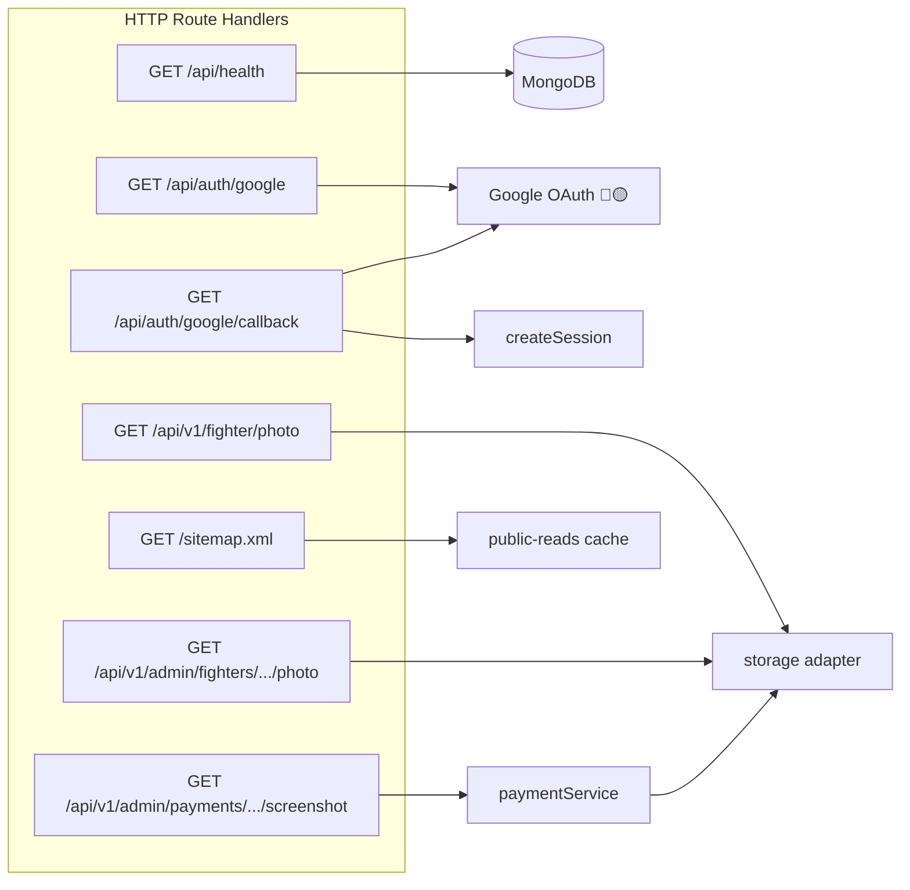

# API Architecture — Up 'n Roll

**Critical distinction:** Product mutations are **Server Actions**, not REST endpoints.  
The large surface in `docs/api/api-contract.md` is a **proposal** and is **not registered** in this codebase.

## Communication surfaces

| Surface | Count (verified) | Status |
|---------|------------------|--------|
| HTTP Route Handlers (`route.ts`) | 7 including sitemap | 🟢 |
| Server Action modules | 13 files | 🟢 |
| JSON REST CRUD `/api/v1/events` etc. | 0 implemented | ⚪ proposal |
| External API client wrappers | 0 | — |

---

## D. HTTP endpoints (complete)

| Method | URL | Handler | Auth | Calls | DB / storage | Status |
|--------|-----|---------|------|-------|--------------|--------|
| `GET` | `/api/health` | `frontend/src/app/api/health/route.ts` | None | `connectDB` + ping | Mongo ping | 🟢 |
| `GET` | `/api/auth/google` | `.../api/auth/google/route.ts` | None; needs `GOOGLE_CLIENT_*` | Builds OAuth URL + HMAC state | — | 🟡 env-gated |
| `GET` | `/api/auth/google/callback` | `.../callback/route.ts` | OAuth code + state | Token exchange, upsert user/profile, `createSession` | `users`, `fighterprofiles`, `sessions` | 🟡 env-gated |
| `GET` | `/api/v1/fighter/photo` | `.../fighter/photo/route.ts` | Session + FIGHTER | `getFighterProfile` → storage.get | profile + storage | 🟢 |
| `GET` | `/api/v1/admin/fighters/[userId]/photo` | `.../admin/fighters/[userId]/photo/route.ts` | `requireActor("ADMIN")` | `FighterProfile.findOne` → storage.get | profile + storage | 🟢 |
| `GET` | `/api/v1/admin/payments/[id]/screenshot` | `.../admin/payments/[id]/screenshot/route.ts` | `requireActor("ADMIN")` | `getPaymentScreenshot` | `paymentsubmissions` + storage | 🟢 |
| `GET` | `/sitemap.xml` | `app/sitemap.xml/route.ts` | None | cached public events/fighters | public reads | 🟢 |

No `POST` / `PUT` / `PATCH` / `DELETE` Route Handlers exist.



---

## Server Actions (complete mutation surface)

### Auth — `frontend/src/features/auth/actions.ts`

| Action | Auth | Params (concept) | Service / logic | Writes | Status |
|--------|------|------------------|-----------------|--------|--------|
| `registerAction` | Public + rate limit | email, password, profile fields | User + FighterProfile + verification mail | `users`, `fighterprofiles`, `emailverifications` | 🟢 |
| `loginAction` | Public + rate limit | email, password | password verify + `createSession` | `sessions` | 🟢 |
| `verifyEmailAction` | Public | code | `verificationMail` + session | verification + `sessions` | 🟢 |
| `resendCodeAction` | Public | — | `verificationMail` | `emailverifications` | 🟢 |
| `logoutAction` | Session optional | — | `destroySession` | `sessions` | 🟢 |

### Registrations — `features/registrations/actions.ts`

| Action | Auth | Service | Status |
|--------|------|---------|--------|
| `createRegistrationAction` | Session | `updateFighterProfile`, `saveProfilePhoto`, `createRegistration` | 🟢 |
| `withdrawRegistrationAction` | ADMIN | `withdrawRegistration` | 🟢 |

### Payments

| Action | File | Auth | Service | Status |
|--------|------|------|---------|--------|
| `submitPaymentAction` | `features/payments/actions.ts` | Session | `submitPayment` | 🟢 |
| `approvePaymentAction` | `features/admin-payments/actions.ts` | ADMIN | `approvePayment` | 🟢 |
| `rejectPaymentAction` | `features/admin-payments/actions.ts` | ADMIN | `rejectPayment` | 🟢 |

### Events — `features/events/actions.ts`

| Action | Auth | Service | Status |
|--------|------|---------|--------|
| `createEventAction` | ADMIN | `createEvent` | 🟢 |
| `createDivisionAction` | ADMIN | `createDivision` | 🟢 |
| `updateEventStatusAction` | ADMIN | `updateEventStatus` | 🟢 |
| `updateEventMatCountAction` | ADMIN | `updateEventMatCount` | 🟢 |

### Brackets — `features/brackets/actions.ts`

| Action | Auth | Service | Status |
|--------|------|---------|--------|
| `generateBracketAction` | ADMIN | `generateBracket` | 🟢 |
| `publishBracketAction` | ADMIN | `publishBracket` | 🟢 |

### Matches — `features/matches/actions.ts`

| Action | Auth | Service | Status |
|--------|------|---------|--------|
| `recordResultAction` | ADMIN | `recordMatchResult` | 🟢 |
| `correctResultAction` | ADMIN | `correctMatchResult` | 🟢 |
| `updateScheduleAction` | ADMIN | `updateMatchSchedule` | 🟢 |

### Requests / transfers — `features/requests/actions.ts`

| Action | Auth | Service | Status |
|--------|------|---------|--------|
| `createRequestAction` | Session | `createRequest` | 🟢 |
| `decideRequestAction` | ADMIN | `decideRequest` | 🟢 |
| `createTeammateTransferAction` | Session | `createTeammateTransfer` | 🟢 |
| `claimTeammateTransferAction` | Session | `claimTeammateTransfer` | 🟢 |

### Profile / rankings / content / media / chatbot

| Action | File | Auth | Service | Status |
|--------|------|------|---------|--------|
| `updateProfileAction` | `profile/actions.ts` | Session | `updateFighterProfile`, `saveProfilePhoto` | 🟢 |
| `recalculateRankingsAction` | `rankings/actions.ts` | ADMIN | `recalculateRankings` | 🟢 |
| `createContentAction` | `content/actions.ts` | ADMIN | `createContentEntry` | 🟢 |
| `publishContentAction` | `content/actions.ts` | ADMIN | `setContentPublicationState` | 🟢 |
| `createMediaAction` | `media/actions.ts` | ADMIN | `createMediaAsset` | 🟢 |
| `askChatbotAction` | `chatbot/ask-chatbot-action.ts` | Public | `matchFaq` + cached FAQ | 🟢 local matcher |

---

## C / D. Action → module map

```mermaid
flowchart TB
  subgraph SA["Server Actions"]
    authA[auth]
    regA[registrations]
    payA[payments]
    evA[events]
    brA[brackets]
    mA[matches]
    rqA[requests]
    prA[profile]
    rkA[rankings]
    cA[content/media]
    chA[chatbot]
  end

  subgraph Svc["backend/services"]
    verificationMail
    registrationService
    paymentService
    eventService
    bracketService
    matchService
    requestService
    teammateTransfer
    fighterService
    rankingService
    contentService
    mediaService
    chatbotEngine
    profilePhoto
  end

  authA --> verificationMail
  regA --> registrationService
  regA --> fighterService
  regA --> profilePhoto
  payA --> paymentService
  evA --> eventService
  brA --> bracketService
  mA --> matchService
  rqA --> requestService
  rqA --> teammateTransfer
  prA --> fighterService
  prA --> profilePhoto
  rkA --> rankingService
  cA --> contentService
  cA --> mediaService
  chA --> chatbotEngine
```



---

## Not APIs (do not mislabel)

| Kind | Examples |
|------|----------|
| RSC service imports | `listPublicEvents`, `getAdminDashboardData`, `listPaymentQueue` |
| Pure helpers | `paymentQueue.flagDuplicateUtrs`, `bracketEngine`, `rankingEngine` |
| Proposed REST | Entire `docs/api/api-contract.md` catalog |

### Service without Server Action wrapper

| Function | Notes | Status |
|----------|-------|--------|
| `setDivisionCapacity` | Test / internal usage only | ⚪ no UI action |

---

## Middleware / auth on the wire

| Layer | File | Behavior |
|-------|------|----------|
| Security headers | `frontend/next.config.ts` | nosniff, referrer, frame deny, CSP Report-Only |
| Proxy | `frontend/src/proxy.ts` | Cookie presence for `/fighter/*`, `/admin/*` |
| Layout | portal layouts | `getSession` + role |
| Action/handler | each mutation / binary GET | `requireSession` / `requireActor` |
| Rate limit | `backend/http/rateLimit.ts` | In-memory; register/login |

---

## Example traces

```
Login Page
  → loginAction
  → password verify (User)
  → createSession
  → sessions + cookie
  → redirect /admin | /fighter/dashboard

Payment Page
  → submitPaymentAction
  → paymentService.submitPayment
  → storage.put(screenshot)
  → paymentsubmissions + registrations
  → Admin Payment Queue

Admin Approve
  → approvePaymentAction
  → paymentService.approvePayment
  → registrations CONFIRMED
  → auditlogs + email adapter
```
