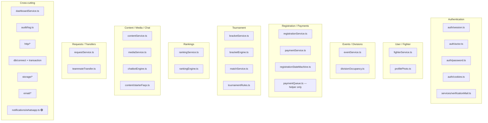
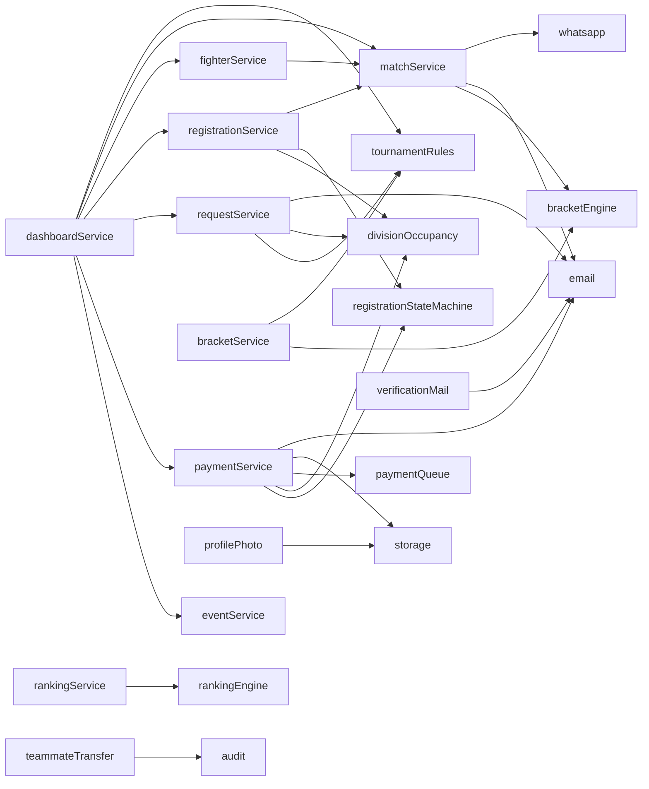

# Backend Architecture — Up 'n Roll

Location: `d:\upnrol\backend\`  
Imported by the Next.js app as `@/server/*` (`frontend/tsconfig.json`).  
**Not** a separate Express/Nest/Fastify process.

## Module map (domain)

---

## Module catalog

### Authentication

| Item | Detail |
|------|--------|
| Responsibilities | Cookie sessions, password hashing, role actors, email verification |
| Handlers | Auth Server Actions; Google OAuth routes |
| Services | `auth/session`, `verificationMail` |
| Models | `User`, `Session`, `EmailVerification`, `FighterProfile` (register) |
| Consumers | All portals; every `requireActor` call site |
| Status | 🟢 (Google OAuth 🟡) |

### User Management

| Item | Detail |
|------|--------|
| Responsibilities | Public/admin fighter views, profile updates, photo keys |
| Services | `fighterService`, `profilePhoto` |
| Models | `FighterProfile`, `User` |
| Storage | via `getStorageAdapter()` |
| Consumers | Profile/registration actions; photo routes; rankings/public pages |
| Status | 🟢 |

### Events & Divisions

| Item | Detail |
|------|--------|
| Responsibilities | Create/list events, divisions, status, mat count, occupancy |
| Services | `eventService`, `divisionOccupancy` |
| Models | `Event`, `Division` |
| Consumers | Public events pages; admin events; registration eligibility |
| Status | 🟢 |
| Partial | `Event.paymentInstructions.qrImageKey` always `""` at create — 🟡 unused storage path |

### Registration & Payments

| Item | Detail |
|------|--------|
| Responsibilities | Register, withdraw, UTR+screenshot submit, admin approve/reject |
| Services | `registrationService`, `paymentService`, `registrationStateMachine`, `paymentQueue` |
| Models | `Registration`, `PaymentSubmission`, `Division`, `Event`, `User` |
| External | Email on review; storage for screenshots |
| Consumers | Fighter registration/payment pages; admin payments |
| Status | 🟢 offline payment flow (no Stripe) |

### Requests & Transfers

| Item | Detail |
|------|--------|
| Responsibilities | Cancellation/transfer requests; teammate invite tokens |
| Services | `requestService`, `teammateTransfer` |
| Models | `RegistrationRequest`, `TransferInvite`, `Registration` |
| Consumers | Fighter requests; admin requests; transfer claim page |
| Status | 🟢 |

### Tournament / Brackets / Matches

| Item | Detail |
|------|--------|
| Responsibilities | Generate/publish brackets; schedule; record/correct results |
| Services | `bracketService`, `matchService` |
| Engines | `bracketEngine`, `tournamentRules` (pure) |
| Models | `Bracket`, `Match`, `Registration`, `Division`, `Event` |
| Side effects | Email + WhatsApp stub on schedule/result paths |
| Status | 🟢 (WhatsApp 🟣) |

### Rankings

| Item | Detail |
|------|--------|
| Responsibilities | Recalculate global points; public list |
| Services | `rankingService`, `rankingEngine` |
| Models | `RankingRecord`, `Match`, `Registration`, `FighterProfile` |
| Consumers | `/rankings`, `/admin/rankings` |
| Status | 🟢 synchronous (no job queue) |

### Content / Media / Chatbot

| Item | Detail |
|------|--------|
| Responsibilities | FAQ/announcement/policy CMS; media URL captions; FAQ keyword match |
| Services | `contentService`, `mediaService`, `chatbotEngine` |
| Models | `ContentEntry`, `MediaAsset` |
| AI | **None** — local matcher only |
| Status | 🟢 |

### File Management

| Item | Detail |
|------|--------|
| Responsibilities | Private put/get for photos and payment screenshots |
| Modules | `storage/factory`, `local-disk`, `gridfs`, `keys`, `types` |
| Consumers | `profilePhoto`, `paymentService`, photo/screenshot routes |
| Status | 🟢 adapters; production requires explicit `STORAGE_DRIVER` |

### Admin / Dashboard / Audit

| Item | Detail |
|------|--------|
| Responsibilities | Compose portal home; append-only audit |
| Services | `dashboardService`, `audit/log` |
| Models | `AuditLog` (+ composed services) |
| Status | 🟢 |

### Background Jobs

| Item | Reality | Status |
|------|---------|--------|
| Cron / BullMQ / Agenda | Not present | ⚪ |
| `paymentQueue.ts` | Duplicate UTR flagging helper | 🟢 misnamed, not a queue |
| Rankings | Inline in admin action | 🟢 |
| CLI scripts | `scripts/create-admin.ts`, `seed-demo.ts`, `backfill-division-occupancy.ts` | 🟢 one-shot |

---

## E. Service dependency map

Directional arrows = verified imports / call sites. Bidirectional I/O with Mongo is via models inside each service (see DATABASE doc).

---

## HTTP helpers (not domain)

| Module | Role |
|--------|------|
| `http/errors.ts` | `AppError` types |
| `http/response.ts` | JSON envelope for routes |
| `http/rateLimit.ts` | In-memory limiter |
| `http/clientIp.ts` | IP extraction |

---

## Consumers matrix (who calls what)

| Module | Pages / actions that consume it |
|--------|----------------------------------|
| Auth | `/login`, `/register`, `/verify`, Google routes, logout in layouts |
| Fighter | Profile, registration create, admin fighters, public fighter pages, photo APIs |
| Events | Public events*, admin events*, registration eligibility |
| Registration/Payment | Fighter regs/payment, admin payments/withdraw |
| Brackets/Matches | Admin brackets/matches, public brackets/schedule/results, fighter matches |
| Rankings | `/rankings`, admin rankings |
| Requests | Fighter + admin requests, transfer page |
| Content/Media/Chat | FAQ/announcements/policies, admin content/media, ChatbotWidget |
| Dashboard | `/admin`, `/fighter/dashboard` |
| Audit | Written by many mutations; read on admin dashboard |

---

## Import boundary

`backend/services/import-boundary.test.ts` enforces server-side import rules. Client components must not import `@/server/**`.
