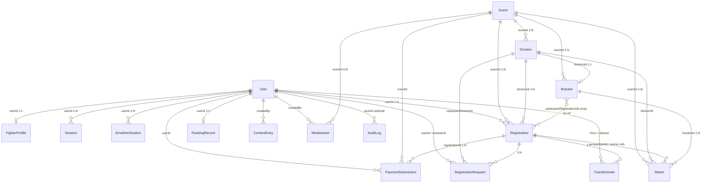
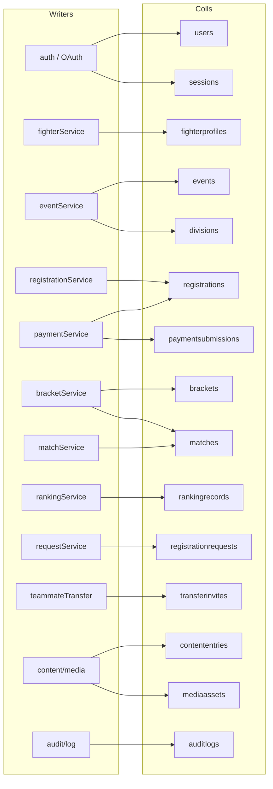

# Database Architecture — Up 'n Roll

| Item | Verified |
|------|----------|
| Engine | MongoDB |
| ODM | Mongoose `^9.3.0` |
| Connect | `backend/db/connect.ts` via `MONGODB_URI` |
| Transactions | `backend/db/transaction.ts` |
| Explicit `collection:` overrides | **None** — Mongoose default pluralization |

> **Doc drift:** `docs/architecture/data-model.md` uses snake_case names (`fighter_profiles`).  
> Actual collections below use Mongoose defaults (`fighterprofiles`, etc.).

---

## Collection nodes (16 + optional GridFS)

| Collection | Model file | Important fields | Indexes / constraints | Status |
|------------|------------|------------------|-----------------------|--------|
| `users` | `backend/models/User.ts` | email, passwordHash, role `FIGHTER\|ADMIN`, status, emailVerified | unique email | 🟢 |
| `sessions` | `Session.ts` | userId, tokenHash, expiresAt, userAgent | userId; unique tokenHash; TTL on expiresAt | 🟢 |
| `emailverifications` | `EmailVerification.ts` | userId, codeHash, expiresAt | userId | 🟢 |
| `fighterprofiles` | `FighterProfile.ts` | userId, displayName, slug, PII, photoKey, waiver… | unique userId, unique slug | 🟢 |
| `events` | `Event.ts` | name, slug, venue, dates, status, matCount, embedded paymentInstructions | unique slug | 🟢 |
| `divisions` | `Division.ts` | eventId, name, discipline, capacity, filledCount | eventId | 🟢 |
| `registrations` | `Registration.ts` | userId, eventId, divisionId, status, consent, statusHistory[] | FKs; partial unique `{userId,divisionId}` for active | 🟢 |
| `paymentsubmissions` | `PaymentSubmission.ts` | registrationId, userId, eventId, UTR, screenshotStorageKey, review | registrationId, userId, submittedUtr | 🟢 |
| `brackets` | `Bracket.ts` | eventId, divisionId, format, seed, participantRegistrationIds[], status | unique divisionId | 🟢 |
| `matches` | `Match.ts` | event/division/bracket, round/order, competitors, winner, schedule, correctionHistory[] | unique `{bracketId,round,order}`; status | 🟢 |
| `rankingrecords` | `RankingRecord.ts` | userId, scope GLOBAL, wins/losses/points, version | unique userId; points/wins | 🟢 |
| `registrationrequests` | `RegistrationRequest.ts` | type CANCEL/TRANSFER, registrationId, reason, review, refundPercent | registrationId, userId | 🟢 |
| `transferinvites` | `TransferInvite.ts` | token, registrationId, fromUserId, claimedByUserId | unique token; registrationId | 🟢 |
| `contententries` | `ContentEntry.ts` | type FAQ/ANNOUNCEMENT/POLICY, title, body, publicationState, createdBy | `{type,publicationState}` | 🟢 |
| `mediaassets` | `MediaAsset.ts` | eventId?, caption, externalUrl, publicationState, createdBy | — | 🟢 |
| `auditlogs` | `AuditLog.ts` | actorId?, action, targetType, targetId?, before/after | none explicit | 🟢 |
| `privateFiles.files` / `.chunks` | GridFS bucket | Binary blobs when `STORAGE_DRIVER=gridfs` | GridFS defaults | 🟢 adapter / 🟡 env |

No orphaned models — all 16 are read/written.

---

## G. Entity relationship map



### Relationship types (verified)

| From → To | Cardinality | Mechanism |
|-----------|-------------|-----------|
| User → FighterProfile | 1:1 | `ref` + unique userId |
| Event → Division | 1:N | `ref` eventId |
| Division → Bracket | 1:1 | unique divisionId |
| Registration → PaymentSubmission | 1:N | `ref` |
| Bracket → participants | 1:N ids | ObjectId array **without** Mongoose `ref` |
| Match → Registration | N:1 | competitor/winner refs |
| Registration.statusHistory | embedded | array of `{status,at}` |
| Match.correctionHistory | embedded | sub-schema `_id:false` |
| Event.paymentInstructions | embedded | `{ feeMinorUnits, currency, qrImageKey }` |

---

## F. Service ↔ collection matrix

| Collection | Readers (services / modules) | Writers |
|------------|------------------------------|---------|
| `users` | session, fighter, registration, match, request, payment, content, audit | auth actions, Google callback, create-admin, verificationMail |
| `sessions` | auth/session | createSession / destroySession |
| `emailverifications` | verificationMail | verificationMail |
| `fighterprofiles` | fighter, registration, match, bracket, ranking, dashboard, photo routes | auth, Google callback, fighterService, profilePhoto |
| `events` | event, registration, payment, match, bracket, request, public pages | eventService, seed-demo |
| `divisions` | event, registration, occupancy, bracket, request | eventService, divisionOccupancy, backfill script |
| `registrations` | registration, payment, request, transfer, match, bracket, ranking | registration, payment, request, transfer |
| `paymentsubmissions` | paymentService, admin UI | paymentService, registration create stub |
| `brackets` | bracketService, public reads | bracketService |
| `matches` | match, bracket, event completion, ranking, registration, public | bracket generate, matchService |
| `rankingrecords` | rankingService, public rankings | rankingService |
| `registrationrequests` | requestService | requestService |
| `transferinvites` | teammateTransfer | teammateTransfer |
| `contententries` | contentService, chatbot, public pages | contentService (+ starter FAQs) |
| `mediaassets` | mediaService, event detail | mediaService |
| `auditlogs` | dashboard (recent) | audit/log from many services |
| GridFS / local files | storage.get | storage.put (photos, screenshots) |



---

## Intentionally absent

| Doc concept | Code reality |
|-------------|--------------|
| `notifications` collection | No model — email/WhatsApp only |
| `GUEST` role | Not in User enum |
| Payment revision history array | Not in PaymentSubmission schema |
| Division weight/age taxonomy | Not modeled yet |

---

## Reverse trace example

```
rankingrecords
  ← RankingRecord model
  ← rankingService.recalculateRankings / listPublicRankings
  ← recalculateRankingsAction + /rankings page + /admin/rankings
```
