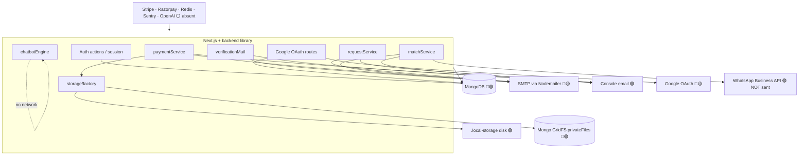

# External Integrations — Up 'n Roll

Verified call sites under `backend/` and `frontend/`.  
Legend: 🟢 fully wired · 🟡 partial · 🔴 broken · ⚪ unused · 🔵 external · 🟣 mocked

---

## H. Integration map

---

## Provider catalog

### MongoDB 🔵🟢

| Item | Detail |
|------|--------|
| Module | `backend/db/connect.ts` |
| Env | `MONGODB_URI` (required via `frontend/src/lib/config.ts`) |
| Used by | All models / services |
| Status | Fully wired |

### Session cryptography 🟢

| Item | Detail |
|------|--------|
| Module | `backend/auth/session.ts`, `cookies.ts`, Google OAuth state |
| Env | `SESSION_SECRET` (≥32 chars) |
| Status | Fully wired |

### Email — SMTP / Nodemailer 🔵🟡

| Item | Detail |
|------|--------|
| Modules | `backend/email/smtp.ts`, `smtp-config.ts`; boot assert `frontend/src/instrumentation.ts` |
| Env | `SMTP_HOST`, `SMTP_PORT`, `SMTP_USER`, `SMTP_PASS`, `SMTP_FROM` |
| Callers | `verificationMail`, `paymentService`, `requestService`, `matchService` |
| Prod | Missing SMTP → process refuses to start |
| Dev | Uses console adapter instead |
| Vendor | Docs may mention SMTP2GO; code is vendor-agnostic Nodemailer |
| Status | Fully implemented; operational status depends on env (🟡 until SMTP configured) |

### Email — Console adapter 🟣

| Item | Detail |
|------|--------|
| Module | `backend/email/console.ts` |
| Behavior | Logs messages; does not send |
| Status | Dev/test mock |

### Google OAuth 🔵🟡

| Item | Detail |
|------|--------|
| Modules | `frontend/src/app/api/auth/google/route.ts`, `.../callback/route.ts`; login page link |
| Env | `GOOGLE_CLIENT_ID`, `GOOGLE_CLIENT_SECRET` |
| Behavior if unset | Soft redirect `/login?google=unavailable` |
| `.env.example` | **Omits** `GOOGLE_*` keys |
| Status | Code complete; configuration partial / undocumented |

### Private file storage — Local disk 🟢

| Item | Detail |
|------|--------|
| Module | `backend/storage/local-disk.ts` |
| Path | Repo `.local-storage/` |
| Selection | Default in non-production when `STORAGE_DRIVER` unset; or `STORAGE_DRIVER=local` |
| Status | Fully wired |

### Private file storage — GridFS 🔵🟢

| Item | Detail |
|------|--------|
| Module | `backend/storage/gridfs.ts` bucket `privateFiles` |
| Selection | `STORAGE_DRIVER=gridfs` |
| Prod | Must set `STORAGE_DRIVER` explicitly (`gridfs` or `local`) |
| Tests | `gridfs.test.ts`, `factory.test.ts` |
| Status | Fully wired in code (older deploy docs claiming “unimplemented” are stale) |

### WhatsApp 🟣

| Item | Detail |
|------|--------|
| Module | `backend/notifications/whatsapp.ts` |
| Caller | `matchService` schedule/result notifications |
| Behavior | `console.log` only — **nothing delivered** |
| Status | Mocked / placeholder |

### FAQ Chatbot (local) 🟢 — not an external AI

| Item | Detail |
|------|--------|
| Module | `backend/services/chatbotEngine.ts` + `askChatbotAction` |
| Behavior | Keyword match against published FAQ content |
| OpenAI / Anthropic | **Not present** |
| Status | Fully wired local feature |

### Manual payments (not a PSP) 🟢

| Item | Detail |
|------|--------|
| Flow | Fighter submits UTR + screenshot; admin reviews |
| Stripe / Razorpay / PayPal | **Absent** (scope excluded) |
| Status | Fully wired offline workflow |

---

## Absent integrations (confirmed not in deps/code)

| Provider class | Status |
|----------------|--------|
| Stripe / Razorpay / PayPal | ⚪ |
| Resend / SendGrid SDKs | ⚪ (SMTP used instead) |
| AWS S3 / Cloudinary upload SDKs | ⚪ |
| Redis / Upstash | ⚪ (in-memory rate limit only) |
| Sentry / OpenTelemetry / PostHog | ⚪ |
| Cloudflare Workers / CDN config | ⚪ |
| Docker / Vercel / Fly / Railway project files | ⚪ |

---

## Infrastructure & deployment nodes

| Node | Path / evidence | Status |
|------|-----------------|--------|
| GitHub Actions CI | `.github/workflows/ci.yml` — tsc, vitest, next build | 🟢 |
| Health check | `GET /api/health` | 🟢 |
| Admin seed CLI | `scripts/create-admin.ts` + `ADMIN_SEED_*` | 🟢 |
| Demo seed | `scripts/seed-demo.ts` | 🟢 |
| Occupancy backfill | `scripts/backfill-division-occupancy.ts` | 🟢 |
| Docker / compose | None | ⚪ |
| Hosting provider lock-in | Unresolved in repo | ⚪ |
| Deploy docs | `docs/deployment/*` | 🟡 partially stale vs GridFS |

---

## Env var integration matrix

| Variable | Required for | Status |
|----------|--------------|--------|
| `MONGODB_URI` | Boot | 🟢 |
| `SESSION_SECRET` | Boot | 🟢 |
| `SMTP_*` | Production email | 🟡 |
| `STORAGE_DRIVER` | Production storage selection | 🟡 |
| `GOOGLE_CLIENT_ID/SECRET` | Google login | 🟡 undocumented in `.env.example` |
| `ADMIN_SEED_EMAIL/PASSWORD` | CLI only | 🟢 |
| `UI_PREVIEW_ENABLED` | `/ui-preview` outside local | 🟡 |
| `CI` | Prerender short-circuit | 🟢 |

No `NEXT_PUBLIC_*` variables found in frontend source.
