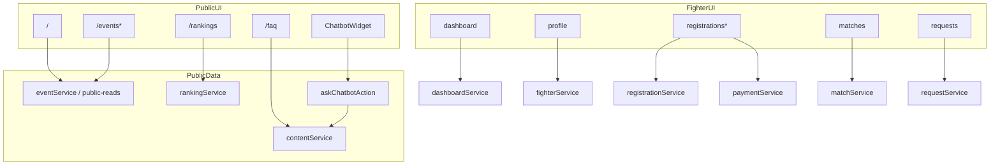
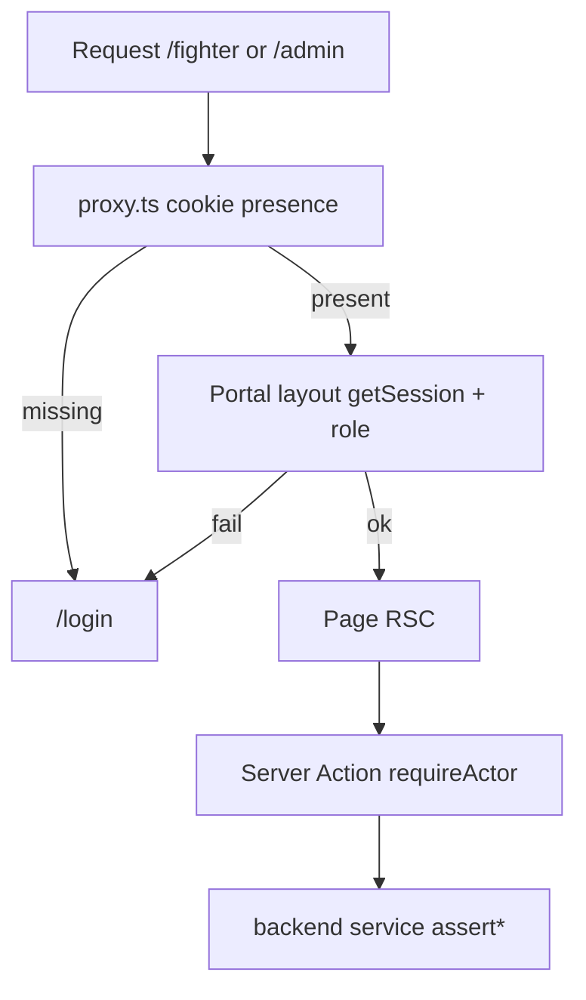

# Frontend Architecture — Up 'n Roll

Verified from `frontend/src/app/**/page.tsx`, layouts, feature modules, and imports.  
Alias: `@/*` → `frontend/src/*`; `@/server/*` → `backend/*`.

## Stack

| Item | Value | Status |
|------|-------|--------|
| Next.js App Router | 16.1.6 under `frontend/` | 🟢 |
| React | 19.2.3 | 🟢 |
| Pages Router | Not present | — |
| Styling | Tailwind 4 + shadcn/Radix | 🟢 |
| Middleware | `frontend/src/proxy.ts` (Next 16 proxy) | 🟢 |
| Data access | Direct `@/server` + Server Actions (no axios client) | 🟢 |

---

## Route groups (URL does not include group name)

| Group | Layout | Auth |
|-------|--------|------|
| `(public)` | `SiteHeader`, `SiteFooter`, `ChatbotWidget` | None |
| `(auth)` | Branded centered panel | None |
| `(fighter)` | `fighter/layout.tsx` + `FighterNav` | Cookie + `FIGHTER` |
| `(admin)` | `admin/layout.tsx` + `AdminNav` | Cookie + `ADMIN` |
| `(preview)` | None special | Env gate |

---

## B. Every page node

### Public pages

| Route | File | Main components | Data / actions | Auth | DB / services | Status |
|-------|------|-----------------|----------------|------|---------------|--------|
| `/` | `(public)/page.tsx` | `HomeHero`, `MangaCards`, `FightingGallery`, `HappyStack`, `AboutStory`, `EventPitchPopup` | `listPublicEvents` | Public | `events` | 🟢 |
| `/events` | `(public)/events/page.tsx` | `EventPoster`, `EventStory` | `listPublicEvents`, `listDivisionsForEvent` | Public | `events`, `divisions` | 🟢 |
| `/events/[slug]` | `events/[slug]/page.tsx` | `HeldRecord`, `SuperfightLanding` | `getEventBySlug`, divisions, results, media | Public | `events`, `divisions`, `matches`, `mediaassets` | 🟢 |
| `/events/[slug]/brackets` | `.../brackets/page.tsx` | `BracketView` | `cachedPublicEvent/Divisions/Bracket` | Public | `events`, `divisions`, `brackets` | 🟢 |
| `/events/[slug]/schedule` | `.../schedule/page.tsx` | Table/Badge | `cachedPublicSchedule` | Public | `matches` | 🟢 |
| `/events/[slug]/results` | `.../results/page.tsx` | Table | `cachedPublicResults` | Public | `matches` | 🟢 |
| `/events/held/[slug]` | `events/held/[slug]/page.tsx` | `HeldRecord` | Static `HELD_ARCHIVE` only | Public | None (fixture) | 🟡 only one slug |
| `/fighters` | `fighters/page.tsx` | — | `redirect("/rankings")` | Public | — | ⚪ redirect-only |
| `/fighters/[slug]` | `fighters/[slug]/page.tsx` | Table / held-card fallback | `getPublicFighterBySlug` | Public | `fighterprofiles`, `users` | 🟢 |
| `/rankings` | `rankings/page.tsx` | `AthleteProfileCard` | `listPublicRankings`, fighters, held athletes | Public | `rankingrecords`, profiles | 🟢 |
| `/rankings/demo` | `rankings/demo/page.tsx` | `RankingDemo` | Fixture UI | Public / noindex | None | ⚪ demo |
| `/brackets` | `brackets/page.tsx` | `BracketView`, `LiveRefresh` | public events/divisions/brackets/schedule | Public | multiple | 🟢 |
| `/faq` | `faq/page.tsx` | `FaqBoard` | `listPublished("FAQ")` | Public | `contententries` | 🟢 |
| `/about` | `about/page.tsx` | `AboutStory` | `listPublicEvents` | Public | `events` | 🟢 |
| `/announcements` | `announcements/page.tsx` | — | `cachedPublishedContent("ANNOUNCEMENT")` | Public | `contententries` | 🟢 |
| `/policies` | `policies/page.tsx` | — | `cachedPublishedContent("POLICY")` | Public | `contententries` | 🟢 |
| `/store` | `store/page.tsx` | `ComingSoon` | None | Public | — | ⚪ |
| `/seminars` | `seminars/page.tsx` | `ComingSoon` | None | Public | — | ⚪ |

### Auth pages

| Route | File | Components | Actions | Auth | Collections | Status |
|-------|------|------------|---------|------|-------------|--------|
| `/login` | `(auth)/login/page.tsx` | `LoginForm` | `loginAction`; link `GET /api/auth/google` | Public | `users`, `sessions` | 🟢 (Google 🟡) |
| `/register` | `(auth)/register/page.tsx` | `RegisterForm` | `registerAction` | Public | `users`, `fighterprofiles`, `emailverifications` | 🟢 |
| `/verify` | `(auth)/verify/page.tsx` | `VerifyForm` | `verifyEmailAction`, `resendCodeAction` | Public | `emailverifications`, `sessions` | 🟢 |

### Fighter portal

| Route | File | Components | Data / actions | Auth | Services | Status |
|-------|------|------------|----------------|------|----------|--------|
| `/fighter/dashboard` | `dashboard/page.tsx` | Badge, Link | `getFighterDashboardData` | FIGHTER | `dashboardService` | 🟢 |
| `/fighter/profile` | `profile/page.tsx` | `ProfileForm` | `getFighterProfile`, `updateProfileAction` | FIGHTER | `fighterService`, `profilePhoto` | 🟢 |
| `/fighter/registrations` | `registrations/page.tsx` | Badge/Button | `listMyRegistrations` | FIGHTER | `registrationService` | 🟢 |
| `/fighter/registrations/new` | `registrations/new/page.tsx` | `NewRegistrationForm` | open divisions + `createRegistrationAction` | FIGHTER | registration + fighter | 🟢 |
| `/fighter/registrations/[id]/payment` | `.../payment/page.tsx` | `PaymentForm` | `getRegistrationForFighter`, `submitPaymentAction` | FIGHTER | `paymentService` + storage | 🟢 |
| `/fighter/matches` | `matches/page.tsx` | Badge | `listMatchesForFighter` | FIGHTER | `matchService` | 🟢 |
| `/fighter/requests` | `requests/page.tsx` | `CreateRequestDialog`, `TeammateTransferButton` | list regs/requests + request/transfer actions | FIGHTER | `requestService`, `teammateTransfer` | 🟢 |
| `/fighter/transfer/[token]` | `transfer/[token]/page.tsx` | Client form | `claimTeammateTransferAction` | FIGHTER | `teammateTransfer` | 🟢 |

### Admin portal

| Route | File | Components | Data / actions | Auth | Services | Status |
|-------|------|------------|----------------|------|----------|--------|
| `/admin` | `admin/page.tsx` | Badge, Link | `getAdminDashboardData` | ADMIN | `dashboardService` | 🟢 |
| `/admin/events` | `events/page.tsx` | `CreateEventForm` | `listEventsForAdmin`, `createEventAction` | ADMIN | `eventService` | 🟢 |
| `/admin/events/[id]` | `events/[id]/page.tsx` | status/mat/withdraw forms | event + regs + actions | ADMIN | event + registration | 🟢 |
| `/admin/events/[id]/divisions` | `.../divisions/page.tsx` | `CreateDivisionForm` | `createDivisionAction` | ADMIN | `eventService` | 🟢 |
| `/admin/events/[id]/brackets` | `.../brackets/page.tsx` | `ParticipantOrderForm`, `PublishBracketButton`, `BracketView` | generate/publish actions | ADMIN | `bracketService` | 🟢 |
| `/admin/events/[id]/matches` | `.../matches/page.tsx` | `MatchResultDialog`, `ScheduleMatchDialog` | result/schedule actions | ADMIN | `matchService` | 🟢 |
| `/admin/fighters` | `fighters/page.tsx` | `FighterRecord` | `listFightersForAdmin`; img → photo API | ADMIN | `fighterService` + storage HTTP | 🟢 |
| `/admin/payments` | `payments/page.tsx` | `PaymentReviewDialog` | queue + approve/reject; screenshot API | ADMIN | `paymentService` | 🟢 |
| `/admin/requests` | `requests/page.tsx` | `DecideRequestDialog` | `decideRequestAction` | ADMIN | `requestService` | 🟢 |
| `/admin/rankings` | `rankings/page.tsx` | `RecalculateRankingsButton` | public list + `recalculateRankingsAction` | ADMIN | `rankingService` | 🟢 |
| `/admin/content` | `content/page.tsx` | `CreateContentForm`, `PublishToggleButton` | content actions | ADMIN | `contentService` | 🟢 |
| `/admin/media` | `media/page.tsx` | `CreateMediaForm` | `createMediaAction` | ADMIN | `mediaService` | 🟢 |

### Preview

| Route | File | Notes | Status |
|-------|------|-------|--------|
| `/ui-preview` | `(preview)/ui-preview/page.tsx` | Allowed if not production **or** `UI_PREVIEW_ENABLED=true`; else `notFound()` | 🟡 |

### Special routes (not pages)

| Path | File | Status |
|------|------|--------|
| `/robots.txt` | `app/robots.ts` | 🟢 |
| `/sitemap.xml` | `app/sitemap.xml/route.ts` | 🟢 |
| `loading` / `error` / `not-found` | root + portal variants | 🟢 |

---

## Frontend → dependency map (by portal)

---

## Shared UI nodes

| Node | Path | Role | Status |
|------|------|------|--------|
| Root layout | `app/layout.tsx` | Fonts, Providers, JSON-LD | 🟢 |
| Providers | `components/Providers.tsx` | Tooltip + Toaster | 🟢 |
| SiteHeader / Footer | `components/layout/*` | Public chrome | 🟢 |
| FighterNav / AdminNav | `features/*/…-nav.tsx` | Portal chrome | 🟢 |
| DynamicBoundary | `components/dynamic-boundary.tsx` | Suspense for auth shells | 🟢 |
| shadcn UI | `components/ui/*` | Primitives | 🟢 |
| ChatbotWidget | `features/chatbot/chatbot-widget.tsx` | Public FAQ matcher UI | 🟢 |

### Orphaned UI (exists, not wired to a page)

| Component | Status |
|-----------|--------|
| `components/home/home-live.tsx` | ⚪ unreferenced |
| `components/home/home-glimpse.tsx` | ⚪ unreferenced |

---

## Auth gate wiring

Cookie: `upnroll_session` (`backend/auth/cookie-name.ts`).  
HMAC + hashed token in `sessions` collection. Not Clerk / NextAuth.

---

## Caching layer

| Module | Role | Status |
|--------|------|--------|
| `src/lib/public-reads.ts` | `"use cache"` wrappers + tags | 🟢 |
| `src/lib/public-tags.ts` | `invalidatePublicTags` after mutations | 🟢 |
| CI short-circuit | `CI` env skips DB during prerender | 🟢 |

---

## Navigation notes (verified)

- Header links: Events, Seminars, Brackets, Rankings, FAQ, About, Store — all resolve; Seminars/Store are placeholders.
- Footer: Announcements, Policies — not in header.
- `/fighters` is not a listing page; sitemap still lists `/fighters`.
