# System Architecture Map — Up 'n Roll

> Generated from the **current codebase** (verified imports, routes, models, and call sites).  
> Not an idealized target design. Last audited: 2026-11-09.

## How to read this map

This app is a **single Next.js 16 process**. `frontend/` is the App Router UI; `backend/` is a colocated server library imported as `@/server/*`. There is **no separate HTTP API server** for most product flows.

Primary communication patterns:

| Pattern | Used for | Status |
|---------|----------|--------|
| Server Component → `@/server/services/*` | Page data loads | Fully wired |
| Server Action (`"use server"`) → services | Mutations | Fully wired |
| Route Handler (`route.ts`) | Health, Google OAuth, binary GETs | Fully wired (limited surface) |
| REST `/api/v1/*` JSON CRUD | Documented in `docs/api/api-contract.md` | **Proposal only — not implemented** |

### Integration status legend

| Marker | Meaning |
|--------|---------|
| 🟢 | Fully connected and verified in source |
| 🟡 | Partially connected (env-gated, soft-fail, or incomplete workflow) |
| 🔴 | Broken or disconnected |
| ⚪ | Unused / unreferenced / placeholder page |
| 🔵 | External dependency |
| 🟣 | Mocked / console stand-in |

### Document index

| Document | Contents |
|----------|----------|
| [FRONTEND_ARCHITECTURE.md](./FRONTEND_ARCHITECTURE.md) | Pages, routes, components, auth gates |
| [API_ARCHITECTURE.md](./API_ARCHITECTURE.md) | HTTP routes + Server Actions (separated) |
| [BACKEND_ARCHITECTURE.md](./BACKEND_ARCHITECTURE.md) | Modules, services, dependencies |
| [DATABASE_ARCHITECTURE.md](./DATABASE_ARCHITECTURE.md) | Models, collections, ER relationships |
| [EXTERNAL_INTEGRATIONS.md](./EXTERNAL_INTEGRATIONS.md) | SMTP, Google, storage, WhatsApp stub |
| [SYSTEM_INTEGRATION_AUDIT.md](./SYSTEM_INTEGRATION_AUDIT.md) | Disconnected / mocked / unused inventory |
| [system-overview.md](./system-overview.md) | Older conceptual overview (partially stale) |
| [route-map.md](./route-map.md) | Older route notes (partially stale) |
| [data-model.md](./data-model.md) | Older data notes (collection names drift) |
| [folder-structure.md](./folder-structure.md) | Older layout notes (stale on `backend/`) |

---

## A. Complete System Mind Map

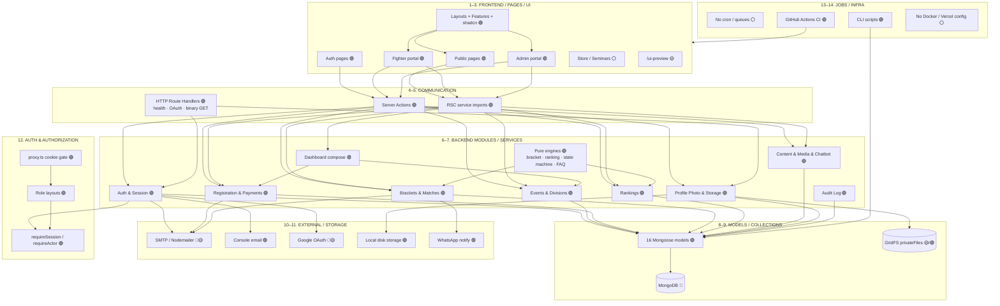

---

## B. Frontend Pages & Component Map

See full page inventory in [FRONTEND_ARCHITECTURE.md](./FRONTEND_ARCHITECTURE.md).

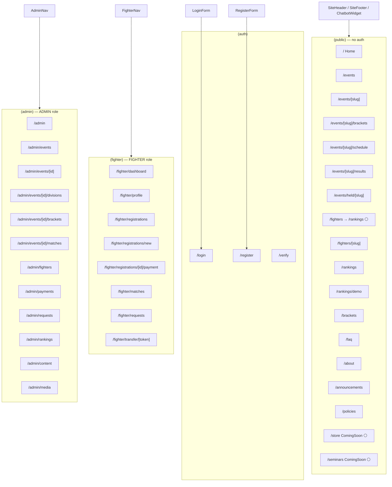

---

## C. Frontend → API / Action Connection Map

Most pages do **not** call HTTP APIs. They call services or Server Actions.

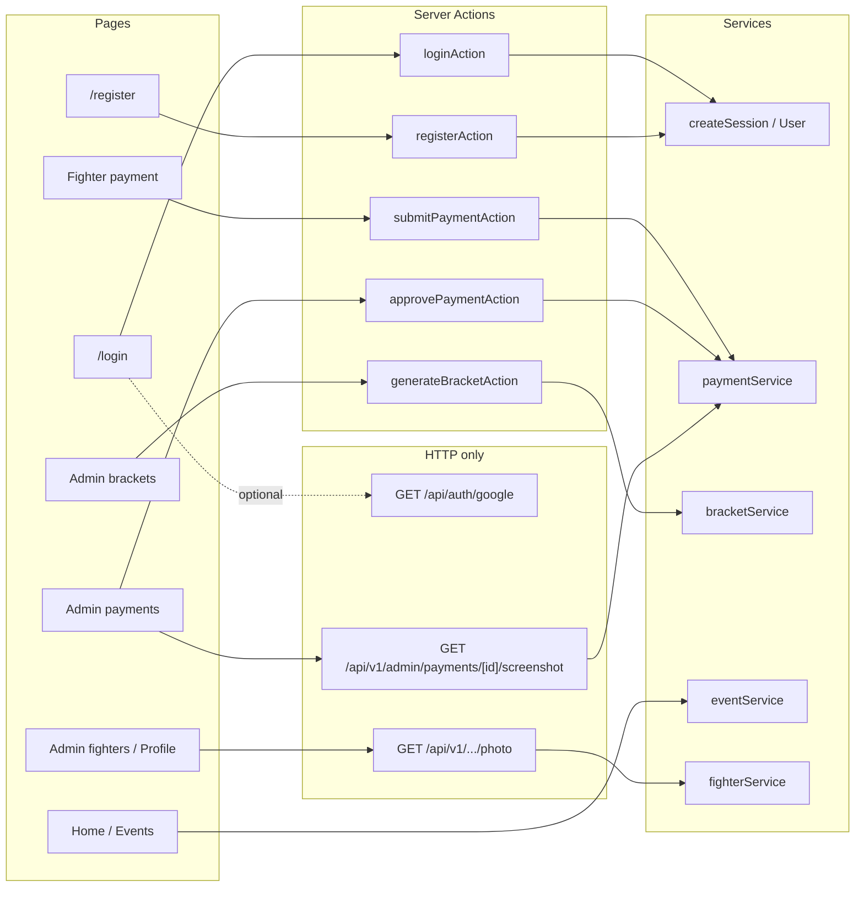

Full tables: [API_ARCHITECTURE.md](./API_ARCHITECTURE.md), [FRONTEND_ARCHITECTURE.md](./FRONTEND_ARCHITECTURE.md).

---

## D. API → Backend Module Map

```mermaid
flowchart TB
  subgraph HTTPHandlers["Route Handlers"]
    H1["/api/health"]
    H2["/api/auth/google*"]
    H3["/api/v1/fighter/photo"]
    H4["/api/v1/admin/fighters/[userId]/photo"]
    H5["/api/v1/admin/payments/[id]/screenshot"]
  end

  subgraph ActionDomains["Server Action domains"]
    AAuth["auth/actions"]
    AReg["registrations/actions"]
    APay["payments + admin-payments"]
    AEv["events/actions"]
    ABr["brackets/actions"]
    AMatch["matches/actions"]
    AReq["requests/actions"]
    AProf["profile/actions"]
    ARank["rankings/actions"]
    ACont["content/actions"]
    AMedia["media/actions"]
    AChat["askChatbotAction"]
  end

  subgraph Modules["backend/"]
    MAuth["auth/* + verificationMail"]
    MFight["fighterService + profilePhoto"]
    MEvent["eventService + divisionOccupancy"]
    MReg["registrationService + stateMachine"]
    MPay["paymentService + paymentQueue helper"]
    MBr["bracketService + bracketEngine"]
    MMatch["matchService"]
    MReq["requestService + teammateTransfer"]
    MRank["rankingService + rankingEngine"]
    MCont["contentService + mediaService + chatbotEngine"]
    MStor["storage/*"]
  end

  H1 --> MAuth
  H2 --> MAuth
  H3 --> MFight --> MStor
  H4 --> MFight --> MStor
  H5 --> MPay --> MStor

  AAuth --> MAuth
  AReg --> MReg
  AReg --> MFight
  APay --> MPay
  AEv --> MEvent
  ABr --> MBr
  AMatch --> MMatch
  AReq --> MReq
  AProf --> MFight
  ARank --> MRank
  ACont --> MCont
  AMedia --> MCont
  AChat --> MCont
```

---

## E. Backend Service Dependency Map

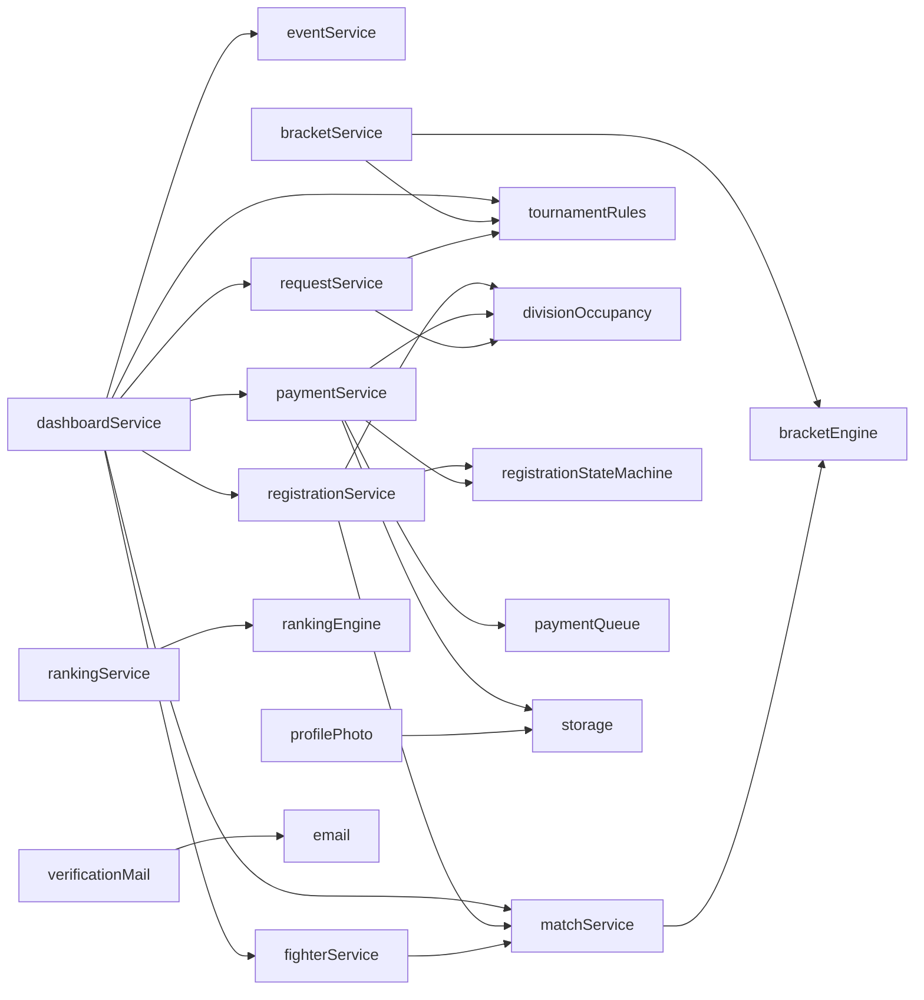

Details: [BACKEND_ARCHITECTURE.md](./BACKEND_ARCHITECTURE.md).

---

## F. Backend → Database Connection Map

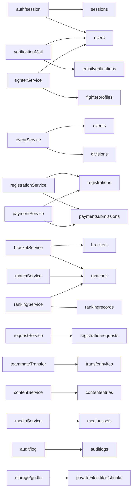

---

## G. Database Entity Relationship Map

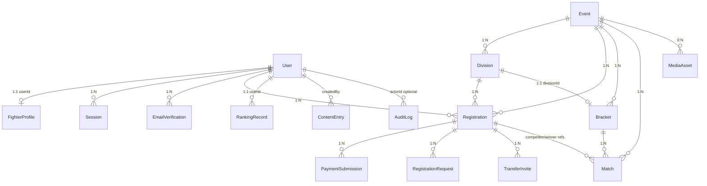

Full field/index detail: [DATABASE_ARCHITECTURE.md](./DATABASE_ARCHITECTURE.md).

---

## H. External Services Integration Map

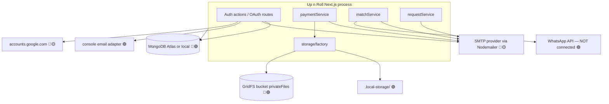

Details: [EXTERNAL_INTEGRATIONS.md](./EXTERNAL_INTEGRATIONS.md).

---

## I. Authentication & Authorization Flow

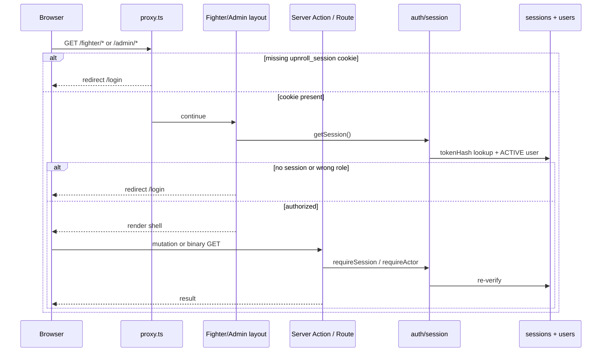

Roles in code: `FIGHTER` | `ADMIN` only (no `GUEST` role model).

Login paths:

1. 🟢 Email/password → `loginAction` → `createSession` → cookie
2. 🟢 Register → email code → `verifyEmailAction` → session
3. 🟡 Google OAuth → `/api/auth/google*` (requires `GOOGLE_CLIENT_ID/SECRET`; else soft redirect)

---

## J. Complete End-to-End Data Flows

### J1. Registration → Payment → Confirmation

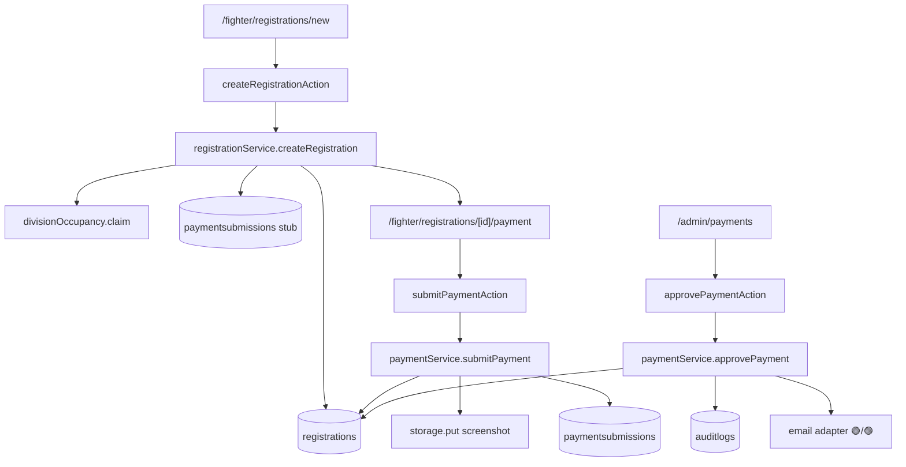

### J2. Bracket → Match result → Rankings

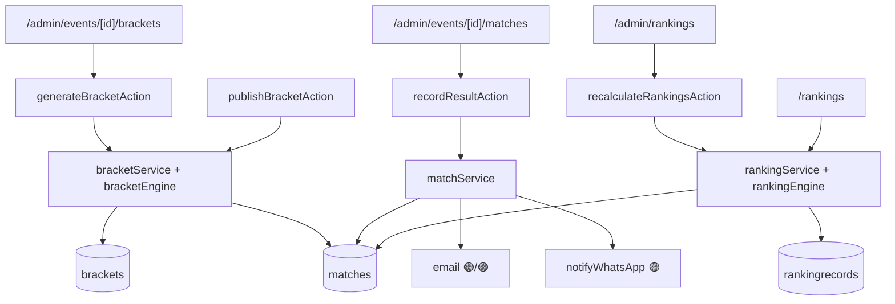

### J3. Public content / FAQ chatbot

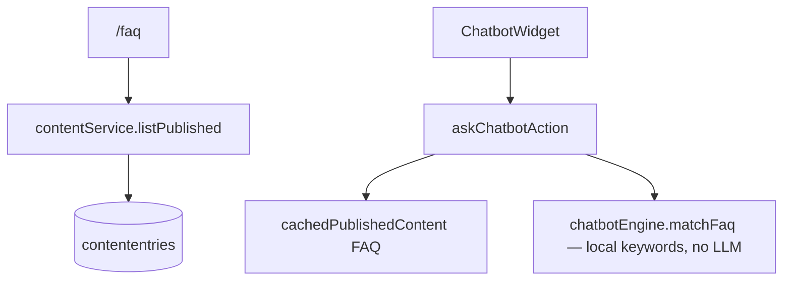

---

## Traceability cheat sheet

Pick any page and follow:

**Forward:** Page → Feature component → Server Action or RSC service import → `backend/services/*` → model → Mongo collection → external adapter (if any)

**Reverse:** Collection → model file in `backend/models/` → greppable service writers → Server Action / page importer in `frontend/src/`

| Example page | Action / loader | Service | Collections |
|--------------|-----------------|---------|-------------|
| `/login` | `loginAction` | `auth/session` + User | `users`, `sessions` |
| `/fighter/registrations/new` | `createRegistrationAction` | `registrationService` | `registrations`, `divisions`, `paymentsubmissions` |
| `/admin/payments` | `approvePaymentAction` + screenshot GET | `paymentService` | `paymentsubmissions`, `registrations`, storage |
| `/events/[slug]/brackets` | `cachedPublishedBracket` | `bracketService` reads | `brackets`, `divisions`, `events` |
| `/rankings` | `listPublicRankings` | `rankingService` | `rankingrecords`, `fighterprofiles` |

---

## Architecture facts (non-negotiable)

1. **One deployable:** Next.js app under `frontend/`; `backend/` is not a standalone server.
2. **Mutations are Server Actions**, not REST POST/PUT/PATCH/DELETE handlers.
3. **Only 6 product HTTP routes** (+ sitemap): health, Google OAuth ×2, 3 binary GETs.
4. **16 Mongoose models**, all referenced; no orphan schemas.
5. **No background job runner**; `paymentQueue.ts` is a duplicate-UTR helper, not a queue.
6. **Payments are manual UTR + screenshot** — no Stripe/Razorpay.
7. **WhatsApp is a console mock**; SMTP is real in production, console in development.
8. Older docs that assume a full `/api/v1` REST surface or missing GridFS are **stale** relative to this map.
