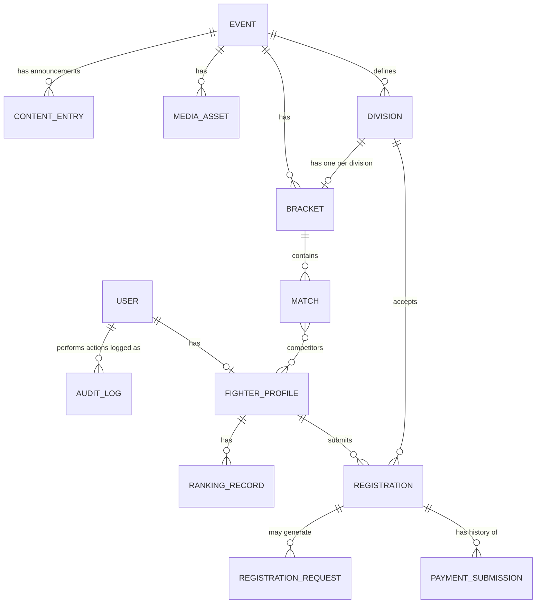

# Data Model Proposal — Up 'n Roll

Status: **fully implemented** as of Phase 5. Every collection below exists as a real Mongoose model except `notifications` as a dedicated persisted collection — acknowledgement/decision emails exist and are sent through the dev `EmailAdapter`, but there's no standalone notification record; not needed yet since nothing currently queries notification history independently of the email send itself.

## Collections (per Part L)

`users`, `fighter_profiles`, `events`, `divisions`, `registrations`, `payment_submissions`, `brackets`, `matches`, `ranking_records`, `registration_requests`, `notifications`, `content_entries`, `media_assets`, `audit_logs`.

## ER diagram

## Field notes (per-collection, not exhaustive — finalized in Phase 2 design)

- **users** — identity, email, auth identity, role (`GUEST`/`FIGHTER`/`ADMIN`), account status, timestamps. Unique index on email.
- **fighter_profiles** — 1:1 with a `FIGHTER`-role user; display name, public slug (unique index), team/gym, discipline, photo reference, privacy flags. No email/phone/DOB here — those stay on `users` and are never exposed via public queries.
- **events** — name, slug (unique), dates, location, status, registration window, payment instructions (client QR reference, amount), publication settings.
- **divisions** — belongs to an event; discipline, category, weight limits, age constraints (pending approval), capacity, bracket format, fee (integer minor units).
- **registrations** — fighter + event + division references, status enum (see state machine in `system-overview.md`), status history array, timestamps. Compound index on `{fighterId, divisionId}` to prevent duplicate active registrations in the same division.
- **payment_submissions** — registration reference, athleteId, eventId, expected amount (integer minor units — never trust client-supplied amount), submitted UTR, private screenshot reference (object storage key, not a public URL), review status (`AWAITING_SUBMISSION`/`PENDING_REVIEW`/`APPROVED`/`REJECTED`), reviewerId, reviewedAt, review note, revision history. Index on UTR for duplicate-reference detection (flag, don't auto-block).
- **brackets** — *(built, Phase 4)* event + division reference (unique per division — one bracket per division), format (`SINGLE_ELIMINATION` only, per OD-003 baseline), seed, locked-in participant list, roundsCount, publication state (`DRAFT`/`PUBLISHED`), version number (incremented on every regeneration; regenerating a `PUBLISHED` bracket is blocked entirely rather than silently overwritten).
- **matches** — *(built, Phase 4)* event, division, bracket reference, round + order (the full addressing scheme — winner advancement is computed arithmetically from these, no stored "next match" pointer), competitor references (nullable — null means not-yet-filled or a bye), status (`PENDING`/`SCHEDULED`/`COMPLETED`/`BYE`), winner, result method, scheduling info (mat/time), `correctionHistory` array (previous winner/method/reason/corrector/timestamp — Part N's "preserve audit history" lives here *and* in the shared `audit_logs`).
- **ranking_records** — *(built, Phase 5)* userId (unique), scope (`GLOBAL` only — not per-division, since event-scoped `Division` documents aren't a stable long-term taxonomy per OD-001/OD-002), wins, losses, points, calculationVersion, computedAt. Points come from `rankingEngine.ts`'s `winLossPointsStrategy` — explicitly labeled a placeholder in the UI and here, pending OD-004.
- **registration_requests** — *(built, Phase 5)* type (`CANCELLATION`/`TRANSFER`), registrationId, userId, requestedDivisionId (transfer only, must be same event, capacity-checked), reason, status (`PENDING`/`APPROVED`/`REJECTED`), reviewerId, reviewNote, reviewedAt. No policy-snapshot/window/fee fields yet — OD-007 still open, so none of that is enforced.
- **notifications** — not a dedicated collection (see status note above).
- **content_entries** — *(built, Phase 5)* type (`FAQ`/`ANNOUNCEMENT`/`POLICY` — eligibility policy kept distinct per the IMMAF research note isn't needed as its own type yet since no eligibility rules exist), title (doubles as the FAQ question), body (doubles as the FAQ answer), publicationState, createdBy.
- **media_assets** — *(built, Phase 5)* eventId (optional), caption, externalUrl (not an uploaded file — OD-012 still open), publicationState, createdBy.
- **audit_logs** — actor, action, target entity, before/after summary, timestamp, correlation id. No raw payment screenshot content or full PII dumped into audit entries — reference ids only.

## Concurrency / integrity notes carried into Phase 2 design

- Bracket structural edits to an already-published bracket must be versioned, not overwritten (Part N bracket integrity rule).
- Payment approval must be idempotent — a double-click or retried request must not create two `APPROVED` states or send two confirmation emails.
- `registrations` and `payment_submissions` are separate collections with separate status enums by design (Part E: "Keep payment status separate from registration status") — never collapse into one contradictory status field.

## Explicitly not modeled yet (pending client decisions)

Ranking formula, exact bracket format set beyond "single elimination baseline," exact division/weight/age taxonomy, refund workflow fields beyond status tracking (refunds are manual/off-platform per Part D §8). See `docs/decisions/open-decisions.md`.
