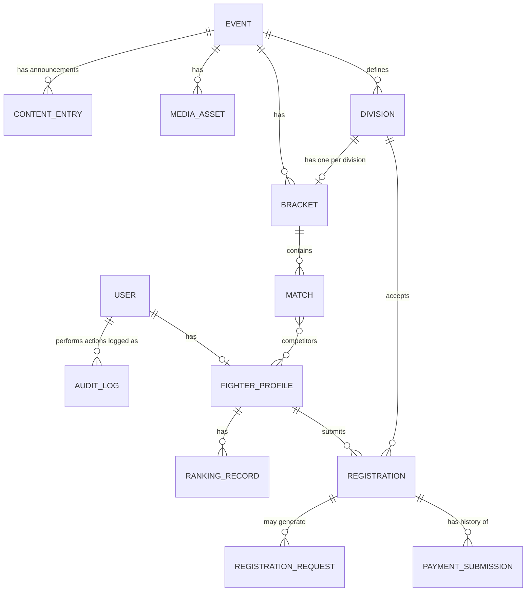

# Data Model Proposal — Up 'n Roll

Status: **proposal, not implemented.** No database work occurs in Phase 1. This exists so Phase 2 has a reviewed starting point and so `/ui-preview` fixture shapes (fictional data only) are consistent with where the real schema is headed.

## Collections (per Part L)

`users`, `fighter_profiles`, `events`, `divisions`, `registrations`, `payment_submissions`, `brackets`, `matches`, `ranking_records`, `registration_requests`, `notifications`, `content_entries`, `media_assets`, `audit_logs`.

## ER diagram

## Field notes (per-collection, not exhaustive — finalized in Phase 2 design)

- **users** — identity, email, auth identity, role (`GUEST`/`FIGHTER`/`ADMIN`), account status, timestamps. Unique index on email.
- **fighter_profiles** — 1:1 with a `FIGHTER`-role user; display name, public slug (unique index), team/gym, discipline, photo reference, privacy flags. No email/phone/DOB here — those stay on `users` and are never exposed via public queries.
- **events** — name, slug (unique), dates, location, status, registration window, payment instructions (client QR reference, amount), publication settings.
- **divisions** — belongs to an event; discipline, category, weight limits, age constraints (pending approval), capacity, bracket format, fee (integer minor units).
- **registrations** — fighter + event + division references, status enum (see state machine in `system-overview.md`), status history array, timestamps. Compound index on `{fighterId, divisionId}` to prevent duplicate active registrations in the same division.
- **payment_submissions** — registration reference, athleteId, eventId, expected amount (integer minor units — never trust client-supplied amount), submitted UTR, private screenshot reference (object storage key, not a public URL), review status (`AWAITING_SUBMISSION`/`PENDING_REVIEW`/`APPROVED`/`REJECTED`), reviewerId, reviewedAt, review note, revision history. Index on UTR for duplicate-reference detection (flag, don't auto-block).
- **brackets** — event + division reference, format, participant list, round structure, publication state (`DRAFT`/`PUBLISHED`), version number (incremented on every structural edit to a published bracket, never overwritten silently).
- **matches** — event, division, bracket reference, competitor references, round, order, status, winner, result + result method, scheduling info, mat/area, audit metadata.
- **ranking_records** — fighter, scope, discipline, division, calculated value, calculation version (so methodology changes don't silently rewrite history), source match references.
- **registration_requests** — type (`CANCELLATION`/`TRANSFER`), source registration reference, requested change, reason, status, reviewer, decision, policy snapshot/version at time of request.
- **notifications** — recipient, type, trigger, delivery state, timestamp, error info.
- **content_entries** — type (announcement/FAQ/policy — eligibility policy kept distinct per the IMMAF research note), body, publication state.
- **media_assets** — event reference, type, storage reference, caption, publication state.
- **audit_logs** — actor, action, target entity, before/after summary, timestamp, correlation id. No raw payment screenshot content or full PII dumped into audit entries — reference ids only.

## Concurrency / integrity notes carried into Phase 2 design

- Bracket structural edits to an already-published bracket must be versioned, not overwritten (Part N bracket integrity rule).
- Payment approval must be idempotent — a double-click or retried request must not create two `APPROVED` states or send two confirmation emails.
- `registrations` and `payment_submissions` are separate collections with separate status enums by design (Part E: "Keep payment status separate from registration status") — never collapse into one contradictory status field.

## Explicitly not modeled yet (pending client decisions)

Ranking formula, exact bracket format set beyond "single elimination baseline," exact division/weight/age taxonomy, refund workflow fields beyond status tracking (refunds are manual/off-platform per Part D §8). See `docs/decisions/open-decisions.md`.
