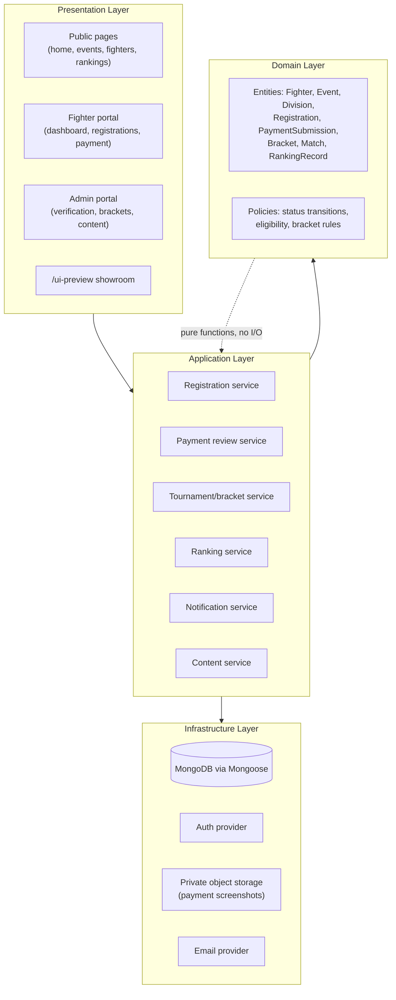
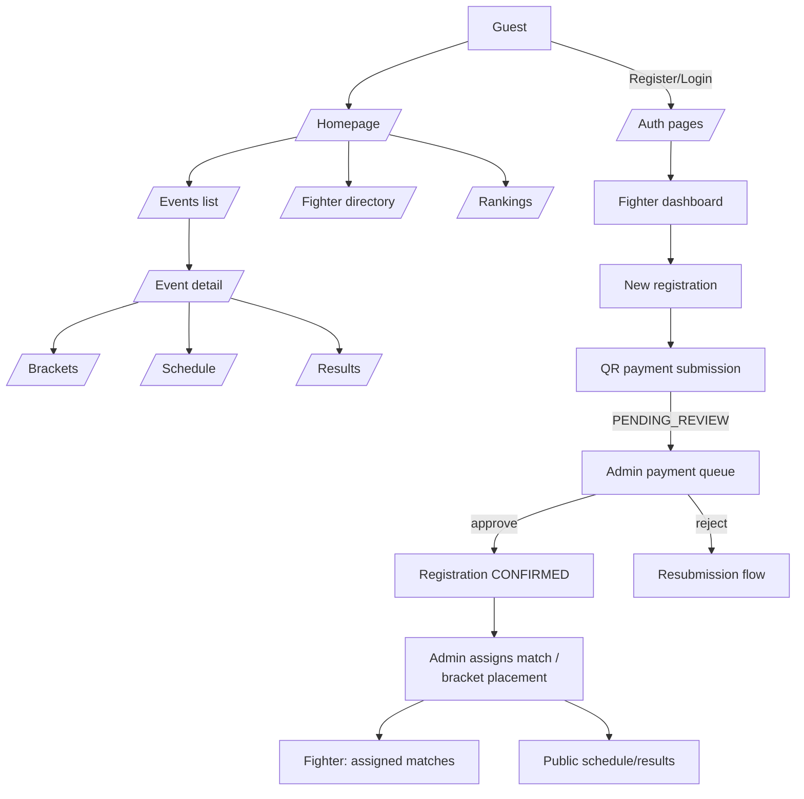
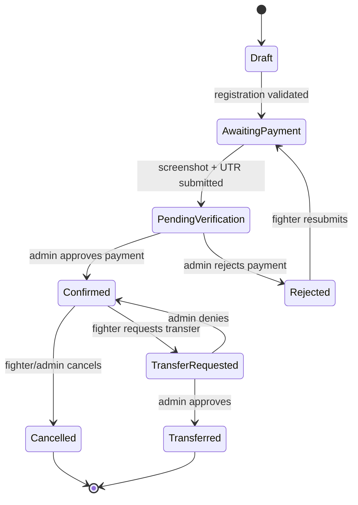
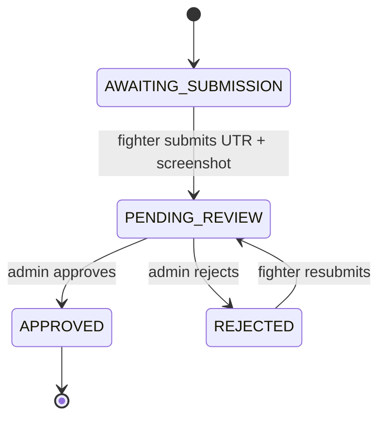

# System Architecture Overview — Up 'n Roll

Single Next.js 16 App Router application. No microservices, no separate backend, no monorepo (per Part A rules 6–9).

## Conceptual layers

Server Components and Route Handlers call application services; application services enforce domain rules and call repositories; repositories are the only layer that touches Mongoose models directly. Client Components never import `src/server/**`.

## Request/mutation data flow

```mermaid
flowchart LR
    Browser --> NextRoute["Next.js page or Route Handler"]
    NextRoute --> Validate["Zod validation"]
    Validate --> AuthZ["Session + role check"]
    AuthZ --> AppSvc["Application service"]
    AppSvc --> DomainRules["Domain rules"]
    DomainRules --> Repo["Repository"]
    Repo --> DB[(MongoDB)]
    DB --> Audit["Audit log entry\n(for sensitive mutations)"]
    Audit --> Cache["Cache invalidation /\nrevalidation"]
    Cache --> UI["UI state update"]
```

## Primary user journeys (navigation)

## Registration + payment state machine (proposed, pending final client sign-off on exact enum — see open-decisions.md)

Payment submission sub-state (independent field, per Part E):

## Server vs. client responsibility boundary

Enforced at the module level: anything under `src/server/**` is server-only (Mongoose models, repositories, storage/email adapters, audit writer) and is never imported by a file containing `"use client"`. Route Handlers and Server Actions are the only callers of `src/server/services/*`.

## Phase 0 scope note

This document describes target architecture for the full Phase 1–7 build. Only Phase 1 (`/ui-preview`, no backend) is authorized to begin after this checkpoint.
