# Project Up 'n Roll

## Project Handover & Technical Documentation

| Field | Value |
|-------|--------|
| **Project** | Up 'n Roll |
| **Document** | Project Handover & Technical Documentation (Master) |
| **Prepared by** | Dimensity Labs |
| **Version** | 1.0.0 |
| **Date** | 2026-11-27 |
| **Git branch** | `main` |
| **Git commit** | `4ffb794` |
| **Client** | *[Requires confirmation]* |

---

### Confidentiality notice

This document and the accompanying handover pack under `docs/handover/` are confidential project materials prepared by **Dimensity Labs**. They are intended solely for the named client and authorised technical custodians.

- Do **not** distribute secrets, production credentials, SMTP passwords, session secrets, cron secrets, or MongoDB URIs containing credentials in this document or related tickets.
- Transfer credentials via a **secure channel separately** (password manager share, encrypted vault, or agreed offline handoff).
- Status tags used throughout: **Implemented**, **Partial** / **Partially Implemented**, **Not Implemented**, **Requires confirmation**, **Verified** (from repository at `4ffb794`).

**Companion documents** (detail expansions of this master):

| Document | Purpose |
|----------|---------|
| [UpnRoll_Client_Operating_Manual.md](./UpnRoll_Client_Operating_Manual.md) | Non-technical admin operating procedures |
| [UpnRoll_Technical_Documentation.md](./UpnRoll_Technical_Documentation.md) | Developer / architect deep dive |
| [UpnRoll_API_Reference.md](./UpnRoll_API_Reference.md) | REST + Server Actions inventory |
| [UpnRoll_Database_Documentation.md](./UpnRoll_Database_Documentation.md) | Full model field lists |
| [UpnRoll_Deployment_Guide.md](./UpnRoll_Deployment_Guide.md) | Install, env, deploy, backups |
| [UpnRoll_Feature_Delivery_Matrix.md](./UpnRoll_Feature_Delivery_Matrix.md) | Feature-by-feature status |
| [UpnRoll_Testing_Report.md](./UpnRoll_Testing_Report.md) | Automated & manual QA status |
| [UpnRoll_Handover_Checklist.md](./UpnRoll_Handover_Checklist.md) | Formal checklist & sign-off |

Research sources synthesised: `docs/handover/_research/*.md`, split docs above, and `docs/handover/diagrams/*.mmd`.

---

## Table of contents

1. [Executive Summary](#1-executive-summary)
2. [Project Statistics](#2-project-statistics)
3. [Technology Stack](#3-technology-stack)
4. [System Architecture](#4-system-architecture)
5. [Complete Page Inventory](#5-complete-page-inventory)
6. [Public Website](#6-public-website)
7. [User Roles & RBAC](#7-user-roles--rbac)
8. [Grappler Registration & Dashboard](#8-grappler-registration--dashboard)
9. [Admin Dashboard Complete](#9-admin-dashboard-complete)
10. [Judge Panel Complete](#10-judge-panel-complete)
11. [Verification System](#11-verification-system)
12. [Tournament Lifecycle](#12-tournament-lifecycle)
13. [Business Rules](#13-business-rules)
14. [Database](#14-database)
15. [API & Server Actions](#15-api--server-actions)
16. [Authentication & Security](#16-authentication--security)
17. [Email & Notifications](#17-email--notifications)
18. [Integrations](#18-integrations)
19. [Directory Structure](#19-directory-structure)
20. [Installation](#20-installation)
21. [Environment Variables](#21-environment-variables)
22. [Deployment](#22-deployment)
23. [Performance](#23-performance)
24. [Testing](#24-testing)
25. [Maintenance & Troubleshooting](#25-maintenance--troubleshooting)
26. [Client Operating Manual (Summary)](#26-client-operating-manual-summary)
27. [Feature Delivery Matrix (Summary)](#27-feature-delivery-matrix-summary)
28. [Known Limitations](#28-known-limitations)
29. [Handover Checklist](#29-handover-checklist)
30. [Client Acceptance Sign-Off](#30-client-acceptance-sign-off)
31. [Glossary](#31-glossary)

---

## 1. Executive Summary

**Up 'n Roll** is a full-stack tournament management platform for combat sports (BJJ / grappling). Dimensity Labs has delivered a production-shaped Next.js application covering public marketing and live boards, grappler self-service, admin operations, and a match-scoped judge scoring console.

### What was delivered

| Area | Outcome | Status |
|------|---------|--------|
| Public website | Marketing home, events, brackets, results, schedule, rankings, FAQ/policies/announcements, grappler public cards | **Implemented** (Store/Seminars stubs **Partial**) |
| Auth | Email/password register + verify + login; optional Google OAuth; admin CLI bootstrap | **Implemented** (OAuth **Partial** / env-gated; password reset **Not Implemented**) |
| Grappler portal | Profile, registration, UPI/QR payment desk, matches, requests, teammate transfer, alerts | **Implemented** |
| Admin portal | Events, divisions, brackets, matches, fees/coupons, payment verification, requests, rankings, CMS, media, settings, outbox, audit | **Implemented** (media & manual-rankings wiring **Partial**) |
| Judge panel | Per-match credentials, scoring console, finalize + bracket advance | **Implemented** |
| Payments | Manual UPI proof + admin UTR/screenshot review — no card gateway | **Implemented** (by design) |
| Rankings | Computed `wins * 3` placeholder + admin manual entries | **Partial** (manual board not wired to public page; OD-004 open) |

### Architecture in one paragraph

One Next.js 16 App Router project (`frontend/`) with server-only business logic in `backend/` (Mongoose models + services). There is no separate backend package; `@/server/*` aliases into `../backend/*`. Auth is custom cookie sessions in MongoDB. Payments are manual UPI/QR + screenshot/UTR review. Private files use a pluggable storage adapter (`local` or `gridfs`).

### Terminology

User-facing product language is **Grappler** (`/grappler/*`, role `GRAPPLER`). Legacy **Fighter** URLs redirect permanently. Internal code still uses names such as `fighterService` and collection `fighterprofiles` — see §19.

### Honest readiness

The codebase at `4ffb794` is feature-complete for the shipped single-elimination tournament loop. Items that remain **Requires confirmation** before calling production “ready” include hosting ownership (OD-012), SMTP inbox proof, backup ownership/retention (OD-011), storage driver choice for multi-instance hosts, occupancy backfill if needed, and client sign-off on open decisions (rankings methodology, fees, refund policy). See §28–§30.

*Sources: `docs/handover/_research/01-architecture-stats.md`, `07-limitations.md`, `UpnRoll_Feature_Delivery_Matrix.md`.*

---

## 2. Project Statistics

Verified 2026-11-27 at commit `4ffb794` (`docs/handover/_research/01-architecture-stats.md`).

### Counts

| Metric | Count |
|--------|------:|
| `page.tsx` routes | 51 |
| API `route.ts` handlers | 18 |
| Mongoose models | 24 |
| Backend services (non-test) | 34 |
| Feature folders (`frontend/src/features`) | 20 |
| `components/ui` primitives | 58 |
| Test files (`*.test.ts` / `*.test.tsx`) | 50 |
| Frontend source files (LOC set) | 342 |
| Backend source files (LOC set) | 98 |

### Lines of code

Non-blank lines via PowerShell `Measure-Object -Line` (excl. `*.test.*`, `node_modules`):

| Scope | Files | Lines |
|-------|------:|------:|
| `frontend/src` | 342 | 24,384 |
| `backend` | 98 | 8,400 |
| **Combined** | **440** | **32,784** |

Including blank lines: 25,027 frontend + 9,336 backend = **34,363**.

### Page status roll-up

| Group | Pages | Implemented | Partial |
|-------|------:|------------:|--------:|
| Public | 18 | 15 | 3 (`/grapplers`, `/store`, `/seminars`) |
| Auth | 3 | 3 | 0 |
| Grappler | 9 | 9 | 0 |
| Admin | 18 | 18 | 0 |
| Judge | 2 | 2 | 0 |
| Preview | 1 | 1 | 0 |
| **Total** | **51** | **48** | **3** |

---

## 3. Technology Stack

Source: `frontend/package.json` at `4ffb794`.

| Package | Version | Role |
|---------|---------|------|
| `next` | 16.4.5 | App Router (Cache Components on) |
| `react` / `react-dom` | 19.2.3 | UI runtime |
| `typescript` | ^5 | Types |
| `mongoose` | ^9.3.0 | MongoDB ODM (shared with `backend/`) |
| `zod` | ^4.3.6 | Validation |
| `react-hook-form` + `@hookform/resolvers` | ^7.71.2 / ^5.2.2 | Forms |
| `nodemailer` | ^10.3.1 | SMTP email |
| `tailwindcss` | ^4 | Styling |
| `framer-motion` / `gsap` | ^12 / ^3 | Motion |
| `lucide-react` | ^0.577.0 | Icons |
| `recharts` | ^3.7.0 | Charts |
| `date-fns` | ^4.1.0 | Dates |
| `sonner` | ^2.0.7 | Toasts |
| `server-only` | ^0.0.1 | Server module boundary |
| Radix / shadcn primitives | various | UI primitives (`components/ui`) |
| `vitest` | ^3.0.5 | Unit / integration tests |
| `tsx` | ^4.19.2 | CLI scripts |
| `eslint` / `eslint-config-next` | ^9 / 16.4.5 | Lint |

**Not in stack (by design):** Stripe/Razorpay, Redis, Sentry/OTel, Docker Compose, React Query, LLM chatbot providers.

Root scripts delegate into `frontend/`: `npm run dev|build|start|lint|test|create-admin|seed-demo`.

---

## 4. System Architecture

### Route groups

Auth is enforced in layouts (and re-checked in actions/services). There is no authoritative `middleware.ts`; `frontend/src/proxy.ts` only checks cookie **presence** for UX redirects.

| Group | Path prefix | Who |
|-------|-------------|-----|
| `(public)` | `/`, `/events`, `/rankings`, … | Anyone |
| `(auth)` | `/login`, `/register`, `/verify` | Guests |
| `(grappler)` | `/grappler/*` | Role `GRAPPLER` |
| `(admin)` | `/admin/*` | Role `ADMIN` |
| `(judge)` | `/judge/*` | Judge cookie session |
| `(preview)` | `/ui-preview` | Dev / `UI_PREVIEW_ENABLED` |

### Layering

Pages, Server Actions, and thin `api/v1/{public,grappler,admin}` handlers call `backend/services/*` through `@/server/*`. Business rules live in services — not re-implemented in routes or components. Public pages prefer tagged cached reads (`frontend/src/lib/public-reads`). Email and reminders use an outbox + cron pattern.

**Figure — High-level system architecture**

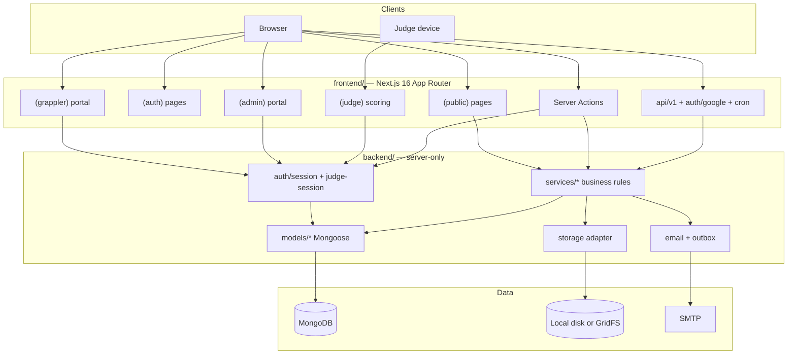

*Source diagram:* `docs/handover/diagrams/01-system-architecture.mmd`

**Figure — API / Server Action request lifecycle**

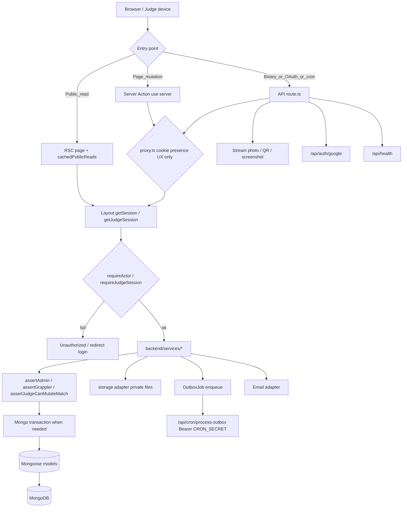

*Source diagram:* `docs/handover/diagrams/15-api-request-lifecycle.mmd`

*Sources: `_research/01-architecture-stats.md`, `CLAUDE.md`, `backend/README.md`.*

---

## 5. Complete Page Inventory

All **51** `page.tsx` routes under `frontend/src/app`. Status from reading pages at `4ffb794`.

### 5.1 Public (18)

| # | Page | URL | Auth | Purpose | Status |
|---|------|-----|------|---------|--------|
| 1 | Home | `/` | No | Marketing landing | Implemented |
| 2 | About | `/about` | No | Brand / story | Implemented |
| 3 | Events list | `/events` | No | Upcoming events | Implemented |
| 4 | Event detail | `/events/[slug]` | No | Event landing | Implemented |
| 5 | Event brackets | `/events/[slug]/brackets` | No | Published brackets | Implemented |
| 6 | Event results | `/events/[slug]/results` | No | Results table | Implemented |
| 7 | Event schedule | `/events/[slug]/schedule` | No | Schedule + call board | Implemented |
| 8 | Held archive | `/events/held/[slug]` | No | Static held record | Implemented |
| 9 | Live brackets hub | `/brackets` | No | Focus-event live board | Implemented |
| 10 | Rankings | `/rankings` | No | Public rankings | Implemented* |
| 11 | Seeding demo | `/rankings/demo` | No | Non-indexed demo | Implemented |
| 12 | Grapplers directory | `/grapplers` | No | Redirects to `/rankings` | **Partial** |
| 13 | Grappler public profile | `/grapplers/[slug]` | No | Public athlete card | Implemented |
| 14 | FAQ | `/faq` | No | CMS FAQ | Implemented |
| 15 | Store | `/store` | No | Merchandise | **Partial** (ComingSoon) |
| 16 | Seminars | `/seminars` | No | Seminars | **Partial** (ComingSoon) |
| 17 | Policies | `/policies` | No | Published policies | Implemented |
| 18 | Announcements | `/announcements` | No | House announcements | Implemented |

\*Public rankings page is Implemented as a board; ranking methodology / manual wiring remain **Partial** (see §28).

### 5.2 Auth (3)

| # | Page | URL | Purpose | Status |
|---|------|-----|---------|--------|
| 19 | Sign in | `/login` | Email login + Google link | Implemented |
| 20 | Sign up | `/register` | Create grappler account | Implemented |
| 21 | Verify email | `/verify` | Email OTP confirm | Implemented |

### 5.3 Grappler (9)

Gate: session required; role ≠ `GRAPPLER` → `/admin`.

| # | Page | URL | Purpose | Status |
|---|------|-----|---------|--------|
| 22 | Desk | `/grappler/dashboard` | Portal home | Implemented |
| 23 | Profile | `/grappler/profile` | Full registration sheet | Implemented |
| 24 | My events | `/grappler/registrations` | List seats | Implemented |
| 25 | New registration | `/grappler/registrations/new` | Enter an event | Implemented |
| 26 | Payment desk | `/grappler/registrations/[id]/payment` | Pay / upload UTR | Implemented |
| 27 | Matches | `/grappler/matches` | Assigned matches | Implemented |
| 28 | Requests | `/grappler/requests` | Cancel / transfer | Implemented |
| 29 | Notifications | `/grappler/notifications` | In-app inbox | Implemented |
| 30 | Claim transfer | `/grappler/transfer/[token]` | Take teammate seat | Implemented |

### 5.4 Admin (18)

Gate: session + role `ADMIN` (else `/grappler/dashboard`).

| # | Page | URL | Purpose | Status |
|---|------|-----|---------|--------|
| 31 | Admin desk | `/admin` | Ops overview | Implemented |
| 32 | Payment queue | `/admin/payments` | Verify UPI submissions | Implemented |
| 33 | Grapplers roster | `/admin/grapplers` | Searchable roster | Implemented |
| 34 | Grappler sheet | `/admin/grapplers/[userId]` | Full admin record | Implemented |
| 35 | Events list | `/admin/events` | Create / list | Implemented |
| 36 | Event hub | `/admin/events/[id]` | Control center | Implemented |
| 37 | Divisions | `/admin/events/[id]/divisions` | Taxonomy | Implemented |
| 38 | Brackets | `/admin/events/[id]/brackets` | Seed / generate / publish | Implemented |
| 39 | Matches | `/admin/events/[id]/matches` | Schedule & results | Implemented |
| 40 | Fees & coupons | `/admin/events/[id]/payments` | Payment options | Implemented |
| 41 | Scoring rules | `/admin/events/[id]/scoring-rules` | Event scoring config | Implemented |
| 42 | Requests | `/admin/requests` | Cancel/transfer decide | Implemented |
| 43 | Rankings | `/admin/rankings` | Manual + recalculate | Implemented* |
| 44 | Content | `/admin/content` | FAQ / policy / announcement | Implemented |
| 45 | Media | `/admin/media` | External media links | Implemented* |
| 46 | Settings | `/admin/settings` | House name + contact | Implemented |
| 47 | Outbox | `/admin/notifications` | Failed job recovery | Implemented |
| 48 | Audit | `/admin/audit` | Audit trail | Implemented |

### 5.5 Judge (2) & Preview (1)

| # | Page | URL | Purpose | Status |
|---|------|-----|---------|--------|
| 49 | Scoring console | `/judge` | Live match scoring | Implemented |
| 50 | Judge login | `/judge/login` | Match credential login | Implemented |
| 51 | UI preview | `/ui-preview` | Design showroom (env-gated) | Implemented |

**Figure — Website sitemap (51 pages)**

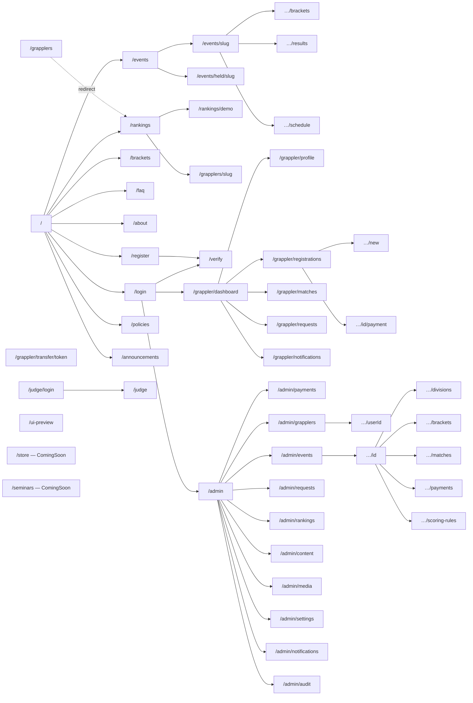

*Source diagram:* `docs/handover/diagrams/02-website-sitemap.mmd`

---

## 6. Public Website

Public chrome: `SiteHeader`, `SiteFooterBoundary`, `ChatbotWidget` (deterministic FAQ keyword engine — **not** an LLM). Data via `frontend/src/lib/public-reads.ts` cached helpers.

| Page | Data source(s) | Notes |
|------|----------------|-------|
| `/` | `cachedPublicEvents()`; static media | Featured = first `REGISTRATION_OPEN` else first event |
| `/about` | `cachedPublicEvents()` | Featured slug into AboutStory |
| `/events` | `cachedPublicEvents()` | Featured + later |
| `/events/[slug]` | event, divisions, announcements; completed → media/results | Special slug `up-n-roll-superfight-series` → SuperfightLanding |
| `…/brackets` | `cachedPublishedBracket` | Empty if none published |
| `…/results` | `cachedPublicResults` | |
| `…/schedule` | `cachedPublicSchedule` + announcement board | Live call banner |
| `/events/held/[slug]` | static `HELD_ARCHIVE` | Not Mongo |
| `/brackets` | events, schedule, published brackets | Soft refresh ~8s when live |
| `/rankings` | `cachedRankingBoardEntries()` | `?level=` beginner/intermediate |
| `/grapplers/[slug]` | `getPublicFighterBySlug` / held-card | Private fields omitted |
| `/faq`, `/policies`, `/announcements` | `cachedPublishedContent` | Admin CMS |
| `/store`, `/seminars` | — | ComingSoon |

*Sources: `_research/01-architecture-stats.md` §8.*

---

## 7. User Roles & RBAC

Actors: **Public**, **Grappler** (`User.role=GRAPPLER`), **Admin** (`ADMIN`), **Judge-credential** (separate session — not a User role). Legacy `FIGHTER` normalises to `GRAPPLER`. **There is no VERIFIER role.**

| Capability | Public | Grappler | Admin | Judge |
|------------|:------:|:--------:|:-----:|:-----:|
| Marketing / public content / public photo by slug | ✓ | ✓ | ✓ | ✓ |
| Register / login / verify / Google OAuth | ✓ | — | — | — |
| Grappler portal | ✗ | ✓ | ✗ | ✗ |
| Own profile, registrations, payment submit | ✗ | ✓ | ✗ | ✗ |
| Admin portal / payment queue / brackets / CMS | ✗ | ✗ | ✓ | ✗ |
| Issue/revoke judge credentials | ✗ | ✗ | ✓ | ✗ |
| Score assigned match | ✗ | ✗ | ✗ | ✓ |
| Create ADMIN user | CLI only | | | |
| Cron process-outbox | Bearer `CRON_SECRET` | | | |

Defense in depth: `proxy.ts` (presence) → layout `getSession`/`requireRole` → `requireActor` → service `assertAdmin` / `assertGrappler` / `assertJudgeCanMutateMatch`.

**Figure — Roles and access planes**

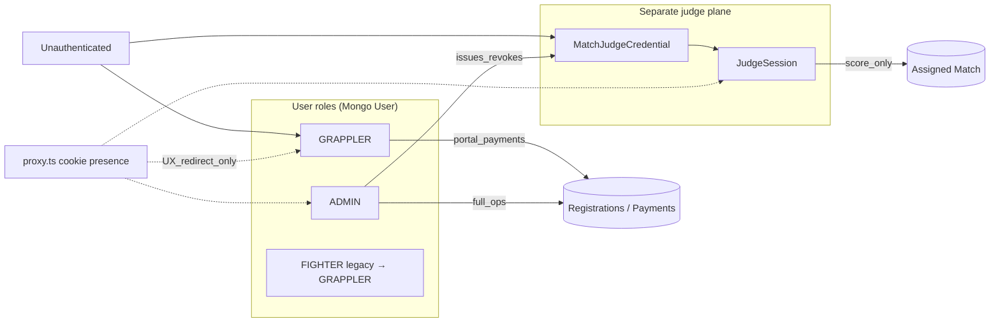

*Source diagram:* `docs/handover/diagrams/03-roles-access.mmd`

**Figure — Authentication flow (app + judge)**

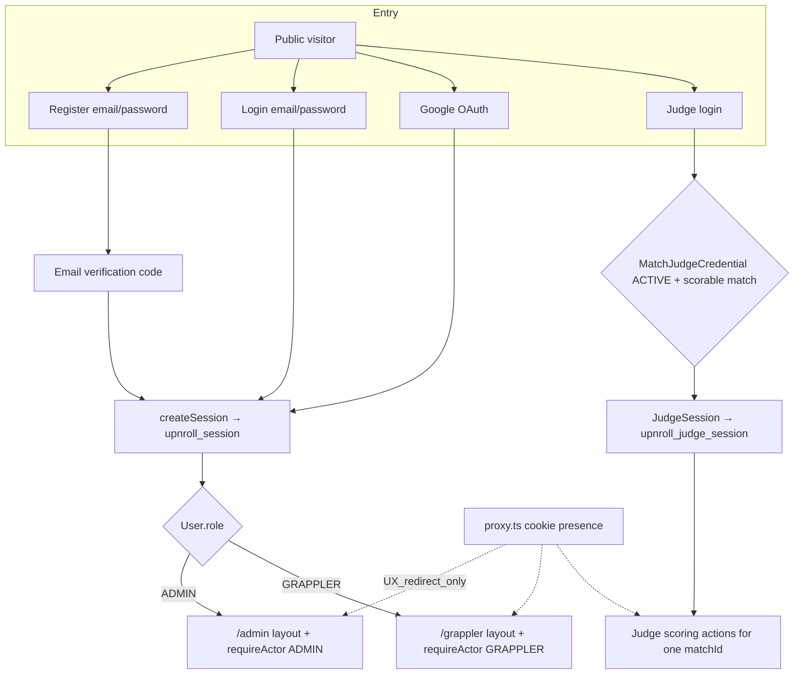

*Source diagram:* `docs/handover/diagrams/04-authentication-flow.mmd`

*Sources: `_research/06-auth-security-rbac.md`.*

---

## 8. Grappler Registration & Dashboard

Portal shell: `frontend/src/app/(grappler)/grappler/layout.tsx`. Nav: Desk, Profile, Events, Matches, Requests, Alerts.

### Journey (summary)

1. **Register** at `/register` → User `GRAPPLER` + GrapplerProfile stub → verification email → `/verify`.
2. **Login** → `/grappler/dashboard`.
3. **Complete profile** (photo, identity/Aadhaar, parental consent if under 18, waiver).
4. **Register for a division** when event is `REGISTRATION_OPEN` → seat claim + `AWAITING_PAYMENT` + feeSnapshot.
5. **Pay offline (UPI)** using QR; optional coupon; upload UTR + screenshot → `PENDING_VERIFICATION`.
6. Admin approves → `CONFIRMED` (bracket-eligible) or rejects → resubmit.
7. View matches / notifications; optional cancel/transfer request or teammate transfer token.

**Figure — Grappler lifecycle / registration journey**

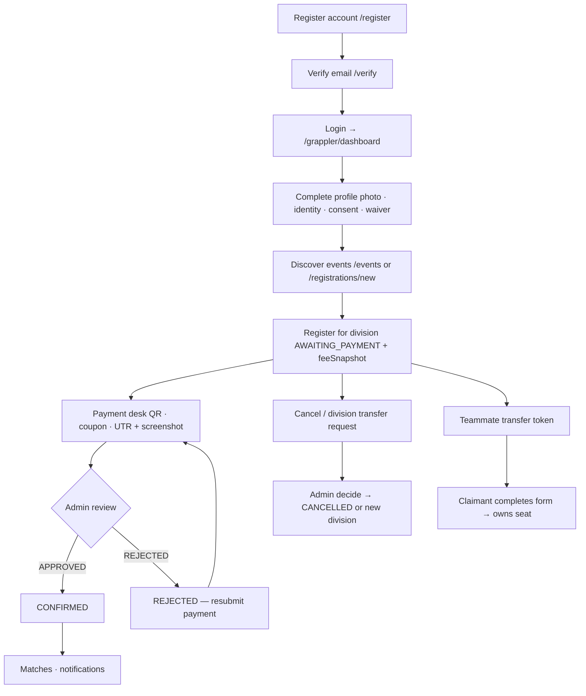

*Source diagram:* `docs/handover/diagrams/05-grappler-registration.mmd`

### Registration statuses

| Status | Meaning |
|--------|---------|
| `AWAITING_PAYMENT` | Seat held; pay / upload pending |
| `PENDING_VERIFICATION` | UTR+screenshot awaiting admin |
| `CONFIRMED` | Payment approved; locked for event |
| `REJECTED` | Payment rejected; may resubmit |
| `CANCELLED` | Withdrawn / cancel approved |

**Active** (capacity + uniqueness): first three. Guards in `backend/services/registrationStateMachine.ts`.

### Payment & coupons (essential)

Platform is a **manual UPI proof + admin verification** desk with automated seat/fee/coupon bookkeeping — **not** a payment processor. Coupons are not percentage discounts; each points at a **payment option** (alternate price/QR).

**Figure — Payment + coupon end-to-end (manual UPI proof)**

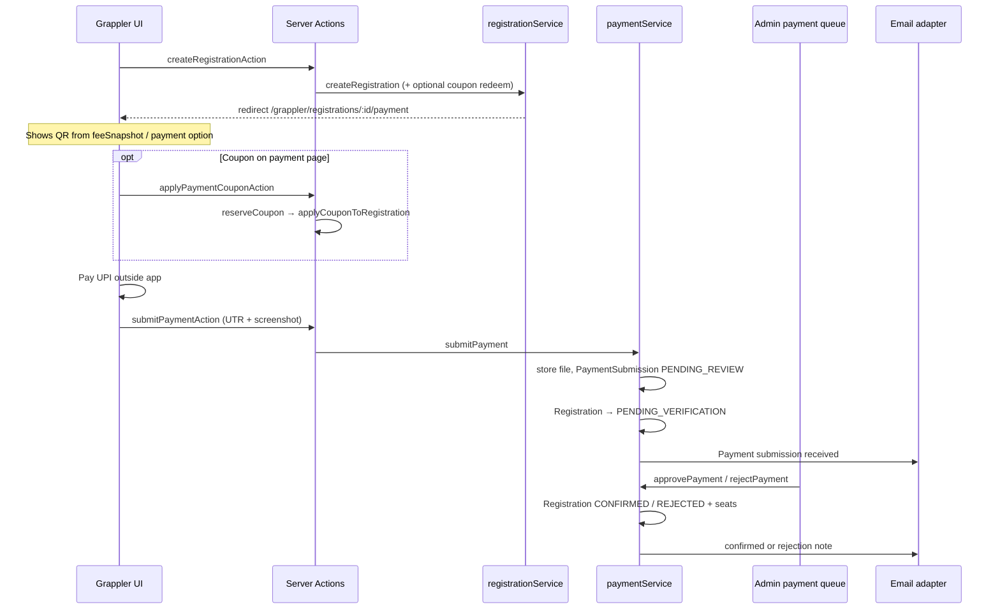

*Source diagram:* `docs/handover/diagrams/06-payment-coupon.mmd`

### Teammate transfer vs admin TRANSFER

| Flow | What it does |
|------|----------------|
| Admin `TRANSFER` request | Same event, other division — admin decides |
| Teammate transfer token | Peer seat handoff; claimant completes form; reassigns `registration.userId` |

*Sources: `_research/03-grappler-lifecycle.md`, `03-payment-coupon.md`.*

Full operational steps for administrators: [UpnRoll_Client_Operating_Manual.md](./UpnRoll_Client_Operating_Manual.md).

---

## 9. Admin Dashboard Complete

Every `/admin/**` route requires `ADMIN`. Nav: Dashboard, Events, Grapplers, Payments, Requests, Rankings, Content, Settings, Media, Outbox, Audit.

**Figure — Admin tournament setup & ops hub**

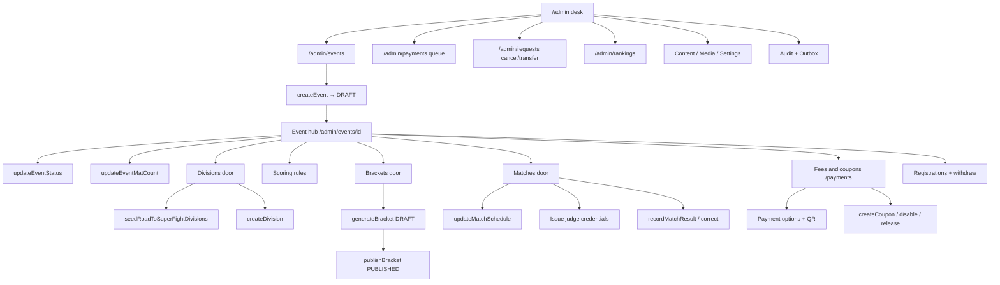

*Source diagram:* `docs/handover/diagrams/08-admin-tournament.mmd`

### Capability catalogue (11-point summaries)

Full operational detail for day-to-day operators: [UpnRoll_Client_Operating_Manual.md](./UpnRoll_Client_Operating_Manual.md). Research detail: `_research/02-admin-complete.md`.

#### 9.1 Admin desk — `/admin`

| # | Item | Detail |
|---|------|--------|
| 1 | Feature | Ops overview |
| 2 | Purpose | Presence, pending money/requests, next-event shortcuts |
| 3 | Path | `/admin` |
| 4 | Permissions | ADMIN |
| 5 | Ops | Review stats → chase payments/requests → open event hub |
| 6 | Fields | Grappler count, logins today, new accounts, pending payments; timelines |
| 7 | Validation | Read-only |
| 8 | Backend | `dashboardService.getAdminDashboardData` |
| 9 | DB | None |
| 10 | Outcome | Operator sees what needs attention |
| 11 | Limits | Feeds capped (e.g. 5 pending payments) |

#### 9.2 Events list & create — `/admin/events`

Create: name, slug, venue, dates, fee, mats → status `DRAFT`. **No delete/archive UI.** Zod + unique slug. Service: `eventService.createEvent`.

#### 9.3 Event hub — `/admin/events/[id]`

Doors: Divisions, Brackets, Matches, Fees & coupons, Scoring rules. Status: `DRAFT` → `REGISTRATION_OPEN` → `REGISTRATION_CLOSED` → `COMPLETED` (manual). Mats, default QR, overview edit, inline division edits, registrations + admin withdraw.

#### 9.4 Divisions — `…/divisions`

Seed Road-to-Super-Fight grid and/or create custom. **No delete division UI**; edit capacity on hub.

#### 9.5 Brackets — `…/brackets`

Order CONFIRMED participants → generate DRAFT (manual or random seed) → publish once. **Unpublish not supported.**

#### 9.6 Matches — `…/matches`

Schedule mats/times (conflict detection), record/correct results, issue judge credentials. Dual result path with judge finalize (prefer one path per match).

#### 9.7 Fees & coupons — `…/payments`

Payment options (tiers + QR) and single-use coupons linked to a tier. Global verification is on `/admin/payments`, not this page.

#### 9.8 Scoring rules — `…/scoring-rules`

JSON editor for points/penalties/outcomes. New events start `configured: false`. Judges blocked until ready.

#### 9.9 Grapplers roster & sheet

Searchable list + read-only registration sheet with private ID images via admin API. **No admin edit of grappler data.**

#### 9.10 Payments queue — `/admin/payments`

Approve/reject UTR + screenshot. Queue cap **200**. Duplicate UTR advisory only. See §11.

#### 9.11 Requests — `/admin/requests`

Decide CANCELLATION / TRANSFER. Refund % recorded on cancel approve (50% if ≥30 days before start, else 0) — **no automated payout**.

#### 9.12 Rankings, content, media, settings, outbox, audit

| Area | Path | Key limits |
|------|------|------------|
| Rankings | `/admin/rankings` | Manual entries **not** consumed by public `/rankings` yet |
| Content | `/admin/content` | No delete; unpublish → DRAFT |
| Media | `/admin/media` | Create+list only; URL-only; always PUBLISHED |
| Settings | `/admin/settings` | House name + public contact |
| Outbox | `/admin/notifications` | Failed jobs only; cap 50 |
| Audit | `/admin/audit` | Latest ~80; no filter UI |

### Admin private media APIs

| Route | Purpose |
|-------|---------|
| `/api/v1/admin/payments/[id]/screenshot` | Payment proof |
| `/api/v1/admin/events/[id]/payment-qr` | Default event QR |
| `/api/v1/admin/events/[id]/payment-options/[optionId]/qr` | Tier QR |
| `/api/v1/admin/grapplers/[userId]/photo` | Passport photo |
| `/api/v1/admin/grapplers/[userId]/aadhaar` | ID proof |
| `/api/v1/admin/grapplers/[userId]/parental-consent` | Consent image |

---

## 10. Judge Panel Complete

Judges are **not** User accounts. Access = per-match `MatchJudgeCredential` + short-lived `JudgeSession` cookie (`upnroll_judge_session`, 12h).

### Credentials

| Item | Detail |
|------|--------|
| Alphabet | 57 chars; omits ambiguous 0/O/1/I/l |
| Username / password | 10 chars each; password shown **once** |
| Preconditions | PUBLISHED bracket; both competitors; match not completed/cancelled/bye for generate |
| Regenerate | Revokes ACTIVE + open sessions; bumps generation |
| Login eligibility | Match status ∈ SCHEDULED | LIVE | DELAYED |

**Figure — Judge credential issue + login**

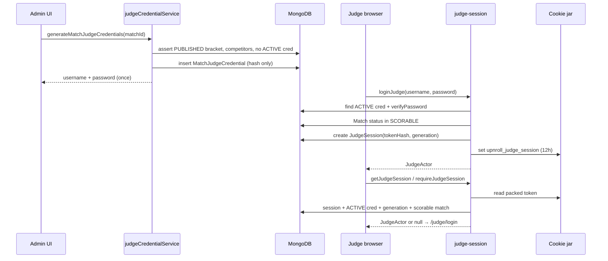

*Source diagram:* `docs/handover/diagrams/11-judge-authentication.mmd`

### Scoring console (`/judge`)

| UI action | Service |
|----------|---------|
| Point / penalty | `applyScoreEvent` |
| Undo | `undoScoreEvent` |
| Finalize | `finalizeMatchResult` → COMPLETED OFFICIAL + advance + outbox |

Each mutation sends `idempotencyKey` + `expectedVersion` (optimistic concurrency). First score flips SCHEDULED/DELAYED → LIVE. Requires `isScoringRulesReady`.

**Figure — Live match scoring sequence**

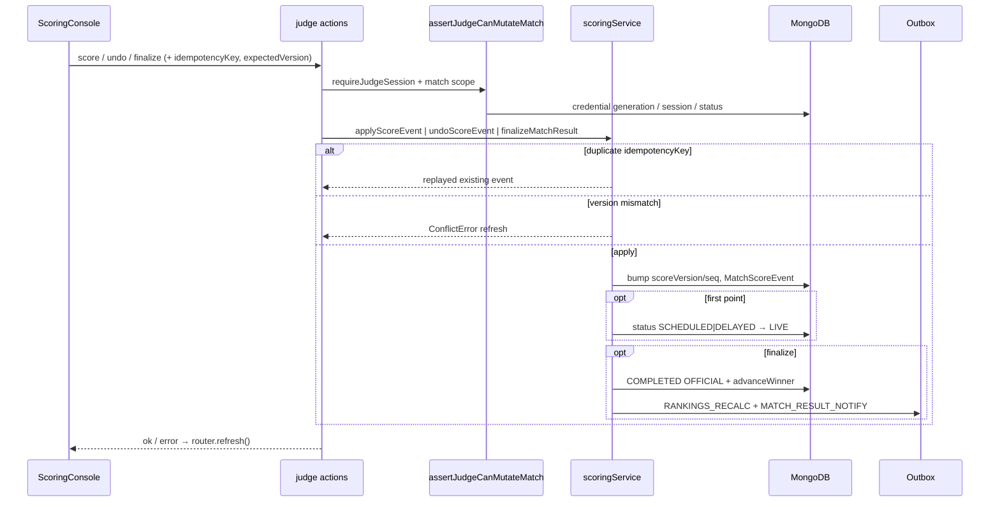

*Source diagram:* `docs/handover/diagrams/12-match-scoring.mmd`

**Operator note:** Prefer one result path per match — judge finalize **or** admin `recordMatchResult` (SCHEDULED-only, no score timeline).

*Sources: `_research/04-judge-panel.md`.*

---

## 11. Verification System

Three distinct “verify” concepts — do not conflate them:

| Concept | Where | Who |
|---------|-------|-----|
| **Payment / registration verification** | `/admin/payments` | ADMIN only |
| **Email OTP verification** | `/verify` | New grappler (auth) |
| **Request review** | `/admin/requests` | ADMIN (cancel/transfer) |

### Payment verification state machine

| Stage | Registration | PaymentSubmission |
|-------|--------------|-------------------|
| After register | `AWAITING_PAYMENT` | often `AWAITING_SUBMISSION` |
| After submit | `PENDING_VERIFICATION` | `PENDING_REVIEW` |
| Approve | `CONFIRMED` | `APPROVED` |
| Reject | `REJECTED` | `REJECTED` (resubmit OK) |

**Figure — Admin payment/registration verification desk**

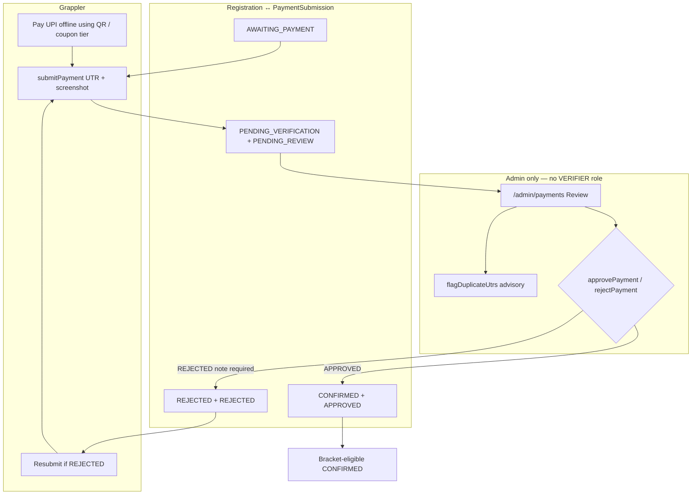

*Source diagram:* `docs/handover/diagrams/07-verification.mmd`

**One-liner for handover:** `/admin/payments` = money/registration confirmation by ADMIN. `/verify` = email ownership for account login.

*Sources: `_research/02-verification.md`.*

---

## 12. Tournament Lifecycle

Status legend: **Implemented** · **Partial** · **Manual** · **Missing**.

| # | Step | Status |
|---|------|--------|
| 1 | Provision admin (CLI) | Manual |
| 2 | Create event DRAFT | Implemented |
| 3 | Configure QR / mats / options / scoring | Implemented |
| 4 | Create / seed divisions | Implemented |
| 5 | Open registration | Manual status flip |
| 6 | Grappler account + email verify | Implemented (OAuth Partial) |
| 7 | Complete profile | Implemented |
| 8 | Create registration + seat | Implemented |
| 9 | Optional coupon | Implemented |
| 10 | Submit UTR + screenshot | Implemented |
| 11 | Admin approve / reject | Implemented |
| 12 | Close registration | Manual |
| 13 | Generate DRAFT bracket | Implemented |
| 14 | Publish bracket | Implemented |
| 15 | Schedule mats / times | Partial |
| 16 | Issue judge credentials | Implemented |
| 17 | Live score / finalize or admin record | Partial (dual path) |
| 18 | Advance winners | Implemented |
| 19 | Rankings recalc + public boards | Partial |
| 20 | Close event / post-event requests | Partial (COMPLETED Manual; requests Implemented) |

**Figure — End-to-end 20-step tournament lifecycle**

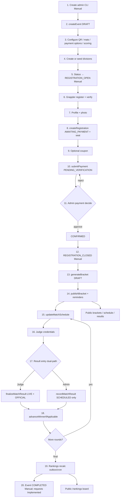

*Source diagram:* `docs/handover/diagrams/09-tournament-lifecycle.mmd`

**Figure — Bracket generate → publish → advance**

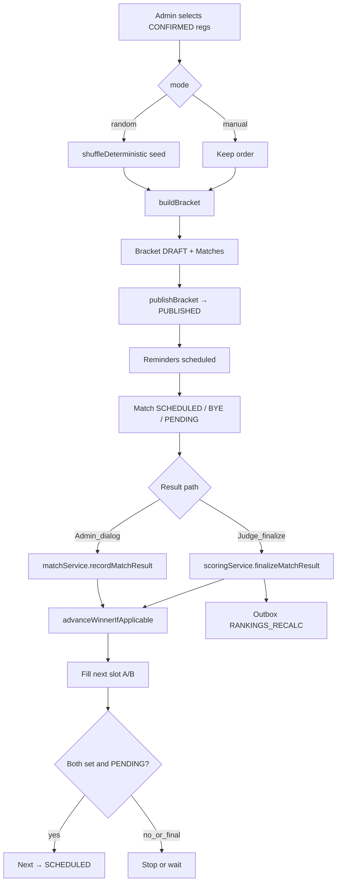

*Source diagram:* `docs/handover/diagrams/10-bracket-progression.mmd`

**Figure — Ranking recalculation path**

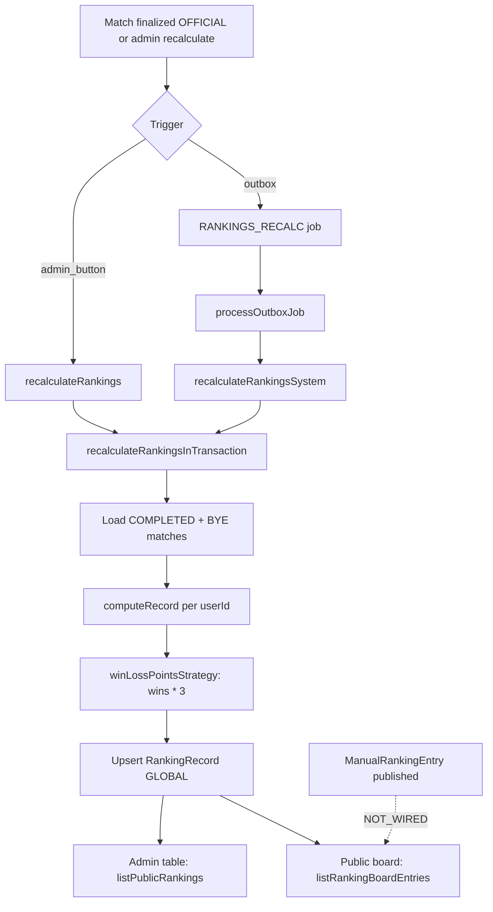

*Source diagram:* `docs/handover/diagrams/13-ranking-update.mmd`

*Sources: `_research/04-tournament-lifecycle.md`, `04-brackets-rankings.md`.*

---

## 13. Business Rules

Essential rules (full write-ups: `_research/05-business-rules.md`).

| # | Rule | Summary | Primary source |
|---|------|---------|----------------|
| 1 | Eligibility | Gender + belt↔experience when taxonomy set; BEGINNER=White; INTERMEDIATE=Blue/Purple | `registrationEligibility.ts` |
| 2 | Division taxonomy | Road-to-Super-Fight weight × gender × experience grid; weight bounds **not** scale-checked at register | `divisionTaxonomy.ts` |
| 3 | Registration | Event open window; consents; no duplicate active seat; server-authoritative fee | `registrationService.ts` |
| 4 | Occupancy | Atomic `filledCount` claim/release; missing counter errors (backfill) | `divisionOccupancy.ts` |
| 5 | Payments | Manual UTR review; feeSnapshot immutable; duplicate UTR flag only | `paymentService.ts` |
| 6 | Coupons | Reserve → redeem; hold minutes env-tunable; not % discount | `couponService.ts` |
| 7 | Schedule conflicts | Assumed match duration; mat/fighter overlap; override flag | `matchConflict.ts` |
| 8 | Brackets | Single-elim; power-of-two pad; byes; publish irreversible | `bracketEngine.ts` |
| 9 | Scoring | Event rules; version + idempotency; finalize OFFICIAL | `scoringService.ts` |
| 10 | Rankings | Placeholder `wins * 3`; manual board unwired | `rankingEngine.ts` |
| 11 | Judge credentials | Per-match; generation revoke; match-scoped | `judgeCredentialService.ts` |
| 12 | Cancel/transfer | Admin-reviewed; refund % informational | `requestService.ts` |
| 13 | Teammate transfer | Hashed invite token; eligibility on claim | `teammateTransfer.ts` |

---

## 14. Database

**24** Mongoose models in `backend/models/`. Timestamps on all except AuditLog (`createdAt` only).

**Figure — Core Mongoose collections ERD**

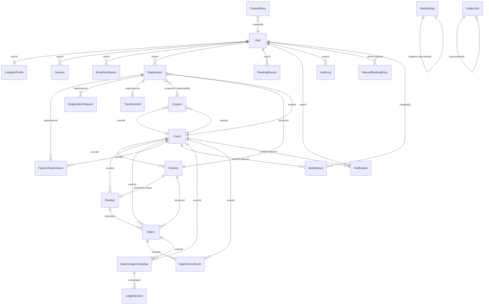

*Source diagram:* `docs/handover/diagrams/14-database-erd.mmd`

### Model catalogue

| # | Model | Collection | Purpose |
|---|-------|------------|---------|
| 1 | User | `users` | Auth identity; GRAPPLER / ADMIN |
| 2 | GrapplerProfile (FighterProfile) | `fighterprofiles` | Public + private profile |
| 3 | Session | `sessions` | App cookie session (hashed token, TTL) |
| 4 | EmailVerification | `emailverifications` | Hashed OTP codes |
| 5 | Event | `events` | Tournament root |
| 6 | Division | `divisions` | Class + capacity |
| 7 | Registration | `registrations` | Seat + feeSnapshot |
| 8 | PaymentSubmission | `paymentsubmissions` | UTR + screenshot queue |
| 9 | Coupon | `coupons` | Single-use payment-option codes |
| 10 | Bracket | `brackets` | One single-elim per division |
| 11 | Match | `matches` | Bout + scores + result |
| 12 | MatchScoreEvent | `matchscoreevents` | Live scoring timeline |
| 13 | MatchJudgeCredential | `matchjudgecredentials` | Per-match judge login |
| 14 | JudgeSession | `judgesessions` | Judge cookie session (TTL) |
| 15 | RankingRecord | `rankingrecords` | Computed W/L/points |
| 16 | ManualRankingEntry | `manualrankingentries` | Admin-curated rows |
| 17 | RegistrationRequest | `registrationrequests` | Cancel / transfer |
| 18 | TransferInvite | `transferinvites` | Teammate handoff |
| 19 | Notification | `notifications` | In-app alerts |
| 20 | OutboxJob | `outboxjobs` | Durable async jobs |
| 21 | ContentEntry | `contententries` | FAQ / announcement / policy |
| 22 | MediaAsset | `mediaassets` | External media links |
| 23 | SiteSettings | `sitesettings` | Singleton contact card |
| 24 | AuditLog | `auditlogs` | Append-only action trail |

### Essential field notes

- **User:** `email` unique; `role` GRAPPLER\|ADMIN\|FIGHTER; `emailVerified`; `status` ACTIVE\|DISABLED.
- **Registration:** active statuses hold capacity; partial unique `{userId, divisionId}`; `feeSnapshot` freezes amount/option/QR/coupon.
- **Event:** nested `paymentOptions[]` + `scoringRules`; status DRAFT→…→COMPLETED.
- **Match:** statuses include PENDING, SCHEDULED, LIVE, DELAYED, COMPLETED, BYE, CANCELLED, ERROR; `scoreVersion` for concurrency.
- **Privacy:** Aadhaar / parental consent / payment screenshots are storage keys only — served via authenticated APIs.

Full operational detail (per-field tables, indexes, lifecycles): [UpnRoll_Database_Documentation.md](./UpnRoll_Database_Documentation.md).

*Sources: `_research/05-database.md`.*

---

## 15. API & Server Actions

**Primary mutation surface:** Server Actions (`"use server"`). REST is mainly binary media, Google OAuth, health, and cron (**18** `route.ts` handlers).

### REST essentials

| Method | Path | Auth | Purpose |
|--------|------|------|---------|
| GET | `/api/health` | Public | Mongo ping |
| GET\|POST | `/api/cron/process-outbox` | Bearer `CRON_SECRET` | Outbox worker |
| GET | `/api/auth/google` (+ callback) | Public / OAuth | Optional Google login |
| GET | `/api/v1/public/grapplers/[slug]/photo` | Public | Public passport photo |
| GET | `/api/v1/grappler/photo\|aadhaar\|parental-consent` | GRAPPLER | Own private images |
| GET | `/api/v1/grappler/events/[eventId]/payment-qr` | Session | Payment QR stream |
| GET | `/api/v1/admin/…` (photo, aadhaar, consent, QR, screenshot) | ADMIN | Private bytes |

Legacy `/api/v1/fighter/*` mirrors grappler routes (redirects also configured).

### Server Actions by module (inventory)

| Module | Actions (representative) | Auth |
|--------|--------------------------|------|
| `features/auth` | register, login, verify, resend, logout | Public / session |
| `features/profile` | updateProfileAction | GRAPPLER |
| `features/registrations` | createRegistration; withdraw (admin) | GRAPPLER / ADMIN |
| `features/payments` | submitPayment; apply coupon; admin option/coupon CRUD | Mixed |
| `features/admin-payments` | approve / reject | ADMIN |
| `features/requests` | create/decide request; teammate transfer create/claim | Mixed |
| `features/events` | create event/division; status; mats; details; seed | ADMIN |
| `features/brackets` | generate; publish | ADMIN |
| `features/matches` | record/correct result; schedule; judge credentials | ADMIN |
| `features/judge` | login/logout; score; undo; finalize | Judge session |
| `features/scoring` | saveScoringRules | ADMIN |
| `features/rankings` | recalculate; manual upsert/delete | ADMIN |
| `features/notifications` | mark read; retry outbox | Mixed |
| `features/settings` / media / content | site settings; media create; content CRUD/publish | ADMIN |
| `features/chatbot` | askChatbotAction | Public |

**Rate limits:** in-memory 10 tokens / 60s on register/login/verify/resend and judge-login — **not** multi-instance safe.

Full field lists and fictional HTTP examples: [UpnRoll_API_Reference.md](./UpnRoll_API_Reference.md).

*Sources: `_research/05-api-actions.md`.*

---

## 16. Authentication & Security

### App session

| Item | Detail |
|------|--------|
| Cookie | `upnroll_session` |
| Max age | 30 days |
| Flags | httpOnly, sameSite=lax, secure in production |
| Value | HMAC-packed token (`SESSION_SECRET`) |
| Store | SHA-256 of raw token in `Session` + TTL |
| Password | scrypt + timing-safe verify |
| Register policy | min 10 chars, letter + number |

### Security controls (Implemented)

- Dual layout + service RBAC; proxy documented as non-authoritative
- Magic-byte upload validation; path traversal hardening; production `STORAGE_DRIVER` assert
- Security headers: HSTS, X-Frame-Options DENY, nosniff, restrictive Permissions-Policy
- CSP **Report-Only** (do not flip to enforcing without nonce/hash strategy)
- Safe client errors via `toAppError` / `fail()`
- Audit logs on auth and credential events

### Recommended improvements (not blockers for understanding)

Distributed rate limiting; enforce CSP; shorter admin session / re-auth; MFA for Admin; real WhatsApp when required.

*Sources: `_research/06-auth-security-rbac.md`.*

---

## 17. Email & Notifications

### Transport

Nodemailer SMTP when all five `SMTP_*` set; otherwise console adapter in non-production. Production runtime **fails closed** without SMTP (`instrumentation.ts`).

### Trigger matrix (essential)

| Trigger | Channel |
|---------|---------|
| Register / resend / verified welcome | Email |
| Payment submitted / approved / rejected | Email |
| Cancel/transfer decided | Email |
| Match schedule updated | Email + WhatsApp **mock** |
| Reminders / result notify | Outbox → in-app + email |
| Rankings recalc | Outbox (system, no user message) |

### Outbox job types

`MATCH_REMINDER` · `MATCH_SCHEDULE_CHANGED` · `MATCH_RESULT_NOTIFY` · `RANKINGS_RECALC` · `EMAIL_DISPATCH` (stub).

Admin recovery: `/admin/notifications` (failed jobs + retry). Cron: `/api/cron/process-outbox`.

**Gaps:** WhatsApp is console-only; `PAYMENT_DECISION` in-app type exists but payment decisions are email-only today; SMTP inbox delivery **Requires confirmation**.

*Sources: `_research/06-email-notifications.md`.*

---

## 18. Integrations

| Integration | Status | Notes |
|-------------|--------|-------|
| MongoDB | Wired | `MONGODB_URI` required |
| Session crypto | Wired | `SESSION_SECRET` ≥32 |
| SMTP / Nodemailer | Wired (config-dependent) | Prod requires all five |
| Google OAuth | Optional | Soft-fail if unset |
| Local disk / GridFS storage | Wired | Prod must set `STORAGE_DRIVER` |
| Outbox cron (Vercel + optional GH Actions) | Wired | Bearer `CRON_SECRET` |
| FAQ chatbot | Local keyword engine | No LLM |
| Manual UPI payments | Wired | No Stripe/Razorpay |
| WhatsApp Business | Mock only | console.log |
| Redis / Sentry / S3 / Docker | Absent | — |

*Sources: `_research/06-integrations-env.md`.*

---

## 19. Directory Structure

Excludes `node_modules/`, `.next/`. Companion detail: `_research/01-directory-tree.md`.

```
upnrol/
├── .github/workflows/          # ci.yml, process-outbox.yml
├── backend/
│   ├── audit/ auth/ content/ db/ email/ http/
│   ├── models/                 # 24 schemas
│   ├── notifications/ observability/
│   ├── services/               # 34 non-test services
│   ├── storage/ validation/
│   └── README.md
├── docs/                       # architecture, decisions, handover, qa, …
├── frontend/
│   ├── public/
│   ├── scripts/ensure-root-modules.mjs
│   └── src/
│       ├── app/                # route groups + api
│       ├── components/         # ui + layout/home/…
│       ├── features/           # 20 domain modules
│       ├── lib/ hooks/ data/ test/
│       └── proxy.ts
├── scripts/                    # create-admin, seed-demo, backfills
├── CLAUDE.md
├── package.json                # delegates to frontend/
├── vercel.json
└── README.md
```

**Alias:** `@/server/*` → `../backend/*` (`frontend/tsconfig.json`, `next.config.ts`).

**Legacy Fighter → Grappler redirects** (`frontend/next.config.ts`): `/fighter/*` → `/grappler/*`; `/fighters/*` → `/grapplers/*`; admin & API equivalents.

---

## 20. Installation

Prerequisites: Node.js **20+** (CI uses **Node 22**); MongoDB with database name in URI path.

```bash
git clone <repo-url>
cd upnroll
npm install --prefix frontend
# Copy frontend/.env.example → frontend/.env.local and fill values (names only in §21)
npm run create-admin -- --email you@example.com --password "a-real-password"
# optional:
npm run seed-demo
npm run dev   # http://localhost:3000
```

Root scripts delegate into `frontend/`. `predev`/`prebuild` run `ensure-root-modules.mjs` so `backend/` resolves packages.

*Sources: `_research/07-deployment.md`, [UpnRoll_Deployment_Guide.md](./UpnRoll_Deployment_Guide.md).*

---

## 21. Environment Variables

**Names and purposes only — never paste real secrets into this pack.** Authoritative template: `frontend/.env.example`.

| Name | Purpose | Required? |
|------|---------|-----------|
| `NEXT_PUBLIC_SITE_URL` | Public origin (SEO, email CTAs) | Strongly recommended |
| `MONGODB_URI` | Mongo connection (must include DB name) | **Required** |
| `SESSION_SECRET` | HMAC for cookies (≥32 chars) | **Required** |
| `ADMIN_SEED_EMAIL` / `ADMIN_SEED_PASSWORD` | CLI create-admin only | Optional (CLI) |
| `UI_PREVIEW_ENABLED` | Enable `/ui-preview` outside local | Optional; never `true` on real prod |
| `SMTP_HOST/PORT/USER/PASS/FROM` | Email | **Required in production runtime** |
| `STORAGE_DRIVER` | `gridfs` \| `local` | **Required in production** |
| `GOOGLE_CLIENT_ID` / `GOOGLE_CLIENT_SECRET` | Optional OAuth | Optional pair |
| `CRON_SECRET` | Bearer for outbox cron | Required for cron |
| `COUPON_RESERVATION_MINUTES` | Coupon hold (default 15) | Optional |
| `COUPON_MAX_OPEN_RESERVATIONS` | Max holds/user (default 3) | Optional |
| `ASSUMED_MATCH_DURATION_MINUTES` | Schedule overlap (default 10) | Optional |

Platform-injected fallbacks: `VERCEL_URL`, `VERCEL_PROJECT_PRODUCTION_URL`, `NODE_ENV`, `CI`, `NEXT_PHASE`.

Full sanitized `.env.example` copy and ops checklist: [UpnRoll_Deployment_Guide.md](./UpnRoll_Deployment_Guide.md) and `_research/06-integrations-env.md`.

---

## 22. Deployment

**Figure — Deployment architecture (Vercel + Mongo + cron)**

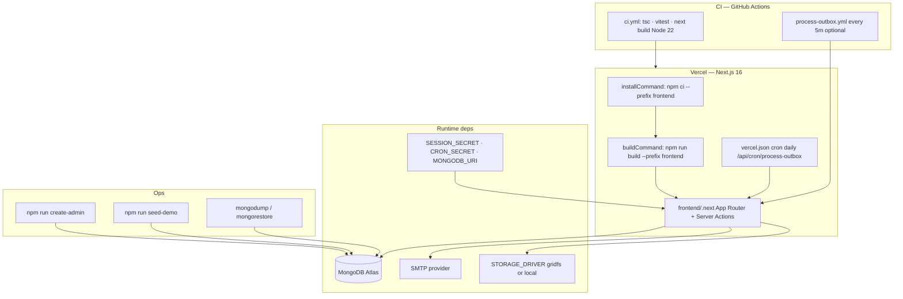

*Source diagram:* `docs/handover/diagrams/16-deployment-architecture.mmd`

### `vercel.json` (Verified in repo)

| Key | Value |
|-----|--------|
| installCommand | `npm ci --prefix frontend && node frontend/scripts/ensure-root-modules.mjs` |
| buildCommand | `npm run build --prefix frontend` |
| outputDirectory | `frontend/.next` |
| crons | Daily `0 0 * * *` → `/api/cron/process-outbox` |

Hosting provider selection remains **Requires confirmation** (OD-012). Prefer `STORAGE_DRIVER=gridfs` on multi-instance / ephemeral FS.

### Cron

- Vercel daily cron (Hobby-friendly stuck-job sweep; force semantics).
- Optional GitHub Actions `.github/workflows/process-outbox.yml` every 5 minutes on fight day (`CRON_OUTBOX_URL` + `CRON_SECRET`).

### Backup / restore (documented)

```bash
mongodump --uri="$MONGODB_URI" --out=./backups/$(date +%Y%m%d-%H%M%S)
mongorestore --uri="$MONGODB_URI" ./backups/<timestamp>
```

Local-disk private files are **not** in mongodump. Backup owner + retention: **Requires confirmation** (OD-011).

Full guide: [UpnRoll_Deployment_Guide.md](./UpnRoll_Deployment_Guide.md).

---

## 23. Performance

| Topic | Status |
|-------|--------|
| Cache Components + partialPrefetching | **Implemented** (`next.config.ts`) |
| Public tagged caches (`cacheLife("minutes")`) | **Implemented** (`public-reads.ts`) |
| `connection()` before cookies/DB on dynamic routes | **Implemented** |
| Session request dedupe via React `cache()` | **Implemented** |
| Model indexes | Declared on schemas; Phase 6 review applied |
| `next/image` on key public surfaces | Present |
| Lighthouse / CWV field scores | **Not claimed** — no standing gate |

Prefer timing judgments on `npm run build` + `npm run start`, not `next dev` cold compiles.

*Sources: `_research/07-performance.md`.*

---

## 24. Testing

| Item | Value |
|------|-------|
| Automated test files | **50** `*.test.ts` |
| Runner | Vitest via `npm test` |
| Manual/browser UAT this pack | **Not Tested** (not re-executed) |
| Standing Playwright/Cypress | Not retained in-repo |
| Historical Phase 6 / E2E | Confidence only — not current sign-off |

### Coverage clusters

Auth/session/HTTP · registration/payments/coupons · brackets/matches/scoring · rankings/requests/chatbot/outbox · storage/email/DB · selected frontend schemas.

### Commands

```bash
npm install --prefix frontend
cd frontend && npx tsc --noEmit --pretty false
npm test
npm run build --prefix frontend
npm run lint
```

Full inventory and feature matrix: [UpnRoll_Testing_Report.md](./UpnRoll_Testing_Report.md).

---

## 25. Maintenance & Troubleshooting

Prefer diagnostics then safe fixes. Do not run destructive DB ops without owner approval.

| Symptom | Likely cause | Safe direction |
|---------|--------------|----------------|
| Always redirected to `/login` | Session cookie / `SESSION_SECRET` mismatch | One stable secret per environment |
| Confirm email before sign in | Unverified account | Complete `/verify`; check console SMTP in dev |
| Admin lands on grappler desk | Role not ADMIN | `npm run create-admin -- --email …` |
| Capacity / cannot register | Full division or missing `filledCount` | Assess backfill script after backup |
| Payment stuck PENDING | Design (manual review) | Admin `/admin/payments` |
| Screenshot 404 on Vercel | Local disk on ephemeral FS | Prefer `gridfs` + migrate keys |
| Judge login fails | Wrong/revoked creds or unscorable match | Regenerate credentials |
| Public bracket empty | Still DRAFT | Admin publish |
| Manual rankings missing on public | Code gap | Do not promise until wired |
| Prod won't start | Missing SMTP or `STORAGE_DRIVER` | Set all five SMTP + driver |
| Cron 401/503 | Bad/missing `CRON_SECRET` | Align host + GH secrets |
| Outbox always skipped | Off event day without force | `?force=1` / Vercel cron / fight-day workflow |

Rollback-oriented: redeploy last good SHA; restore Mongo to non-prod first; disable GH outbox workflow if jobs misbehave; rotate `SESSION_SECRET` only when full logout is acceptable.

*Sources: `_research/07-troubleshooting.md`.*

---

## 26. Client Operating Manual (Summary)

This section is a **summary** for stakeholders. Day-to-day step-by-step procedures with screenshots placeholders live in:

**→ [UpnRoll_Client_Operating_Manual.md](./UpnRoll_Client_Operating_Manual.md)**

### Operator quick path

1. Sign in at `/login` with an ADMIN account (CLI-provisioned — never public register).
2. Create event at `/admin/events` → configure hub (status, mats, QR, fees, scoring rules).
3. Seed/create divisions → open registration.
4. Review payments at `/admin/payments` → approve/reject.
5. Generate + publish brackets → schedule matches → issue judge credentials.
6. Prefer judge console for live scoring; or admin record result for SCHEDULED matches.
7. Recalculate rankings / ensure outbox cron runs; set event COMPLETED when done.
8. Keep FAQ/policies/announcements and site settings current.

Remember: **no verifier role**; refunds are operational (percent recorded, no auto payout); published brackets cannot be unpublished.

---

## 27. Feature Delivery Matrix (Summary)

Full row-by-row inventory: **[UpnRoll_Feature_Delivery_Matrix.md](./UpnRoll_Feature_Delivery_Matrix.md)**.

### Module roll-up (from matrix §3)

| Module | Rows | Implemented | Partially | Not Implemented |
|--------|------|-------------|-----------|-----------------|
| Public | 14 | 11 | 3 | 0 |
| Auth | 7 | 5 | 1 | 1 (password reset) |
| Grappler | 12 | 12 | 0 | 0 |
| Admin | 16 | 14 | 2 | 0 |
| Judge | 6 | 5 | 1 | 0 |
| Brackets & matches | 8 | 6 | 0 | 2 (RR, season locks) |
| Payments | 8 | 7 | 1 | 0 |
| Rankings | 5 | 3 | 2 | 0 |
| Content & media | 6 | 4 | 1 | 1 |
| Notifications | 7 | 5 | 2 | 0 |
| Security | 8 | 7 | 0 | 1 (ext. monitoring) |

Must-disclose **Partial** items before claiming production completeness: public rankings/manual wiring, media CRUD limits, Store/Seminars stubs, dual match-result path, OAuth env dependency.

---

## 28. Known Limitations

Nothing below is an approved production default. Priority from `_research/07-limitations.md` + open decisions.

### P0 — production / integrity

| Item | Notes |
|------|-------|
| Hosting / integrations (OD-012) | Owner decisions |
| SMTP delivery unproven | Vars required; inbox proof **Requires confirmation** |
| Backup ownership + retention (OD-011) | Payment screenshots PII-adjacent |
| Multi-instance + local disk / in-memory rate limit | Prefer GridFS; distributed limiter absent |
| GridFS production readiness | Adapter exists; owner-confirm key persistence |
| Occupancy backfill | Missing `filledCount` can block registrations |

### P1 — product / polish (selected)

| Item | Notes |
|------|-------|
| OD-004 ranking methodology | `wins * 3` placeholder |
| Manual rankings unwired to `/rankings` | Admin copy overstates behaviour |
| No bracket unpublish | Publish is one-way |
| Media create-only | No edit/delete/unpublish |
| Store / Seminars | ComingSoon stubs |
| Password reset | **Not Implemented** |
| Coupon apply rate limit | Gap (BUG-QA-2026-03) |
| Formats beyond single-elim (OD-003) | RR / points open |
| CSP Report-Only | Do not enforce casually |
| Fee/UTR/refund policy (OD-005–008) | Workflow exists; policy open |

### P2 — deferred

WhatsApp real send; REST CRUD product API (Server Actions by design); champion entity; standing Lighthouse/pen-test gates; `/ui-preview` must stay disabled in real production.

---

## 29. Handover Checklist

Executable checklist with ownership columns: **[UpnRoll_Handover_Checklist.md](./UpnRoll_Handover_Checklist.md)**.

### Condensed checklist

| Area | Key items |
|------|-----------|
| Repository | Access shared; pack at `docs/handover/` for `4ffb794` |
| Deployment | Procedure understood; staging ≠ prod; rollback agreed |
| Hosting | Provider approved (OD-012); topology; monitoring |
| Domain | DNS/TLS; `NEXT_PUBLIC_SITE_URL`; OAuth redirect if used |
| Database | Prod Mongo; DB name in URI; network access; occupancy assessed |
| Backups | Owner named; retention; restore drill; private-file plan |
| Secrets | All env set on host; transferred via **secure channel separately** |
| External accounts | SMTP, Atlas, host, GitHub Actions secrets |
| Admin access | Production ADMIN provisioned; credentials secure |
| Documentation | Full pack received; open-decisions path known |
| Training | Admin / grappler / judge / cron walkthroughs |
| Testing | Fresh `npm test` + staging smoke + SMTP proof |
| Maintenance | Deploy owner; outbox monitoring; CSP stays Report-Only |

Mark items ☐ / ☑ in the dedicated checklist document — do not treat this summary as the signed artefact.

---

## 30. Client Acceptance Sign-Off

Placeholders for formal acceptance. Prefer also completing signatures in [UpnRoll_Handover_Checklist.md](./UpnRoll_Handover_Checklist.md) §18.

### Project identification

| Field | Value |
|-------|-------|
| Project | Up 'n Roll |
| Git commit handed over | `4ffb794` |
| Document version | 1.0.0 |
| Client organisation | *[Requires confirmation]* ________________ |
| Date of acceptance | ________________ |

### Dimensity Labs (delivering party)

| Field | Value |
|-------|-------|
| Name | ______________________________ |
| Role | ______________________________ |
| Signature | ______________________________ |
| Date | ______________________________ |

I confirm that this master handover document and companion pack for commit **`4ffb794`** have been prepared in good faith from repository evidence. Items marked **Requires confirmation** remain operational responsibilities until closed by the receiving party.

### Receiving party (client / owner)

| Field | Value |
|-------|-------|
| Name | ______________________________ |
| Organisation | ______________________________ |
| Role | ______________________________ |
| Signature | ______________________________ |
| Date | ______________________________ |

I confirm receipt of repository access (or agreed alternative), documentation, and that credentials (if any) were transferred via a **secure channel separately**. I understand known limitations and open decisions and accept ownership of items marked **Requires confirmation**.

### Optional technical witness

| Field | Value |
|-------|-------|
| Name | ______________________________ |
| Role | ______________________________ |
| Signature | ______________________________ |
| Date | ______________________________ |

### Acceptance scope acknowledgement

| Statement | Initials |
|-----------|----------|
| Single-elimination tournament loop understood | ______ |
| Manual UPI verification model accepted (no PSP) | ______ |
| Ranking methodology provisional until OD-004 closed | ______ |
| Store/Seminars stubs acknowledged | ______ |
| Password reset not included | ______ |
| Secrets not present in this document | ______ |

---

## 31. Glossary

| Term | Meaning |
|------|---------|
| **Grappler** | Athlete user role and portal (`GRAPPLER`, `/grappler/*`) |
| **Fighter** | Legacy term / code identifiers; URLs redirect to Grappler |
| **Admin** | Operator role (`ADMIN`, `/admin/*`) |
| **Judge** | Match-scoped credential session — not a User role |
| **UTR** | Bank/UPI transaction reference submitted as payment proof |
| **feeSnapshot** | Frozen fee/QR/coupon on a Registration at create time |
| **CONFIRMED** | Registration status after payment approval; bracket-eligible |
| **PENDING_VERIFICATION** | Awaiting admin payment decision |
| **Outbox** | Durable async job queue (`OutboxJob`) processed by cron |
| **OD-xxx** | Open decision id in `docs/decisions/open-decisions.md` |
| **Server Action** | Next.js `"use server"` mutation — primary API surface |
| **Cache Components** | Next.js 16 caching mode enabled in this project |
| **GridFS** | MongoDB file storage adapter for private blobs |
| **Road to Super Fight** | Seeded division taxonomy (gender × weight × experience) |
| **Teammate transfer** | Peer seat handoff via hashed invite token |
| **TRANSFER request** | Admin-reviewed same-event division move |
| **Implemented / Partial / Requires confirmation** | Status tags used throughout this handover |

---

*End of Master Project Handover & Technical Documentation — Dimensity Labs · Version 1.0.0 · 2026-11-27 · `main` @ `4ffb794`*

*This document consolidates research under `docs/handover/_research/`, companion split docs, and all 16 diagrams under `docs/handover/diagrams/`.*