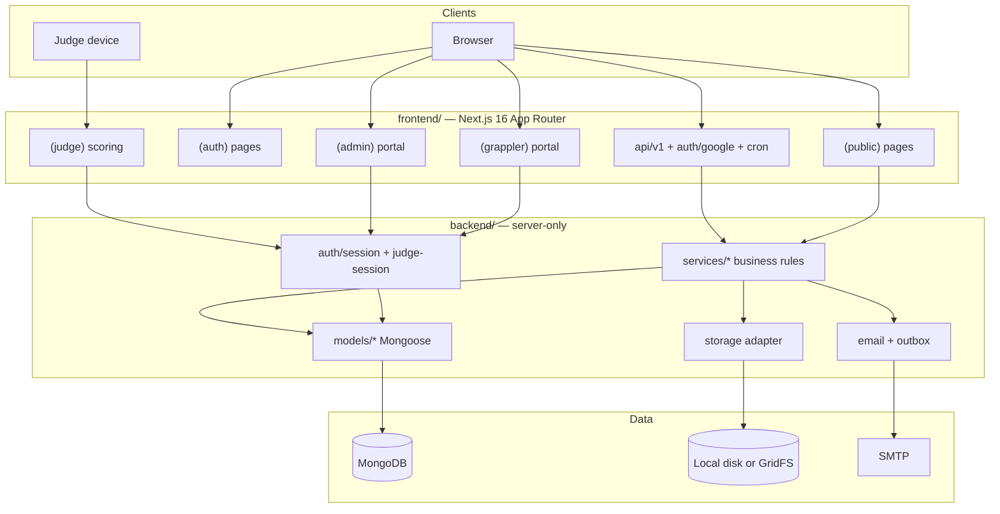
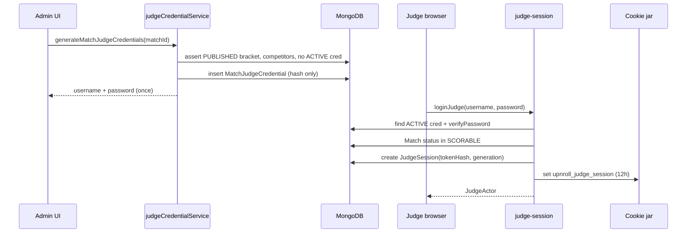
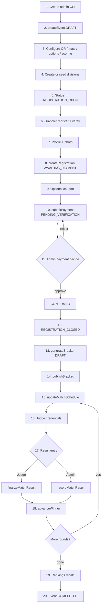
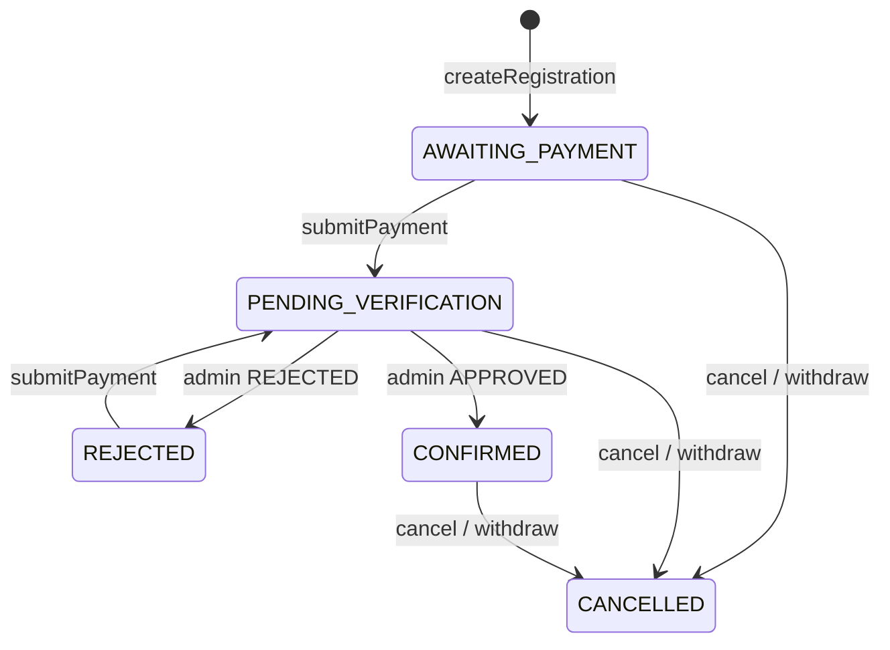
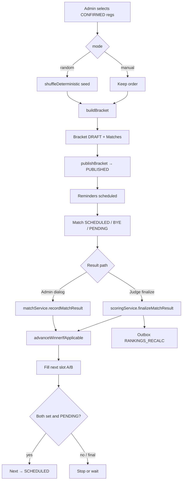
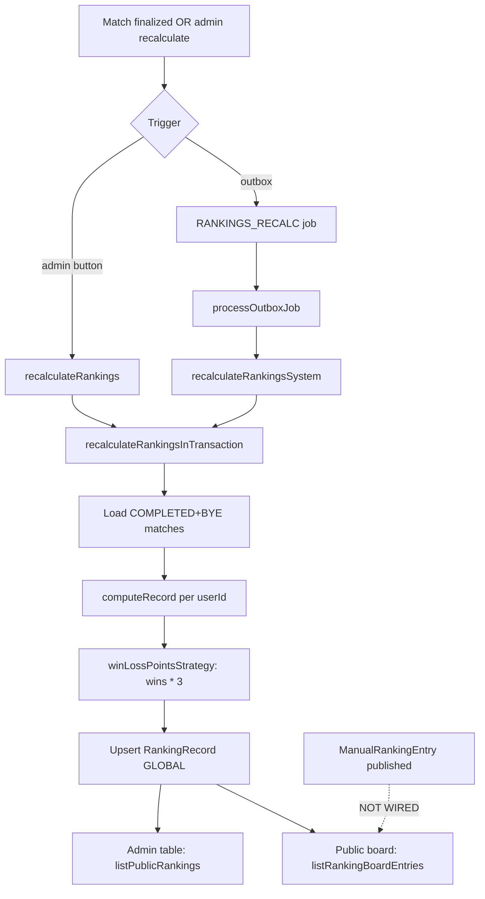
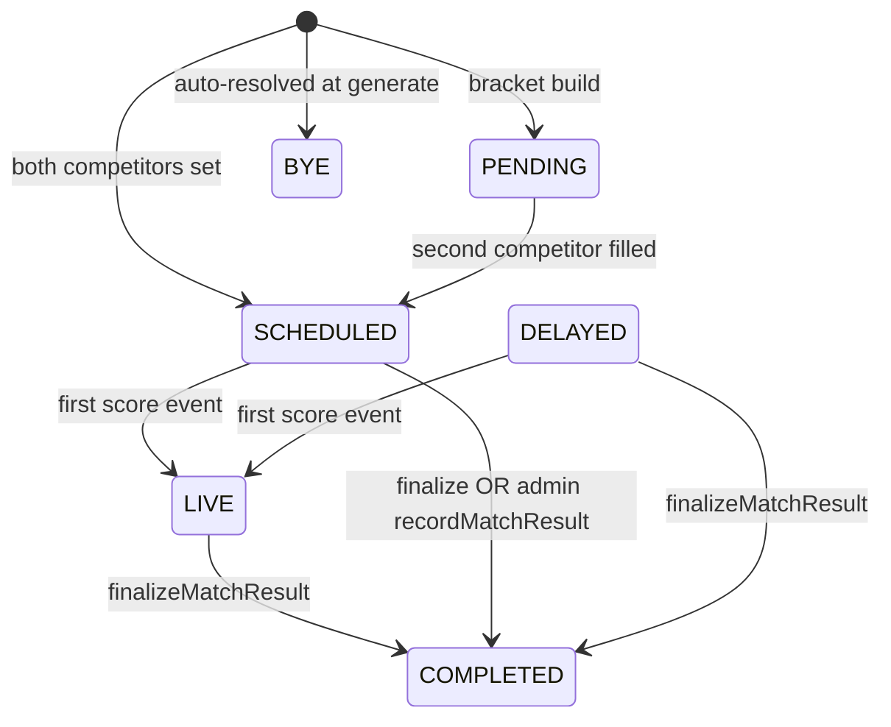
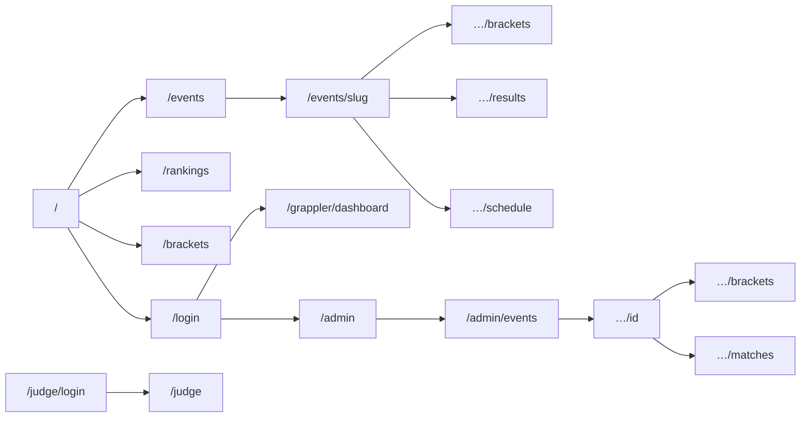

# Up 'n Roll — Technical Documentation

| Field | Value |
|-------|--------|
| Prepared by | **Dimensity Labs** |
| Document | Technical Documentation |
| Version | 1.0.0 |
| Date | 2026-11-27 |
| Git commit | `4ffb794` (`main`) |
| Audience | Developers / architects taking ownership |

**Sibling docs (full detail):**

| Doc | Scope |
|-----|--------|
| [UpnRoll_API_Reference.md](./UpnRoll_API_Reference.md) | REST routes + Server Actions inventory |
| [UpnRoll_Database_Documentation.md](./UpnRoll_Database_Documentation.md) | Models, indexes, ERD |
| [UpnRoll_Deployment_Guide.md](./UpnRoll_Deployment_Guide.md) | Env, Vercel, cron, backups |
| [UpnRoll_Client_Operating_Manual.md](./UpnRoll_Client_Operating_Manual.md) | Non-technical admin ops |
| `_research/` | Raw research notes used to build this pack |

---

## 1. Architecture overview

Up 'n Roll is a full-stack tournament platform for combat sports (BJJ / grappling): public marketing and live boards, grappler self-service, admin operations, and a match-scoped judge scoring console.

**Shape:** one Next.js 16 App Router app (`frontend/`) with server-only business logic in `backend/`. There is no separate backend package. Webpack/tsconfig alias `@/server/*` → `../backend/*`. Dependencies used by `backend/` are installed in `frontend/package.json`.

**Auth:** custom cookie sessions in MongoDB (not a primary third-party IdP). Optional Google OAuth. Judge access is a separate credential + cookie plane.

**Payments:** manual UPI/QR + screenshot/UTR review — no Stripe/Razorpay.

**Storage:** pluggable private-file adapters (`local` disk or `gridfs`) via `STORAGE_DRIVER`.



### Route groups (no `middleware.ts`)

| Group | Prefix | Gate |
|-------|--------|------|
| `(public)` | `/`, `/events`, `/rankings`, … | None |
| `(auth)` | `/login`, `/register`, `/verify` | Guest |
| `(grappler)` | `/grappler/*` | Session + role `GRAPPLER` |
| `(admin)` | `/admin/*` | Session + role `ADMIN` |
| `(judge)` | `/judge/*` | Judge cookie session |
| `(preview)` | `/ui-preview` | Dev / `UI_PREVIEW_ENABLED` |

`frontend/src/proxy.ts` (Next 16 proxy) only checks **cookie presence** for UX redirects. Authoritative auth is layout + Server Action / service asserts.

**Terminology:** User-facing routes use **Grappler**. Legacy `/fighter/*`, `/fighters/*`, `/admin/fighters/*` permanently redirect. Internal identifiers (`fighterService`, `FighterProfile`, `assertFighter`) remain.

---

## 2. Technology stack

| Layer | Choice |
|-------|--------|
| Framework | Next.js **16.4.5** (App Router, Cache Components, webpack builds) |
| UI | React **19.2.3**, Tailwind **4**, shadcn/Radix primitives |
| Language | TypeScript **^5** |
| Validation | Zod **^4**, react-hook-form |
| Data | MongoDB + Mongoose **^9** |
| Auth | Custom sessions (HMAC cookie + hashed token); optional Google OAuth |
| Email | Nodemailer SMTP (console adapter in incomplete local config) |
| Motion | Framer Motion, GSAP |
| Tests | Vitest **^3** (frontend + backend via aliases) |
| Scripts | `tsx` + `frontend/.env.local` |

**Scale snapshot @ `4ffb794`:** 51 pages · 18 API `route.ts` · 24 models · 34 services · ~32.8k non-blank LOC (`frontend/src` + `backend`, excl. tests).

---

## 3. Directory layout

```
upnrol/
├── backend/           # server-only: models, services, auth, storage, email, http
├── frontend/          # Next.js app (package.json, next.config.ts, src/)
│   └── src/
│       ├── app/       # route groups + api/
│       ├── features/  # feature-sliced UI + Server Actions
│       ├── components/
│       └── lib/       # public-reads, tags, config, site-url
├── scripts/           # create-admin, seed-demo, backfills, e2e audit
├── docs/              # architecture, qa, handover, deployment
├── package.json       # root scripts delegate into frontend/
└── vercel.json
```

**Rule:** business logic lives in `backend/services/*`. Pages, actions, and API handlers stay thin and call services through `@/server/*`.

Key backend areas: `models/`, `services/`, `auth/`, `storage/`, `http/`, `email/`, `notifications/`, `audit/`, `validation/`.

---

## 4. Authentication & RBAC

### Roles

| Role | Portal | Notes |
|------|--------|-------|
| `ADMIN` | `/admin` | Created only via `npm run create-admin` / `scripts/create-admin.ts` |
| `GRAPPLER` | `/grappler` | Public register; legacy Mongo `FIGHTER` normalized on read |
| Judge | `/judge` | **Not** a `User.role` — `MatchJudgeCredential` + `JudgeSession` |

No VERIFIER / multi-admin ACL beyond `ADMIN`.

### App session

| Item | Detail |
|------|--------|
| Cookie | `upnroll_session` · httpOnly · sameSite lax · secure in prod · 30 days |
| Packing | HMAC-SHA256 (`SESSION_SECRET` ≥ 32 chars) |
| Store | `Session.tokenHash` = SHA-256 of raw token; TTL `expiresAt` |
| Read | `getSession()` → `connection()` then React `cache()`-wrapped `readSession` |
| Guards | `requireSession` / `requireRole` / `requireActor`; services `assertAdmin` / `assertGrappler` |

Password hashing: Node `scrypt` + salt (`backend/auth/password.ts`). Register policy: min 10 chars, letter + number. Email verify required before password login (6-digit code, 15 min TTL).

### Judge session

| Item | Detail |
|------|--------|
| Cookie | `upnroll_judge_session` · 12h |
| Issue | Admin generates 10-char username/password once; password hash only stored |
| Scope | Bound to `matchId` + credential `generation`; regenerate revokes sessions |
| Login gate | Match status ∈ `SCHEDULED` \| `LIVE` \| `DELAYED` |



### Layout gates

- Admin: no session → `/login`; non-ADMIN → `/grappler/dashboard`; `instant = false`
- Grappler: no session → `/login`; non-GRAPPLER → `/admin`
- Judge layout is shell only; pages/actions call `requireJudgeSession`

---

## 5. API pattern: Server Actions vs REST

**Primary mutation surface:** Next.js Server Actions (`"use server"`) in `frontend/src/features/*/actions.ts`. They call `requireActor` / `requireJudgeSession`, then `backend/services/*`.

**REST (`frontend/src/app/api/**`) is narrow:**

| Kind | Examples |
|------|----------|
| Health / cron | `GET /api/health`, `GET\|POST /api/cron/process-outbox` (Bearer `CRON_SECRET`) |
| OAuth | `/api/auth/google`, `/api/auth/google/callback` |
| Private/public media streams | `/api/v1/{admin,grappler,public}/…` photos, Aadhaar, payment QR/screenshots |

There is **no general REST CRUD product API**. Prefer extending Server Actions + services.

Rate limiting: in-memory token bucket (10 / 60s) on auth (and judge-login) actions only — **not multi-instance safe**.

Full inventory: sibling **UpnRoll_API_Reference.md**.

---

## 6. Key services

| Service | Responsibility |
|---------|----------------|
| `eventService` | Events, divisions, status, mats, QR, seed Road-to-Super-Fight |
| `registrationService` + `registrationStateMachine` | Seats, feeSnapshot, status guards |
| `registrationEligibility` / `divisionTaxonomy` / `divisionOccupancy` | Gender/belt gates, grid seed, capacity |
| `paymentService` / `paymentQueue` / `paymentOptionService` | UTR submit, approve/reject, fee tiers |
| `couponService` | Reserve / redeem / disable / release |
| `bracketEngine` + `bracketService` | Pure single-elim + persist/publish |
| `matchService` + `matchConflict` | Schedule, admin record/correct, conflicts |
| `scoringService` + `tournamentRules` | Live score timeline, finalize, provisional winner |
| `judgeCredentialService` | Per-match credentials |
| `rankingEngine` + `rankingService` + `manualRankingService` | Computed records; manual CRUD (public wiring gap) |
| `requestService` / `teammateTransfer` | Admin cancel/transfer; peer seat handoff |
| `fighterService` / `dashboardService` | Profiles, desks |
| `contentService` / `mediaService` / `siteSettingsService` | CMS, media URLs, footer contact |
| `chatbotEngine` | Deterministic FAQ keyword match (no LLM) |
| `outboxService` + reminder/notify processors | Durable jobs for rankings, reminders, emails |
| `notificationService` | In-app grappler alerts |

---

## 7. Business rules summary

See `_research/05-business-rules.md` for full rule cards. Condensed:

| Domain | Rule |
|--------|------|
| Eligibility | Division gender/experience gates belt (`White` beginner; `Blue`/`Purple` intermediate) when taxonomy set |
| Weight | Taxonomy bands seeded; **body weight not scale-validated** at register |
| Registration | Event open + clock window; one active seat per user+division; server-authoritative fee; seat claim atomic |
| Payments | Submit only `AWAITING_PAYMENT`/`REJECTED`; admin decide only `PENDING_REVIEW`; duplicate UTR advisory |
| Coupons | Single-use → payment option; hold TTL (default 15m); redeem in TX; release redeemed → DISABLED |
| Brackets | Single-elim only; pad + byes; DRAFT regenerable; PUBLISHED locked |
| Schedule | Assumed match duration (default 10m) for overlap; `allowConflicts` override |
| Scoring | Rules must be ready; optimistic `scoreVersion` + idempotency keys; dual path: judge finalize vs admin record |
| Rankings | Placeholder `points = wins * 3` (OD-004); BYE counts as decided |
| Cancel | Refund % informational (50% if ≥30 days before start); no PSP refund |
| Teammate transfer | Hashed one-time invite; claimant completes full profile eligibility |

### Tournament lifecycle (E2E)



### Registration state



### Bracket & rankings flow





### Match scoring states



---

## 8. Caching & rendering (Next.js 16)

| Concern | Implementation |
|---------|----------------|
| Cache Components | `cacheComponents: true` + `partialPrefetching: true` in `next.config.ts` |
| Public reads | `"use cache"` + `cacheLife("minutes")` + `cacheTag` in `frontend/src/lib/public-reads.ts` |
| Invalidation | Server Actions → `invalidatePublicTags` / `updateTag` |
| Request binding | Call `connection()` before cookies / Mongo / `Date.now()` on dynamic paths |
| Session dedupe | `getSession()` → `connection()` → `cache(readSession)` |
| Portals | `export const instant = false` on cookie-bound layouts/pages |
| CI builds | When `CI=true`, cached public helpers short-circuit (empty / NotFound) so prerender needs no Atlas |
| Not cached | Sessions, portal data, payments, private files |

Historical build/TTFB notes exist in `docs/phases/performance-pass.md` and QA docs — **no standing Lighthouse / CWV gate** at handover.

Indexes: see models (Registration partial unique active seat; Match schedule compounds; Outbox idempotency; etc.). Full ERD/index detail → **UpnRoll_Database_Documentation.md**.

---

## 9. Security

| Area | Behaviour |
|------|-----------|
| Headers | HSTS, `X-Frame-Options: DENY`, nosniff, restrictive Permissions-Policy |
| CSP | **Report-Only** until Next inline bootstrap nonce/hash strategy |
| Uploads | Magic-byte image check; size caps; path traversal blocked on local disk |
| Private media | Streamed via authenticated API routes; public photo by slug only |
| ObjectIds | Strict 24-hex validation |
| Errors | Typed `UnauthorizedError` / `ForbiddenError` / `ValidationError`; avoid secret leakage |
| Production storage | `STORAGE_DRIVER` must be set (`gridfs` \| `local`) — no silent default |
| Production email | All five `SMTP_*` required at runtime (`instrumentation`) |

Judge credentials are shared mat logins (audit actor = credential, not a person). Prefer regenerate over password recovery.

Detail: `_research/06-auth-security-rbac.md`.

---

## 10. Integrations & env (names only)

| Integration | Status |
|-------------|--------|
| MongoDB | Required (`MONGODB_URI` with DB name in path) |
| Session HMAC | Required (`SESSION_SECRET`) |
| SMTP / Nodemailer | Required in production runtime |
| Google OAuth | Optional pair; soft-fail if unset |
| Storage local / GridFS | Prod must set `STORAGE_DRIVER` |
| Outbox cron | `CRON_SECRET` + Vercel/GH Actions |
| WhatsApp | **Mock** (`console.log` only) |
| Chatbot | Local keyword FAQ — **no LLM vendor** |
| Stripe/Razorpay/S3/Redis/Sentry | **Absent** |

Also: `NEXT_PUBLIC_SITE_URL`, coupon/match duration knobs, `UI_PREVIEW_ENABLED`, `CI` / `NEXT_PHASE`.

Full env matrix → **UpnRoll_Deployment_Guide.md** and `_research/06-integrations-env.md`. **Never commit real secrets.**

---

## 11. Troubleshooting (quick)

| Symptom | First checks |
|---------|----------------|
| Always redirected to login | `SESSION_SECRET` stable ≥32; Session docs vs cookie |
| Admin lands on grappler desk | `User.role` not `ADMIN` → `npm run create-admin` |
| “Confirm email” | Complete `/verify`; local codes in console when SMTP incomplete |
| Payments stuck pending | Expected — approve/reject at `/admin/payments` |
| Screenshot 404 on Vercel | Prefer `STORAGE_DRIVER=gridfs`; local disk is ephemeral |
| Coupon rejected | Status/expiry/hold; unique per event |
| Bracket empty publicly | Still DRAFT — must Publish |
| Manual ranks missing on `/rankings` | **Code gap** — public uses computed board only |
| Points stale | Admin Recalculate + ensure outbox cron (`CRON_SECRET`) |
| Cron 401/503 | Secret mismatch / unset |
| Prod boot storage error | Set `STORAGE_DRIVER` explicitly |
| Judge login fails | Cred ACTIVE? Bracket published? Match scorable? Regenerate |

Expanded playbook: `_research/07-troubleshooting.md`. Ops runbooks: deployment + backup-restore docs.

---

## 12. Known limitations

Prioritized from open decisions + verified gaps (`_research/07-limitations.md`):

**P0 / ops integrity**

- Hosting, SMTP inbox proof, backup retention, multi-instance rate limit, GridFS production confirmation still owner-owned  
- Divisions missing `filledCount` reject mutations until occupancy backfill  

**P1 product / engineering**

- Ranking formula placeholder (`wins * 3`); OD-004 open  
- Manual rankings **not wired** to public `/rankings` (admin copy overstates)  
- No bracket unpublish; media no edit/unpublish; store/seminars ComingSoon  
- Password reset **not implemented**  
- Coupon apply not rate-limited; CSP not enforcing  
- No external error monitoring  

**P2**

- Round-robin / other formats (OD-003)  
- WhatsApp real send  
- REST product CRUD  
- Live pen-test / Lighthouse field program  

---

## 13. Local commands

From repo root (delegate into `frontend/`):

```bash
npm run dev          # next dev --webpack → http://localhost:3000
npm run build
npm run lint
npm test             # vitest
npm run create-admin
npm run seed-demo
```

Single test example:

```bash
cd frontend && npx vitest run ../backend/services/bracketEngine.test.ts
```

---

## 14. Website map (reference)



---

*Dimensity Labs · Up 'n Roll Technical Documentation · v1.0.0 · 2026-11-27 · commit `4ffb794`*
