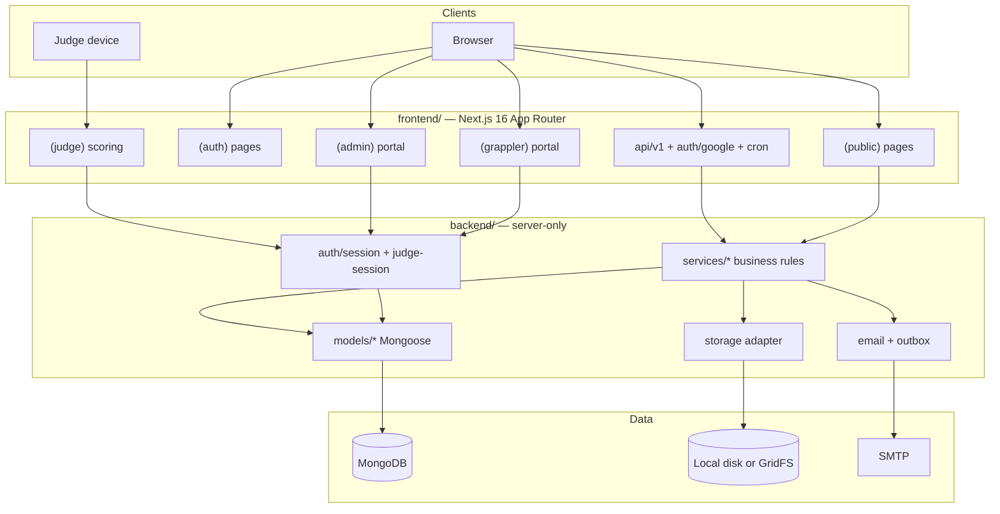
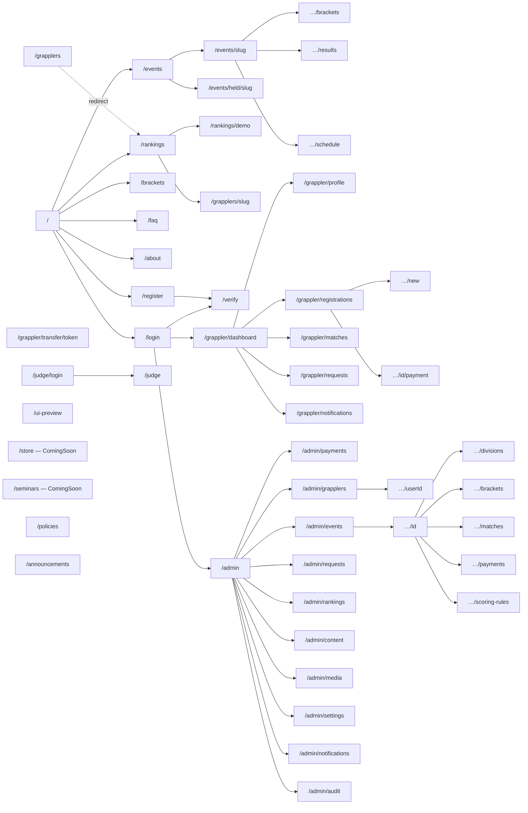

# Architecture & page inventory research

| Field | Value |
|-------|--------|
| Repo | `d:\upnrol` |
| Git | `main` @ `4ffb794` (merge PR #75) |
| Research date | 2026-11-27 |
| Method | Read all 51 `page.tsx` files + group `layout.tsx` + `frontend/package.json` + `frontend/next.config.ts` |
| Terminology | User-facing routes use **Grappler** (`/grappler/*`, `/grapplers/*`). Legacy **Fighter** aliases redirect via `frontend/next.config.ts`. Internal code still uses names like `fighterService`, `FighterProfile`, `features/fighter`. |

Companion tree: [`01-directory-tree.md`](./01-directory-tree.md).

---

## 1. Project overview

**Up 'n Roll** is a full-stack tournament management platform for combat sports (BJJ / grappling events). It covers public marketing and live boards, grappler self-service (profile, registration, UPI/QR payment with UTR proof, matches, cancellation/transfer requests), admin operations (events, divisions, brackets, match scheduling, payment review, rankings, content, media, audit), and a separate **Judge** scoring console with match-scoped credentials.

**Stack shape:** one Next.js 16 App Router project (`frontend/`) with server-only business logic in `backend/` (Mongoose models + services). There is no separate backend package; `@/server/*` aliases into `../backend/*`. Auth is custom cookie sessions in MongoDB (not a third-party IdP for primary login); Google OAuth routes exist. Payments are manual UPI/QR + screenshot/UTR review (not a card gateway). Storage for private files is pluggable (`LocalDiskStorageAdapter` / `GridFSStorageAdapter` via `STORAGE_DRIVER`).

**Route groups** (auth in layouts, not `middleware.ts`):

| Group | Path prefix | Who |
|-------|-------------|-----|
| `(public)` | `/`, `/events`, `/rankings`, … | Anyone |
| `(auth)` | `/login`, `/register`, `/verify` | Guests |
| `(grappler)` | `/grappler/*` | Role `GRAPPLER` |
| `(admin)` | `/admin/*` | Role `ADMIN` |
| `(judge)` | `/judge/*` | Judge cookie session |
| `(preview)` | `/ui-preview` | Dev / `UI_PREVIEW_ENABLED` |

---

## 2. Complete page inventory (51 × `page.tsx`)

**Status rubric (from reading `page.tsx` only):**

- **Implemented** — page renders real UI wired to services, cached public reads, or forms.
- **Partially** — placeholder (`ComingSoon`), hard redirect, or intentionally stubbed surface.
- **Unable to Verify** — insufficient signal in `page.tsx` alone (not used below; all 51 classified).

**Auth columns:** from group `layout.tsx` / page redirects.

### 2.1 Public (18)

| S.No | Page name | URL | Module | Role access | Auth required | Purpose | Major features | Status |
|------|-----------|-----|--------|-------------|---------------|---------|----------------|--------|
| 1 | Home | `/` | Public | Public | No | Marketing landing | Hero, next-event strip (`cachedPublicEvents`), how-to-enter, gallery, about story, FAQ section | Implemented |
| 2 | About | `/about` | Public | Public | No | Brand / story page | `AboutStory` + featured event slug from `cachedPublicEvents` | Implemented |
| 3 | Events list | `/events` | Public | Public | No | Upcoming events board | Featured poster, later events list, “how a match runs” story | Implemented |
| 4 | Event detail | `/events/[slug]` | Public | Public | No | Single event landing | Live/upcoming card, Superfight special landing, completed → `HeldRecord`, announcements | Implemented |
| 5 | Event brackets | `/events/[slug]/brackets` | Public | Public | No | Published brackets per division | `cachedPublishedBracket` + `BracketView` | Implemented |
| 6 | Event results | `/events/[slug]/results` | Public | Public | No | Results table | Matchup / winner / method from `cachedPublicResults` | Implemented |
| 7 | Event schedule | `/events/[slug]/schedule` | Public | Public | No | Schedule + call board | Table + `MatchAnnouncementBanner` | Implemented |
| 8 | Held archive | `/events/held/[slug]` | Public | Public | No | Static held-event record | `HELD_ARCHIVE` fixture map + `HeldRecord` | Implemented |
| 9 | Live brackets hub | `/brackets` | Public | Public | No | Focus event live board | Pre-event board or live/decided/brackets; `LiveRefresh` | Implemented |
| 10 | Rankings | `/rankings` | Public | Public | No | Public rankings board | Beginner/Intermediate via `?level=`; `cachedRankingBoardEntries` | Implemented |
| 11 | Seeding demo | `/rankings/demo` | Public | Public | No | Non-indexed seeding walkthrough | Fixture `RankingDemo`; `robots: noindex` | Implemented |
| 12 | Grapplers directory | `/grapplers` | Public | Public | No | Directory entry | **Redirects to `/rankings`** | Partially |
| 13 | Grappler public profile | `/grapplers/[slug]` | Public | Public | No | Public athlete card | Live `getPublicFighterBySlug` and/or held-card athlete; share card; match history | Implemented |
| 14 | FAQ | `/faq` | Public | Public | No | FAQ board | `cachedPublishedContent("FAQ")` + `FaqBoard` | Implemented |
| 15 | Store | `/store` | Public | Public | No | Merchandise (future) | `ComingSoon` only | Partially |
| 16 | Seminars | `/seminars` | Public | Public | No | Seminars (future) | `ComingSoon` only | Partially |
| 17 | Policies | `/policies` | Public | Public | No | Published policies | `cachedPublishedContent("POLICY")` | Implemented |
| 18 | Announcements | `/announcements` | Public | Public | No | House announcements | `cachedPublishedContent("ANNOUNCEMENT")` | Implemented |

Sources: `frontend/src/app/(public)/**/page.tsx`.

### 2.2 Auth (3)

| S.No | Page name | URL | Module | Role access | Auth required | Purpose | Major features | Status |
|------|-----------|-----|--------|-------------|---------------|---------|----------------|--------|
| 19 | Sign in | `/login` | Auth | Guest | No | Email login | `LoginForm`, Google link, `from` return path | Implemented |
| 20 | Sign up | `/register` | Auth | Guest | No | Create grappler account | `RegisterForm`, Google link | Implemented |
| 21 | Verify email | `/verify` | Auth | Guest | No | Email OTP confirm | `VerifyForm` + email/from query | Implemented |

Sources: `frontend/src/app/(auth)/**/page.tsx`. Layout: `(auth)/layout.tsx` (public chrome).

### 2.3 Grappler (9)

Gate: `(grappler)/grappler/layout.tsx` — `getSession()`; no session → `/login`; role ≠ `GRAPPLER` → `/admin`.

| S.No | Page name | URL | Module | Role access | Auth required | Purpose | Major features | Status |
|------|-----------|-----|--------|-------------|---------------|---------|----------------|--------|
| 22 | Grappler desk | `/grappler/dashboard` | Grappler | GRAPPLER | Yes | Portal home | Next bout, active registration, alerts, public card preview | Implemented |
| 23 | Profile | `/grappler/profile` | Grappler | GRAPPLER | Yes | Full registration sheet | Personal / competition / medical / waiver / photos | Implemented |
| 24 | My events | `/grappler/registrations` | Grappler | GRAPPLER | Yes | List seats | Status badges → payment desk links | Implemented |
| 25 | New registration | `/grappler/registrations/new` | Grappler | GRAPPLER | Yes | Enter an event | Open divisions, grappler form, ID uploads | Implemented |
| 26 | Payment desk | `/grappler/registrations/[id]/payment` | Grappler | GRAPPLER | Yes | Pay / upload UTR | QR, coupon, screenshot form, status thank-you | Implemented |
| 27 | Matches | `/grappler/matches` | Grappler | GRAPPLER | Yes | Assigned matches only | Round/mat/time/result cards | Implemented |
| 28 | Requests | `/grappler/requests` | Grappler | GRAPPLER | Yes | Cancel / transfer | Create request, teammate transfer, history | Implemented |
| 29 | Notifications | `/grappler/notifications` | Grappler | GRAPPLER | Yes | In-app inbox | List + fight-soon alert | Implemented |
| 30 | Claim transfer | `/grappler/transfer/[token]` | Grappler | GRAPPLER | Yes | Take teammate seat | Peek token + claim form | Implemented |

**Legacy URL aliases:** `/fighter/*` → `/grappler/*` (permanent redirect).

### 2.4 Admin (18)

Gate: `(admin)/admin/layout.tsx` — session required; role ≠ `ADMIN` → `/grappler/dashboard`.

| S.No | Page name | URL | Module | Role access | Auth required | Purpose | Major features | Status |
|------|-----------|-----|--------|-------------|---------------|---------|----------------|--------|
| 31 | Admin desk | `/admin` | Admin | ADMIN | Yes | Ops overview | Stats, timelines, pending payments/requests | Implemented |
| 32 | Payment queue | `/admin/payments` | Admin | ADMIN | Yes | Verify UPI submissions | Filters, review dialog, duplicate UTR flag | Implemented |
| 33 | Grapplers roster | `/admin/grapplers` | Admin | ADMIN | Yes | Searchable roster | Photo thumbnails → sheets | Implemented |
| 34 | Grappler sheet | `/admin/grapplers/[userId]` | Admin | ADMIN | Yes | Full admin record | `FighterRecord` (all profile sections) | Implemented |
| 35 | Events list | `/admin/events` | Admin | ADMIN | Yes | Create / list events | `CreateEventForm` + hub links | Implemented |
| 36 | Event hub | `/admin/events/[id]` | Admin | ADMIN | Yes | Event control center | Status, mats, QR, fees/coupons, divisions, registrations | Implemented |
| 37 | Divisions | `/admin/events/[id]/divisions` | Admin | ADMIN | Yes | Division taxonomy | Seed grid + create form | Implemented |
| 38 | Brackets admin | `/admin/events/[id]/brackets` | Admin | ADMIN | Yes | Seed / generate / publish | Participant order, `BracketView`, publish | Implemented |
| 39 | Matches admin | `/admin/events/[id]/matches` | Admin | ADMIN | Yes | Schedule & results | Tabs, schedule dialog, judge credentials, record/correct | Implemented |
| 40 | Fees & coupons | `/admin/events/[id]/payments` | Admin | ADMIN | Yes | Payment options | `EventPaymentsPanel` | Implemented |
| 41 | Scoring rules | `/admin/events/[id]/scoring-rules` | Admin | ADMIN | Yes | Event scoring config | `ScoringRulesForm` | Implemented |
| 42 | Requests queue | `/admin/requests` | Admin | ADMIN | Yes | Decide cancel/transfer | Table + `DecideRequestDialog` | Implemented |
| 43 | Rankings admin | `/admin/rankings` | Admin | ADMIN | Yes | Manual + computed ranks | Manual form, recalculate, tables | Implemented |
| 44 | Content | `/admin/content` | Admin | ADMIN | Yes | FAQ / policy / announcement CMS | Create, edit, publish toggle | Implemented |
| 45 | Media | `/admin/media` | Admin | ADMIN | Yes | Event media links | Create + gallery of captions/URLs | Implemented |
| 46 | Settings | `/admin/settings` | Admin | ADMIN | Yes | House name + public contact | `HouseNameForm`, `SiteSettingsForm` | Implemented |
| 47 | Failed deliveries | `/admin/notifications` | Admin | ADMIN | Yes | Outbox recovery | Failed jobs + retry panel | Implemented |
| 48 | Audit log | `/admin/audit` | Admin | ADMIN | Yes | Audit trail | Recent actions table/cards | Implemented |

**Legacy URL aliases:** `/admin/fighters/*` → `/admin/grapplers/*`.

### 2.5 Judge (2)

Layout: `(judge)/judge/layout.tsx` — no role gate; pages use `getJudgeSession()`.

| S.No | Page name | URL | Module | Role access | Auth required | Purpose | Major features | Status |
|------|-----------|-----|--------|-------------|---------------|---------|----------------|--------|
| 49 | Scoring console | `/judge` | Judge | Judge session | Yes (judge cookie) | Live match scoring | Scores, penalties, timeline, provisional result | Implemented |
| 50 | Judge login | `/judge/login` | Judge | Public → judge | No (issues judge session) | Match credential login | `JudgeLoginForm`; redirects if already logged in | Implemented |

### 2.6 Preview (1)

| S.No | Page name | URL | Module | Role access | Auth required | Purpose | Major features | Status |
|------|-----------|-----|--------|-------------|---------------|---------|----------------|--------|
| 51 | UI preview showroom | `/ui-preview` | Preview | Internal | No (env-gated) | Design fixture gallery | Brand/tokens through chatbot sections; `notFound` unless dev or `UI_PREVIEW_ENABLED=true` | Implemented |

**Totals:** Public 18 · Auth 3 · Grappler 9 · Admin 18 · Judge 2 · Preview 1 = **51**.  
Status: Implemented **48** · Partially **3** (`/grapplers`, `/store`, `/seminars`) · Unable to Verify **0**.

---

## 3. Project statistics

### Counting methodology

| Metric | How counted |
|--------|-------------|
| Pages | Files named `page.tsx` under `frontend/src/app` (recursive) |
| API routes | Files named `route.ts` under `frontend/src/app/api` |
| Models | Non-test `*.ts` under `backend/models` |
| Services | Non-test `*.ts` under `backend/services` |
| Feature modules | Immediate child directories of `frontend/src/features` |
| UI primitives | `*.tsx` under `frontend/src/components/ui` |
| Tests | `*.test.ts` / `*.test.tsx` under repo, excluding `node_modules` |
| LOC | PowerShell: `.ts`/`.tsx` under `frontend/src` + `backend`, exclude `*.test.*` and `node_modules`; `Measure-Object -Line` (non-blank lines) |

### Counts (verified 2026-11-27 @ `4ffb794`)

| Metric | Count |
|--------|------:|
| `page.tsx` routes | 51 |
| API `route.ts` handlers | 18 |
| Mongoose models | 24 |
| Backend services (non-test) | 34 |
| Feature folders | 20 |
| `components/ui` primitives | 58 |
| Test files | 50 |
| Frontend source files (LOC set) | 342 |
| Backend source files (LOC set) | 98 |

### Lines of code

**Exact command run:**

```powershell
$frontendFiles = Get-ChildItem -Path "d:\upnrol\frontend\src" -Recurse -Include *.ts,*.tsx |
  Where-Object { $_.FullName -notmatch "node_modules" -and $_.Name -notmatch "\.test\." }
$backendFiles  = Get-ChildItem -Path "d:\upnrol\backend" -Recurse -Include *.ts,*.tsx |
  Where-Object { $_.FullName -notmatch "node_modules" -and $_.Name -notmatch "\.test\." }
$frontendLines = ($frontendFiles | Get-Content | Measure-Object -Line).Lines
$backendLines  = ($backendFiles  | Get-Content | Measure-Object -Line).Lines
[pscustomobject]@{
  FrontendFiles = $frontendFiles.Count
  FrontendLines = $frontendLines
  BackendFiles  = $backendFiles.Count
  BackendLines  = $backendLines
  TotalLines    = ($frontendLines + $backendLines)
}
```

**Result:**

| Scope | Files | Lines (`Measure-Object -Line`) |
|-------|------:|-------------------------------:|
| `frontend/src` (excl. `*.test.*`) | 342 | 24,384 |
| `backend` (excl. `*.test.*`) | 98 | 8,400 |
| **Combined** | **440** | **32,784** |

Note: PowerShell `Measure-Object -Line` counts non-blank lines. Including blank lines (sum of `(Get-Content).Count`) measured **25,027** frontend + **9,336** backend = **34,363**.

---

## 4. Technology stack (`frontend/package.json`)

| Package | Version | Role |
|---------|---------|------|
| `next` | 16.4.5 | App Router framework (Cache Components on) |
| `react` / `react-dom` | 19.2.3 | UI runtime |
| `typescript` | ^5 | Types |
| `mongoose` | ^9.3.0 | MongoDB ODM (also used from `backend/`) |
| `zod` | ^4.3.6 | Validation |
| `react-hook-form` | ^7.71.2 | Forms |
| `@hookform/resolvers` | ^5.2.2 | Zod ↔ RHF |
| `nodemailer` | ^10.3.1 | SMTP email |
| `tailwindcss` | ^4 | Styling |
| `@tailwindcss/postcss` | ^4 | PostCSS |
| `framer-motion` | ^12.34.5 | Motion |
| `gsap` / `@gsap/react` | ^3.14.2 / ^2.1.2 | Animation |
| `lucide-react` | ^0.577.0 | Icons |
| `recharts` | ^3.7.0 | Charts |
| `date-fns` | ^4.1.0 | Dates |
| `sonner` | ^2.0.7 | Toasts |
| `next-themes` | ^0.4.6 | Theme helper |
| `server-only` | ^0.0.1 | Server module boundary |
| `class-variance-authority` | ^0.7.1 | Variant classes |
| `clsx` / `tailwind-merge` | ^2.1.1 / ^3.5.0 | Class utils |
| `cmdk` | ^1.1.1 | Command palette |
| `embla-carousel-react` | ^8.6.0 | Carousel |
| `input-otp` | ^1.4.2 | OTP input |
| `vaul` | ^1.1.2 | Drawer |
| `react-day-picker` | ^9.14.0 | Date picker |
| `react-resizable-panels` | ^4.7.1 | Panels |
| `radix-ui` + `@radix-ui/react-*` | various ^1.x / ^2.x | Primitives (shadcn) |
| `vitest` | ^3.0.5 | Unit tests |
| `eslint` / `eslint-config-next` | ^9 / 16.4.5 | Lint |
| `tsx` | ^4.19.2 | Scripts |
| `shadcn` | ^3.8.5 | CLI (dev) |
| `tw-animate-css` / `tailwindcss-animate` | ^1.4.0 / ^1.0.7 | Animate utilities |

App scripts (from same file): `dev` / `build` use webpack; `create-admin`, `seed-demo`, `seed-event`, backfills via `tsx` + `.env.local`.

---

## 5. High-level architecture

Next.js App Router pages and thin `api/v1/{public,grappler,admin}` handlers call `backend/services/*` through `@/server/*`. Layouts enforce session/role. Public pages prefer tagged cached reads (`frontend/src/lib/public-reads`). Private blobs go through the storage adapter. Email and reminders use an outbox job pattern (`OutboxJob` + cron `/api/cron/process-outbox`). Judge scoring uses a separate cookie session and match credentials issued from admin matches UI.



---

## 6. Website sitemap



---

## 7. Directory structure (top 3 levels)

Excludes `node_modules/`, `.next/`. Full companion detail: [`01-directory-tree.md`](./01-directory-tree.md).

```
upnrol/
├── .github/workflows/
├── backend/{audit,auth,content,db,email,http,models,notifications,observability,services,storage,validation}/
├── backups/
├── docs/{api,architecture,decisions,deployment,engineering,handover,legal,Meeting,phases,product,qa,research,security}/
├── frontend/
│   ├── public/{banners,emojis,Fighting,gallery,…}/
│   ├── scripts/
│   └── src/{app,components,data,features,hooks,lib,test}/
├── scripts/
├── CLAUDE.md
├── package.json
├── README.md
├── tsconfig.json
└── vercel.json
```

---

## 8. Public website feature notes (data sources)

Verified by reading each public `page.tsx`:

| Page | Data source(s) | Notes |
|------|----------------|-------|
| `/` | `cachedPublicEvents()`; static `FIGHTING_MEDIA` | Featured = first `REGISTRATION_OPEN` else first event |
| `/about` | `cachedPublicEvents()` | Passes featured slug into `AboutStory` |
| `/events` | `cachedPublicEvents()` | Splits non-`COMPLETED` into featured + later |
| `/events/[slug]` | `cachedPublicEvent`, divisions, announcement board; completed also media + results | Special-case slug `up-n-roll-superfight-series` → `SuperfightLanding` |
| `/events/[slug]/brackets` | event + divisions + `cachedPublishedBracket` | Empty state if none published |
| `/events/[slug]/results` | `cachedPublicResults(slug)` | Table; 404 via `NotFoundError` |
| `/events/[slug]/schedule` | `cachedPublicSchedule` + `getEventAnnouncementBoard` | Live call banner + table |
| `/events/held/[slug]` | static `HELD_ARCHIVE[slug]` | Not Mongo; archive fixture |
| `/brackets` | events, divisions, schedule, published brackets | Soft refresh every 8s when live |
| `/rankings` | `cachedRankingBoardEntries()` | `?level=intermediate` switches board |
| `/rankings/demo` | client fixture component only | `noindex` |
| `/grapplers` | none | Immediate `redirect("/rankings")` |
| `/grapplers/[slug]` | `getPublicFighterBySlug` and/or `getHeldCardAthleteBySlug` | Shareable public card; private fields omitted |
| `/faq` | `cachedPublishedContent("FAQ")` | Admin CMS-backed |
| `/policies` | `cachedPublishedContent("POLICY")` | Admin CMS-backed |
| `/announcements` | `cachedPublishedContent("ANNOUNCEMENT")` | Admin CMS-backed |
| `/store`, `/seminars` | none | `ComingSoon` component |

Public chrome (`(public)/layout.tsx`): `SiteHeader`, `SiteFooterBoundary`, `ChatbotWidget` (deterministic FAQ keyword engine — not an LLM).

---

## 9. Legacy Fighter → Grappler

| Layer | Grappler (current) | Fighter (legacy) |
|-------|--------------------|------------------|
| Portal URLs | `/grappler/*` | `/fighter/*` → permanent redirect |
| Public profiles | `/grapplers/[slug]` | `/fighters/*` → redirect |
| Admin roster | `/admin/grapplers` | `/admin/fighters/*` → redirect |
| API | `/api/v1/grappler/*`, `/api/v1/public/grapplers/*` | `/api/v1/fighter/*` still has route files; also redirected |
| Code identifiers | User-facing copy “Grappler” | `fighterService`, `FighterProfile` model, `features/fighter(s)` |

Empty App Router directories under `grappler/fighter/`, `grapplers/fighters/`, and `admin/grapplers/fighters/` remain on disk without `page.tsx` (see directory tree doc).

---

## 10. Source citations (key files)

| Concern | Path |
|---------|------|
| Package / versions | `frontend/package.json` |
| Redirects / security headers / aliases | `frontend/next.config.ts` |
| Grappler auth gate | `frontend/src/app/(grappler)/grappler/layout.tsx` |
| Admin auth gate | `frontend/src/app/(admin)/admin/layout.tsx` |
| Judge shell | `frontend/src/app/(judge)/judge/layout.tsx` |
| Public shell | `frontend/src/app/(public)/layout.tsx` |
| Session API | `backend/auth/session.ts`, `backend/auth/judge-session.ts` |
| Monorepo guidance | `CLAUDE.md`, `backend/README.md` |
