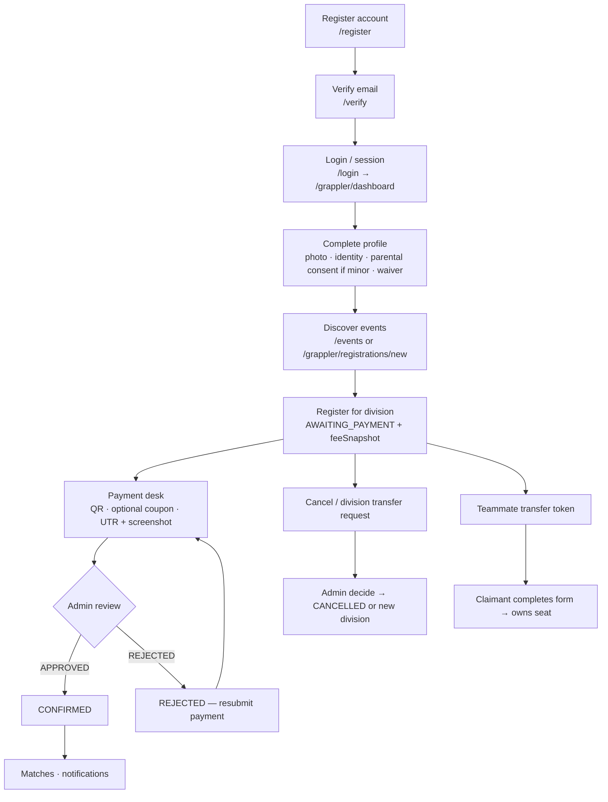
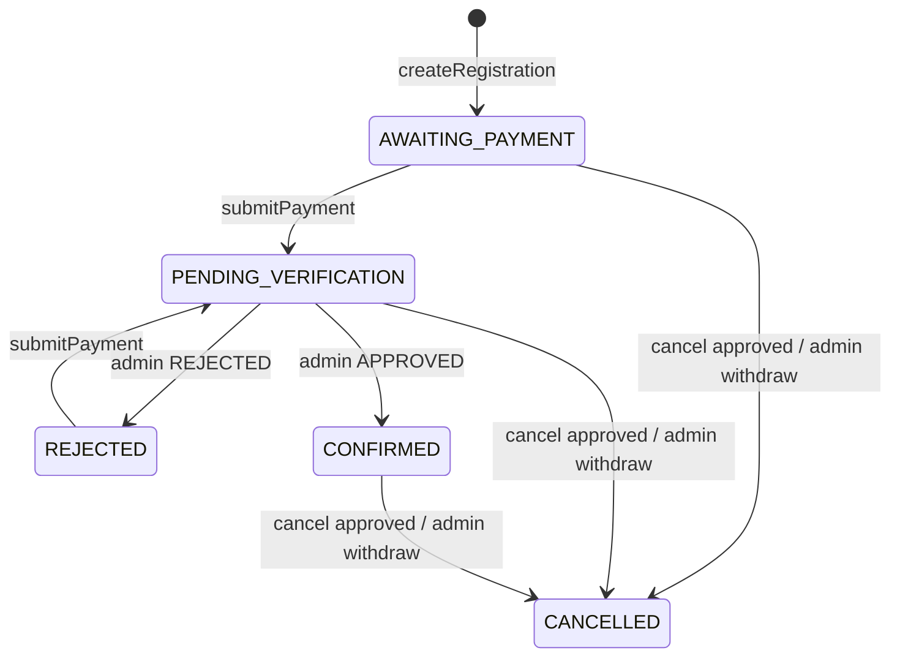

# 03 — Grappler lifecycle

Research notes for Up 'n Roll handover. **Terminology:** product role is **Grappler** (`User.role = "GRAPPLER"`). Backend helpers still use `assertFighter` / `FighterProfile` as legacy names; they normalize `FIGHTER` → `GRAPPLER` in `backend/auth/actor.ts`.

**Portal shell:** `frontend/src/app/(grappler)/grappler/layout.tsx` — session required; non-grappler redirected to `/admin`. Nav: Desk, Profile, Events, Matches, Requests, Alerts (`frontend/src/features/fighter/fighter-nav.tsx`).

---

## Journey diagram

---

## 1. Register account

### UI
| Item | Path |
|------|------|
| Page | `frontend/src/app/(auth)/register/page.tsx` |
| Form | `frontend/src/features/auth/register-form.tsx` |
| Action | `registerAction` in `frontend/src/features/auth/actions.ts` |
| Schema | `registerSchema` in `frontend/src/features/fighters/grappler-schema.ts` |

**Steps:** grappler enters display name, mobile, email, password → submit.

### Backend
1. Rate limit by IP (`checkRateLimit`).
2. Reject duplicate email.
3. `User.create` with `role: "GRAPPLER"`, `emailVerified: false`, hashed password (`backend/auth/password.ts`).
4. Create `FighterProfile` with slugified display name (`discipline` default `"No-Gi"`).
5. Audit: `USER_REGISTERED`, `FIGHTER_PROFILE_CREATED`.
6. `sendVerificationCode` (`backend/services/verificationMail.ts`) — 6-digit code, 15 min TTL, hashed in `EmailVerification`.
7. Redirect to `/verify?email=…`.

Public registration **never** creates admin accounts (admins via `scripts/create-admin.ts` only).

---

## 2. Verify email

### UI
| Item | Path |
|------|------|
| Page | `frontend/src/app/(auth)/verify/page.tsx` |
| Form | `frontend/src/features/auth/verify-form.tsx` |
| Actions | `verifyEmailAction`, `resendCodeAction` |

### Backend
- `confirmVerificationCode`: timing-safe hash compare → set `emailVerified` / `emailVerifiedAt` → delete pending codes → welcome email.
- Creates session (`createSession`) and redirects to safe `from` path or `/grappler/dashboard`.
- Login blocked until verified (`loginAction` returns “Confirm the code…”).

---

## 3. Login

### UI
| Item | Path |
|------|------|
| Page | `frontend/src/app/(auth)/login/page.tsx` |
| Form | `frontend/src/features/auth/login-form.tsx` |
| Action | `loginAction` |

### Backend
1. Rate limit → validate email/password.
2. Require `status === "ACTIVE"` and `emailVerified !== false`.
3. `createSession` (cookie + hashed token in Mongo — `backend/auth/session.ts`).
4. Redirect: ADMIN → `/admin`; GRAPPLER → `/grappler/dashboard` (or safe return path).
5. Sign-out: `logoutAction` / `SignOutButton` → `destroySession`.

Google sign-in UI exists (`google-sign-in-link.tsx`) but email/password + verify is the primary documented path.

---

## 4. Profile (photo / Aadhaar / parental consent / waiver)

### UI
| Item | Path |
|------|------|
| Page | `frontend/src/app/(grappler)/grappler/profile/page.tsx` |
| Form | `ProfileForm` → `GrapplerForm` mode `"profile"` |
| Action | `updateProfileAction` in `frontend/src/features/profile/actions.ts` |
| Shared form | `frontend/src/features/fighters/grappler-form.tsx` |

**Fields (high level):** display name, DOB/age, gender, mobile, nationality, city/state, emergency contact, blood group, Instagram, academy, head coach, belt, years training, past record, weight band, medical Qs, medically fit.

**Uploads (present in product):**
| Asset | Storage helper | Private API preview |
|-------|----------------|---------------------|
| Passport photo | `saveProfilePhoto` (`backend/services/profilePhoto.ts`) | `/api/v1/grappler/photo` |
| Identity proof (“Aadhaar” / gov ID) | `saveAadhaarImage` | `/api/v1/grappler/aadhaar` |
| Parental consent image (minors) | `saveParentalConsentImage` | `/api/v1/grappler/parental-consent` |

**Minor rules:** `isMinorAge` + `grapplerFieldIssues({ requireParentalConsent })` — under-18 must upload signed parental consent if not already stored. Keys live on `FighterProfile`: `photoKey`, `aadhaarImageKey`, `parentalConsentImageKey`, `waiverAcceptedAt` (`backend/models/FighterProfile.ts`).

### Backend
- `getFighterProfile` / `updateFighterProfile` — `backend/services/fighterService.ts`.
- Public pages (`/grapplers/[slug]`) expose hype-card fields only — **never** aadhaar/medical/mobile.
- Dashboard checklist (`dashboardService.profileChecklist`): name, photo, personal, competition, medical, waiver.

---

## 5. Discover events

### Public
- List: `frontend/src/app/(public)/events/page.tsx`
- Detail: `frontend/src/app/(public)/events/[slug]/page.tsx`
- When `status === "REGISTRATION_OPEN"`, CTA → `/grappler/registrations/new?event=<eventId>`

### Grappler portal
- Events list (own seats): `/grappler/registrations` → `listMyRegistrations`
- New registration: `/grappler/registrations/new` → `listOpenDivisionsForRegistration`  
  Filters events with `status: "REGISTRATION_OPEN"` and now within `registrationOpensAt`…`registrationClosesAt`.

---

## 6. Register for a division

### UI
| Item | Path |
|------|------|
| Page | `frontend/src/app/(grappler)/grappler/registrations/new/page.tsx` |
| Form | `frontend/src/features/registrations/new-registration-form.tsx` |
| Action | `createRegistrationAction` |

**UI steps:**
1. Pick event (preselected via `?event=`).
2. Complete / refresh grappler details (same `GrapplerForm` mode `"event"`).
3. Upload identity proof if missing; parental consent if minor.
4. Choose Beginner/Intermediate (when taxonomy present) + weight class filtered by gender.
5. Tick consent + agreement.
6. Submit → redirect to payment desk.

### Backend (`backend/services/registrationService.ts` → `createRegistration`)
Inside a transaction:
1. `assertFighter`; event must be open for registration.
2. Block duplicate **active** registration (`isActiveRegistration`).
3. `assertDivisionEligibility` — gender + belt↔experience (`registrationEligibility.ts`).
4. Resolve **server-authoritative** fee via `getDefaultPaymentOption` / optional coupon redeem (`paymentOptionService`, `couponService`). Client amounts are never trusted.
5. `claimSeat` (division occupancy).
6. Create `Registration` with `status: "AWAITING_PAYMENT"`, `feeSnapshot`, `statusHistory`.
7. Optionally redeem reserved coupon → rewrite `feeSnapshot` / `couponId`.
8. Create placeholder `PaymentSubmission` with `status: "AWAITING_SUBMISSION"`.
9. Audit `REGISTRATION_CREATED`.

Action also persists profile fields + sets `waiverAcceptedAt` before creating the registration.

---

## 7. Payment (QR + screenshot + UTR)

### UI
| Item | Path |
|------|------|
| Page | `frontend/src/app/(grappler)/grappler/registrations/[id]/payment/page.tsx` |
| Form | `frontend/src/features/payments/payment-form.tsx` |
| Coupon UI | `payment-coupon-field.tsx` + `applyPaymentCouponAction` |
| Action | `submitPaymentAction` |
| QR stream | `GET /api/v1/grappler/events/[eventId]/payment-qr` |

**Shown when** registration is `AWAITING_PAYMENT` or `REJECTED`:
- Fee / option label / coupon code from `feeView`
- QR image (option-scoped key preferred)
- Optional coupon apply
- UTR + screenshot (PNG/JPEG/WebP ≤ 5MB) → “Submit for review”

**After submit:** status `PENDING_VERIFICATION` — thank-you + WhatsApp community invite.  
**When confirmed:** thank-you locked seat message.

### Backend (`backend/services/paymentService.ts`)
1. `canSubmitPayment` only for `AWAITING_PAYMENT` | `REJECTED`.
2. Validate screenshot meta; store under private storage (`payment-screenshots/…`).
3. Create `PaymentSubmission` `PENDING_REVIEW` with UTR + key; expected amount from **feeSnapshot**.
4. Move registration → `PENDING_VERIFICATION` (`registrationStatusForNewSubmission`).
5. Email “payment received” (not yet confirmation).
6. Admin `approvePayment` / `rejectPayment` → registration `CONFIRMED` / `REJECTED`; seat claim/release; emails (tournament-confirmed or rejection with note).

Detail: see sibling doc [`03-payment-coupon.md`](./03-payment-coupon.md).

---

## 8. Status tracking

### Registration statuses (`backend/models/Registration.ts`)

| Status | Meaning |
|--------|---------|
| `AWAITING_PAYMENT` | Seat held; pay / upload pending |
| `PENDING_VERIFICATION` | UTR+screenshot awaiting admin |
| `CONFIRMED` | Payment approved; locked for event |
| `REJECTED` | Payment rejected; may resubmit |
| `CANCELLED` | Withdrawn / cancel request approved |

**Active** (capacity + uniqueness): `AWAITING_PAYMENT`, `PENDING_VERIFICATION`, `CONFIRMED` — `ACTIVE_REGISTRATION_STATUSES` in `registrationStateMachine.ts` and model partial unique index.

### Surfaces
- Desk: `getFighterDashboardData` — open reg + payment CTA labels.
- Events list: status badge + “Pay / upload UTR” / “Payment status” / “View seat”.
- Payment page: humanized status string.

### State machine (`backend/services/registrationStateMachine.ts`)

Pure guards (no I/O):

| Helper | Rule |
|--------|------|
| `canSubmitPayment` | `AWAITING_PAYMENT` \| `REJECTED` |
| `canDecidePayment` | submission `PENDING_REVIEW` |
| `isActiveRegistration` | three active statuses |
| `registrationStatusForNewSubmission` | → `PENDING_VERIFICATION` |
| `registrationStatusForPaymentDecision` | APPROVED → `CONFIRMED`; REJECTED → `REJECTED` |

Payment submission statuses: `AWAITING_SUBMISSION` → `PENDING_REVIEW` → `APPROVED` | `REJECTED` (`PaymentSubmission` model).

---

## 9. Matches

### UI
| Item | Path |
|------|------|
| Page | `frontend/src/app/(grappler)/grappler/matches/page.tsx` |
| Service | `listMatchesForFighter` (`backend/services/matchService.ts`) |
| Desk preview | next bout on dashboard |

Shows event, round, mat, schedule, opponents, winner/method when completed. Grappler only sees matches they are in (privacy-conscious listing).

---

## 10. Notifications (“Alerts”)

### UI
| Item | Path |
|------|------|
| Page | `frontend/src/app/(grappler)/grappler/notifications/page.tsx` |
| List | `frontend/src/features/notifications/fighter-notifications-list.tsx` |
| Service | `backend/services/notificationService.ts` |

**Sources (examples):**
- Outbox jobs: `processMatchResultNotifyJob`, `processScheduleChangedNotifyJob`
- Warm-up / fight-soon style reminders (`createInAppAndEmailReminder`, dashboard `warmUpMinutes`)
- Emails also fire on payment / request decisions (separate from in-app `Notification` docs)

Grappler can list, mark one/all read, count unread.

---

## 11. Cancel / transfer requests (admin-reviewed)

### UI
| Item | Path |
|------|------|
| Page | `frontend/src/app/(grappler)/grappler/requests/page.tsx` |
| Dialog | `frontend/src/features/requests/create-request-dialog.tsx` |
| Action | `createRequestAction` |
| Admin decide | `decideRequestAction` + admin UI |

**Types:** `CANCELLATION` | `TRANSFER` (same event, other division with capacity).

### Backend (`backend/services/requestService.ts`)
1. Active registration required; one `PENDING` request per registration.
2. Transfer: target division same event, not current, not full.
3. Create `RegistrationRequest` `PENDING`.
4. Admin approve:
   - **Cancellation:** `releaseSeat`, set registration `CANCELLED`, compute `refundPercent` (`refundPercentForCancellation` — 50% if ≥30 days before event start, else 0). Refund is recorded on the request; payout is operational, not automated PSP.
   - **Transfer:** claim target seat, release source, update `divisionId`.
5. Email grappler with outcome (+ refund % for cancellations).

---

## 12. Teammate transfer token flow

Peer-to-peer seat handoff — **not** the admin TRANSFER request.

### Create link (current owner)
| Item | Path |
|------|------|
| Button | `frontend/src/features/requests/teammate-transfer-button.tsx` |
| Action | `createTeammateTransferAction` |
| Service | `createTeammateTransfer` in `backend/services/teammateTransfer.ts` |

- Requires active registration.
- Generates raw token (hex); stores **SHA-256 hash** in `TransferInvite`.
- Rotating an existing unclaimed invite invalidates the previous raw link.
- Returns path `/grappler/transfer/<rawToken>` for the owner to share.

### Claim (teammate)
| Item | Path |
|------|------|
| Page | `frontend/src/app/(grappler)/grappler/transfer/[token]/page.tsx` |
| Form | `claim-transfer-form.tsx` |
| Peek | `peekTeammateTransfer` (event/division only — no owner PII) |
| Claim | `claimTeammateTransfer` + `claimTeammateTransferAction` |

**Claimant must:**
1. Be signed-in grappler (not the current owner).
2. Complete full grappler form + identity proof + waiver (+ parental consent if minor).
3. Pass division eligibility (gender/belt).
4. Not already hold an active seat in that division.

**On claim (transaction):** mark invite claimed → reassign `registration.userId` → reassign related `PaymentSubmission.userId` → audit `TEAMMATE_TRANSFER_CLAIMED`. Redirect to payment desk if still awaiting payment/verification, else dashboard.

---

## Key path index

| Concern | Primary paths |
|---------|----------------|
| Auth UI | `frontend/src/app/(auth)/`, `frontend/src/features/auth/` |
| Portal | `frontend/src/app/(grappler)/grappler/` |
| Profile | `frontend/src/features/profile/`, `backend/services/fighterService.ts`, `profilePhoto.ts` |
| Registrations | `frontend/src/features/registrations/`, `backend/services/registrationService.ts` |
| State machine | `backend/services/registrationStateMachine.ts` |
| Payments | `frontend/src/features/payments/`, `backend/services/paymentService.ts` |
| Coupons / options | `couponService.ts`, `paymentOptionService.ts` |
| Requests | `frontend/src/features/requests/`, `requestService.ts` |
| Teammate transfer | `teammateTransfer.ts` |
| Matches | `matchService.ts`, `/grappler/matches` |
| Notifications | `notificationService.ts`, `/grappler/notifications` |
)
