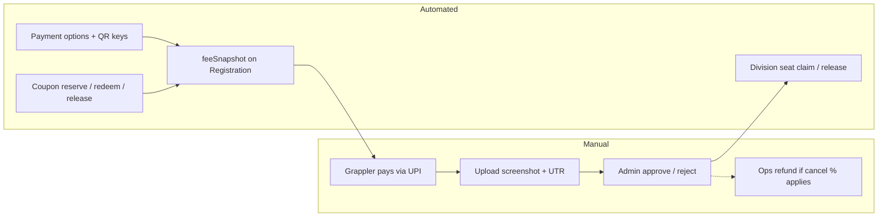
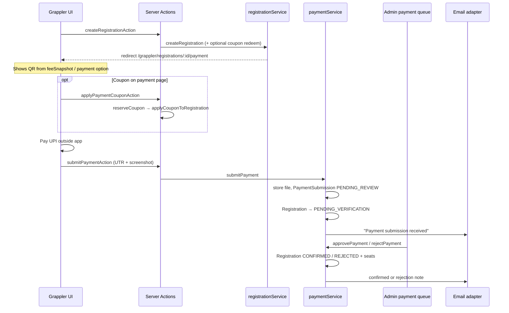
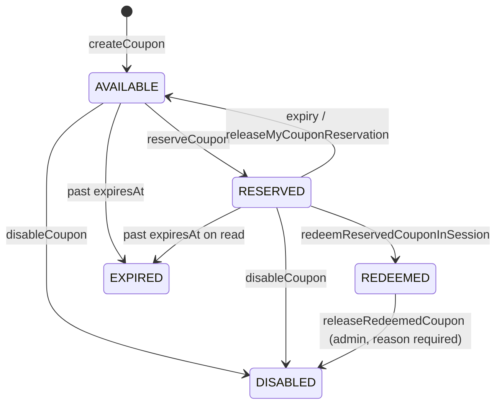

# 03 — Payment & coupon workflow

Research notes for Up 'n Roll handover. Companion to [`03-grappler-lifecycle.md`](./03-grappler-lifecycle.md). **Grappler** is the paying athlete; admins configure options/coupons and **manually** review UPI submissions.

---

## Manual vs automated

| Concern | Mode | What happens |
|---------|------|----------------|
| Fee / QR selection | **Automated (server)** | Default payment option or coupon-linked option resolved in `registrationService` / `couponService`; amount snapshotted on `Registration.feeSnapshot`. Client fee fields are rejected if they disagree. |
| Coupon hold / redeem | **Automated** | Reserve → redeem in Mongo transaction; expiry + per-user caps from `tournamentRules`. |
| UPI transfer | **Manual (grappler)** | Grappler pays outside the app (UPI / bank) using the displayed QR / house instructions. |
| Proof upload | **Semi-automated** | Screenshot + UTR stored via `submitPayment`; private storage adapter. |
| Payment confirmation | **Manual (admin)** | Admin queue reviews screenshot/UTR; `approvePayment` / `rejectPayment`. **No payment gateway / auto-capture / Razorpay-style webhook.** |
| Refund money movement | **Manual (ops)** | Cancel approval only records `refundPercent` on `RegistrationRequest`; cash/UPI refund is out of band. |
| Duplicate UTR hint | **Automated (assist)** | `flagDuplicateUtrs` in admin queue (`paymentQueue`) — advisory for reviewers, not auto-reject. |
| Emails | **Automated** | Submission received, approved (tournament-confirmed template), rejected. |

**Bottom line:** the platform is a **manual UPI proof + admin verification** desk with automated seat/fee/coupon bookkeeping — not an automated payment processor.

---

## End-to-end payment flow

### Grappler UI
| Step | Path |
|------|------|
| Payment desk | `frontend/src/app/(grappler)/grappler/registrations/[id]/payment/page.tsx` |
| Submit form | `frontend/src/features/payments/payment-form.tsx` → `submitPaymentAction` |
| Coupon field | `payment-coupon-field.tsx` → `applyPaymentCouponAction` |
| QR | `GET /api/v1/grappler/events/[eventId]/payment-qr?registrationId=…&paymentOptionId=…` |

### Backend
| Step | Path |
|------|------|
| Create seat + fee | `backend/services/registrationService.ts` |
| Submit proof | `backend/services/paymentService.ts` → `submitPayment` |
| Decide | `approvePayment` / `rejectPayment` |
| State guards | `backend/services/registrationStateMachine.ts` |
| File rules | `frontend/src/features/payments/file-validation.ts` (imported by payment service) |

**Submit eligibility:** registration must be `AWAITING_PAYMENT` or `REJECTED`.  
**Expected amount:** `registration.feeSnapshot.amountMinorUnits` preferred so later admin fee edits cannot rewrite an open submission.

**PaymentSubmission statuses** (`backend/models/PaymentSubmission.ts`):

`AWAITING_SUBMISSION` → `PENDING_REVIEW` → `APPROVED` | `REJECTED`

(On createRegistration a placeholder `AWAITING_SUBMISSION` row is created; `submitPayment` creates a new `PENDING_REVIEW` row.)

---

## Fee options (payment options)

Event-scoped priced QR rows live on `Event.paymentOptions`, with legacy mirror fields in `Event.paymentInstructions`.

### Service — `backend/services/paymentOptionService.ts`

| API | Role | Behavior |
|-----|------|----------|
| `ensureDefaultPaymentOption` | system | If no options, seed one from legacy `paymentInstructions`. |
| `listActivePaymentOptionsForEvent` | public/system | Active options only. |
| `getDefaultPaymentOption` | system | Default+active, else first active. |
| `getPaymentOption` | system | By id. |
| `createPaymentOption` / `updatePaymentOption` | admin | Label, `amountMinorUnits`, currency, active, isDefault. |
| `setPaymentOptionQr` | admin | Upload QR bytes → storage key `events/{eventId}/payment-options/{id}/qr…`. |
| `openPaymentOptionQr` | system | Stream QR for grappler/admin routes. |
| `resolvePaymentSelection` | system | Server-authoritative pick; never trust client amount. |
| `syncLegacyInstructions` | internal | Keeps `paymentInstructions` aligned with default option. |

### Admin UI
- Event payments panel: `frontend/src/features/payments/event-payments-panel.tsx`
- Actions: `frontend/src/features/payments/admin-actions.ts`
- Pages: `frontend/src/app/(admin)/admin/events/[id]/page.tsx`, `…/payments/page.tsx`

### How a fee lands on a registration

1. **Default path:** `getDefaultPaymentOption(eventId)` → amount/currency/QR/label into `feeSnapshot`.
2. **Client-suggested option (no coupon):** `clientPaymentOptionId` may select another **active** option; server re-fetches it. `clientAmountMinorUnits` must match or validation fails.
3. **Division override:** if `Division.feeMinorUnitsOverride` is set, it wins over the option amount (legacy behaviour in `createRegistration` / coupon apply).
4. **Coupon path:** coupon’s `paymentOptionId` becomes the fee option after redeem (see below).
5. **Snapshot immutability:** later event fee edits do not rewrite existing `feeSnapshot`; `submitPayment` reads the snapshot.

`PaymentOptionView` shape: `{ id, label, amountMinorUnits, currency, qrImageKey, active, isDefault }`.

Amounts are **minor units** (e.g. paise for INR); UI divides by 100 for display.

---

## Coupon lifecycle

### Model — `backend/models/Coupon.ts`

Statuses: `AVAILABLE` | `RESERVED` | `REDEEMED` | `DISABLED` | `EXPIRED`

Key fields: `code` (unique per event), `paymentOptionId`, `expiresAt`, optional `intendedUserId`, reservation (`reservedByUserId`, `reservedUntil`, `reservationIntentId`), redeem (`redeemedByRegistrationId`, `redeemedAt`), admin disable/release metadata.

### Rules — `backend/services/tournamentRules.ts`

| Knob | Env | Default |
|------|-----|---------|
| Hold duration | `COUPON_RESERVATION_MINUTES` | 15 (cap 120) |
| Max open holds / user | `COUPON_MAX_OPEN_RESERVATIONS` | 3 (cap 20) |

### Service — `backend/services/couponService.ts`

#### Reserve
`reserveCoupon(actor, { eventId, code, reservationIntentId })`
- Grappler only; normalizes code (uppercase, strip spaces).
- Caps concurrent open reservations per user.
- Releases own expired hold first; rejects if held by another user/intent.
- Enforces `intendedUserId` (targeted coupons).
- Sets `RESERVED` + `reservedUntil` + `reservationIntentId`.
- Returns `CouponPreview`: couponId, code, linked `paymentOption`, reservedUntil, intent id.
- Same user+intent can extend the hold.

#### Redeem
`redeemReservedCouponInSession(session, …)` — called inside registration create **or** `applyCouponToRegistration`.
- Requires `reservationStillValid` (status, user, intent, not expired).
- Sets `REDEEMED`, clears reservation fields, links `redeemedByRegistrationId`.
- Caller rewrites `feeSnapshot` from the coupon’s payment option (division override still applies).

#### Apply after registration (payment page)
`applyCouponToRegistration` — only if registration `canSubmitPayment` and no coupon yet. Used by `applyPaymentCouponAction` which **reserve then apply** in one action.

#### Release
| Function | Who | Effect |
|----------|-----|--------|
| `releaseMyCouponReservation` | grappler | Own `RESERVED` → `AVAILABLE` (abandon form). |
| Expiry on read | system | `releaseExpiredReservation` → `AVAILABLE`. |
| `disableCoupon` | admin | Non-redeemed → `DISABLED`; clears hold. Cannot disable a redeemed code this way. |
| `releaseRedeemedCoupon` | admin | `REDEEMED` → `DISABLED` with mandatory reason (reissue path is audited; does not auto-create a new AVAILABLE code). |

#### Preview
`previewCouponForFighter` — soft validity check without holding (messages for expired/disabled/redeemed/held/wrong user).

### Coupon entry points in product

| When | UI | Backend |
|------|----|---------|
| At registration create | Form can pass `couponId` + `reservationIntentId` hidden fields (`createRegistrationAction`) | Redeem inside `createRegistration` transaction |
| On payment desk | `PaymentCouponField` (“Do you have a coupon code?”) | `reserveCoupon` + `applyCouponToRegistration` |
| Admin mint | Event payments panel | `createCoupon` linked to a payment option (optionally custom code / expiry) |

Coupons are **not percentage discounts**. Each coupon points at a **payment option** (alternate price/QR), e.g. early-bird or complimentary tier.

---

## Admin payment queue

| Item | Path |
|------|------|
| Service | `listPaymentQueue`, `countPaymentsByStatus`, screenshot open/get |
| Filters | status, eventId, UTR/email `q`, date from/to, limit ≤ 200 |
| Duplicate UTR | `flagDuplicateUtrs` (`paymentQueue`) |
| Admin pages | `frontend/src/app/(admin)/admin/payments/page.tsx` (+ event-scoped panels) |

Approve/reject require admin actor; reject requires a non-empty note. Seat occupancy is adjusted when status transitions cross the active/inactive boundary.

---

## Related emails

| Trigger | Template / subject |
|---------|-------------------|
| Payment submitted | “Payment submission received” — not confirmation |
| Approved | `tournamentConfirmedEmail` |
| Rejected | “Payment rejected — action needed” + review note |
| Cancel/transfer request decided | simpleEmail from `requestService` (includes refund % when cancel approved) |

Mail adapter: `backend/email/` (console in local; production adapter via env).

---

## Path index

| Area | Paths |
|------|-------|
| Grappler payment UI | `frontend/src/features/payments/payment-form.tsx`, `payment-coupon-field.tsx`, `coupon-actions.ts`, `actions.ts` |
| Admin fee/coupon UI | `event-payments-panel.tsx`, `admin-actions.ts` |
| Services | `paymentService.ts`, `couponService.ts`, `paymentOptionService.ts`, `registrationService.ts`, `registrationStateMachine.ts`, `tournamentRules.ts` |
| Models | `PaymentSubmission.ts`, `Coupon.ts`, `Registration.ts` (`feeSnapshot`), `Event` (`paymentOptions` / `paymentInstructions`) |
| QR API | `frontend/src/app/api/v1/grappler/events/[eventId]/payment-qr/route.ts` |
)
