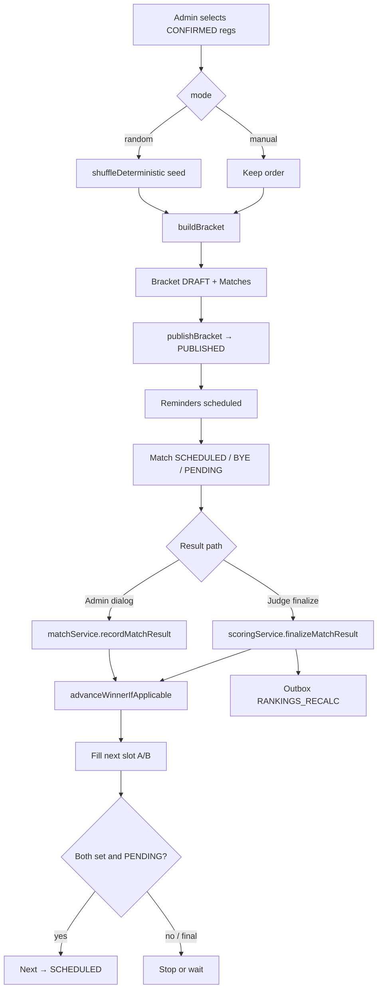
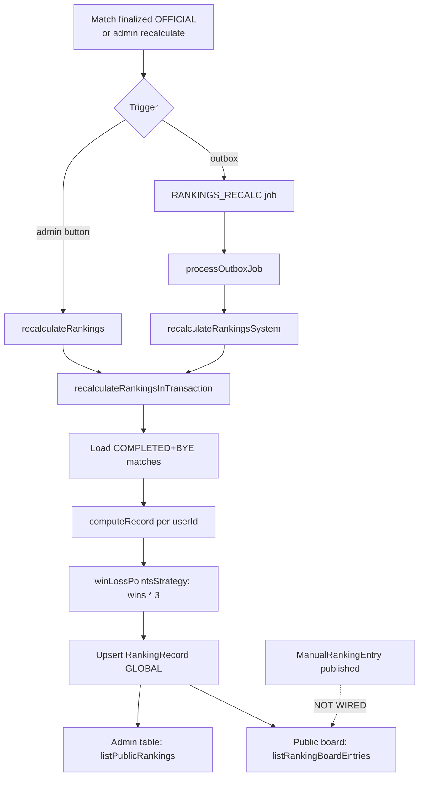

# Brackets & rankings

Research notes for handover (Agent 4). Validated against source under `d:\upnrol`.

---

## 1. Source map

| Piece | Path |
|-------|------|
| Pure bracket algorithm | `backend/services/bracketEngine.ts` (+ `bracketEngine.test.ts`) |
| Persist / publish | `backend/services/bracketService.ts` |
| Models | `backend/models/Bracket.ts`, `backend/models/Match.ts` |
| Winner advance (admin path) | `backend/services/matchService.ts` |
| Winner advance (scoring path) | `backend/services/scoringService.ts` (`advanceWinnerIfApplicable`) |
| Pure ranking formula | `backend/services/rankingEngine.ts` (+ `rankingEngine.test.ts`) |
| Persist / public board | `backend/services/rankingService.ts` |
| Manual rankings CRUD | `backend/services/manualRankingService.ts` |
| Manual model | `backend/models/ManualRankingEntry.ts` |
| Computed model | `backend/models/RankingRecord.ts` |
| Outbox recalc | `backend/services/outboxService.ts` → `RANKINGS_RECALC` |
| Public board page | `frontend/src/app/(public)/rankings/page.tsx` |
| Admin rankings page | `frontend/src/app/(admin)/admin/rankings/page.tsx` |
| Cache wrappers | `frontend/src/lib/public-reads.ts` (`cachedRankingBoardEntries`, `cachedPublicRankings`) |
| Admin UI actions | `frontend/src/features/brackets/actions.ts`, `frontend/src/features/rankings/actions.ts` |

---

## 2. `bracketEngine` algorithm

Pure, no DB. Single-elimination only.

### 2.1 Seeding order — `standardSeedOrder(n)`

- `n` must be a **power of two**.
- Classic recursive bracket: seed 1 vs 2 only meet in the final; 1 vs 3/4 in semis, etc.
- Base `[1]`; each doubling interleaves `s` with `size + 1 - s`.

### 2.2 Random order — `shuffleDeterministic(items, seed)`

- **mulberry32** PRNG from integer seed.
- Fisher–Yates; same seed ⇒ same permutation (admin “random” mode).

### 2.3 `buildBracket(orderedParticipantIds)`

1. Require ≥ 2 participants.
2. Pad field size to `nextPowerOfTwo(count)`.
3. Map `standardSeedOrder` slots: real ids for seeds ≤ participantCount; else `null` bye.
4. **Round 0**: pair adjacent slots.
   - One null → match `status: "BYE"`, winner = real fighter, pre-filled into next round carry.
   - Both present → `SCHEDULED`, winner null.
5. **Rounds 1..R-1**: from previous winners.
   - Both empty → `PENDING` (no competitors yet).
   - Exactly one → cascading `BYE` (auto COMPLETED-style bye with winner).
   - Both set → `SCHEDULED`.
   - Waiting on upstream → `PENDING` with partial/null slots.
6. Returns `{ roundsCount, matches: MatchSkeleton[] }` with `round`, `order`, competitors, status, winner.

### 2.4 Advancement arithmetic — `nextSlot(round, order)`

```
nextRound = round + 1
nextOrder = floor(order / 2)
slot     = order even → "A", odd → "B"
```

No stored “next match” pointer.

### 2.5 Correction guard — `canCorrectResult(nextMatchStatus)`

- Final (no next) → always allowed.
- Otherwise blocked if next is already `COMPLETED` or `BYE` (would silently invalidate a decided bout).

---

## 3. `bracketService` publish flow

### 3.1 Generate — `generateBracket(actor, divisionId, orderedRegistrationIds, mode)`

Admin-only, transactional:

1. Division must exist.
2. If bracket exists and is **`PUBLISHED`** → conflict (no unpublish / regenerate-in-place after publish).
3. All ids must be **CONFIRMED** registrations for that division.
4. Order: `manual` keeps array order; `random` applies `shuffleDeterministic(..., seed)`.
5. `buildBracket(orderedIds)`.
6. Upsert `Bracket` as **`DRAFT`** (version++ if regenerating draft); delete prior matches for that bracket id.
7. `Match.insertMany` with mat from `matNumberForOrder(order, event.matCount)`.
8. Audit `BRACKET_GENERATED`.

### 3.2 Publish — `publishBracket(actor, bracketId)`

1. Atomic `findOneAndUpdate({ status: "DRAFT" } → "PUBLISHED")`.
2. Audit `BRACKET_PUBLISHED`.
3. **After** commit: `scheduleRemindersForPublishedBracket` (reminder outbox jobs). Draft edits never schedule reminders.

### 3.3 Reads

- Admin: `getBracketForDivision` (any status) + name enrichment.
- Public: `getPublishedBracketForDivision` — **PUBLISHED only**.

---

## 4. Match progression

Triggered when a winner is recorded:

| Path | Entry | Advance helper |
|------|-------|----------------|
| Live scoring finalize | `scoringService.finalizeMatchResult` | local `advanceWinnerIfApplicable` |
| Admin quick result | `matchService.recordMatchResult` | local duplicate of same logic |
| Corrections | `adminCorrectOfficialResult` / `correctMatchResult` | re-writes next slot if `canCorrectResult` |

Advance behavior:

1. If `round + 1 >= bracket.roundsCount` → final; stop.
2. Compute `nextSlot`; load next match.
3. Write winner into slot A or B.
4. If both competitors set and next was `PENDING` → set **`SCHEDULED`**.

Finalize path also enqueues rankings + notify outbox jobs; admin `recordMatchResult` historically emails/WhatsApp via separate code paths and does **not** set `resultKind: OFFICIAL` / score timeline (dual-path gap for handover).

---

## 5. Ranking engine & service

### 5.1 `rankingEngine`

- `computeRecord(userId, decidedMatches)` → wins/losses from matches where the fighter competed and a winner exists.
- **Placeholder strategy** `winLossPointsStrategy`: **`points = wins * 3`** (0 for losses). Documented as pending **OD-004**; designed to be swapped without touching persistence.

### 5.2 `rankingService.recalculateRankings*`

- Inputs: all matches with status `COMPLETED` or `BYE`.
- Maps registration ids → user ids; computes records for every competitor user id seen.
- Upserts `RankingRecord` (`scope: "GLOBAL"`) with bumped `calculationVersion`.
- Optimistic conflict if another calc already advanced past `existingVersion`.
- Admin: `recalculateRankings(actor)`; system/outbox: `recalculateRankingsSystem("system:outbox")`.
- Audit `RANKINGS_RECALCULATED`.

Triggered automatically after judge/admin **finalize** via outbox `RANKINGS_RECALC` (`scoringService` → `outboxService` → cron `/api/cron/process-outbox`). Admin can also press recalculate on `/admin/rankings`.

### 5.3 Public list helpers

| Function | Behavior |
|----------|----------|
| `listPublicRankings` | Sort `RankingRecord` by points desc, wins desc; join display names. Used on **admin** computed table + `cachedPublicRankings`. |
| `listRankingBoardEntries` | One row per **CONFIRMED** registration with division gender/weight/level; wins/losses/points from `RankingRecord` or zeros. Powers **public** `/rankings` via `cachedRankingBoardEntries`. |

---

## 6. Manual rankings vs public board — wiring gap

### What exists

- `manualRankingService`: CRUD + `listPublishedManualRankings()` (`published: true`, sort by rank).
- Admin UI copy on `/admin/rankings`: *“Public board prefers published manual numbers…”* and form to upsert manual entries (`ManualRankingForm`).
- Model `ManualRankingEntry` with gender/weightBand/experienceLevel/rank/photoUrl/etc.

### What public actually loads

```12:21:frontend/src/app/(public)/rankings/page.tsx
  // The board fills in automatically: a grappler appears in their division once their
  // registration is confirmed, and ranks start once matches are decided.
  const entries = await cachedRankingBoardEntries();
```

`cachedRankingBoardEntries` → `listRankingBoardEntries()` → **computed `RankingRecord` + CONFIRMED registrations only**.

### Gap (validated)

- `listPublishedManualRankings` is **defined but never imported** outside `manualRankingService.ts` (grep-confirmed).
- Public board therefore **ignores** manual entries entirely.
- Admin page text overstates product behavior: manual numbers are managed/admin-visible only; public board is auto from registrations + placeholder `wins*3` records.
- `cachedPublicRankings` (flat computed list) is also unused by the current rankings page (board uses division-bucketed entries).

**Handover implication:** either wire `listPublishedManualRankings` into the public page (with precedence rules) or fix admin copy; until then OD-004 + manual board are parallel unfinished tracks.

---

## 7. Mermaid — bracket progression



---

## 8. Mermaid — ranking update



---

## 9. Known limitations (code-backed)

- Format: **SINGLE_ELIMINATION** only (`Bracket.format`).
- No unpublish; published brackets cannot regenerate.
- Ranking formula is explicitly a placeholder (OD-004).
- Bye matches count in ranking recalc the same as COMPLETED (winner gets a win if present).
- Manual vs computed public wiring gap (section 6).
