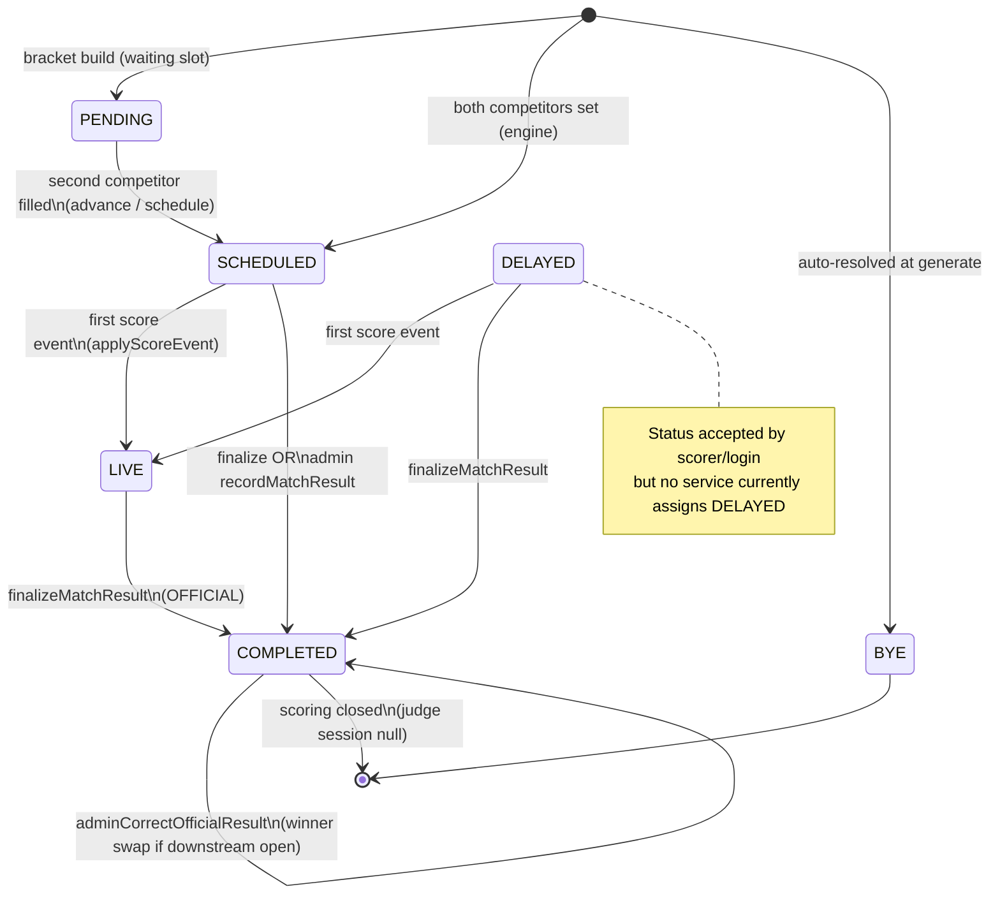
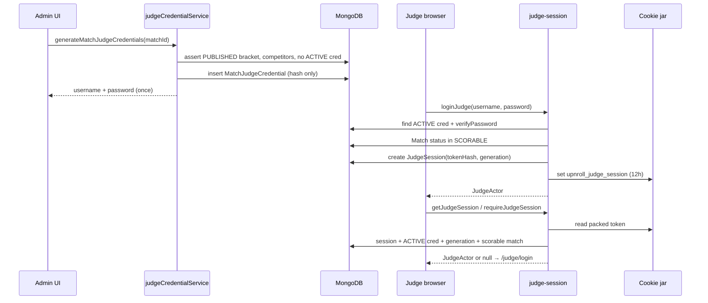
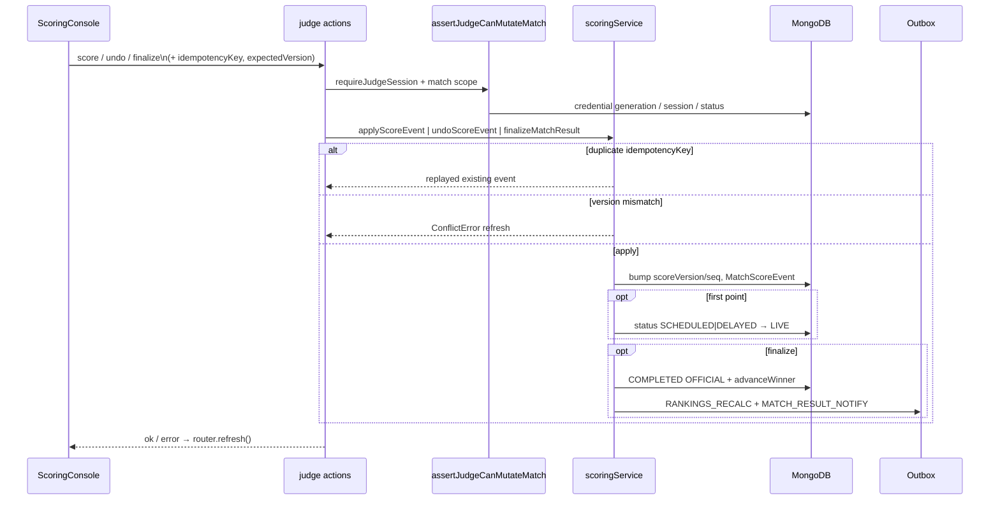

# Judge panel — credentials, auth, scoring console

Research notes for handover (Agent 4). Validated against source as of the documented commit on `main`. Paths are repo-relative from `d:\upnrol`.

---

## 1. Overview

Judges are **not** `User` accounts. Access is a **per-match shared credential** (`MatchJudgeCredential`) plus a short-lived **judge session cookie** (`JudgeSession`). Scoring mutations go through `scoringService` with the same optimistic-concurrency / idempotency rules as admin scoring.

| Concern | Primary sources |
|---------|-----------------|
| Credential generate / regenerate / revoke | `backend/services/judgeCredentialService.ts` |
| Credential schema | `backend/models/MatchJudgeCredential.ts` |
| Login, cookie, session read, mutate guard | `backend/auth/judge-session.ts`, `backend/auth/judge-cookie-name.ts` |
| Session schema + TTL | `backend/models/JudgeSession.ts` |
| Admin UI actions | `frontend/src/features/matches/judge-credential-actions.ts`, `judge-credentials-panel.tsx` |
| Judge portal | `frontend/src/app/(judge)/judge/{layout,page,login/page}.tsx` |
| Console UI + actions | `frontend/src/features/judge/{scoring-console.tsx,actions.ts,login-form.tsx}` |
| Points / undo / finalize | `backend/services/scoringService.ts` |
| Rules / provisional winner | `backend/services/tournamentRules.ts` |
| Match statuses | `backend/models/Match.ts` |

---

## 2. Credential generation

### 2.1 Alphabet, length, randomness

From `judgeCredentialService.ts`:

- **Alphabet** `CRED_ALPHABET`: `ABCDEFGHJKLMNPQRSTUVWXYZabcdefghijkmnopqrstuvwxyz23456789`  
  - 57 characters; omits ambiguous `0/O/1/I/l`.
- **Username**: `randomCredentialPart(10)` → exactly **10** chars; schema enforces `minlength`/`maxlength` 10 and `unique`.
- **Password**: `randomCredentialPart(10)` → **10** chars; stored only as `passwordHash` via `hashPassword` (`backend/auth/password.ts` — scrypt + random salt). Plaintext password is **returned once** to the admin UI and never persisted recoverably.
- **Entropy source**: Node `crypto.randomBytes(length)`; each byte mapped with `bytes[i] % CRED_ALPHABET.length` (slight modulo bias; still CSPRNG-backed).
- **Username uniqueness**: up to **12** attempts via `uniqueUsername()`; on exhaustion → `ConflictError`.

### 2.2 Issue preconditions (`generateMatchJudgeCredentials`)

Admin-only (`assertAdmin`). Transactional. Requires:

1. Match exists.
2. Parent bracket `status === "PUBLISHED"`.
3. Match status ∈ `{ SCHEDULED, LIVE, DELAYED }` **or** `PENDING` (completed / cancelled / bye blocked).
4. Both `competitorARegistrationId` and `competitorBRegistrationId` set.
5. No existing credential with `status: "ACTIVE"` for that match (else conflict — must revoke/regenerate).

Creates `generation: 1`, audits `JUDGE_CREDENTIALS_ISSUED`.

### 2.3 Regenerate / revoke

| Action | Behavior |
|--------|----------|
| **Regenerate** | Revokes all `ACTIVE` creds for the match; sets `revokedAt`/`revokedBy`; revokes open `JudgeSession` rows (`revokedAt`); issues new username/password with `generation = (previous.generation ?? 0) + 1`. Blocked if match is `COMPLETED` / `CANCELLED` / `BYE`. Audit: `JUDGE_CREDENTIALS_REGENERATED`. |
| **Revoke** | Same session kill + `REVOKED` on active creds; no replacement issued. Audit: `JUDGE_CREDENTIALS_REVOKED`. |
| **Meta (admin)** | `getActiveJudgeCredentialMeta` returns username/generation/issuedAt — **not** the password. |

Admin Server Actions: `generateJudgeCredentialsAction` / `regenerateJudgeCredentialsAction` / `revokeJudgeCredentialsAction` in `frontend/src/features/matches/judge-credential-actions.ts` — return `{ oneTime: { username, password, generation } }` for display once.

---

## 3. Login & session cookie

### 3.1 Cookie

| Constant | Value | File |
|----------|-------|------|
| Name | `upnroll_judge_session` | `backend/auth/judge-cookie-name.ts` |
| Max age | **12 hours** (`60 * 60 * 12`) | same |
| Flags | `httpOnly`, `secure` in production, `sameSite: "lax"`, `path: "/"` | `loginJudge` |
| Value | Packed raw token via `packCookieValue` | `backend/auth/cookies.ts` |
| DB | SHA-256 hex of raw token in `JudgeSession.tokenHash` | `judge-session.ts` |

Separate from fighter/admin session cookie (comment: Edge-safe name module, no `node:crypto`).

### 3.2 Login (`loginJudge`)

1. Rate limit key `judge-login:{username.lower}` — failures look like bad credentials (`UnauthorizedError`).
2. Load credential by username; must be `ACTIVE`.
3. `verifyPassword` against hash.
4. Match must be scorable: status ∈ `{ SCHEDULED, LIVE, DELAYED }` (note: **PENDING is not login-eligible** even if credentials could be issued for PENDING).
5. Delete prior judge session if cookie already present.
6. Create session: `randomBytes(32).toString("hex")`, store hash, `generation` copied from credential, `expiresAt`.
7. Set cookie; audit `JUDGE_SESSION_LOGIN` (notes shared login is not a verified person).
8. Return frozen `JudgeActor`: `{ kind: "JUDGE_SESSION", sessionId, credentialId, matchId, generation, username }`.

UI: `/judge/login` → `judgeLoginAction` → redirect `/judge`.

### 3.3 Session read / logout / mutate assert

- `getJudgeSession()`: `connection()` then `cache()`-wrapped reader — invalid if missing cookie, revoked, expired, credential not ACTIVE, **generation mismatch**, or match not scorable.
- Mongo TTL index on `JudgeSession.expiresAt` (`expireAfterSeconds: 0`).
- `destroyJudgeSession`: mark session revoked + delete cookie; `judgeLogoutAction` → `/judge/login`.
- `assertJudgeCanMutateMatch`: same-match only; re-checks credential generation/ACTIVE and session not revoked; match still scorable.

---

## 4. Scoring console

Route: `/judge` (`frontend/src/app/(judge)/judge/page.tsx`) loads `loadJudgeScoringConsole` → `getMatchScoringState` + fighter profile cards.

### 4.1 Capabilities (UI → service)

| UI action | Server action | Service |
|-----------|---------------|---------|
| Point / penalty buttons from event rules | `judgeScorePointAction` | `applyScoreEvent` (`POINT` \| `PENALTY`) |
| Undo last reversible timeline event | `judgeUndoScoreAction` | `undoScoreEvent` |
| Outcome buttons (finalize) | `judgeFinalizeAction` | `finalizeMatchResult` |
| Sign out | `judgeLogoutAction` | `destroyJudgeSession` |

Each mutating call sends:

- `idempotencyKey` — `crypto.randomUUID()` per click (`scoring-console.tsx`)
- `expectedVersion` — client `scoreVersion` (optimistic concurrency)

### 4.2 Points & penalties

- Driven by `Event.scoringRules` (`ScoringRulesConfig` in `tournamentRules.ts`).
- Console disables scoring if `!rulesReady` (`isScoringRulesReady`: `configured` + ≥1 outcome; if `winByHighestScore` then ≥1 point rule).
- First score on `SCHEDULED` or `DELAYED` flips match to **`LIVE`**.
- Penalties: `pointsAgainst` applied as negative delta on that side; `penaltiesA/B` incremented.
- Updates `provisionalWinnerRegistrationId` / `provisionalResultMethod` via `provisionalWinnerFromScores`.

### 4.3 Undo

- Finds last timeline item that is not already reversed and not `UNDO`/`FINALIZE`.
- Service creates an `UNDO` event, links `reversesEventId` / `reversedByEventId`, reverses score/penalty deltas.
- Cannot undo `UNDO` or `FINALIZE`.

### 4.4 Finalize

- Requires configured outcomes; `POINTS` / win-by-score path uses provisional winner; outcomes with `requiresExplicitWinner` need a registration id (UI may `confirm()` A vs B).
- Sets match `COMPLETED`, `resultKind: "OFFICIAL"`, winner/method, `finalizedByKind: "JUDGE_SESSION"`, advances bracket winner (`advanceWinnerIfApplicable` + `nextSlot`), writes `FINALIZE` score event.
- Enqueues outbox: `RANKINGS_RECALC`, `MATCH_RESULT_NOTIFY`.
- Invalidates public tags: `schedule`, `rankings`, `fighters`, `brackets`.

### 4.5 Restrictions (summary)

| Rule | Enforcement |
|------|-------------|
| One match per session | `judge.matchId` must equal mutation `matchId` |
| Credential rotation invalidates session | generation check on read + mutate |
| Only published-bracket matches get creds | generate guard |
| Scoring only while open | `OPEN_FOR_SCORE` = SCHEDULED \| LIVE \| DELAYED |
| Rules must be configured | `isScoringRulesReady` |
| Version conflicts | `scoreVersion !== expectedVersion` → refresh |
| Dual path: admin `recordMatchResult` | Only allows **SCHEDULED** (not LIVE); no score timeline — see match lifecycle section |

**Note:** `DELAYED` is accepted for login/scoring but **no writer** in services sets `status = "DELAYED"` (enum-only / partial).

---

## 5. Duplicate submission handling

Implemented in `scoringService.applyScoreEvent` / `undoScoreEvent` / `finalizeMatchResult`:

1. **Idempotency key** unique per `(matchId, idempotencyKey)` on `MatchScoreEvent`. Same key → return existing event with `replayed: true` (no double apply).
2. **Duplicate-key race**: catch `isDuplicateKey`, re-load existing event and return replayed.
3. **Finalize extras**:
   - Already `COMPLETED` + `OFFICIAL` → replayed, no side effects.
   - `effectsAppliedKey === finalize:{matchId}:v{nextVersion}` → replayed.
4. **Outbox** jobs use idempotency keys derived from `effectsKey` so rankings/notify are not duplicated on replay.
5. UI: `pendingKey` blocks concurrent clicks in the console while a save is in flight.

---

## 6. Match state transitions (scoring-relevant)

Statuses from `MATCH_STATUSES` in `backend/models/Match.ts`.

Related: `CANCELLED` / `ERROR` exist on the model; judge credential regenerate treats CANCELLED as terminal; login/scoring treat them as non-scorable.

---

## 7. Mermaid — auth sequence

---

## 8. Mermaid — scoring sequence

---

## 9. Gaps / handover flags

- Shared credentials = shared accountability; audit actor is credential id, not a person.
- Admin quick-result (`matchService.recordMatchResult`) bypasses live scoring timeline and only works from `SCHEDULED`.
- Password shown once; lost password ⇒ regenerate (kills sessions).
- Judge layout does **not** call `requireJudgeSession` itself — page redirects; mutations re-check.
