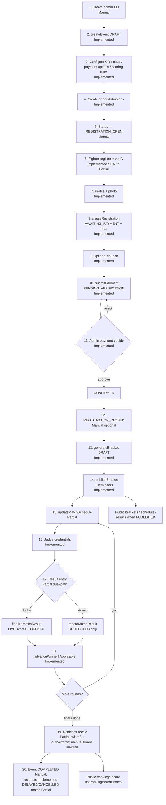

# Tournament lifecycle — 20-step E2E map (code-validated)

Research notes for handover (Agent 4). Each step is marked **Implemented**, **Partial**, **Manual**, or **Missing** after checking services/routes under `d:\upnrol`. Cross-checks: `docs/qa/END_TO_END_USER_FLOW_MAP.md`, `scripts/e2e-lifecycle-audit.ts`, phase docs.

Status legend:

| Tag | Meaning |
|-----|---------|
| **Implemented** | Service + typical UI/API path exist and enforce the state change |
| **Partial** | Logic or UI exists but incomplete, dual-path, or env-gated |
| **Manual** | Operator/cron/human action required; no automatic calendar FSM |
| **Missing** | No writer/UI found for the expected step |

---

## 20-step lifecycle

| # | Step | Status | What the code does | Key sources |
|---|------|--------|--------------------|-------------|
| 1 | Provision admin account | **Manual** | No public signup. CLI `npm run create-admin` / `scripts/create-admin.ts` creates `ADMIN` user. | `scripts/create-admin.ts`, `docs/qa/END_TO_END_USER_FLOW_MAP.md` |
| 2 | Create event (`DRAFT`) | **Implemented** | Admin `createEvent` → status default `DRAFT`. | `backend/services/eventService.ts`, `backend/models/Event.ts` |
| 3 | Configure event ops (details, mats, payment QR/options, scoring rules) | **Implemented** | `updateEventDetails`, `updateEventMatCount`, `setEventPaymentQr` / `paymentOptionService`, `updateEventScoringRules`. | `eventService.ts`, `paymentOptionService.ts`, `scoringService.ts`, `tournamentRules.ts` |
| 4 | Create / seed divisions | **Implemented** | `createDivision` or `seedRoadToSuperFightDivisions` (capacity, gender, weightBand, experienceLevel). | `eventService.ts` |
| 5 | Open registration | **Manual** | `updateEventStatus(..., "REGISTRATION_OPEN")` — admin sets status; **no calendar auto-open**. | `eventService.ts`, `EVENT_STATUSES` |
| 6 | Fighter account + email verify | **Implemented** | Register → verification code → session. Google OAuth **Partial** (env-gated). | auth session modules, `(auth)` routes; flow map §B |
| 7 | Complete fighter / grappler profile | **Implemented** | Profile + photo via storage adapter; required for sensible registration UX. | `fighterService.ts`, storage adapters |
| 8 | Create registration (claim seat) | **Implemented** | `createRegistration` → `AWAITING_PAYMENT` + division occupancy claim; stub payment row. | `registrationService.ts`, `registrationStateMachine` |
| 9 | Optional coupon hold / apply | **Implemented** | Reserve/redeem/apply coupon against registration fee. | `couponService.ts`, `tournamentRules.couponReservationMinutes` |
| 10 | Submit UTR + screenshot | **Implemented** | `submitPayment` → payment `PENDING_REVIEW`, registration `PENDING_VERIFICATION`. Manual verification by design (no PSP). | `paymentService.ts` |
| 11 | Admin approve / reject payment | **Implemented** | Approve → `CONFIRMED`; reject → `REJECTED` + seat release; duplicate decide guarded. | `paymentService.ts`, admin payments UI |
| 12 | Close registration | **Manual** | Admin sets `REGISTRATION_CLOSED`. No automatic close at capacity/date. | `eventService.updateEventStatus` |
| 13 | Generate draft bracket | **Implemented** | `generateBracket` from CONFIRMED regs; `DRAFT`; byes auto-resolved. Regenerable while draft. | `bracketService.ts`, `bracketEngine.ts` |
| 14 | Publish bracket | **Implemented** | `DRAFT` → `PUBLISHED` (locked); schedules match reminders. | `bracketService.publishBracket`, `reminderService.ts` |
| 15 | Schedule mats / times | **Partial** | `updateMatchSchedule` + conflict detection exist; mats auto-assigned at generate; full scheduling UX historically thin vs model. Conflicts can be overridden with `allowConflicts`. | `matchService.updateMatchSchedule`, `matchConflict.ts` |
| 16 | Issue judge credentials | **Implemented** | Per-match username/password; requires published bracket + both competitors. | `judgeCredentialService.ts`, judge credentials panel |
| 17 | Live score / finalize **or** admin record result | **Partial** (dual path) | Judge console → `scoringService` (LIVE timeline, OFFICIAL finalize, outbox). Admin dialog → `recordMatchResult` only from `SCHEDULED`, no score events / `resultKind`. | `scoringService.ts`, `matchService.ts`, judge + match UIs |
| 18 | Advance winners through bracket | **Implemented** | `nextSlot` + fill A/B; PENDING→SCHEDULED when both set. Corrections blocked if downstream decided. | `bracketEngine`, `matchService`, `scoringService` |
| 19 | Recalculate rankings + public boards | **Partial** | Finalize enqueues `RANKINGS_RECALC`; cron `/api/cron/process-outbox` or admin button. Formula `wins*3` placeholder. Public board uses computed + CONFIRMED regs; **manual rankings not wired**. | `rankingService.ts`, `rankingEngine.ts`, `manualRankingService.ts`, `outboxService.ts`, `frontend/src/app/api/cron/process-outbox/route.ts` |
| 20 | Close event / post-event requests | **Partial** | Event `COMPLETED` is **manual** status set. Cancellation/transfer requests **Implemented** (`requestService`). Match `CANCELLED`/`DELAYED`/`ERROR` mostly enum-only (no solid transition writers found). WhatsApp notify stub; email env-gated. | `eventService`, `requestService`, `notifications/whatsapp`, email adapters |

---

## Supporting state machines (compact)

### Event

`DRAFT` → `REGISTRATION_OPEN` → `REGISTRATION_CLOSED` → `COMPLETED` — all via admin `updateEventStatus` (Manual transitions).

### Registration

`AWAITING_PAYMENT` → `PENDING_VERIFICATION` → `CONFIRMED`  
`PENDING_VERIFICATION` → `REJECTED` → (resubmit) → `PENDING_VERIFICATION`  
`CONFIRMED` / others → `CANCELLED` (withdraw / approved cancellation request)

### Bracket

`DRAFT` (regenerate OK) → `PUBLISHED` (no unpublish)

### Match (operational)

See also `04-judge-panel.md` state diagram. Engine creates `PENDING` / `SCHEDULED` / `BYE`; scoring drives `LIVE` → `COMPLETED`; admin quick path `SCHEDULED` → `COMPLETED`.

---

## Full mermaid flowchart

---

## Validation notes vs older docs

- `docs/qa/END_TO_END_USER_FLOW_MAP.md` still describes rankings as **manual** recalculate only and match statuses without LIVE/scoring — **stale** relative to judge panel + outbox. Prefer this file + `04-judge-panel.md` / `04-brackets-rankings.md` for current behavior.
- `scripts/e2e-lifecycle-audit.ts` exercises a shortened DB path (2 fighters → pay → bracket → result → rankings) and mirrors engines inline; it does **not** cover judge sessions or scoring rules.
- Architecture map claim “no background job runner” is outdated: durable **outbox** + `/api/cron/process-outbox` exist (`outboxService.ts`). Reminders/rankings/notify depend on cron being called in the deploy environment (**Partial** ops concern).

---

## Critical dual-path / gap checklist for operators

1. Prefer **one** result path per match (judge finalize vs admin record) to avoid inconsistent `resultKind` / timeline.
2. Configure **scoring rules** before fight day if judges will score.
3. Ensure **outbox cron** runs or manually recalculate rankings after results.
4. Do not expect **manual ranking** rows to appear on `/rankings` until wired (see `04-brackets-rankings.md` §6).
5. Event open/close/complete remain **operator-driven** status flips.
