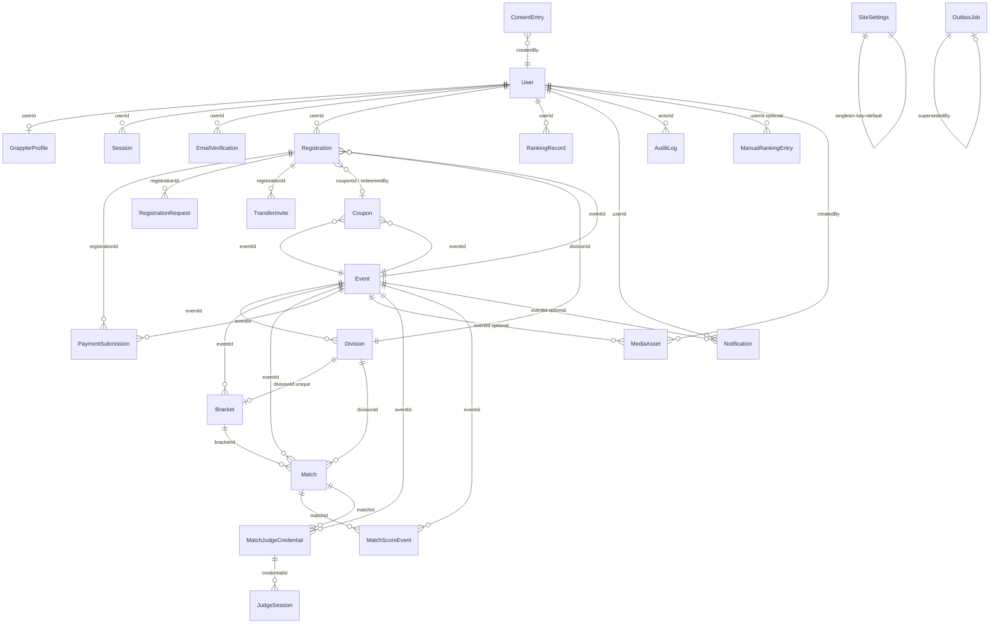

# 05 — Database models

Source of truth: `backend/models/*.ts`. Collection names are Mongoose defaults (lowercased plural) unless noted. Every schema uses `timestamps: true` except `AuditLog` (`createdAt` only).

---

## Mermaid ERD

---

## Models

### User — collection `users`

| Purpose | Auth identity; roles GRAPPLER / ADMIN (legacy FIGHTER still readable). |
|---|---|

| Field | Type | Required | Default | Notes |
|---|---|---|---|---|
| email | String | yes | — | unique, lowercase, trim |
| displayName | String | no | `""` | house greeting name |
| passwordHash | String | yes | — | |
| role | String enum | yes | `"GRAPPLER"` | `GRAPPLER` \| `ADMIN` \| `FIGHTER` |
| status | String enum | yes | `"ACTIVE"` | `ACTIVE` \| `DISABLED` |
| emailVerified | Boolean | no | — | `false` = awaiting code; missing = legacy allow-login |
| emailVerifiedAt | Date | no | — | |
| createdAt / updatedAt | Date | auto | — | |

**Indexes / unique:** `email` unique.

**Relationships:** 1→1 GrapplerProfile; 1→N Session, Registration, Notification, AuditLog (as actor).

**Lifecycle:** Created by register / Google OAuth / `scripts/create-admin`. Soft-disabled via `status=DISABLED`.

---

### GrapplerProfile (alias FighterProfile) — collection `fighterprofiles`

| Purpose | Grappler public + private profile. Model name `GrapplerProfile`; collection remains `fighterprofiles` until migration. |
|---|---|

| Field | Type | Required | Default | Notes |
|---|---|---|---|---|
| userId | ObjectId→User | yes | — | **unique** |
| displayName | String | yes | — | |
| slug | String | yes | — | **unique**, lowercase |
| gym, discipline | String | no | `""` | |
| dateOfBirth | String | no | `""` | |
| age | Number | no | `0` | |
| gender, mobile, nationality | String | no | `""` | |
| aadhaar | String | no | `""` | legacy text; keep private |
| aadhaarImageKey | String | no | `""` | private storage key |
| parentalConsentImageKey | String | no | `""` | minors under 18 |
| cityState, emergencyContactName, emergencyRelationship, bloodGroup | String | no | `""` | |
| instagramHandle | String | no | `""` | without `@` |
| photoKey | String | no | `""` | |
| academy, headCoach, beltRank | String | no | `""` | |
| yearsTraining | Number | no | `0` | |
| pastRecord | String | no | `""` | free-text |
| careerWins | Number | no | `0` | min 0; seeding hint |
| weightDivision, heardAbout | String | no | `""` | |
| hasMedicalCondition, hasAllergies, takingMedication, medicallyFit | Boolean | no | `false` | |
| medicalConditionDetail, allergiesDetail | String | no | `""` | |
| waiverAcceptedAt | Date | no | — | |
| createdAt / updatedAt | Date | auto | — | |

**Indexes / unique:** `userId` unique; `slug` unique; `{ createdAt: -1 }`; `{ displayName: 1 }`.

**Relationships:** User 1:1. Referenced by rankings / brackets via userId.

**Lifecycle:** Created at register (minimal) or Google OAuth; enriched on profile / registration forms. Private keys never exposed on public pages.

---

### Session — collection `sessions`

| Purpose | Cookie session: hashed token ↔ user. |
|---|---|

| Field | Type | Required | Default |
|---|---|---|---|
| userId | ObjectId→User | yes | — |
| tokenHash | String | yes | — unique |
| expiresAt | Date | yes | — |
| userAgent | String | no | — |
| createdAt / updatedAt | Date | auto | — |

**Indexes:** `userId`; `tokenHash` unique; TTL on `expiresAt` (`expireAfterSeconds: 0`).

---

### EmailVerification — collection `emailverifications`

| Purpose | Hashed email verification codes for new accounts. |
|---|---|

| Field | Type | Required | Default |
|---|---|---|---|
| userId | ObjectId→User | yes | — indexed |
| codeHash | String | yes | — |
| expiresAt | Date | yes | — |
| createdAt / updatedAt | Date | auto | — |

---

### Event — collection `events`

| Purpose | Tournament / event root: schedule windows, fees, scoring rules, mats. |
|---|---|

| Field | Type | Required | Default | Notes |
|---|---|---|---|---|
| name | String | yes | — | |
| slug | String | yes | — | **unique**, lowercase |
| description, venue | String | no | `""` | |
| startDate | Date | yes | — | |
| registrationOpensAt / registrationClosesAt | Date | yes | — | |
| status | enum | yes | `"DRAFT"` | `DRAFT` \| `REGISTRATION_OPEN` \| `REGISTRATION_CLOSED` \| `COMPLETED` |
| matCount | Number | yes | `1` | min 1 |
| timezone | String | yes | `"Asia/Kolkata"` | IANA |
| paymentInstructions.feeMinorUnits | Number | yes | — | legacy single-fee mirror |
| paymentInstructions.currency | String | yes | `"INR"` | |
| paymentInstructions.qrImageKey | String | no | `""` | |
| paymentOptions[] | subdocs | no | `[]` | authoritative multi-option list |
| paymentOptions._id | ObjectId | auto | — | |
| paymentOptions.label | String | yes | — | |
| paymentOptions.amountMinorUnits | Number | yes | — | min 0 |
| paymentOptions.currency | String | yes | `"INR"` | |
| paymentOptions.qrImageKey | String | no | `""` | |
| paymentOptions.active | Boolean | yes | `true` | |
| paymentOptions.isDefault | Boolean | yes | `false` | |
| scoringRules | subdoc | no | `{ configured: false }` | see below |
| scheduleExternalUrl | String | no | `""` | |
| createdAt / updatedAt | Date | auto | — | |

**scoringRules:** `configured`, `winByHighestScore`, `allowTies` (bools); `points[]` `{code,label,points}`; `penalties[]` `{code,label,pointsAgainst}`; `outcomes[]` `{code,label,requiresExplicitWinner}`.

**Indexes / unique:** `slug` unique.

**Lifecycle:** DRAFT → REGISTRATION_OPEN → REGISTRATION_CLOSED → COMPLETED (admin status transitions).

---

### Division — collection `divisions`

| Purpose | Weight / experience class within an event; capacity + occupancy. |
|---|---|

| Field | Type | Required | Default | Notes |
|---|---|---|---|---|
| eventId | ObjectId→Event | yes | — | indexed |
| name | String | yes | — | |
| discipline | String | yes | — | e.g. No-Gi |
| capacity | Number | yes | — | min 1 |
| filledCount | Number | no | — | missing ≠ 0; set by create / backfill |
| feeMinorUnitsOverride | Number | no | `null` | null → use event fee |
| gender | enum | no | `""` | `""` \| `MALE` \| `FEMALE` |
| experienceLevel | enum | no | `""` | `""` \| `BEGINNER` \| `INTERMEDIATE` |
| weightBand | String | no | `""` | taxonomy id e.g. `55-65` |
| weightMinKg / weightMaxKg | Number | no | `null` | taxonomy bounds (not enforced at register) |
| createdAt / updatedAt | Date | auto | — | |

**Relationships:** N per Event; 0..1 Bracket (unique on divisionId); N Registrations / Matches.

---

### Registration — collection `registrations`

| Purpose | Grappler seat in a division + fee snapshot + status machine. |
|---|---|

| Field | Type | Required | Default | Notes |
|---|---|---|---|---|
| userId | ObjectId→User | yes | — | indexed |
| eventId | ObjectId→Event | yes | — | indexed |
| divisionId | ObjectId→Division | yes | — | indexed |
| status | enum | yes | `"AWAITING_PAYMENT"` | see statuses |
| consentAcceptedAt / agreementAcceptedAt | Date | no | `null` | |
| feeSnapshot | subdoc \| null | no | `null` | frozen fee/QR/coupon at create |
| feeSnapshot.amountMinorUnits | Number | yes* | — | *when snapshot present |
| feeSnapshot.currency | String | yes* | `"INR"` | |
| feeSnapshot.paymentOptionId | ObjectId | no | `null` | |
| feeSnapshot.paymentOptionLabel / qrImageKey / couponCode | String | no | `""` | |
| feeSnapshot.couponId | ObjectId→Coupon | no | `null` | |
| feeSnapshot.snapshottedAt | Date | yes* | `Date.now` | |
| couponId | ObjectId→Coupon | no | `null` | |
| statusHistory[] | `{status, at}` | no | `[]` | |
| createdAt / updatedAt | Date | auto | — | |

**Statuses:** `AWAITING_PAYMENT` \| `PENDING_VERIFICATION` \| `CONFIRMED` \| `REJECTED` \| `CANCELLED`.  
**Active set** (capacity + duplicate block): first three.

**Indexes / unique:** partial unique `{ userId: 1, divisionId: 1 }` where status ∈ active set.

**Lifecycle:** create → AWAITING_PAYMENT (+ PaymentSubmission); submit payment → PENDING_VERIFICATION; admin approve → CONFIRMED / reject → REJECTED; cancel/withdraw → CANCELLED. Rejected may resubmit payment.

---

### PaymentSubmission — collection `paymentsubmissions`

| Purpose | UTR + screenshot review queue for a registration. |
|---|---|

| Field | Type | Required | Default |
|---|---|---|---|
| registrationId | ObjectId→Registration | yes | — indexed |
| userId | ObjectId→User | yes | — indexed |
| eventId | ObjectId→Event | yes | — |
| expectedAmountMinorUnits | Number | yes | — server-derived, min 0 |
| submittedUtr | String \| null | no | `null` indexed |
| screenshotStorageKey | String \| null | no | `null` |
| submittedAt | Date \| null | no | `null` |
| status | enum | yes | `"AWAITING_SUBMISSION"` |
| reviewerId | ObjectId→User | no | `null` |
| reviewedAt | Date | no | `null` |
| reviewNote | String | no | `""` |
| createdAt / updatedAt | Date | auto | — |

**Statuses:** `AWAITING_SUBMISSION` \| `PENDING_REVIEW` \| `APPROVED` \| `REJECTED`.

**Indexes:** `{ status: 1, createdAt: -1 }`; `submittedUtr`.

**Lifecycle:** Created with registration (AWAITING_SUBMISSION). New row on each submit (PENDING_REVIEW). Admin decides once; duplicates flagged by UTR helper (not blocked).

---

### Coupon — collection `coupons`

| Purpose | Per-event single-use codes bound to a payment option; reserve → redeem. |
|---|---|

| Field | Type | Required | Default |
|---|---|---|---|
| code | String | yes | — uppercase, trim |
| eventId | ObjectId→Event | yes | — indexed |
| paymentOptionId | ObjectId | yes | — Event.paymentOptions._id |
| status | enum | yes | `"AVAILABLE"` indexed |
| expiresAt | Date | no | `null` |
| intendedUserId | ObjectId→User | no | `null` |
| reservedByUserId | ObjectId→User | no | `null` |
| reservedUntil | Date | no | `null` |
| reservationIntentId | String | no | `null` |
| redeemedByRegistrationId | ObjectId→Registration | no | `null` |
| redeemedAt | Date | no | `null` |
| createdBy | ObjectId→User | yes | — |
| disabledAt / disabledBy | Date / ObjectId | no | `null` |
| releasedAt / releasedBy / releaseReason | Date / ObjectId / String | no | null / null / `""` |
| createdAt / updatedAt | Date | auto | — |

**Statuses:** `AVAILABLE` \| `RESERVED` \| `REDEEMED` \| `DISABLED` \| `EXPIRED`.

**Indexes / unique:** `{ code: 1, eventId: 1 }` unique; `{ status: 1, reservedUntil: 1 }`; `{ reservedByUserId: 1, status: 1 }`.

---

### Bracket — collection `brackets`

| Purpose | One single-elimination bracket per division. |
|---|---|

| Field | Type | Required | Default |
|---|---|---|---|
| eventId | ObjectId→Event | yes | — indexed |
| divisionId | ObjectId→Division | yes | — **unique** |
| format | enum | yes | `"SINGLE_ELIMINATION"` |
| seed | Number | yes | — RNG seed (0 for manual) |
| participantRegistrationIds | ObjectId[] | no | `[]` |
| roundsCount | Number | yes | — |
| status | enum | yes | `"DRAFT"` | `DRAFT` \| `PUBLISHED` |
| version | Number | yes | `1` |
| createdAt / updatedAt | Date | auto | — |

**Lifecycle:** generate (DRAFT, may replace prior DRAFT matches) → publish (irreversible in app). Unpublish not supported.

---

### Match — collection `matches`

| Purpose | Bracket slot / bout with schedule, scores, official result. |
|---|---|

| Field | Type | Required | Default | Notes |
|---|---|---|---|---|
| eventId / divisionId / bracketId | ObjectId | yes | — | each indexed |
| round / order | Number | yes | — | unique together with bracketId |
| competitorARegistrationId / competitorBRegistrationId | ObjectId→Registration | no | `null` | |
| status | enum | yes | `"PENDING"` | see list |
| winnerRegistrationId | ObjectId | no | `null` | |
| resultMethod | String | no | `""` | |
| resultKind | enum \| null | no | `null` | `PROVISIONAL` \| `OFFICIAL` |
| scheduledAt | Date | no | `null` | |
| scheduleVersion | Number | yes | `0` | reminder supersede |
| mat | String | no | `""` | |
| resultRecordedBy / resultRecordedAt | ObjectId / Date | no | null | |
| finalizedByKind | enum \| null | no | `null` | `JUDGE_SESSION` \| `ADMIN` |
| finalizedById / finalizedAt | ObjectId / Date | no | null | |
| correctionHistory[] | subdocs | no | `[]` | previous winner/method/reason/by/at |
| scoreVersion / scoreEventSeq | Number | yes | `0` | optimistic concurrency |
| scoreA / scoreB / penaltiesA / penaltiesB | Number | yes | `0` | |
| provisionalWinnerRegistrationId | ObjectId | no | `null` | |
| provisionalResultMethod | String | no | `""` | |
| effectsAppliedKey | String | no | `null` | side-effect idempotency |
| createdAt / updatedAt | Date | auto | — | |

**Statuses:** `PENDING` \| `SCHEDULED` \| `LIVE` \| `DELAYED` \| `COMPLETED` \| `BYE` \| `CANCELLED` \| `ERROR`.

**Indexes / unique:** `{ bracketId, round, order }` unique; `{ status }`; `{ eventId, status }`; `{ eventId, scheduledAt, mat }`; competitorA/B + scheduledAt.

---

### MatchScoreEvent — collection `matchscoreevents`

| Purpose | Append-only live scoring / finalize audit trail. |
|---|---|

| Field | Type | Required | Default |
|---|---|---|---|
| matchId / eventId | ObjectId | yes | — indexed |
| type | enum | yes | — `POINT` \| `PENALTY` \| `ADJUSTMENT` \| `UNDO` \| `STATUS` \| `FINALIZE` |
| side | enum | no | — `A` \| `B` |
| value | Number | yes | `0` |
| label | String | no | `""` |
| actorKind | enum | yes | — `JUDGE_SESSION` \| `ADMIN` |
| actorId | ObjectId | yes | — credential or admin user |
| sessionId | ObjectId→JudgeSession | no | `null` |
| sequence | Number | yes | — min 1 |
| matchVersion | Number | yes | — |
| idempotencyKey | String | yes | — |
| reversesEventId / reversedByEventId | ObjectId | no | `null` |
| meta | Mixed | no | `{}` |
| createdAt / updatedAt | Date | auto | — |

**Indexes / unique:** `{ matchId, sequence }` unique; `{ matchId, idempotencyKey }` unique.

---

### MatchJudgeCredential — collection `matchjudgecredentials`

| Purpose | Per-match judge login (username + password hash). |
|---|---|

| Field | Type | Required | Default |
|---|---|---|---|
| matchId / eventId | ObjectId | yes | — indexed |
| username | String | yes | — **unique**, length 10 |
| passwordHash | String | yes | — |
| generation | Number | yes | `1` | sessions must match |
| status | enum | yes | `"ACTIVE"` | `ACTIVE` \| `REVOKED` |
| issuedBy / issuedAt | ObjectId / Date | yes | — / Date.now |
| revokedAt / revokedBy | Date / ObjectId | no | null |
| createdAt / updatedAt | Date | auto | — |

**Indexes:** `{ matchId, status }`; `username` unique.

---

### JudgeSession — collection `judgesessions`

| Purpose | Short-lived judge cookie session bound to credential generation. |
|---|---|

| Field | Type | Required | Default |
|---|---|---|---|
| credentialId | ObjectId→MatchJudgeCredential | yes | — indexed |
| matchId | ObjectId→Match | yes | — indexed |
| generation | Number | yes | — min 1 |
| tokenHash | String | yes | — unique |
| expiresAt | Date | yes | — TTL index |
| userAgent | String | no | `""` |
| revokedAt | Date | no | `null` |
| createdAt / updatedAt | Date | auto | — |

---

### RankingRecord — collection `rankingrecords`

| Purpose | Computed global W/L/points per user (placeholder formula). |
|---|---|

| Field | Type | Required | Default |
|---|---|---|---|
| userId | ObjectId→User | yes | — **unique** |
| scope | enum | yes | `"GLOBAL"` |
| wins / losses / points | Number | yes | `0` |
| calculationVersion | Number | yes | `1` |
| computedAt | Date | yes | Date.now |
| createdAt / updatedAt | Date | auto | — |

**Indexes:** `{ points: -1, wins: -1 }`.

---

### ManualRankingEntry — collection `manualrankingentries`

| Purpose | Admin-curated public board rows (prefer when published rows exist). |
|---|---|

| Field | Type | Required | Default |
|---|---|---|---|
| displayName | String | yes | — |
| slug | String | no | `""` lowercase |
| userId | ObjectId→User | no | `null` |
| rank | Number | yes | — min 1 |
| gender | enum | no | `""` |
| weightBand / gym / photoUrl / note | String | no | `""` |
| experienceLevel | enum | no | `""` |
| published | Boolean | no | `true` |
| createdAt / updatedAt | Date | auto | — |

**Indexes:** `{ published: 1, rank: 1 }`; `{ weightBand: 1, gender: 1, rank: 1 }`.

---

### RegistrationRequest — collection `registrationrequests`

| Purpose | Admin-reviewed cancellation or division transfer. |
|---|---|

| Field | Type | Required | Default |
|---|---|---|---|
| type | enum | yes | — `CANCELLATION` \| `TRANSFER` |
| registrationId | ObjectId→Registration | yes | — indexed |
| userId | ObjectId→User | yes | — indexed |
| requestedDivisionId | ObjectId→Division | no | `null` | TRANSFER only |
| reason | String | yes | — |
| status | enum | yes | `"PENDING"` | `PENDING` \| `APPROVED` \| `REJECTED` |
| reviewerId / reviewNote / reviewedAt | ObjectId / String / Date | no | null / `""` / null |
| refundPercent | Number | no | `null` | set on cancel approve |
| createdAt / updatedAt | Date | auto | — |

**Indexes:** `{ status: 1, createdAt: -1 }`.

---

### TransferInvite — collection `transferinvites`

| Purpose | Teammate seat handoff; raw token never stored (SHA-256 `tokenHash` only). |
|---|---|

| Field | Type | Required | Default |
|---|---|---|---|
| tokenHash | String | yes | — unique + indexed |
| registrationId | ObjectId→Registration | yes | — indexed |
| fromUserId | ObjectId→User | yes | — |
| claimedByUserId | ObjectId→User | no | `null` |
| claimedAt | Date | no | `null` |
| createdAt / updatedAt | Date | auto | — |

**Indexes:** `{ registrationId: 1, claimedAt: 1 }`.

---

### Notification — collection `notifications`

| Purpose | In-app fighter notifications (reminders, schedule, payment, results). |
|---|---|

| Field | Type | Required | Default |
|---|---|---|---|
| userId | ObjectId→User | yes | — indexed |
| type | enum | yes | — see list |
| title / body | String | yes | — |
| href | String | no | `""` |
| readAt | Date | no | `null` |
| eventId / matchId | ObjectId | no | `null` |
| dedupeKey | String | yes | — **unique** |
| meta | Mixed | no | `{}` |
| createdAt / updatedAt | Date | auto | — |

**Types:** `MATCH_REMINDER_10M` \| `MATCH_STARTING_SOON` \| `MATCH_SCHEDULE_CHANGED` \| `MATCH_CANCELLED` \| `MATCH_RESULT` \| `PAYMENT_DECISION` \| `GENERIC`.

**Indexes:** `{ userId, createdAt: -1 }`; `{ userId, readAt }`; `dedupeKey` unique.

---

### OutboxJob — collection `outboxjobs`

| Purpose | Durable async jobs (reminders, email, rankings recalc). |
|---|---|

| Field | Type | Required | Default |
|---|---|---|---|
| type | enum | yes | — indexed |
| status | enum | yes | `"PENDING"` indexed |
| runAt | Date | yes | — indexed |
| attempts | Number | yes | `0` |
| maxAttempts | Number | yes | `5` |
| lastError | String | no | `""` |
| idempotencyKey | String | yes | — **unique** |
| payload | Mixed | yes | `{}` |
| processingStartedAt / completedAt | Date | no | `null` |
| supersededBy | ObjectId→OutboxJob | no | `null` |
| createdAt / updatedAt | Date | auto | — |

**Types:** `MATCH_REMINDER` \| `MATCH_SCHEDULE_CHANGED` \| `MATCH_RESULT_NOTIFY` \| `EMAIL_DISPATCH` \| `RANKINGS_RECALC`.  
**Statuses:** `PENDING` \| `PROCESSING` \| `DONE` \| `FAILED` \| `CANCELLED` \| `SUPERSEDED`.

**Indexes:** `idempotencyKey` unique; `{ status: 1, runAt: 1 }`.

---

### ContentEntry — collection `contententries`

| Purpose | FAQ / announcement / policy CMS for public site + chatbot. |
|---|---|

| Field | Type | Required | Default |
|---|---|---|---|
| type | enum | yes | — `FAQ` \| `ANNOUNCEMENT` \| `POLICY` |
| title / body | String | yes | — FAQ: Q/A |
| publicationState | enum | yes | `"DRAFT"` | `DRAFT` \| `PUBLISHED` |
| createdBy | ObjectId→User | yes | — |
| createdAt / updatedAt | Date | auto | — |

**Indexes:** `{ type: 1, publicationState: 1 }`.

---

### MediaAsset — collection `mediaassets`

| Purpose | Gallery / media links (external URL until OD-012 storage). |
|---|---|

| Field | Type | Required | Default |
|---|---|---|---|
| eventId | ObjectId→Event | no | `null` |
| caption | String | yes | — |
| externalUrl | String | yes | — |
| publicationState | enum | yes | `"DRAFT"` |
| createdBy | ObjectId→User | yes | — |
| createdAt / updatedAt | Date | auto | — |

---

### SiteSettings — collection `sitesettings`

| Purpose | Singleton public house contact card (`key: "default"`). |
|---|---|

| Field | Type | Required | Default |
|---|---|---|---|
| key | String | yes | `"default"` unique |
| instagramHandle | String | no | `"up.n.roll"` |
| email / phoneDisplay / phoneTel | String | no | `""` |
| city | String | no | `"Mumbai"` |
| createdAt / updatedAt | Date | auto | — |

---

### AuditLog — collection `auditlogs`

| Purpose | Append-only action trail (no updatedAt). |
|---|---|

| Field | Type | Required | Default |
|---|---|---|---|
| actorId | ObjectId→User | no | — |
| action | String | yes | — |
| targetType | String | yes | — |
| targetId | String | no | — |
| before / after | Mixed | no | — |
| correlationId | String | no | — |
| createdAt | Date | auto | — |

---

## Lifecycle notes (cross-cutting)

1. **Occupancy:** `Division.filledCount` is claimed/released atomically on active registration enter/leave. Missing counter is an error (run backfill), not treated as empty.
2. **Fee immutability:** `Registration.feeSnapshot` freezes amount/option/QR/coupon at create; later event fee edits do not rewrite open submissions.
3. **Bracket immutability after publish:** regenerating only allowed while DRAFT; publish schedules reminder outbox jobs.
4. **Scoring concurrency:** Match `scoreVersion` + MatchScoreEvent `idempotencyKey` prevent double-apply; finalize enqueues RANKINGS_RECALC + MATCH_RESULT_NOTIFY once via `effectsAppliedKey`.
5. **TTL:** Session and JudgeSession documents auto-delete when `expiresAt` passes.
6. **Privacy:** Aadhaar / parental consent / payment screenshots are storage keys only; served via authenticated API routes, not public URLs.
7. **Naming debt:** GrapplerProfile still uses collection `fighterprofiles`; User may still store legacy role `FIGHTER`.
