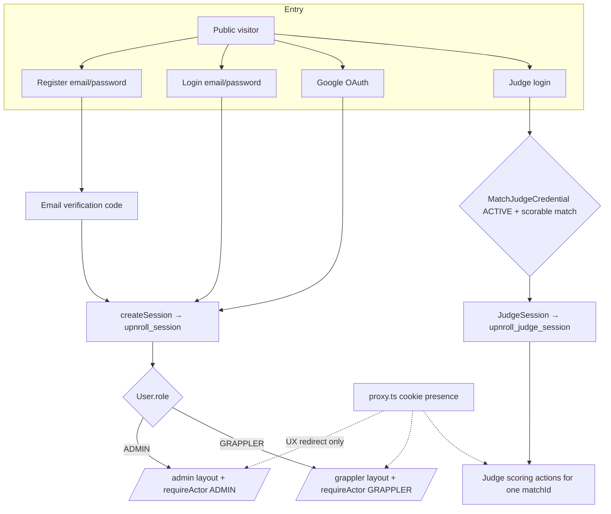
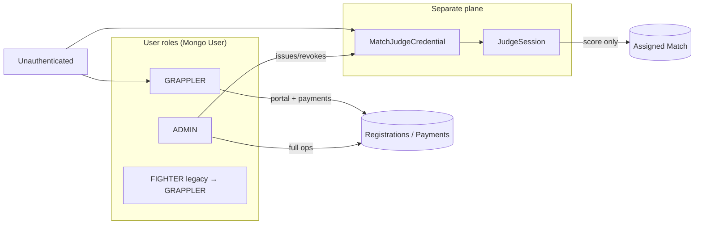

# 06 — Auth, security & RBAC

Research for Up 'n Roll handover. Verified against `backend/auth/*`, layouts, `frontend/src/proxy.ts`, `frontend/next.config.ts`, `backend/http/*`, `backend/storage/*`, `backend/validation/*`, and related services. **No secret values** — env names only.

---

## 1. Login & registration

| Flow | Entry | Behaviour |
|------|--------|-----------|
| Email/password register | `registerAction` (`frontend/src/features/auth/actions.ts`) | Creates `User` with role `GRAPPLER` only; creates `FighterProfile`; sends verification code; redirects to `/verify`. Admins are **never** created via public register (`scripts/create-admin.ts` only). |
| Email verify | `verifyEmailAction` / `confirmVerificationCode` | SHA-256 hashed 6-digit code, 15 min TTL (`backend/services/verificationMail.ts`). On success: mark verified, welcome email, `createSession`, redirect. |
| Resend code | `resendCodeAction` | Rate-limited; generic success message even if account missing/already verified (no email enumeration). |
| Email/password login | `loginAction` | Requires `ACTIVE` + `emailVerified !== false`; generic “Incorrect email or password.”; session + audit; ADMIN → `/admin`, else safe `from` path or grappler dashboard. |
| Google OAuth | `/api/auth/google` → callback | Optional; soft-fail if unset. See §6. |
| Logout | `logoutAction` | Destroys session + audit; redirect `/login`. |
| Judge login | `loginJudge` (`backend/auth/judge-session.ts`) | Separate credential model; see §7. |

**Password policy (register):** min 10 chars, max 200, must include a letter and a number (`registerSchema` in `frontend/src/features/fighters/grappler-schema.ts`). Login schema only requires non-empty password.

**Rate limits (in-memory):** `login:{ip}`, `register:{ip}`, `verify:{ip}`, `resend:{ip}`, `judge-login:{username}` via `checkRateLimit` — 10 tokens / 60s burst (§10).

---

## 2. Password hashing

| Item | Detail |
|------|--------|
| Module | `backend/auth/password.ts` |
| Algorithm | Node `scrypt` (promisified), 16-byte random salt, key length 64 |
| Storage format | `{saltHex}:{derivedKeyHex}` |
| Verify | Re-derive + `timingSafeEqual`; malformed stored hash → `false` |
| Used for | User passwords; Google-provisioned users get a random unusable hash; judge credential passwords |

---

## 3. Sessions & cookies

### App session (grappler / admin)

| Item | Detail |
|------|--------|
| Cookie name | `upnroll_session` (`SESSION_COOKIE_NAME`) |
| Max age | 30 days |
| Cookie flags | `httpOnly`, `sameSite: lax`, `path: /`, `secure` in production |
| Value | HMAC-SHA256 packed `token.signature` (`packCookieValue` / `SESSION_SECRET`) |
| Server store | `Session` Mongo doc: **SHA-256 hash** of raw token, `userId`, `expiresAt`, optional `userAgent` |
| Fixation | `createSession` deletes prior cookie-bound session before issuing a new token |
| Read path | `getSession()` → `connection()` then `cache()`-wrapped `readSession`; inactive users → null |
| Guards | `requireSession` / `requireRole` / `requireActor` throw `UnauthorizedError` / `ForbiddenError` |
| Legacy role | Mongo `"FIGHTER"` normalized to `"GRAPPLER"` on read |

### Judge session

| Item | Detail |
|------|--------|
| Cookie name | `upnroll_judge_session` |
| Max age | 12 hours |
| Same packing | HMAC cookie + hashed token in `JudgeSession` |
| Scope | Bound to `credentialId`, `matchId`, `generation`; revoked on credential rotate/revoke |
| Mutate check | `assertJudgeCanMutateMatch` re-validates generation, revocation, and scorable match status |

### OAuth cookies

`upnroll_oauth_state`, `upnroll_oauth_entry`, `upnroll_oauth_return` — short-lived (600s), signed state dual-checked (cookie + query param).

---

## 4. Layout guards

| Portal | Layout | Guard |
|--------|--------|-------|
| Admin | `(admin)/admin/layout.tsx` | `instant = false`; `getSession()`; no session → `/login`; non-ADMIN → `/grappler/dashboard`; `robots: noindex` |
| Grappler | `(grappler)/grappler/layout.tsx` | Same pattern; non-GRAPPLER → `/admin`; optional safe `x-upnroll-return` → login `from` |
| Judge | `(judge)/judge/layout.tsx` | Branding shell only; **auth is proxy + page/actions** (`requireJudgeSession`), not layout role redirect |

Server Actions / API routes call `requireActor("ADMIN"|"GRAPPLER")` or `requireJudgeSession` independently. Services re-assert with `assertAdmin` / `assertGrappler` (`assertFighter` alias).

---

## 5. `proxy.ts` (Next.js 16)

Path: `frontend/src/proxy.ts` (replaces deprecated `middleware.ts`).

| Matcher | Behaviour |
|---------|-----------|
| `/judge/*` except `/judge/login` | Redirect to `/judge/login` if **judge** cookie absent |
| `/grappler/*`, `/admin/*` | Redirect to `/login?from=…` if **app** session cookie absent; sets `x-upnroll-return` |

**Explicit design:** cookie **presence** only for UX. Not authoritative — layouts and actions re-verify session + role server-side.

---

## 6. Google OAuth

| Item | Detail |
|------|--------|
| Start | `GET /api/auth/google?entry=login|register&from=…` |
| Env | `GOOGLE_CLIENT_ID`, `GOOGLE_CLIENT_SECRET` — both required or soft redirect `?google=unavailable` |
| Redirect URI | `{origin}/api/auth/google/callback` |
| Scopes | `openid email profile` |
| State | Dual-signed nonce (cookie + query) via `SESSION_SECRET` |
| Callback | Exchange code → userinfo; create GRAPPLER + profile if new; mark email verified; `createSession`; clear OAuth cookies |
| Disabled user | `?google=disabled` |
| Return | ADMIN → `/admin`; else safe return path or `/grappler/dashboard` |

---

## 7. Judge credentials security

| Control | Implementation |
|---------|----------------|
| Issuance | Admin-only `generateMatchJudgeCredentials` / regenerate / revoke (`judgeCredentialService`) |
| Password | Cryptographically random 10-char alphabet (no ambiguous 0/O/1/I/l); returned **once** in API response; only `passwordHash` stored |
| Username | Random unique 10-char |
| Generation | Increment on regenerate; old sessions fail when `generation` mismatches |
| Match gate | Login/session only if match status in `SCHEDULED` \| `LIVE` \| `DELAYED` |
| Bracket | Issue only on **PUBLISHED** bracket; both competitors set |
| Audit | `JUDGE_SESSION_LOGIN`, `JUDGE_CREDENTIALS_*` with note that shared login ≠ verified person |
| Rate limit | Per username on login |
| Errors | Generic invalid credentials; no field leakage |

Judge is **not** a `User.role` — it is a separate credential + session plane.

---

## 8. Validation

| Layer | What |
|-------|------|
| Zod | Login/register schemas; feature forms |
| ObjectIds | `requireObjectId` / `isMongoObjectId` — strict 24-hex only |
| Uploads | Magic-byte image detection (PNG/JPEG/WebP); claimed MIME must match; size caps |
| Errors | `ValidationError` (400) via `toAppError`; Mongoose cast → “Invalid identifier.” |

---

## 9. Upload security

| Asset | Max size | Types | Storage key pattern | Access |
|-------|----------|-------|---------------------|--------|
| Profile / Aadhaar / parental consent | 1.5 MB | JPG/PNG/WebP (magic bytes) | `profiles/`, `aadhaar/`, `parental-consent/` | Grappler own; admin by userId; public photo by slug only |
| Payment screenshot | 3 MB | same | payment paths via `paymentService` | Admin stream only |
| Event payment QR | admin upload | image | event storage keys | Grappler/admin QR routes |

Additional:

- Server Actions body limit **3mb** (`next.config.ts` experimental).
- Local disk: path traversal blocked (`resolveStoragePath` rejects `..`, absolute, null bytes).
- GridFS keys: `gridfs:{24hex}` validated.
- Served images: `X-Content-Type-Options: nosniff`, `Cache-Control: private, no-store` (public profile photo uses short public cache).
- Production: `STORAGE_DRIVER` must be `gridfs` or `local` (no silent default).

---

## 10. Rate limiting

`backend/http/rateLimit.ts` — in-process token bucket (10 / 60s). **Not** multi-instance safe (no Redis). Prune helper caps map growth. Documented as gap closure for highest-risk unauth endpoints only.

---

## 11. CSP & security headers (`next.config.ts`)

Applied to `/:path*`:

| Header | Value / notes |
|--------|----------------|
| `X-Content-Type-Options` | `nosniff` |
| `Referrer-Policy` | `strict-origin-when-cross-origin` |
| `X-Frame-Options` | `DENY` |
| `Strict-Transport-Security` | `max-age=63072000; includeSubDomains; preload` |
| `Permissions-Policy` | camera/microphone/geolocation/payment/usb disabled |
| `Content-Security-Policy-Report-Only` | `default-src 'self'`; scripts `'self'` only; styles `'self' 'unsafe-inline'`; img `data: blob: https:`; `frame-ancestors 'none'`; etc. |

**Not enforcing CSP** until nonce/hash strategy for Next inline bootstraps exists.

---

## 12. Error exposure

| Path | Behaviour |
|------|-----------|
| Route handlers | `fail()` → `{ success: false, error: { code, message } }`; unknown errors → generic “Something went wrong.” (`toAppError`); 500s logged without stacking full client message |
| Auth actions | Field errors from Zod; intentional generic login/resend messages |
| Payment email fail | Logged server-side; admin decision still commits |
| Cron | `401` / `503` short JSON; no secret echo |

---

## 13. RBAC matrix

Actors: **Public** (no session), **Grappler** (`User.role=GRAPPLER`), **Admin** (`ADMIN`), **Judge-credential** (judge session, not a User role).

| Capability | Public | Grappler | Admin | Judge-credential |
|------------|:------:|:--------:|:-----:|:----------------:|
| Marketing / public content / public grappler photo by slug | ✓ | ✓ | ✓ | ✓ |
| Register / login / verify / Google OAuth | ✓ | — | — | — |
| Grappler portal (`/grappler/*`) | ✗ | ✓ | ✗ (redirected) | ✗ |
| Own profile, registrations, payments submit | ✗ | ✓ | ✗ | ✗ |
| In-app notifications (own inbox) | ✗ | ✓ | list/outbox admin | ✗ |
| Admin portal (`/admin/*`) | ✗ | ✗ | ✓ | ✗ |
| Events, brackets, payments queue, coupons, content, audits | ✗ | ✗ | ✓ | ✗ |
| Issue/revoke judge credentials | ✗ | ✗ | ✓ | ✗ |
| Judge login / score assigned match | ✗ | ✗ | ✗ | ✓ (scoped match) |
| Cross-match scoring / other credentials | ✗ | ✗ | ✗ | ✗ |
| Cron process-outbox | Bearer `CRON_SECRET` only | | | |
| Create ADMIN user | CLI seed only | | | |

Defense in depth: proxy → layout → `requireActor` → service `assert*`.

---

## 14. Auth flow (Mermaid)

## 15. Roles diagram (Mermaid)

---

## 16. Implemented vs recommended

### Implemented

- scrypt passwords + timing-safe verify  
- HMAC-signed session cookies; hashed tokens in Mongo; session fixation rotation  
- Dual layout + service RBAC; proxy documented as non-authoritative  
- Google OAuth with signed state; soft-fail when unset  
- Judge credentials: one-time password reveal, generation revoke, match-scoped sessions  
- Magic-byte upload validation; path traversal hardening; storage driver prod assert  
- In-memory rate limits on auth endpoints  
- Security headers + CSP Report-Only  
- Safe client error messages via `toAppError` / `fail`  
- Email verification with hashed codes  
- Audit logs on auth and credential events  

### Recommended improvements

- **Distributed rate limiting** (Redis/Upstash) — current limiter is single-instance only  
- **Enforce CSP** once Next nonce/hash strategy is ready  
- **Session absolute/idle timeout** shorter than 30 days for admin, or re-auth for sensitive ops  
- **Account lockout / progressive delay** beyond token bucket; CAPTCHA on repeated fails  
- **Judge credentials delivery** — currently shown once in UI; consider encrypted one-time reveal channel and shorter TTL  
- **WhatsApp / SMS** for fight notices remain mocked — do not treat as security channel until real provider  
- **PAYMENT_DECISION** notification type exists in schema but payment decisions currently email-only — align in-app if product wants parity  
- **Multi-factor** for Admin (not present)  
- **Centralized authz policy table** / generated matrix tests beyond `authorization.security.test.ts`  
- Consider **HttpOnly cookie prefix** / `__Host-` style naming if all traffic is HTTPS-only on a fixed host  
