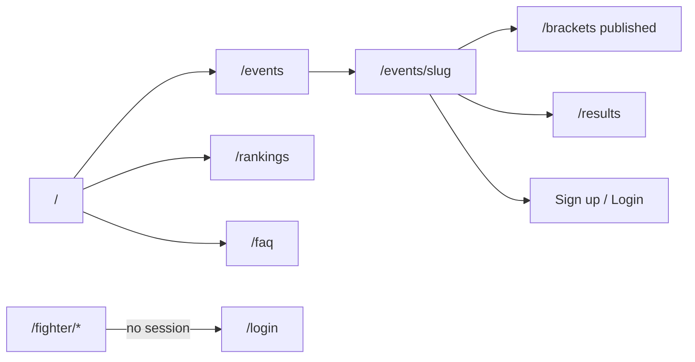
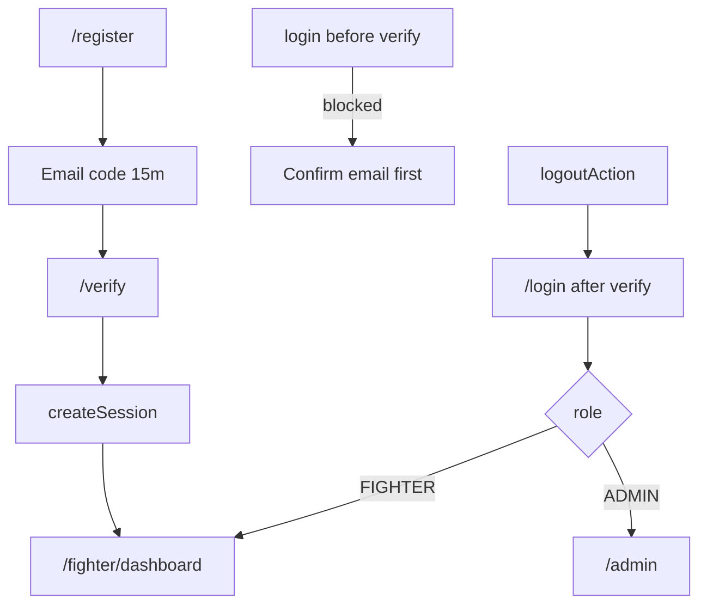
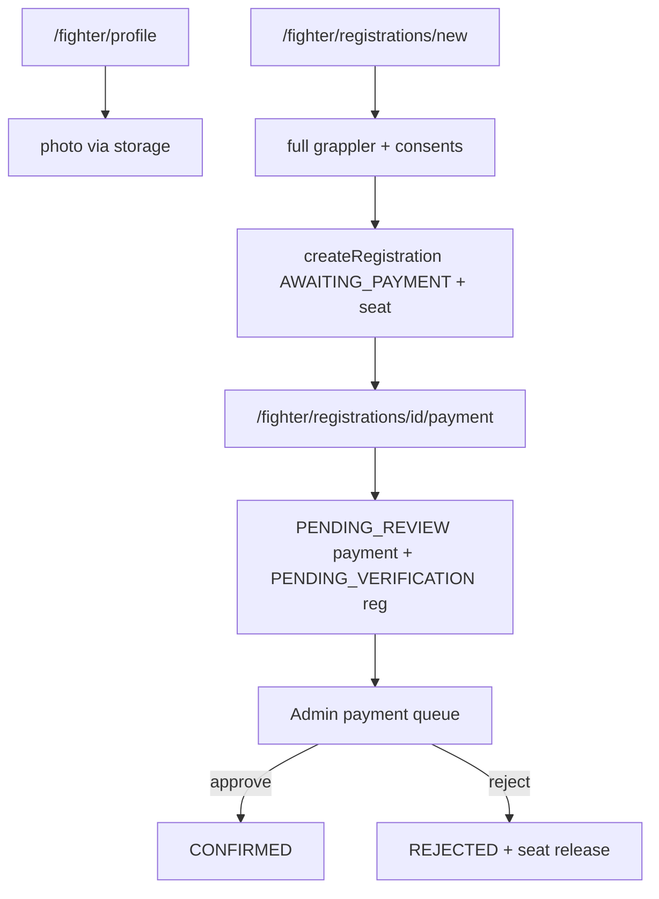
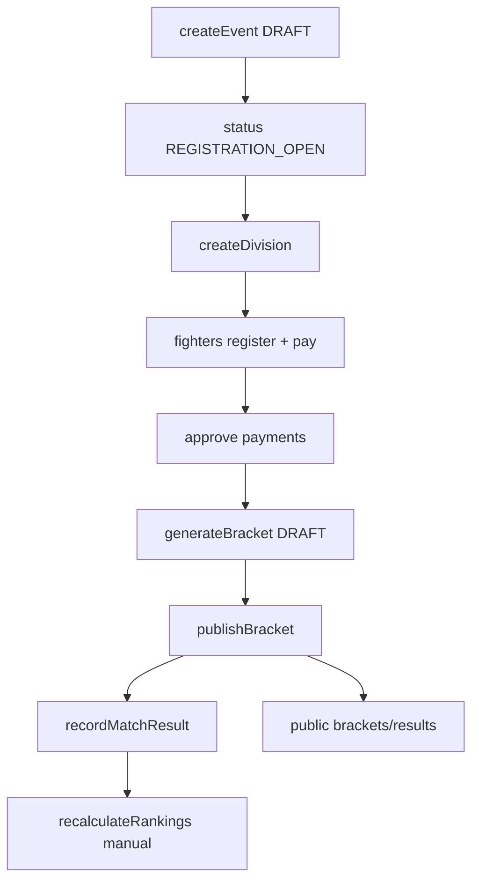

# End-to-End User Flow Map — Up 'n Roll

Evidence date: 2026-11-09 · Branch: `suraj` · Source of truth: codebase + live local run.

This map describes **implemented** journeys only. Gaps are labeled **NOT IMPLEMENTED** or **PARTIAL**.

---

## 1. Roles and permissions

| Role | How created | Portal | Core authority |
|------|-------------|--------|----------------|
| Visitor (anonymous) | — | Public routes | Read public events, brackets (published), results, rankings, FAQ/content |
| `FIGHTER` | `/register` → email verify (or Google OAuth when configured) | `/fighter/*` | Own profile, registrations, payments, requests, matches; teammate transfer claim |
| `ADMIN` | CLI `scripts/create-admin.ts` only | `/admin/*` | Events/divisions, payment review, requests, brackets/matches, rankings recalc, content/media, fighter PII |

Enforcement layers: `proxy.ts` (cookie presence) → role layouts → `requireActor` / `assertAdmin` / `assertFighter` in services.

---

## 2. Business state machines (implemented)

### Registration

`AWAITING_PAYMENT` → (submit UTR+screenshot) → `PENDING_VERIFICATION` → (admin approve) → `CONFIRMED`  
`PENDING_VERIFICATION` → (admin reject) → `REJECTED` → (resubmit) → `PENDING_VERIFICATION`  
Active statuses (capacity + duplicate index): `AWAITING_PAYMENT` | `PENDING_VERIFICATION` | `CONFIRMED`  
Also: `CANCELLED` (admin withdraw / approved cancellation request)

### Payment submission

Stub at register: `AWAITING_SUBMISSION`  
Real submit creates **new** row: `PENDING_REVIEW` → `APPROVED` | `REJECTED`  
Duplicate decide blocked by `findOneAndUpdate({ status: "PENDING_REVIEW" })`.

### Event

`DRAFT` | `REGISTRATION_OPEN` | `REGISTRATION_CLOSED` | `COMPLETED` — **manual** admin set (no calendar FSM).

### Bracket

`DRAFT` (regenerate allowed) → `PUBLISHED` (locked; no unpublish). Format: `SINGLE_ELIMINATION` only. Min 2 `CONFIRMED` participants.

### Match

`PENDING` | `SCHEDULED` | `COMPLETED` | `BYE`  
Results: admin `recordMatchResult` / `correctMatchResult`. Rankings: **manual** `recalculateRankings` (`wins * 3` placeholder).

### Requests

`PENDING` → `APPROVED` | `REJECTED` for `CANCELLATION` | `TRANSFER`. Separate teammate token transfer reassigns ownership without admin.

---

## 3. Journey maps

### A. Visitor

### B. Account creation & auth

**NOT IMPLEMENTED:** password reset/change, MFA, self-disable, admin signup UI.  
**BLOCKED locally:** Google OAuth without `GOOGLE_CLIENT_*`.

### C–E. Fighter onboarding → registration → payment

### F–G. Admin tournament lifecycle

### H–I. Post-registration & public tournament

Fighter sees own registrations/matches; public sees published brackets/results/rankings only. Draft events and unpublished brackets stay off public lists.

---

## 4. Cross-role consistency matrix

| Action | Fighter | Admin | Public |
|--------|---------|-------|--------|
| Registration submitted | Own list status | Dashboard recent + event regs | No private PII |
| Payment submitted | Pending verification | Payment queue + screenshot API | No payment data |
| Payment approved | `CONFIRMED` | Approved row | No payment data |
| Bracket published | Matches when assigned | Draft+published admin | Published bracket/results |
| Match completed | Own match result | Matches admin | Public results |
| Rankings recalculated | — | Admin rankings | Public rankings board |

---

## 5. Dependencies and failure paths

| Dependency | Failure behavior |
|------------|------------------|
| MongoDB | App cannot load authenticated portals |
| Console/SMTP email | Codes logged in dev; SMTP env-gated |
| Storage (local/GridFS) | Photos/screenshots; GridFS requires storing returned `gridfs:` keys (see blockers) |
| Google OAuth | Soft-fail → `/login?google=unavailable` |
| WhatsApp | Stub only — copy prepared, not sent |

Recovery: resend verification code; payment resubmit after reject; bracket regenerate while DRAFT; match correction if downstream undecided.

---

## 6. Entry points

| Entry | Path |
|-------|------|
| Marketing home | `/` |
| Auth | `/login`, `/register`, `/verify` |
| Fighter | `/fighter/dashboard` |
| Admin | `/admin` |
| Public tournament | `/events/[slug]`, `/brackets`, `/results`, `/rankings` |
| Private files | `/api/v1/fighter/photo`, `/api/v1/admin/fighters/[userId]/photo`, `/api/v1/admin/payments/[id]/screenshot` |
